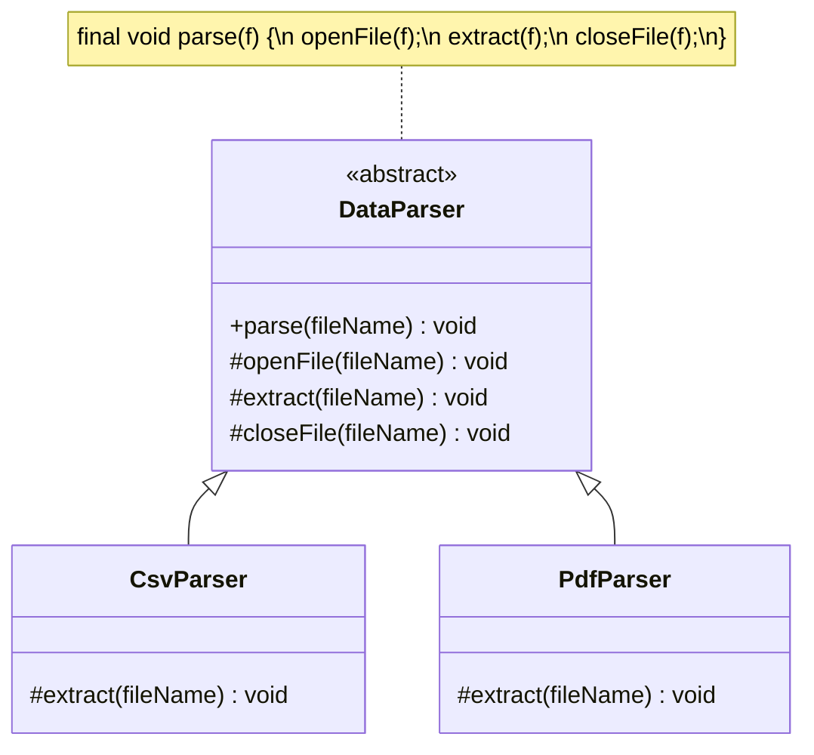
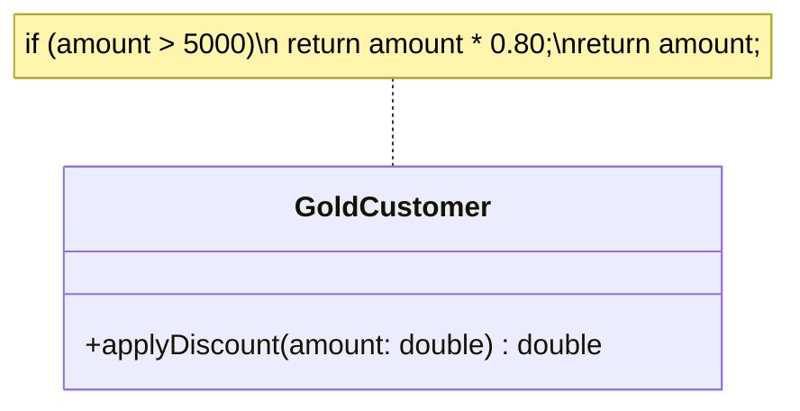

# 📏 IJ Ma'am's Exam Rules (how she marks)

IJ ma'am told the class exactly how she will mark the term final. This note turns her six suggestions into a fixed routine you follow for every pattern and refactoring question. Read it once before you start the `03 TF Solves` folder, and once more on the morning of the exam.

> [!important] 🔑 Her suggestions, in one place
> ==Go through the last two years' papers== (that is exactly the `03 TF Solves` folder). ==Pattern and refactoring questions are a must.== For a pattern question you get ==partial marks for a well-justified approach even if the pattern is wrong==. For a 15–20 mark question, ==draw the diagram AND write the code; if time is short, the code comes first==. Include ==all required methods and the main conditions==, and explain anything too long or repetitive ==with comments==. ==Breaking basic Java principles costs marks.== If a diagram needs a special condition inside a method, ==write that method's definition on the diagram==.

---

## 1. The last two years and the "must" topics

The two newest papers are 2023-24 and 2022-23, and both are fully solved in [[TF 2023-24 (May 2026 paper)]], [[TF 2023-24 (Feb 2025 paper)]] and [[TF 2022-23 (CSE307 May 2024)]]. Every one of those papers has at least one 15–20 mark pattern question and at least one refactoring question, which matches what ma'am said. So the two notes you cannot afford to be weak in are [[IJ-1 Structural Design Patterns]] together with [[IJ-2 Behavioral Design Patterns]] for patterns, and [[IJ-6 Refactoring and Code Smells]] for refactoring. If you are short of study time, cut from anywhere else first.

---

## 2. Always justify the pattern — it is your safety net

Ma'am said a wrong pattern can still get partial marks if you justify it. That means the justification paragraph is not decoration. It is insurance. Write it as the very first thing in your answer, before the diagram, in three or four sentences that follow this shape.

First, ==name the pattern==. Second, ==quote the words from the scenario== that point to it, for example "notify all subscribers", "add features at runtime without subclassing", "convert zip code to city name" or "a family of matching ingredients". Third, ==say which problem the pattern removes==, for example tight coupling, a subclass explosion, or a big if-else on type. Fourth, if another pattern looks similar, ==say in one line why you did not pick it==, for example "Strategy rather than State, because the client chooses the algorithm and the object does not change behaviour by itself".

> [!example] ✍️ A model justification (Adapter, 2022-23 Q1a)
> The appropriate pattern is ==Adapter==. The existing temperature service only understands a city name and we must not modify it, while the new client wants to call it with a zip code. Adapter converts the interface of an existing class into the interface the client expects, so an adapter class will accept the zip code, convert it to a city name, and delegate to the old service. Facade is not the right choice because we are not simplifying many subsystems; we are matching one mismatched interface.

Even if ma'am had wanted a different pattern here, an answer like this shows that you understood the problem, and that understanding is what she gives partial marks for. Every pattern solve in the `03 TF Solves` folder opens with a paragraph of this kind, so read them as models. For the signal words of each pattern, use [[00 Pattern Picker]].

---

## 3. 15–20 mark questions: diagram + code, and code wins when time is short

For a big pattern question you write four blocks in this order: the justification paragraph, the class diagram, the code, and a short `main` that shows it working. When time is fine, write all four.

> [!warning] ⚠️ When the clock is running out
> ==Do not spend your last ten minutes drawing a neat diagram.== Ma'am explicitly said that if time is short, the ==code gets priority==. Write the justification (two lines is enough), then go straight to the interfaces and classes in code. If any time is left after that, add a ==quick, rough diagram== with only the class names, the interface/abstract markers and the arrows. The arrows show the relationships even without a full method list.

The reason this order works is that the code already contains everything the diagram shows: the interfaces, which class implements which, and which class holds a reference to which. A good examiner can see the design from the code alone. A diagram alone cannot show that your logic is right.

---

## 4. Required methods and main conditions — never skip; use comments for the boring parts

Ma'am wants ==every method the question asks for== and ==every important condition== (the `if` that decides the behaviour) to appear in your code. She also allows you to replace long or repetitive parts with a comment. The skill is knowing which part is which.

==Never replace with a comment:== the interface or abstract class and its method signatures, the method that holds the pattern's key logic (`notifyObservers()` looping over the list, a decorator's `super.cost() + extra`, the adapter converting and then delegating, the template's `final` skeleton method, the state object switching the context's state), and any condition the scenario mentions explicitly (for example "only notify if the price changed by more than 5%", or "if the balance is below zero, reject").

==Safe to replace with a comment:== the second, third and fourth concrete classes when they are identical to the first apart from a name or a number, plain getters and setters, printing details, and input parsing that has nothing to do with the pattern.

```java
class ItalianIngredientFactory implements PizzaIngredientFactory {
    @Override
    public Crust createCrust()   { return new ThinCrust(); }
    @Override
    public Sauce createSauce()   { return new MarinaraSauce(); }
    @Override
    public Cheese createCheese() { return new MozzarellaCheese(); }
}

// AmericanIngredientFactory is written exactly like ItalianIngredientFactory,
// but returns ThickCrust, PlumTomatoSauce and CheddarCheese.

class StockGrabber implements Subject {
    private final List<Observer> observers = new ArrayList<>();
    private double ibmPrice;

    @Override
    public void notifyObservers() {
        for (Observer o : observers) {      // key pattern logic: always write it out
            o.update(ibmPrice);
        }
    }

    public void setIbmPrice(double newPrice) {
        if (newPrice != ibmPrice) {         // main condition from the scenario: always write it out
            ibmPrice = newPrice;
            notifyObservers();
        }
    }
    // register/unregister: add to / remove from the observers list (standard, omitted)
}
```

Notice that the comment says ==what the omitted code does==, not just "etc.". A comment like "same as above" is weak. A comment like "same as Italian but returns ThickCrust, PlumTomatoSauce, CheddarCheese" earns the marks.

---

## 5. Basic Java principles — the checklist she marks against

Ma'am deducts marks for breaking basic Java rules. These are the ones students lose marks on most often in pattern answers. Run through them in your head before you move to the next question.

> [!important] 🔑 Java checklist for every pattern answer
> ==Fields are `private`== (use `private final` for references that never change, like the wrapped component in a Decorator or the adaptee in an Adapter). ==An interface method is implemented as `public`== in the class; leaving the modifier out is a compile error, because it would reduce visibility. ==Every abstract or interface method is implemented== in each concrete class, or the class itself is declared `abstract`. ==You never write `new` on an interface or abstract class.== ==Put `@Override`== on every overriding method. ==Compare Strings with `.equals()`, never `==`.== ==Program to the interface==: write `Shape s = new Circle();` and `List<Observer> list = new ArrayList<>();`, not the concrete type on the left. ==A Singleton has a `private` constructor and a `static` getInstance().== ==A constructor has the class name and no return type.== ==Use generics on collections== (`List<Observer>`, not raw `List`). ==The template method in Template Method is `final`==, so subclasses cannot change the skeleton.

The other common mistake is not a compile error but still costs marks: a pattern written so that it is not really that pattern. For example, a "Decorator" that does not hold a reference to the component it wraps, an "Observer" whose subject knows the concrete observer classes, or a "Strategy" where the context still has an if-else choosing the algorithm. Each pattern section in [[IJ-1 Structural Design Patterns]] and [[IJ-2 Behavioral Design Patterns]] has a ⚠️ box that names its typical version of this mistake.

---

## 6. Putting a method's definition on the diagram

Sometimes a diagram question has a rule that lives inside one method, for example "a gold member gets 20% off only if the order is above 5000", or "the parser must always open, then extract, then close". A class box can only list `+applyDiscount(order) double`, which hides the rule. Ma'am said you may write ==the method's definition next to the class== in that case. On paper, draw a ==UML note==: a rectangle with a folded top-right corner, connected to the class with a ==dashed line==, and write the short code or pseudocode of that method inside it. Do this only for the one or two methods that carry the special condition, not for every method.





In the exam you draw these notes by hand. The Mermaid version above is only to show you what the note looks like and where it sits.

---

## Quick self-check before handing in a pattern answer

Before you move on, ask yourself these questions. Did I name the pattern and justify it with words from the scenario? Is every method the question asked for present? Did I write out every condition the scenario mentions? Did I write out the key pattern logic rather than replacing it with a comment? Are my fields private, my interface methods public with `@Override`, and my Strings compared with `.equals()`? If the question asked for a diagram and a method carries a special rule, did I attach a note with its definition?
