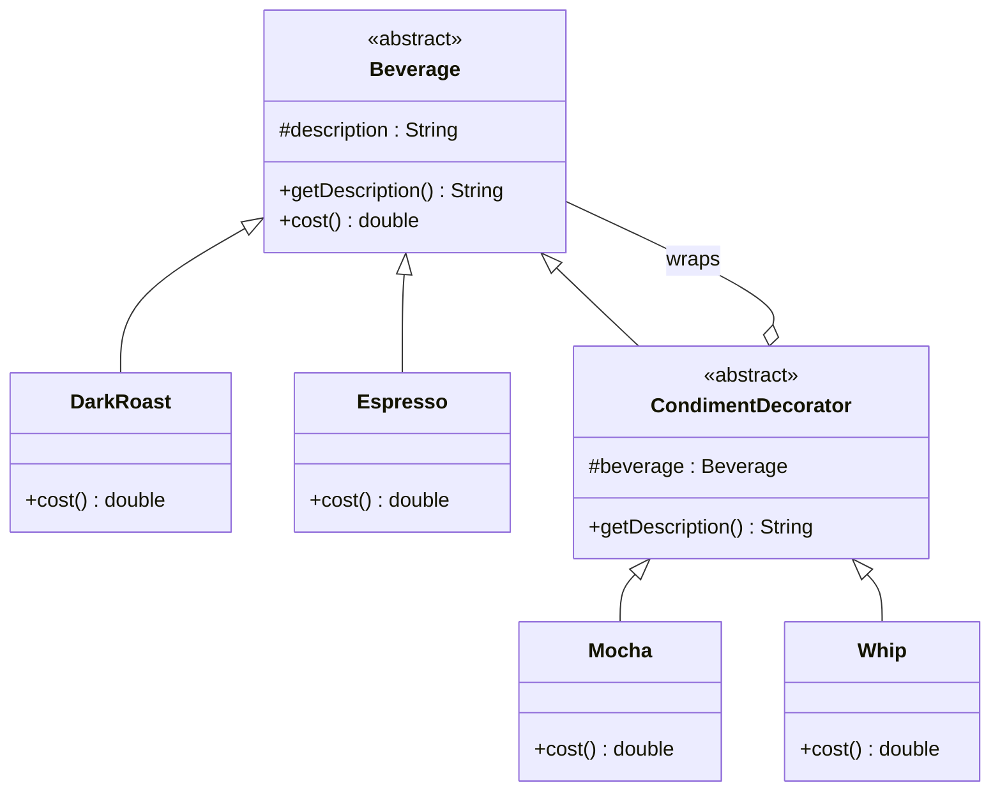
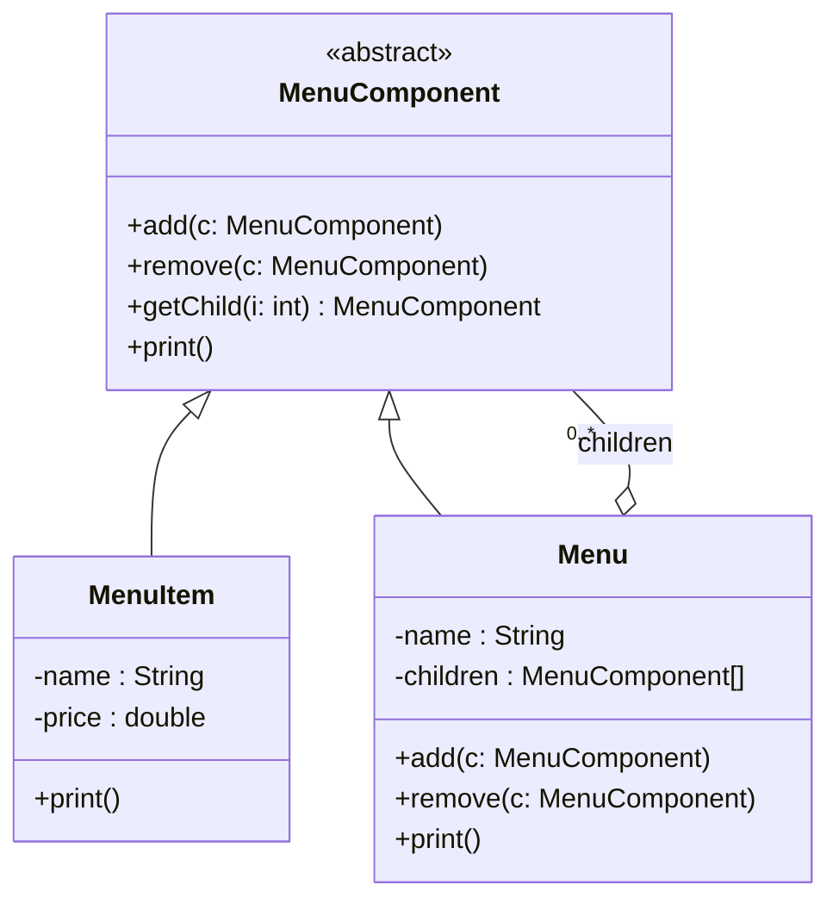
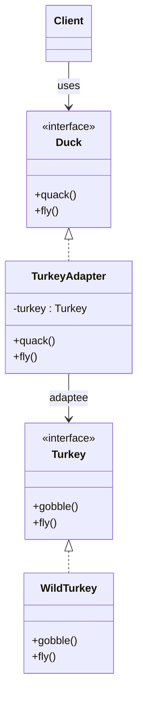
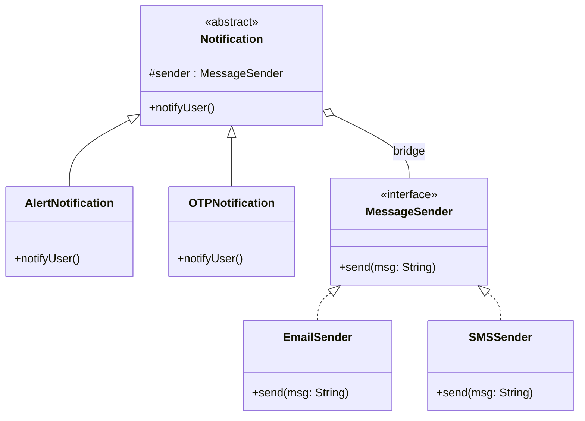
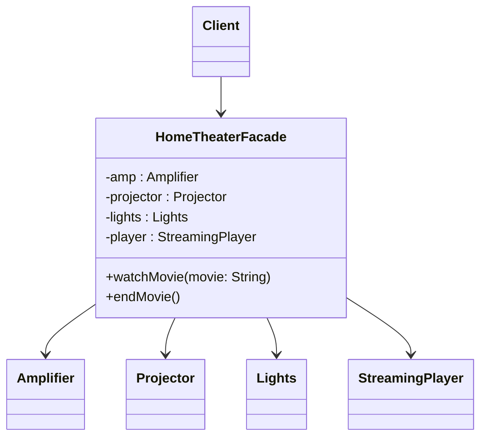
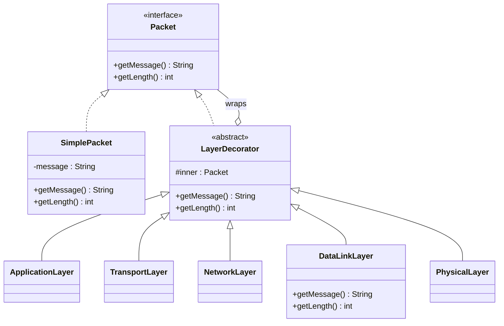
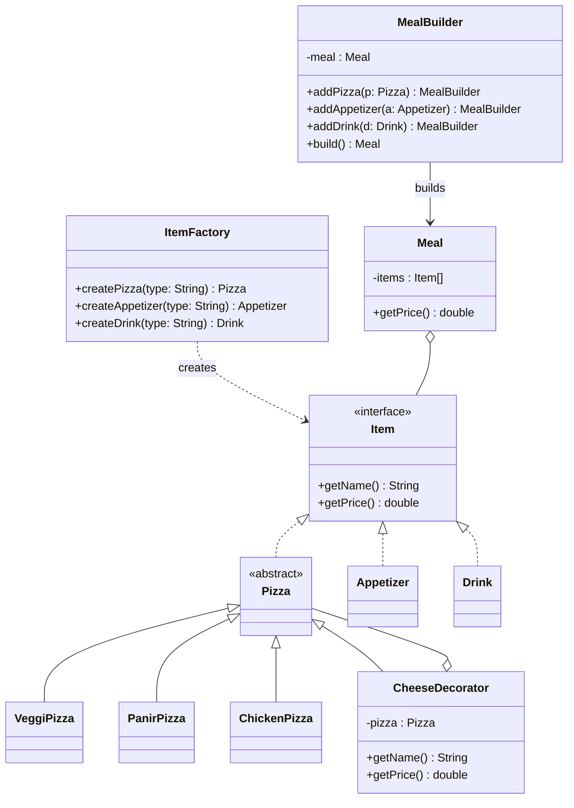
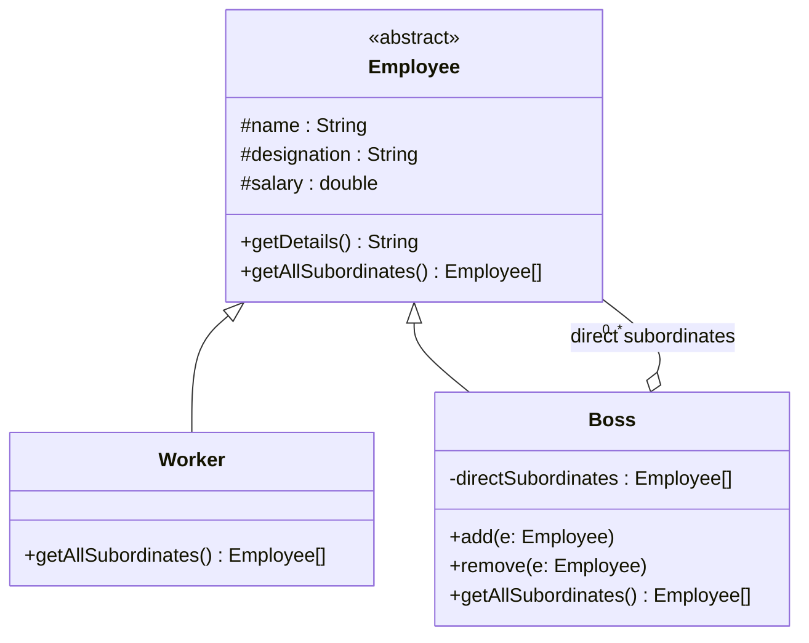

# IJ-1 Structural Design Patterns

This note covers the structural design patterns from IJ ma'am's slides: Decorator, Composite, Adapter and Bridge, plus Facade and Proxy, which are not in the IJ slides but are part of the GoF list and have been asked in the term final. Structural patterns are about **how classes and objects are put together into bigger structures** while the structure stays flexible. In the TF these are almost always asked as "identify the pattern, draw the UML, write the code" questions worth 15–20 marks, so you must be able to draw each diagram and write each skeleton from memory.

**TF frequency:** Decorator — 2023-24 (May-2026) Q2(a), 2021-22 Q2(a), 2020-21 Q1(a). Composite — 2023-24 (May-2026) Q2(a), 2020-21 Q3(a), 2019-20 Q2(a). Adapter — 2022-23 Q1(a), Feb-2025 Q5(b). Bridge — 2021-22 Q1(a). Facade — Feb-2025 Q5(b).

> [!important] 🔑 Memorize — Structural pattern
> ==Structural patterns explain how to assemble objects and classes into larger structures, while keeping this structure flexible and efficient.==
> 📑 **See:** *[2] IJ mam / 1 - StructuralDesignPattern.pdf* → p.2–4

---

## The one idea behind almost all of them: composition over inheritance

Before learning the individual patterns, understand the common idea. With inheritance, behaviour is fixed at compile time, and when things vary in more than one way you get a "subclass explosion" (one class for every combination). With **composition**, an object holds a reference to another object and delegates work to it. Because the reference can be changed or wrapped at runtime, behaviour becomes flexible. Decorator wraps an object to add behaviour, Adapter wraps an object to change its interface, Composite holds child objects to form a tree, Bridge holds an "implementation" object to separate two dimensions, and Facade holds many subsystem objects to give one simple entry point. If you remember "**who wraps / holds whom, and why**", you can rebuild every diagram in this note.

---

## Decorator Pattern

### The story (Starbuzz Coffee)

Starbuzz Coffee started with a simple menu: an abstract `Beverage` class with subclasses `HouseBlend`, `DarkRoast`, `Decaf` and `Espresso`, each implementing its own `cost()`. Then customers wanted **condiments** — steamed milk, soy, mocha, whipped milk — and a customer may take any number of them, or none, or the same one twice.

The first idea was to make a subclass for every combination, such as `DarkRoastWithMochaAndWhip`. This causes a ==class explosion==: with 4 coffees and 4 condiments you already need dozens of classes, and every new condiment multiplies the count. The slides call this "definitely not an option" (p.11–13).

The second idea was to put boolean fields (`milk`, `soy`, `mocha`, `whip`) into the `Beverage` superclass and let `Beverage.cost()` add the condiment prices. This also fails, for three reasons that you should be able to write in the exam: ==a new condiment forces us to change the superclass== (violates Open/Closed), ==some beverages (for example iced tea) inherit condiments that make no sense for them==, and ==the design cannot handle multiple quantities such as double mocha== (p.18–21).

The real solution is to start with a beverage and **decorate** it with condiments at runtime. To make a DarkRoast with Mocha and Whip, we create a `DarkRoast` object, wrap it in a `Mocha` object, then wrap that in a `Whip` object. When `cost()` is called on the outermost `Whip`, it calls `cost()` on the `Mocha` it wraps, which calls `cost()` on the `DarkRoast`; each layer adds its own price on the way back (p.22–32 show this wrapping step by step, and p.41–46 show the "test drive").

> [!important] 🔑 Memorize — Decorator definition
> ==Decorator lets you attach new behaviors to objects by placing these objects inside special wrapper objects that contain the behaviors.==
> (Head First wording: *attach additional responsibilities to an object dynamically; decorators provide a flexible alternative to subclassing for extending functionality.*)
> 📑 **See:** *1 - StructuralDesignPattern.pdf* → p.47 (definition), p.48–50 (general structure), p.33–40 (Starbuzz design), p.41–46 (test drive)

### Participants

The **Component** (`Beverage`) is the common abstract type that both the real object and the wrappers share. The **ConcreteComponent** (`DarkRoast`, `Espresso`) is the plain object that we start with. The **Decorator** (`CondimentDecorator`) is an abstract class that *is-a* Component (it extends it, so it can be used anywhere a Beverage is expected) and *has-a* Component (it holds a reference to the object it wraps). The **ConcreteDecorators** (`Mocha`, `Whip`, `Soy`) add their own behaviour before or after delegating to the wrapped object. The key trick that you must mention in every answer is that ==the decorator both inherits from and contains the component== — inheritance is used only to get the same type, and composition is used to get the behaviour.
**%%%%**


### Code (exam-sized)

```java
abstract class Beverage {
    protected String description = "Unknown Beverage";
    public String getDescription() { return description; }
    public abstract double cost();
}

class DarkRoast extends Beverage {
    public DarkRoast() { description = "Dark Roast"; }
    public double cost() { return 0.99; }
}

abstract class CondimentDecorator extends Beverage {   // IS-A Beverage
    protected Beverage beverage;                         // HAS-A Beverage
    public CondimentDecorator(Beverage b) { this.beverage = b; }
    public abstract String getDescription();
}

class Mocha extends CondimentDecorator {
    public Mocha(Beverage b) { super(b); }
    public String getDescription() { return beverage.getDescription() + ", Mocha"; }
    public double cost() { return beverage.cost() + 0.20; }   // delegate, then add
}

class Whip extends CondimentDecorator {
    public Whip(Beverage b) { super(b); }
    public String getDescription() { return beverage.getDescription() + ", Whip"; }
    public double cost() { return beverage.cost() + 0.10; }
}

public class StarbuzzDemo {                     // client
    public static void main(String[] args) {
        Beverage b = new DarkRoast();
        b = new Mocha(b);      // double mocha is now easy:
        b = new Mocha(b);
        b = new Whip(b);
        System.out.println(b.getDescription() + " $" + b.cost());  // 0.99+0.20+0.20+0.10
    }
}
```

### Real-world example: java.io

Java's file reading classes are the textbook Decorator. In `new BufferedReader(new InputStreamReader(new FileInputStream("data.txt")))`, the `FileInputStream` is the core component that only reads raw bytes, `InputStreamReader` is a decorator that converts bytes to characters, and `BufferedReader` is a decorator that adds buffering and `readLine()`. Each wrapper has the same kind of interface as what it wraps and adds one capability without touching the original class — ==open for extension, closed for modification==.
📑 **See:** *3 - Design Pattern Misc.pdf* → p.2

### How to recognize Decorator in a TF scenario

Look for these signals: ==optional add-ons that can be combined in any number and order== (toppings, condiments, extra cheese, report sections, headers/trailers, encryption + compression layers), the phrase ==without changing the core structure / at runtime / may or may not be included==, and a price or output that is **accumulated layer by layer**. The 2021-22 network-packet question (each layer adds a header) and the May-2026 FinCorp "additional report sections" are both Decorator.

> [!warning] ⚠️ Common mistake
> Do not forget that the abstract decorator must **extend** the component type. If your decorator only holds a reference but is not itself a `Beverage`, you cannot wrap a decorator inside another decorator, and the pattern breaks. Also, decorators add behaviour; they do not change the interface — changing the interface is Adapter.

---

## Composite Pattern

### The story (Pancake House and Diner menus)

The restaurant now has menus that contain menu items, but a menu can also contain a **submenu** (for example, a Dessert menu inside the Diner menu). The structure is a **tree**. The client (the waitress) wants to print everything, or only one submenu, without writing `if (x is a Menu) ... else if (x is a MenuItem) ...` everywhere. The slides list the requirement as "tree-structured menus with support for submenus and items, and flexible traversal over a specific submenu or the whole hierarchy" (p.53–55).

The solution is to give both `Menu` (a node that has children) and `MenuItem` (a leaf) the same abstract type `MenuComponent`. The client then treats a single item and a whole group of items **uniformly**: it just calls `print()` on whatever it has, and a `Menu` forwards the call to all of its children recursively.

> [!important] 🔑 Memorize — Composite definition
> ==Composite pattern lets you compose objects into tree structures and then work with these structures as if they were individual objects.==
> (GoF: *compose objects into tree structures to represent part-whole hierarchies; Composite lets clients treat individual objects and compositions of objects uniformly.*)
> 📑 **See:** *1 - StructuralDesignPattern.pdf* → p.56 (nodes and leaves), p.57 (menu design), p.58–60 (definition + structure)

### Participants

The **Component** declares the common operations for both simple and complex objects (for example `print()`, `getSalary()`, and optionally `add()`, `remove()`, `getChild()`). The **Leaf** is an object with no children; it does the actual work. The **Composite** (container) stores a list of child Components and implements the operations by **delegating to its children and combining their results**. The **Client** works only through the Component interface.



```java
abstract class MenuComponent {
    public void add(MenuComponent c)    { throw new UnsupportedOperationException(); }
    public void remove(MenuComponent c) { throw new UnsupportedOperationException(); }
    public abstract void print();
}

class MenuItem extends MenuComponent {           // Leaf
    private String name; private double price;
    MenuItem(String n, double p) { name = n; price = p; }
    public void print() { System.out.println("  " + name + " - " + price); }
}

class Menu extends MenuComponent {               // Composite
    private String name;
    private List<MenuComponent> children = new ArrayList<>();
    Menu(String n) { name = n; }
    public void add(MenuComponent c)    { children.add(c); }
    public void remove(MenuComponent c) { children.remove(c); }
    public void print() {
        System.out.println(name);
        for (MenuComponent c : children) c.print();   // recursion through the tree
    }
}
```

There is a design trade-off you can mention for extra marks. If `add/remove` are declared in the Component (as above), the client gets **transparency** (it treats everything the same way) but loses some **safety** (calling `add` on a leaf only fails at runtime). If `add/remove` are declared only in the Composite, it is safer but the client must know which is which. Head First chooses transparency.

### How to recognize Composite in a TF scenario

Look for ==hierarchy, tree, part–whole, "a boss has subordinates who may have their own subordinates", "the level of hierarchy is not fixed", "aggregate data from all subordinate units", "show all employees under any employee"==. Whenever an operation on a group should equal the combination of the same operation on its members (total salary, total expenditure, print everything), it is Composite.

> [!warning] ⚠️ Common mistake
> The Composite must hold a list of the **abstract Component type**, not a list of Leaves. Otherwise a composite cannot contain another composite and you lose the tree.

---

## Adapter Pattern

### The story (Ducks and Turkeys)

We have existing code that works with the `Duck` interface (`quack()`, `fly()`). A vendor gives us a `Turkey` class whose interface is different (`gobble()`, a short `fly()`). We are short of ducks and want to use turkeys in the existing duck code, but we cannot change the client code and we cannot change the vendor code. So we write a `TurkeyAdapter` that **implements `Duck`** (the interface the client expects) and **holds a `Turkey`** (the adaptee). When the client calls `quack()`, the adapter calls `turkey.gobble()`; when the client calls `fly()`, the adapter calls `turkey.fly()` five times because turkeys fly only short distances. The client keeps using `Duck` and never knows a turkey is underneath (p.66–76). It is exactly like a real power plug adapter between a European socket and an American plug (p.61–62).

> [!important] 🔑 Memorize — Adapter definition
> ==Convert the interface of a class into another interface clients expect. Adapter lets classes work together that couldn't otherwise because of incompatible interfaces.==
> 📑 **See:** *1 - StructuralDesignPattern.pdf* → p.83 (definition), p.63–65 (adapter in OO systems), p.66–76 (Duck/Turkey code), p.81 (bird's-eye view), p.86–90 (object vs class adapter)

### Participants

The **Target** is the interface the client already uses (`Duck`). The **Adaptee** is the existing class with an incompatible interface (`Turkey`). The **Adapter** implements the Target and translates every call into calls on the Adaptee. The **Client** talks only to the Target.



```java
interface Duck   { void quack(); void fly(); }
interface Turkey { void gobble(); void fly(); }

class WildTurkey implements Turkey {
    public void gobble() { System.out.println("Gobble gobble"); }
    public void fly()    { System.out.println("I'm flying a short distance"); }
}

class TurkeyAdapter implements Duck {          // implements the TARGET
    private Turkey turkey;                     // wraps the ADAPTEE
    public TurkeyAdapter(Turkey t) { this.turkey = t; }
    public void quack() { turkey.gobble(); }   // translate the call
    public void fly() { for (int i = 0; i < 5; i++) turkey.fly(); }
}

public class DuckDemo {                          // client code is unchanged
    public static void main(String[] args) {
        Duck d = new TurkeyAdapter(new WildTurkey());
        d.quack();
    }
}
```

### Object adapter vs class adapter

The **object adapter** uses composition: the adapter implements the target interface and wraps an adaptee object. It works in every popular language (Java, C#, Python) and it can adapt any subclass of the adaptee. The **class adapter** uses inheritance: the adapter inherits from both the target and the adaptee at the same time, so it needs **multiple inheritance** (C++). In Java you can only do it if the Target is an interface (`class Adapter extends Adaptee implements Target`). ==In Java exams always draw the object adapter.==
📑 **See:** *1 - StructuralDesignPattern.pdf* → p.86–88 (object adapter), p.89–90 (class adapter)

### How to recognize Adapter in a TF scenario

Look for ==an existing service/library/vendor class whose input or output format does not match what the client now wants==, and you are not allowed to modify either side. Examples: "the service takes a city name but the client wants to pass a zipcode" (2022-23 Q1(a)), "legacy XML API but our code expects JSON", "third-party payment gateway with different method names". The key word is **incompatible interface**.

> [!warning] ⚠️ Common mistake
> Adapter does not add new features; it only translates. If the question says "add extra responsibilities", that is Decorator. If it says "give one simple interface to a complicated set of classes", that is Facade.

---

## Bridge Pattern

### The story (Colored Shapes)

You have two shapes, `Circle` and `Square`, and you want to add colors `Red` and `Blue`. If you use inheritance you create `RedCircle`, `BlueCircle`, `RedSquare`, `BlueSquare`. Adding a green color or a triangle shape makes the hierarchy grow **multiplicatively** (shapes × colors). The slides explain that this happens ==because things extend in two independent dimensions== — form and color (p.96–101).

The fix is to split the one hierarchy into **two separate hierarchies** and connect them with composition: `Shape` holds a reference to a `Color` object and delegates the color-related work to it (p.102–104). Now adding a new color touches only the Color hierarchy, and adding a shape touches only the Shape hierarchy: shapes + colors classes instead of shapes × colors. That reference between the two hierarchies is the "bridge".

The GoF book uses two terms. The **Abstraction** is the high-level control layer (also called the interface); it should not do real work itself but delegate it. The **Implementation** is the low-level layer that does the work (also called the platform). The slides' real example is a GUI (abstraction: regular customer view, admin view) running on different operating-system APIs (implementation: Linux, Windows, macOS). The same GUI works under any OS because the implementations are interchangeable (p.105–107).

> [!important] 🔑 Memorize — Bridge definition
> ==Bridge lets you split a large class or a set of closely related classes into two separate hierarchies, abstraction and implementation, which can be developed independently of each other.==
> (GoF: *decouple an abstraction from its implementation so that the two can vary independently.*)
> 📑 **See:** *1 - StructuralDesignPattern.pdf* → p.108–109 (definition + structure), p.96–104 (shapes/colors), p.105–107 (abstraction vs implementation); *3 - Design Pattern Misc.pdf* → p.5–8 (Notification × MessageSender example with code)

### Participants

The **Abstraction** (`Notification`, `Shape`) holds a reference to an Implementor. **Refined Abstractions** (`AlertNotification`, `OTPNotification`, `Circle`) are its variants. The **Implementor** (`MessageSender`, `Color`) is the interface for the low-level work, and **Concrete Implementors** (`EmailSender`, `SMSSender`, `PushSender`) do the real work.



```java
interface MessageSender { void send(String msg); }               // Implementor
class EmailSender implements MessageSender {
    public void send(String msg) { System.out.println("Email: " + msg); }
}
class SMSSender implements MessageSender {
    public void send(String msg) { System.out.println("SMS: " + msg); }
}

abstract class Notification {                                    // Abstraction
    protected MessageSender sender;                              // the bridge
    Notification(MessageSender s) { this.sender = s; }
    abstract void notifyUser();
}
class AlertNotification extends Notification {                   // Refined abstraction
    AlertNotification(MessageSender s) { super(s); }
    void notifyUser() { sender.send("Server is down!"); }
}
class OTPNotification extends Notification {
    OTPNotification(MessageSender s) { super(s); }
    void notifyUser() { sender.send("Your OTP is 4821"); }
}

public class BridgeDemo {
    public static void main(String[] args) {
        // 2 notifications x 2 channels = 4 behaviours from only 4 small classes
        new AlertNotification(new SMSSender()).notifyUser();
    }
}
```

### How to recognize Bridge in a TF scenario

Look for ==two independent dimensions of variation== that would otherwise create a class for every combination: notification type × channel, shape × color, remote control × device, GUI × OS, report type × output format. If the question only has one dimension with interchangeable algorithms, it is Strategy instead.

> [!warning] ⚠️ Common mistake — Bridge vs Strategy vs Adapter
> Structurally, Bridge looks like Strategy (an object holding an interface reference). The difference is intent. ==Bridge is designed up-front to let two hierarchies grow independently==; both sides have their own subclasses. Strategy is about swapping one algorithm inside one context. Adapter is applied *after* the fact to make two existing, incompatible things work together, while Bridge is planned *before* the classes are written.

---

## Facade Pattern

> [!note] Not in IJ ma'am's slides — but it is one of the 7 GoF structural patterns (AI sir's *Lec 2 - Basics of Design Pattern.pdf* p.5) and it was asked in the Feb-2025 paper Q5(b) together with Adapter. Learn it.

### The story (Home Theater)

To watch a movie with a home theater you must turn on the popcorn popper, dim the lights, lower the screen, turn on the projector, set the projector input, turn on the amplifier, set the volume, and finally start the player — calls on six or seven different classes. Every client that wants to "watch a movie" must know all of these classes and the correct order. A **Facade** is one new class, `HomeTheaterFacade`, with simple methods `watchMovie()` and `endMovie()`. Internally it calls all the subsystem classes in the right order. The subsystem classes are still available for clients who need fine control, but most clients only talk to the facade.

> [!important] 🔑 Memorize — Facade definition
> ==Facade provides a unified, simplified interface to a set of interfaces in a subsystem. Facade defines a higher-level interface that makes the subsystem easier to use.==
> It supports the **Principle of Least Knowledge** ("talk only to your immediate friends"): the client depends on one class instead of many.



```java
class HomeTheaterFacade {
    private Amplifier amp; private Projector projector;
    private Lights lights; private StreamingPlayer player;
    HomeTheaterFacade(Amplifier a, Projector p, Lights l, StreamingPlayer s) {
        amp = a; projector = p; lights = l; player = s;
    }
    public void watchMovie(String movie) {      // one simple call ...
        lights.dim(10);                         // ... hides many subsystem calls
        projector.on(); projector.wideScreenMode();
        amp.on(); amp.setVolume(5);
        player.on(); player.play(movie);
    }
    public void endMovie() { player.stop(); amp.off(); projector.off(); lights.on(); }
}
```

### Recognizing Facade, and how one class can be both Adapter and Facade

Look for ==a complex subsystem with many classes, and the client wants one simple entry point== ("place order" that internally checks inventory, takes payment, books shipping, sends email).

The Feb-2025 Q5(b) asks how a **single class** can be both. It becomes an Adapter when it **implements an interface the client already expects** (the Target), and it becomes a Facade when, behind each method of that interface, it **coordinates several subsystem classes**. For example, a `PaymentGatewayAdapter implements PaymentProcessor` (Target used by our shop) and its `pay()` method internally calls a third-party `FraudChecker`, `CurrencyConverter` and `BankAPI` in the right order. Towards the client it is an adapter (it matches the expected interface); towards the subsystem it is a facade (it simplifies many classes into one call). The difference in intent is worth stating: ==Adapter changes an interface to one the client expects; Facade simplifies an interface==.

---

## Proxy Pattern (short)

> [!note] Not in IJ ma'am's slides; in the GoF structural list (AI sir Lec 2 p.5). Not asked in the five priority papers — read once.

A **Proxy** provides a surrogate or placeholder for another object to **control access to it**. The proxy implements the same interface as the real subject and holds a reference to it. Before forwarding a call it may check permissions (protection proxy), create the expensive real object only when first needed (virtual proxy), talk to an object on another machine (remote proxy), or cache results (caching proxy). It looks like Decorator in structure, but ==Decorator adds behaviour, while Proxy controls access== and usually manages the life cycle of the real object itself.

---

## Comparing the structural patterns (read this before the exam)

All five of Decorator, Adapter, Facade, Composite and Bridge use composition, so their diagrams look similar. The examiner gives marks for choosing the one whose **intent** fits the scenario, so learn them by intent.

**Decorator** keeps the same interface and *adds* responsibilities to one object at runtime; you can stack many decorators, and the client cannot tell a decorated object from a plain one. **Adapter** *changes* the interface of one existing object into the interface the client expects, without adding features; it is usually a single wrapper, not a stack. **Facade** *simplifies* a whole subsystem of many objects behind one new, higher-level interface; it wraps many objects, not one. **Composite** builds a *tree* where a group and a single item share the same interface, so an operation on a group is done by running it on every child; a composite holds many children of the abstract type, while a decorator holds exactly one. **Bridge** separates *two dimensions* of variation into two hierarchies connected by a reference, and it is planned up-front, while Adapter is a fix applied afterwards to existing incompatible classes.

A handy exam sentence: ==Decorator — same interface, more behaviour; Adapter — different interface, same behaviour; Facade — simpler interface over many classes; Composite — same interface for one and many (tree); Bridge — two hierarchies joined by composition.==

Decorator and Composite are often used **together** (May-2026 Q2(a)): Composite builds the city → state → country report hierarchy, and Decorator adds optional sections (tax, investment, compliance) to any report without changing the reporting interface.

---

## TF questions on this topic

> [!example] ✍️ Worked TF question — 2021-22 Q2(a) [20] — five-layer network model ("hello" packet)

**Identification.** ==The Decorator pattern== best captures this scenario. A `Packet` object starts as a plain message, and each layer (Application, Transport, Network, Data-link, Physical) **wraps** the packet it receives and adds its own header (and Data-link also adds a trailer) without changing the `Packet` interface. The layers can be stacked in sequence, each layer only knows about the packet it wraps, and a new layer (for example a Session layer) can be added later as one new class without modifying any existing class (Open/Closed). The final length is accumulated layer by layer, exactly like the cost in Starbuzz.

**Checking the numbers.** "hello" has length 5. `APPHEADER_` has 10 characters, so 5 + 10 = 15. `TRHEADER_` has 9, so 15 + 9 = 24. `NETHEADER_` has 10, so 24 + 10 = 34. `DHEADER_` (8) plus `_DTRAILER` (9) gives 34 + 17 = 51. `PHEADER_` (8) gives 51 + 8 = 59. So each decorator simply adds `header.length()` (and trailer length) to the wrapped packet's length, which matches every value in the question.



```java
interface Packet {
    String getMessage();
    int getLength();
}

class SimplePacket implements Packet {               // Concrete component
    private String message;
    SimplePacket(String m) { message = m; }
    public String getMessage() { return message; }
    public int getLength() { return message.length(); }
}

abstract class LayerDecorator implements Packet {     // Decorator: IS-A and HAS-A Packet
    protected Packet inner;
    protected String header;
    LayerDecorator(Packet p, String header) { inner = p; this.header = header; }
    public String getMessage() { return header + inner.getMessage(); }
    public int getLength() { return header.length() + inner.getLength(); }
}

class ApplicationLayer extends LayerDecorator {
    ApplicationLayer(Packet p) { super(p, "APPHEADER_"); }
}
class TransportLayer extends LayerDecorator {
    TransportLayer(Packet p) { super(p, "TRHEADER_"); }
}
class NetworkLayer extends LayerDecorator {
    NetworkLayer(Packet p) { super(p, "NETHEADER_"); }
}
class DataLinkLayer extends LayerDecorator {          // adds header AND trailer
    private String trailer = "_DTRAILER";
    DataLinkLayer(Packet p) { super(p, "DHEADER_"); }
    public String getMessage() { return header + inner.getMessage() + trailer; }
    public int getLength() { return header.length() + inner.getLength() + trailer.length(); }
}
class PhysicalLayer extends LayerDecorator {
    PhysicalLayer(Packet p) { super(p, "PHEADER_"); }
}

public class NetworkModel {
    public static Packet send(String msg) {
        Packet p = new SimplePacket(msg);       // message: hello, length: 5
        p = new ApplicationLayer(p);            // length 15
        p = new TransportLayer(p);              // length 24
        p = new NetworkLayer(p);                // length 34
        p = new DataLinkLayer(p);               // length 51
        p = new PhysicalLayer(p);               // length 59
        return p;                               // final Packet object
    }
    public static void main(String[] args) {
        Packet p = send("hello");
        System.out.println("message: " + p.getMessage() + ", length: " + p.getLength());
    }
}
```

Why not plain inheritance? Writing `PacketWithAppAndTransportHeader` and so on would give a class for every combination of layers; with Decorator each layer is one class and any order or subset is possible at runtime.

---

> [!example] ✍️ Worked TF question — 2020-21 Q1(a) [28] + Q1(b) [7] — burger shop meals (Veggi/Panir/Chicken pizza, extra cheese, drinks, appetizers, combo meal)

**Choice of three patterns.** The question asks us to construct the order classes using three different patterns and compute prices. A sensible set is: ==Factory Method== to create the base pizza (Veggi, Panir, Chicken) and the appetizers/drinks from a type name; ==Decorator== to add extra cheese (any number of times) to a pizza; and ==Builder== to assemble a combo meal step by step from an appetizer, a (possibly decorated) pizza and one or more drinks, then return the final `Meal`. (Composite is also acceptable for the meal, since a meal is a group of items whose price is the sum of its children.)

**Assumed prices** (the question lets us assume): Veggi pizza 300, Chicken pizza 350, Panir pizza 400, Extra cheese +50, French Fry 120, Onion Rings 100, Water 20, Coke 40, Coffee 80.



```java
interface Item { String getName(); double getPrice(); }

abstract class Pizza implements Item { }
class VeggiPizza   extends Pizza { public String getName(){return "Veggi Pizza";}   public double getPrice(){return 300;} }
class ChickenPizza extends Pizza { public String getName(){return "Chicken Pizza";} public double getPrice(){return 350;} }
class PanirPizza    extends Pizza { public String getName(){return "Panir Pizza";}    public double getPrice(){return 400;} }

class CheeseDecorator extends Pizza {                 // Decorator: extra cheese
    private Pizza pizza;
    CheeseDecorator(Pizza p) { pizza = p; }
    public String getName()  { return pizza.getName() + " + Cheese"; }
    public double getPrice() { return pizza.getPrice() + 50; }
}

class Appetizer implements Item {
    private String name; private double price;
    Appetizer(String n, double p) { name = n; price = p; }
    public String getName() { return name; } public double getPrice() { return price; }
}
class Drink implements Item {
    private String name; private double price;
    Drink(String n, double p) { name = n; price = p; }
    public String getName() { return name; } public double getPrice() { return price; }
}

class ItemFactory {                                   // Factory: creation from a type name
    static Pizza createPizza(String t) {
        switch (t) {
            case "Veggi":   return new VeggiPizza();
            case "Chicken": return new ChickenPizza();
            case "Panir":    return new PanirPizza();
            default: throw new IllegalArgumentException(t);
        }
    }
    static Appetizer createAppetizer(String t) {
        return t.equals("FrenchFry") ? new Appetizer("French Fry", 120) : new Appetizer("Onion Rings", 100);
    }
    static Drink createDrink(String t) {
        switch (t) {
            case "Coke":   return new Drink("Coke", 40);
            case "Water":  return new Drink("Water", 20);
            default:       return new Drink("Coffee", 80);
        }
    }
}

class Meal {
    private List<Item> items = new ArrayList<>();
    void add(Item i) { items.add(i); }
    double getPrice() { double s = 0; for (Item i : items) s += i.getPrice(); return s; }
}

class MealBuilder {                                   // Builder: assemble step by step
    private Meal meal = new Meal();
    MealBuilder addPizza(Pizza p)         { meal.add(p); return this; }
    MealBuilder addAppetizer(Appetizer a) { meal.add(a); return this; }
    MealBuilder addDrink(Drink d)         { meal.add(d); return this; }
    Meal build() { return meal; }
}
```

**The four orders and their prices.**

Order (1), Panir pizza with French fry and cheese: 
```
Pizza panirPizza = ItemFactory.createPizza("Panir");
Pizza cheesyPanirPizza = new CheeseDecorator(panirPizza);

Appetizer fries = ItemFactory.createAppetizer("FrenchFry");

Meal meal = new MealBuilder()
    .addPizza(cheesyPanirPizza)
    .addAppetizer(fries)
    .build();
```
gives 400 + 50 + 120 = ==570==.

Order (2), Chicken pizza with onion rings and a bottle of water: 350 + 100 + 20 = ==470==.

Order (3), combo meal with Veggi pizza, French fry and two bottles of Coke: `addDrink` is called twice, so 300 + 120 + 40 + 40 = ==500==.

Order (4), combo meal with Veggi pizza, onion rings and coffee: 300 + 100 + 80 = ==480==.

**Q1(b) — relative advantages and disadvantages.** Decorator lets us add any number of extra-cheese toppings at runtime without making a subclass for every pizza-plus-topping combination, and new toppings are new classes only; its disadvantage is that it creates many small wrapper objects, and a decorated object's identity is not the same as the plain object, which makes debugging and type-checking harder. Builder separates the step-by-step construction of a meal from its final representation, gives fine control over the order of steps and makes the client code readable (method chaining); its disadvantage is the extra builder class and that it is overkill for very simple objects. Factory Method hides the `new` of concrete pizza and drink classes from the client so new items can be added in one place, which reduces coupling; its disadvantage is that the factory's switch must be edited (or a new subclass created) whenever a new product is introduced. A single inheritance-only design would be simpler to read but would explode into classes like `PanirPizzaWithCheeseAndFries`, so the combination of patterns is the better design.

📑 **See:** Decorator *1 - StructuralDesignPattern.pdf* p.47–50; Builder *[1] AI sir / Lec 3 - Creational Design Patterns.pdf* p.43–49 (the "kid's meal" builder picture on p.45); see also [[AI-2 Creational Design Patterns]].

---

> [!example] ✍️ Worked TF question — 2020-21 Q3(a) [15] — employee hierarchy with direct and indirect subordinates

**Identification.** ==Composite pattern==. An employee may be a boss with subordinates, those subordinates may have their own subordinates, the depth is not fixed, and subordinates can be added or removed at any time. This is a part–whole tree, and we want to treat a single employee and a boss-with-team uniformly, for example to list all subordinates down to the leaf.



```java
abstract class Employee {
    protected String name, designation; protected double salary;
    Employee(String n, String d, double s) { name = n; designation = d; salary = s; }
    public String getDetails() { return name + " (" + designation + ", " + salary + ")"; }
    public abstract List<Employee> getAllSubordinates();   // direct + indirect
}

class Worker extends Employee {                          // Leaf: no subordinates
    Worker(String n, String d, double s) { super(n, d, s); }
    public List<Employee> getAllSubordinates() { return new ArrayList<>(); }
}

class Boss extends Employee {                            // Composite
    private List<Employee> direct = new ArrayList<>();
    Boss(String n, String d, double s) { super(n, d, s); }
    public void add(Employee e)    { direct.add(e); }
    public void remove(Employee e) { direct.remove(e); }
    public List<Employee> getDirectSubordinates() { return direct; }
    public List<Employee> getAllSubordinates() {
        List<Employee> all = new ArrayList<>();
        for (Employee e : direct) {
            all.add(e);                          // direct subordinate
            all.addAll(e.getAllSubordinates());  // indirect ones, recursively
        }
        return all;
    }
}
```

A practical point to mention: if a `Worker` later gets a subordinate, we can model every employee as `Boss` with an empty list (then the leaf class is optional), which matches "the level of hierarchy is not fixed and varies any time".

---

> [!example] ✍️ Worked TF question — 2019-20 Q2(a) [20] — Managing Director → three managers → developers/executives/officers

**Identification.** ==Composite pattern==, with a method to show all employees under any employee.

The structure is exactly the same as the previous solution: an abstract `Employee` (component), `Manager`/`Director` as composite (`Head` class holding a `List<Employee>`), and `Developer`, `Executive`, `Officer` as leaves. Write the classes, then build the tree in `main`:

```java
abstract class Employee {
    protected String name, role;
    Employee(String n, String r) { name = n; role = r; }
    public void show(String indent) { System.out.println(indent + role + ": " + name); }
    public void showAllUnder() { }                   // leaves have no one under them
}
class Developer extends Employee { Developer(String n) { super(n, "Developer"); } }
class Executive extends Employee { Executive(String n) { super(n, "Executive"); } }
class Officer   extends Employee { Officer(String n)   { super(n, "Officer"); } }

class Head extends Employee {                        // Composite: MD and Managers
    private List<Employee> team = new ArrayList<>();
    Head(String n, String r) { super(n, r); }
    public void add(Employee e)    { team.add(e); }
    public void remove(Employee e) { team.remove(e); }
    @Override public void show(String indent) {
        super.show(indent);
        for (Employee e : team) e.show(indent + "   ");   // recursive print
    }
    @Override public void showAllUnder() {
        for (Employee e : team) e.show("");
    }
}

public class Company {
    public static void main(String[] args) {
        Head md = new Head("Rahim", "Managing Director");
        Head tech = new Head("Karim", "Technical Manager");
        Head admin = new Head("Selina", "Admin Manager");
        Head fin = new Head("Jamal", "Finance Manager");
        md.add(tech); md.add(admin); md.add(fin);
        for (int i = 1; i <= 5; i++) tech.add(new Developer("Dev" + i));
        for (int i = 1; i <= 3; i++) admin.add(new Executive("Exec" + i));
        for (int i = 1; i <= 2; i++) fin.add(new Officer("Off" + i));
        md.show("");            // whole hierarchy
        tech.showAllUnder();    // only those under the technical manager
    }
}
```

The class diagram is the same as the one above with `Head` in place of `Boss` and three leaf classes.

---

## Same type in the papers you will solve last

These are the same kind of questions in the papers you will do at the very end. Do not look at the solutions until you have tried them yourself:

2023-24 (May-2026 paper) Q2(a) — FinCorp hierarchical expenditure reports with optional sections → Composite + Decorator. See [[TF 2023-24 (May 2026 paper)]].

2023-24 (Feb-2025 paper) Q5(b) — one class acting as both Adapter and Facade, with class diagram. See [[TF 2023-24 (Feb 2025 paper)]].

2022-23 (CSE307) Q1(a) — temperature service takes city name, client wants to pass zipcode → Adapter. See [[TF 2022-23 (CSE307 May 2024)]].

🔗 Related notes: [[IJ-2 Behavioral Design Patterns]] · [[AI-2 Creational Design Patterns]] · [[00 Pattern Picker]] · [[AI-1 Design Principles (SOLID)]]
