# IJ-2 Behavioral Design Patterns

This note covers every behavioral pattern in IJ ma'am's slides — Strategy, Template Method, Observer, Mediator, Command and State — together with the four "difference between" slides that are asked almost word for word, plus Chain of Responsibility (not in the slides, but asked in the Feb-2025 paper) and a short note on Iterator. Behavioral patterns are the **single biggest source of marks in recent CSE 213 papers**: the May-2026 paper alone asks Template + Strategy, Observer, State vs Strategy, Mediator and Command. Expect to identify the pattern from a story, justify it, draw the UML and write Java code.

**TF frequency:** Observer — May-2026 Q8(b), Feb-2025 Q2(a), 2022-23 Q4(a), 2021-22 Q4(a)(i), 2020-21 Q3(b), CT. Strategy — May-2026 Q8(a), 2021-22 Q4(a)(iii), 2020-21 Q2(b)(c). Template — May-2026 Q8(a). Mediator — May-2026 Q5(b), 2022-23 Q2(a), 2021-22 Q4(a)(iv), 2019-20 Q1(b). Command — May-2026 Q5(b), 2021-22 Q4(a)(ii), CT. State vs Strategy — May-2026 Q8(c). Chain of Responsibility — Feb-2025 Q2(b).

> [!important] 🔑 Memorize — Behavioral pattern
> ==Behavioral patterns deal with how objects behave and interact; defining communication, responsibility flow and how tasks are carried out between objects. They are concerned with algorithms and the assignment of responsibilities between objects.==
> 📑 **See:** *[2] IJ mam / 2 - BehavioralDesignPattern.pdf* → p.2–3

---

## Strategy Pattern

### The story (SimUDuck)

A duck simulation game has a `Duck` superclass with `quack()`, `swim()` and `display()`, and subclasses `MallardDuck`, `RedheadDuck` and so on (p.4–8). Management asks for ducks that fly, so the developer adds `fly()` to the superclass. Suddenly the `RubberDuck` flies around the screen, because every subclass inherited `fly()` (p.9–12). Overriding `fly()` to do nothing in every rubber or decoy duck is a maintenance nightmare. Putting `Flyable` and `Quackable` interfaces on only the ducks that need them is also bad (p.13–18), because interfaces have no code, so the same flying code is **duplicated** in every flying duck class, and a small change to flying behaviour must be repeated in dozens of classes.

The slides then apply design principles (p.19–23). ==Identify the aspects of your application that vary and separate them from what stays the same==, and ==program to an interface, not an implementation==. Flying and quacking are the parts that vary, so they are pulled out into their own families: a `FlyBehavior` interface with `FlyWithWings` and `FlyNoWay`, and a `QuackBehavior` interface with `Quack`, `Squeak` and `MuteQuack`. The `Duck` now **has-a** `FlyBehavior` and a `QuackBehavior` and **delegates**: `performFly()` simply calls `flyBehavior.fly()` (p.24–31). Finally, adding a setter `setFlyBehavior()` makes the behaviour **dynamic** — a model duck can get a rocket-powered fly behaviour at runtime (p.32–39). The third principle appears here: ==favor composition over inheritance==.

> [!important] 🔑 Memorize — Strategy definition
> ==Define a family of algorithms, encapsulate each one, and make them interchangeable. Strategy lets the algorithm vary independently from the clients that use it.==
> 📑 **See:** *2 - BehavioralDesignPattern.pdf* → p.45 (definition), p.40–41 (bird's-eye view diagram), p.24–39 (duck code), p.42–44 (another example)

### Participants

The **Context** (`Duck`) holds a reference to a strategy object and delegates the varying work to it; it does not know which concrete strategy it holds. The **Strategy** interface (`FlyBehavior`) declares the method that all algorithms share. **Concrete Strategies** (`FlyWithWings`, `FlyNoWay`, `FlyRocketPowered`) implement different algorithms. The **Client** creates a concrete strategy and passes it to the context, and may swap it later through a setter.

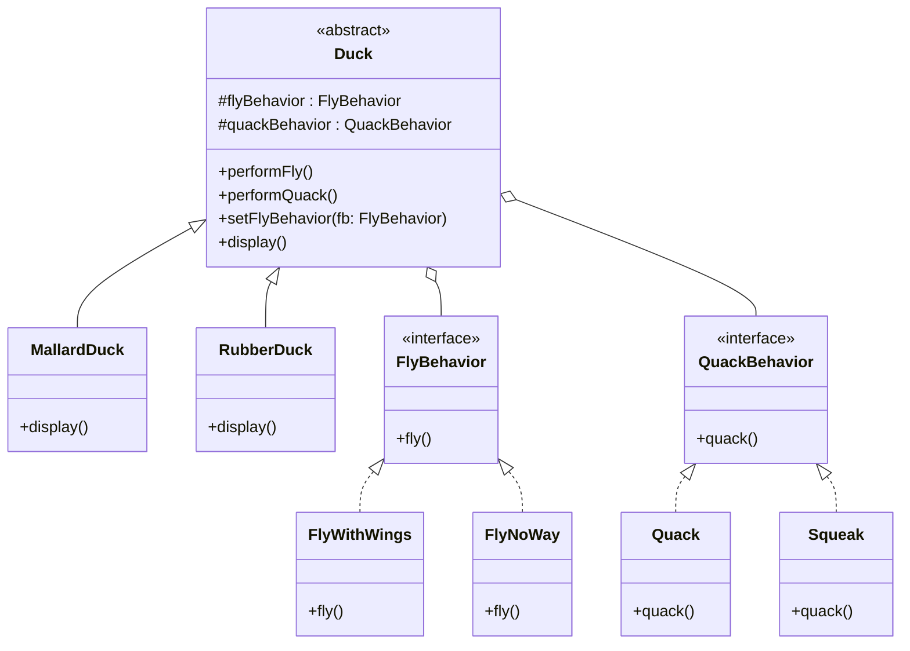

```java
interface FlyBehavior { void fly(); }
class FlyWithWings implements FlyBehavior { public void fly() { System.out.println("I'm flying!"); } }
class FlyNoWay     implements FlyBehavior { public void fly() { System.out.println("I can't fly"); } }

interface QuackBehavior { void quack(); }
class Quack  implements QuackBehavior { public void quack() { System.out.println("Quack"); } }
class Squeak implements QuackBehavior { public void quack() { System.out.println("Squeak"); } }

abstract class Duck {
    protected FlyBehavior flyBehavior;          // HAS-A strategy
    protected QuackBehavior quackBehavior;
    public void performFly()   { flyBehavior.fly(); }       // delegate
    public void performQuack() { quackBehavior.quack(); }
    public void setFlyBehavior(FlyBehavior fb) { flyBehavior = fb; }   // change at runtime
    public abstract void display();
}

class MallardDuck extends Duck {
    MallardDuck() { flyBehavior = new FlyWithWings(); quackBehavior = new Quack(); }
    public void display() { System.out.println("I'm a mallard"); }
}
class RubberDuck extends Duck {
    RubberDuck() { flyBehavior = new FlyNoWay(); quackBehavior = new Squeak(); }
    public void display() { System.out.println("I'm a rubber duck"); }
}
```

### How to recognize Strategy in a TF scenario

Look for ==several interchangeable algorithms for the same task== (sorting routines, grading schemes, discount rules, payment methods, compression formats, routing algorithms, "fast but unstable vs slow but stable implementation") and a need to ==choose or switch the algorithm at runtime without changing the client==. Long `if/else` or `switch` blocks that choose a calculation by type are also a Strategy smell (the refactoring "Replace Conditional with Polymorphism").

> [!warning] ⚠️ Common mistake
> In Strategy the **client usually chooses** which strategy to plug in, and the strategies do not know about each other. If the object switches its own behaviour automatically because its internal condition changed, that is State, not Strategy.

---

## Template Method Pattern

### The story (Coffee and Tea)

Starbuzz writes a `Coffee` class whose `prepareRecipe()` does four steps: boil water, brew coffee grinds, pour in cup, add sugar and milk. The `Tea` class does: boil water, steep tea bag, pour in cup, add lemon (p.49–53). Two of the four steps are identical and the other two are similar, so the code is duplicated, and the overall algorithm is written twice. A first attempt moves `boilWater()` and `pourInCup()` into a superclass (p.54–56), but the algorithm itself is still duplicated in both `prepareRecipe()` methods.

The key observation (p.57–60) is that both recipes have the **same skeleton**. So we generalize `brew()` and `steepTeaBag()` into one abstract step `brew()`, generalize `addSugarAndMilk()` and `addLemon()` into `addCondiments()`, and write `prepareRecipe()` **once** in an abstract class `CaffeineBeverage`. That method is declared ==final== so subclasses cannot change the order of steps; subclasses only fill in the steps that differ (p.61–63). The slides add a **hook** — `customerWantsCondiments()` — a method with a default implementation in the abstract class that subclasses may override to influence the algorithm, giving conditional execution with `if` (p.72).

> [!important] 🔑 Memorize — Template Method definition
> ==Template Method pattern defines the skeleton of an algorithm in the superclass but lets subclasses override specific steps of the algorithm without changing its structure.==
> 📑 **See:** *2 - BehavioralDesignPattern.pdf* → p.73 (definition), p.74 (generalized structure — "it is final method"), p.61–63 (coffee/tea), p.72 (hook with if-else), p.75–77 (data-mining example: only some steps vary); *3 - Design Pattern Misc.pdf* → p.3–4

### Participants

The **AbstractClass** contains the **template method** (final), which calls the steps in a fixed order. Steps are of three kinds: ==concrete steps== implemented in the abstract class and shared by all (`boilWater`), ==abstract (primitive) steps== that every subclass must implement (`brew`, `addCondiments`), and ==hooks== that have a default (often empty or `true`) implementation and may optionally be overridden (`customerWantsCondiments`). **ConcreteClasses** implement the abstract steps. This also illustrates the **Hollywood Principle**: "Don't call us, we'll call you" — the superclass calls the subclass steps, not the other way round.

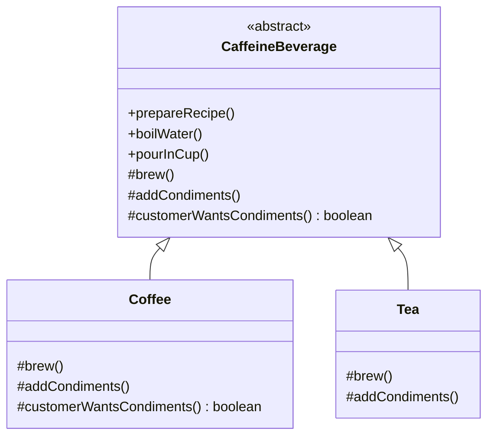

```java
abstract class CaffeineBeverage {
    public final void prepareRecipe() {        // TEMPLATE METHOD: fixed skeleton
        boilWater();
        brew();                                // abstract step
        pourInCup();
        if (customerWantsCondiments())         // HOOK controls an optional step
            addCondiments();
    }
    protected abstract void brew();
    protected abstract void addCondiments();
    void boilWater() { System.out.println("Boiling water"); }   // concrete step
    void pourInCup() { System.out.println("Pouring into cup"); }
    protected boolean customerWantsCondiments() { return true; } // hook, default
}

class Coffee extends CaffeineBeverage {
    protected void brew() { System.out.println("Dripping coffee through filter"); }
    protected void addCondiments() { System.out.println("Adding sugar and milk"); }
    protected boolean customerWantsCondiments() { return false; } // overrides hook
}
class Tea extends CaffeineBeverage {
    protected void brew() { System.out.println("Steeping the tea"); }
    protected void addCondiments() { System.out.println("Adding lemon"); }
}
```

### How to recognize Template Method in a TF scenario

Look for ==a fixed sequence of steps that is the same for all variants, where only one or two steps differ== — "open → extract → close", "read data → parse → analyze → report", "boil → brew → pour → add". The phrase "the overall workflow remains the same" is the giveaway (May-2026 Q8(a)).

## Strategy vs Template Method

This comparison is a classic short question, and the May-2026 paper asks you to **combine** them.

> [!important] 🔑 Memorize — Difference between Strategy and Template (slide p.78)
> ==Template Method is based on inheritance: it alters parts of an algorithm by extending those parts in subclasses. Strategy is based on composition: it alters parts of the object's behavior by supplying it with different strategies that correspond to that behavior. Template Method works at the class level, so it is static. Strategy works on the object level, letting you switch behaviors at runtime.==
> 📑 **See:** *2 - BehavioralDesignPattern.pdf* → p.78

Explained simply: in Template, the variant is chosen when you write `new Coffee()` and it cannot change afterwards; in Strategy, the same `Duck` object can receive a new behaviour while the program runs. Template controls the **whole algorithm and its order** in one place, whereas Strategy replaces the **whole algorithm** (one interchangeable unit). When the skeleton is fixed but one step must be changeable at runtime, combine them: keep the final template method in the abstract class, but make the varying step delegate to a strategy object held by that class instead of being an abstract method — then one parser class can use a CSV, JSON or XML extraction strategy at runtime without a new subclass per format.

---

## Observer Pattern

### The story (Weather-O-Rama)

A `WeatherData` object gets new temperature, humidity and pressure readings and has a method `measurementsChanged()` that is called whenever the readings update. There are three displays — current conditions, statistics and forecast — and third parties may want to add more (p.82–89). The misguided implementation (p.90–94) puts the three display objects directly inside `measurementsChanged()` and calls `currentConditionsDisplay.update(t, h, p)` and so on. This codes to concrete classes, so adding or removing a display at runtime requires changing `WeatherData`.

The slides compare the solution to a **newspaper subscription** (p.95–107): the publisher (subject) publishes, readers (observers) subscribe or unsubscribe at any time, and every subscriber gets each new edition. So `WeatherData` becomes a **Subject** that keeps a list of `Observer` objects and offers `registerObserver()`, `removeObserver()` and `notifyObservers()`. Each display implements `Observer.update()`. When readings change, `measurementsChanged()` simply calls `notifyObservers()`, which loops through the list (p.108–120). The subject only knows that its observers implement the `Observer` interface — that is ==loose coupling==.

> [!important] 🔑 Memorize — Observer definition
> ==Define a one-to-many dependency between objects so that when one object changes state, all its dependents are notified and updated automatically.==
> Principle: ==strive for loosely coupled designs between objects that interact.==
> 📑 **See:** *2 - BehavioralDesignPattern.pdf* → p.121–122 (definition + class diagram), p.95–107 (newspaper analogy), p.110–111 (new design), p.112–120 (code)

### Participants

The **Subject** interface declares `registerObserver`, `removeObserver`, `notifyObservers`. The **ConcreteSubject** (`WeatherData`) stores the state and the list of observers and calls `notifyObservers()` whenever its state changes. The **Observer** interface declares `update(...)`. **ConcreteObservers** (`CurrentConditionsDisplay`) implement `update` to react; often they keep a reference to the subject so they can register themselves (in their constructor) and later unsubscribe.

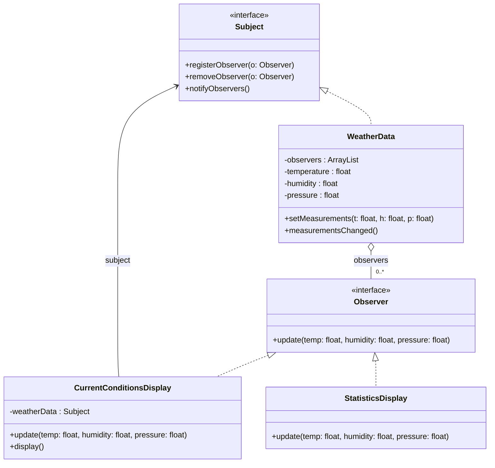

```java
interface Subject {
    void registerObserver(Observer o);
    void removeObserver(Observer o);
    void notifyObservers();
}
interface Observer { void update(float temp, float humidity, float pressure); }

class WeatherData implements Subject {
    private List<Observer> observers = new ArrayList<>();
    private float temperature, humidity, pressure;
    public void registerObserver(Observer o) { observers.add(o); }
    public void removeObserver(Observer o)   { observers.remove(o); }
    public void notifyObservers() {
        for (Observer o : observers) o.update(temperature, humidity, pressure);  // PUSH
    }
    public void measurementsChanged() { notifyObservers(); }
    public void setMeasurements(float t, float h, float p) {
        temperature = t; humidity = h; pressure = p;
        measurementsChanged();
    }
}

class CurrentConditionsDisplay implements Observer {
    private Subject weatherData;
    CurrentConditionsDisplay(Subject s) { weatherData = s; s.registerObserver(this); } // self-register
    public void update(float t, float h, float p) {
        System.out.println("Current: " + t + "F, " + h + "% humidity");
    }
}
```

**Push vs pull.** In the **push** model (above), the subject sends the changed data as arguments of `update()`. In the **pull** model, `update()` has no data arguments (or just the subject), and each observer calls getters such as `weatherData.getTemperature()` to pull only what it needs. Pull is more flexible when observers need different data; push is simpler. Mention both when asked to "justify the design".

### How to recognize Observer in a TF scenario

Look for ==subscribe / register / follow, and "notify all registered users/displays automatically whenever X changes"==: stock price updates, blog posts to registered alumni, breaking-news displays, group notifications, movies recommended to users who chose a genre, temperature dashboards, multiple views of the same data (km table and miles table). The words **one-to-many** and **automatically updated** are the strongest signals.

> [!warning] ⚠️ Common mistake
> Do not hard-code the observers inside the subject (that is the "misguided implementation" on p.90). The subject must hold a **list of the Observer interface type** and must provide register **and** remove. Also, notify only when the state actually changes if the question says so (Feb-2025 StockMarket: "only when a different price is set").

---

## Mediator Pattern

### The story (Air traffic control and a UI form)

During landing, aircraft pilots do not talk to each other directly; all communication goes through the control tower. Without the tower, every pilot would need to be aware of every other aircraft, and crashes would skyrocket (p.129–130). Software has the same problem. A customer-profile UI has many components — a text box, check boxes ("I have a dog" shows a dog-name field), buttons, labels — and they depend on each other: ticking a check box must reveal a text field, clicking "Submit" must validate all fields (p.131–140). If each component refers to the others directly, every component becomes coupled to many others, cannot be reused in another form, and any change ripples everywhere.

The solution (p.141–156) is a **Mediator** object (the dialog). Components stop talking to each other; when something happens, a component only calls `mediator.notify(this, "click")`. The mediator knows all the components and decides who must react. Each component now depends on one mediator instead of many peers, so components become reusable and the interaction logic lives in one place.

> [!important] 🔑 Memorize — Mediator definition
> ==Mediator pattern restricts direct communications between objects and forces them to collaborate only via a mediator object. It lets you reduce chaotic dependencies between objects.==
> 📑 **See:** *2 - BehavioralDesignPattern.pdf* → p.157–159 (definition + structure), p.129–130 (ATC), p.131–150 (UI design), p.151–152 (bird's-eye view), p.153–156 (code)

### Participants

The **Mediator** interface declares a notification method used by components (`notify(sender, event)` or a domain-specific one like `requestLanding(flight)`). The **ConcreteMediator** holds references to all components and contains the coordination logic. **Components (Colleagues)** hold a reference to the mediator only, and call it instead of calling each other.

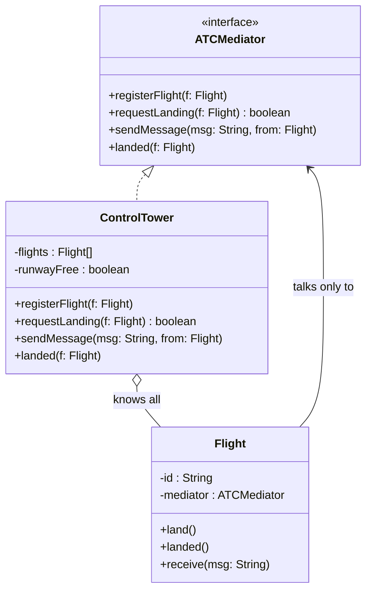

```java
interface ATCMediator {
    void registerFlight(Flight f);
    boolean requestLanding(Flight f);
    void sendMessage(String msg, Flight from);
    void landed(Flight f);
}

class ControlTower implements ATCMediator {
    private List<Flight> flights = new ArrayList<>();
    private boolean runwayFree = true;
    @Override public void registerFlight(Flight f) { flights.add(f); }
    @Override public boolean requestLanding(Flight f) {
        if (runwayFree) { runwayFree = false; sendMessage(f.getId() + " is landing", f); return true; }
        return false;                                   // must wait
    }
    @Override public void landed(Flight f) { runwayFree = true; sendMessage(f.getId() + " has landed, runway free", f); }
    @Override public void sendMessage(String msg, Flight from) {
        for (Flight f : flights) if (f != from) f.receive(msg);   // tower relays
    }
}

class Flight {
    private String id; private ATCMediator mediator;
    Flight(String id, ATCMediator m) { this.id = id; mediator = m; m.registerFlight(this); }
    public String getId() { return id; }
    public void land() {
        if (mediator.requestLanding(this)) System.out.println(id + " landing");
        else System.out.println(id + " waiting");
    }
    public void landed() { mediator.landed(this); }       // tells the tower the runway is free
    public void receive(String msg) { System.out.println(id + " received: " + msg); }
}
```

### How to recognize Mediator in a TF scenario

Look for ==many objects that would otherwise talk to each other (many-to-many), a central hub/broker/controller/tower/committee through which all communication passes, and "objects should not interact directly / should not know each other"==: air traffic control, chat room, smart-home hub coordinating sensors and lights, a sorting broker forwarding requests to servers, a journal committee hiding reviewers and authors from each other.

## Mediator vs Observer

> [!important] 🔑 Memorize — Difference between Mediator and Observer (slide p.167)
> ==The primary goal of Mediator is to eliminate mutual dependencies among a set of components; instead, they all depend on a single mediator object. The goal of Observer is to establish dynamic, one-way, one-to-many connections between objects, where some objects act as subordinates (subscribers) of others and can subscribe or unsubscribe.==
> 📑 **See:** *2 - BehavioralDesignPattern.pdf* → p.167

In simple words, Observer is about **broadcasting a change** from one subject to many interested listeners, and the subject does not care what they do. Mediator is about **coordinating** many peers that would otherwise call each other; the mediator contains real decision logic ("if the check box is ticked, show the text field"). A mediator is sometimes implemented with observer-style notifications, which is why the two are confused, but the intent is different.

---

## Command Pattern

### The story (a simple text editor)

A text editor has buttons (Copy, Paste, Cut, Undo), menu items and keyboard shortcuts that all trigger the same operations (p.168–173). The first idea is to subclass `Button` into `CopyButton`, `PasteButton` and so on, each containing the business logic (p.174–178). This couples the GUI to the business logic, and the same copy code must be duplicated in the copy menu item and the Ctrl+C shortcut.

The solution is **separation of concerns** (p.179–188): the GUI objects should not perform the work; they should only **send a request**. Each request is turned into a separate **command object** with a single `execute()` method, for example `CopyCommand`, that knows the receiver (the `Editor`) and the operation to call on it. A button, a menu item and a shortcut can all hold the same `CopyCommand`. Because a request is now an object, it can be **stored in a history stack (for undo), put in a queue (for delayed or scheduled execution), logged, or replayed**.

> [!important] 🔑 Memorize — Command definition
> ==Command pattern turns a request into a stand-alone object that contains all information about the request. This transformation lets you parameterize methods with different requests, delay or queue a request's execution, and support undoable operations.==
> 📑 **See:** *2 - BehavioralDesignPattern.pdf* → p.192–193 (definition), p.189–191 (bird's-eye view), p.179–188 (text editor redesign), p.201 (queuing requests)

### Participants

The **Command** interface declares `execute()` (and often `undo()`). A **ConcreteCommand** stores a reference to the **Receiver** and any parameters, and its `execute()` calls the right method on the receiver. The **Receiver** (`Editor`, `Light`, `StockTrade`) contains the actual business logic. The **Invoker** (`Button`, remote control, `Agent`, a scheduler) holds commands and triggers them; it knows nothing about the receiver. The **Client** creates concrete commands, connects them with receivers, and gives them to the invoker.

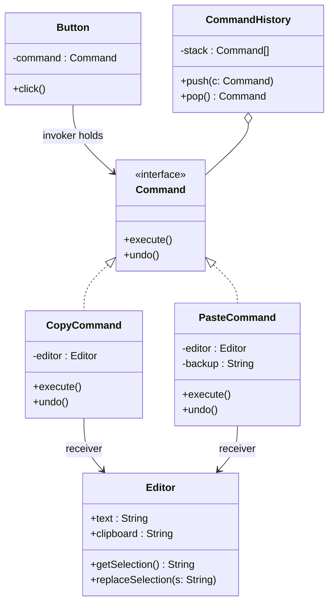

```java
interface Command { void execute(); void undo(); }

class Editor {                                       // RECEIVER: real work
    private String text = "", clipboard = "";
    String getSelection()           { return text; }
    void replaceSelection(String s) { text = s; }
    String getText()                { return text; }
    void setText(String s)          { text = s; }
    String getClipboard()           { return clipboard; }
    void setClipboard(String s)     { clipboard = s; }
}

class CopyCommand implements Command {
    private Editor editor;
    CopyCommand(Editor e) { editor = e; }
    @Override public void execute() { editor.setClipboard(editor.getSelection()); }
    @Override public void undo() { }                           // copy changes nothing visible
}

class PasteCommand implements Command {
    private Editor editor; private String backup;
    PasteCommand(Editor e) { editor = e; }
    @Override public void execute() { backup = editor.getText(); editor.replaceSelection(editor.getClipboard()); }
    @Override public void undo() { editor.setText(backup); }     // restore previous state
}

class Button {                                       // INVOKER: knows only Command
    private Command command; private Deque<Command> history;
    Button(Command c, Deque<Command> h) { command = c; history = h; }
    void click() { command.execute(); history.push(command); }
}

// Undo: history.pop().undo();
// Queue: Queue<Command> q = new LinkedList<>(); q.add(cmd); ... while(!q.isEmpty()) q.poll().execute();
```

### How to recognize Command in a TF scenario

Look for ==undo/redo, queue, schedule, log, record and replay requests, "decouple the object that issues a request from the object that performs it"==, remote controls, buttons/menus/shortcuts doing the same action, an agent/broker that **stores orders in a queue** and places them later, and version-control-like operations (commit, push, stash) each being a self-contained action.

## Command vs Mediator

> [!important] 🔑 Memorize — Difference between Command and Mediator (slide p.202)
> ==Command establishes unidirectional connections between senders and receivers. Mediator eliminates direct connections between senders and receivers, forcing them to communicate indirectly via a mediator object.==
> 📑 **See:** *2 - BehavioralDesignPattern.pdf* → p.202

With Command, the sender (invoker) still triggers one specific receiver, but through a command object, so the connection is one-way and can be stored or delayed. With Mediator, nobody talks to a specific peer at all; everybody talks only to the hub, and the hub decides.

---

## State Pattern

### The story (Mighty Gumball machine)

A gumball machine has four states: **No Quarter**, **Has Quarter**, **Gumball Sold** and **Out of Gumballs**, and four actions: insert quarter, eject quarter, turn crank and dispense (p.203–204). The first implementation (p.205–214) stores the state as an integer constant and writes every action as a big `if (state == NO_QUARTER) ... else if (state == HAS_QUARTER) ...` block. Then the CEO asks for a new feature: **10% of the time, turning the crank gives two gumballs** (a Winner state, p.215). Adding a state means editing every `if/else` block in every method — the code is not closed for modification, state transitions are hidden in conditionals, and bugs are likely.

The new design (p.217–235) creates a `State` interface with one method per action (`insertQuarter`, `ejectQuarter`, `turnCrank`, `dispense`) and one class per state (`NoQuarterState`, `HasQuarterState`, `SoldState`, `SoldOutState`, later `WinnerState`). The `GumballMachine` (the context) holds one object for each state and a `currentState` reference, and every action simply **delegates** to `currentState`. Each state class decides what to do and **itself changes the machine's state** by calling `machine.setState(machine.getSoldState())`. Adding `WinnerState` now means adding one class and changing only the transition in `HasQuarterState` (p.236–240).

> [!important] 🔑 Memorize — State definition
> ==Allow an object to alter its behavior when its internal state changes. The object will appear to change its class.==
> 📑 **See:** *2 - BehavioralDesignPattern.pdf* → p.241–242 (definition + structure), p.204 & p.215 (state diagrams), p.217–235 (new design and code), p.236–240 (Winner state), p.252–253 (document publish example)

### Participants

The **Context** (`GumballMachine`, `Document`) stores a reference to the current state object and exposes the actions; it delegates each action to the state. The **State** interface declares state-specific methods. **ConcreteStates** implement the behaviour for one state and trigger transitions by setting the context's next state. Unlike Strategy, ==concrete states know about each other== (each one knows which state comes next).

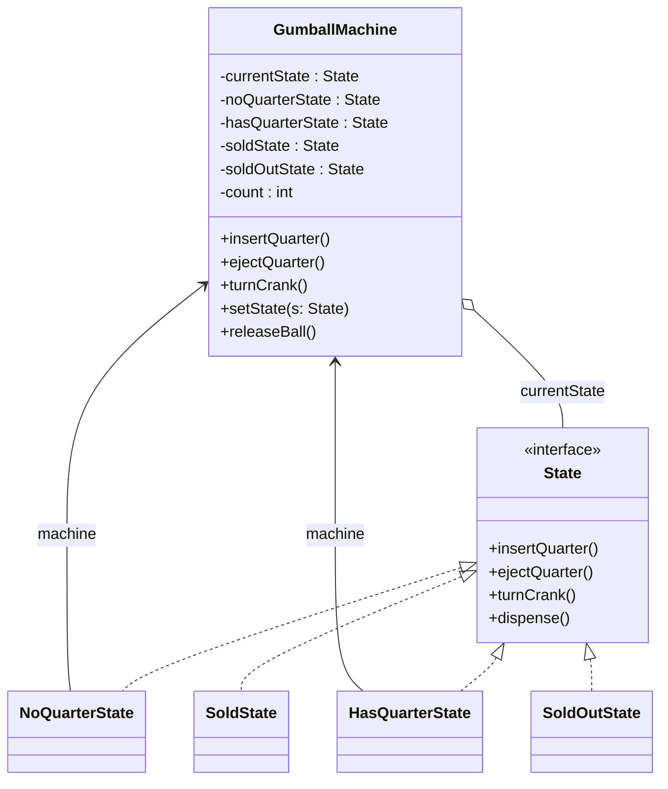

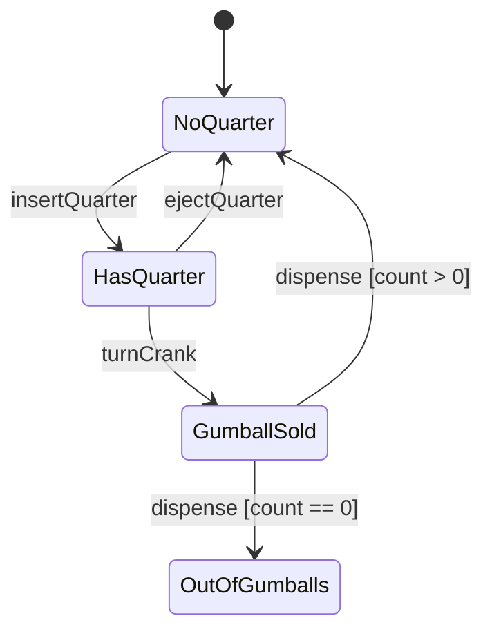

```java
interface State { void insertQuarter(); void ejectQuarter(); void turnCrank(); void dispense(); }

class GumballMachine {
    private final State noQuarter = new NoQuarterState(this), hasQuarter = new HasQuarterState(this),
                        sold = new SoldState(this), soldOut = new SoldOutState(this);
    private State currentState; private int count;
    GumballMachine(int n) { count = n; currentState = (n > 0) ? noQuarter : soldOut; }
    void insertQuarter() { currentState.insertQuarter(); }        // delegate
    void ejectQuarter()  { currentState.ejectQuarter(); }
    void turnCrank()     { currentState.turnCrank(); currentState.dispense(); }
    void setState(State s) { currentState = s; }
    State getNoQuarterState()  { return noQuarter; }
    State getHasQuarterState() { return hasQuarter; }
    State getSoldState()       { return sold; }
    State getSoldOutState()    { return soldOut; }
    int getCount()             { return count; }
    void releaseBall() { System.out.println("A gumball rolls out"); if (count > 0) count--; }
}

class NoQuarterState implements State {
    private final GumballMachine m; NoQuarterState(GumballMachine m) { this.m = m; }
    public void insertQuarter() { System.out.println("Quarter inserted"); m.setState(m.getHasQuarterState()); }
    public void ejectQuarter()  { System.out.println("No quarter to eject"); }
    public void turnCrank()     { System.out.println("Insert a quarter first"); }
    public void dispense()      { System.out.println("Pay first"); }
}
class HasQuarterState implements State {
    private final GumballMachine m; HasQuarterState(GumballMachine m) { this.m = m; }
    public void insertQuarter() { System.out.println("Already have a quarter"); }
    public void ejectQuarter()  { System.out.println("Quarter returned"); m.setState(m.getNoQuarterState()); }
    public void turnCrank()     { System.out.println("You turned..."); m.setState(m.getSoldState()); }
    public void dispense()      { System.out.println("No gumball dispensed"); }
}
class SoldState implements State {
    private final GumballMachine m; SoldState(GumballMachine m) { this.m = m; }
    public void insertQuarter() { System.out.println("Please wait"); }
    public void ejectQuarter()  { System.out.println("Already turned the crank"); }
    public void turnCrank()     { System.out.println("Turning twice gives nothing"); }
    public void dispense() {
        m.releaseBall();
        m.setState(m.getCount() > 0 ? m.getNoQuarterState() : m.getSoldOutState());      // state decides the next state
    }
}
class SoldOutState implements State {
    private final GumballMachine m; SoldOutState(GumballMachine m) { this.m = m; }
    public void insertQuarter() { System.out.println("Sold out"); }
    public void ejectQuarter()  { System.out.println("No quarter"); }
    public void turnCrank()     { System.out.println("Sold out"); }
    public void dispense()      { System.out.println("No gumball"); }
}
```

### How to recognize State in a TF scenario

Look for ==an object whose response to the same request depends on its current mode/status, with clear transitions== — vending machine, document (draft → moderation → published, p.252), order (placed → paid → shipped), traffic light, TCP connection, media player — and ==large conditionals on a status field==. If the question gives you a state diagram and asks for code, it is State.

## State vs Strategy

> [!important] 🔑 Memorize — Difference between State and Strategy (slides p.254–256)
> ==State can be considered an extension of Strategy; they are twins separated at birth. Both are based on composition: they change the behavior of the context by delegating some work to helper objects. Strategy makes these objects completely independent and unaware of each other. State does not restrict dependencies between concrete states, letting them alter the state of the context at will.==
> 📑 **See:** *2 - BehavioralDesignPattern.pdf* → p.254–256, and p.250–251 ("no dumb questions")

**Why structurally similar:** the class diagrams are almost identical — a context holds a reference to an interface, several concrete classes implement that interface, and the context delegates calls to whichever object it currently holds.

**Why conceptually different:** the **intent and who drives the change** differ. In Strategy, the **client** picks an algorithm (often once) and passes it in; the strategies are independent alternatives for doing the same job and none of them knows the others or the context's lifecycle. In State, the context **changes its own behaviour over time** as its internal condition changes; the states are not alternatives but **stages**, each state usually knows the next state and calls `context.setState(...)`, and the client is often unaware that any state object exists. Strategy answers "*how* should this task be done?"; State answers "*what* should I do now, given where I am?". A one-line summary to write: ==Strategy = client-chosen, interchangeable, independent algorithms; State = object-driven, transition-aware behaviours that replace a status conditional.==

---

## Chain of Responsibility Pattern

> [!note] Not in IJ ma'am's slides, but it is in the GoF behavioral list (AI sir *Lec 2* p.6) and it was asked in the Feb-2025 paper Q2(b) (HelpHandler/Widget/Button/Dialog/Application — this is the original GoF example). Learn it.

### The idea

A request should be handled by **one of several objects**, but the sender should not know which one. So the handlers are linked into a **chain**: each handler has a reference to its **successor**. When a handler receives a request it either handles it, or passes it on to its successor. In the GoF help system, the user clicks a `Button` asking for help; if the button has a help topic it shows it and the search ends; otherwise it forwards the request to its container `Dialog`, which forwards to the `Application`, which shows general help.

> [!important] 🔑 Memorize — Chain of Responsibility definition
> ==Avoid coupling the sender of a request to its receiver by giving more than one object a chance to handle the request. Chain the receiving objects and pass the request along the chain until an object handles it.==

The **Handler** (`HelpHandler`) declares `handleHelp()` and holds the `successor`; its default `handleHelp()` simply forwards to the successor. **ConcreteHandlers** (`Button`, `Dialog`, `Application`) override `handleHelp()` to handle the request if they can, or call the superclass version to pass it on.

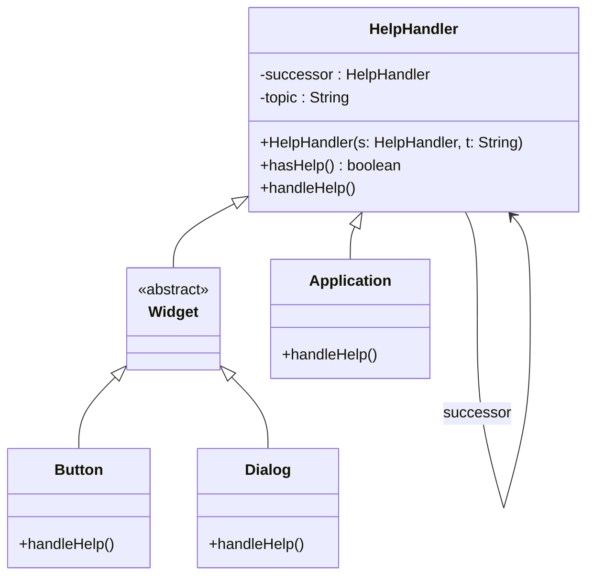

```java
class HelpHandler {
    private HelpHandler successor; protected String topic;   // topic empty by default
    HelpHandler(HelpHandler s, String t) { successor = s; topic = t; }
    boolean hasHelp() { return topic != null && !topic.isEmpty(); }
    void handleHelp() { if (successor != null) successor.handleHelp(); }  // forward
}
abstract class Widget extends HelpHandler {
    Widget(HelpHandler parent, String t) { super(parent, t); }
}
class Button extends Widget {
    Button(HelpHandler parent, String t) { super(parent, t); }
    void handleHelp() {
        if (hasHelp()) System.out.println("Button help: " + topic);   // handled, chain stops
        else super.handleHelp();                                       // pass along
    }
}
class Dialog extends Widget {
    Dialog(HelpHandler parent, String t) { super(parent, t); }
    void handleHelp() { if (hasHelp()) System.out.println("Dialog help: " + topic); else super.handleHelp(); }
}
class Application extends HelpHandler {
    Application(String t) { super(null, t); }
    void handleHelp() { System.out.println("General help / list of topics"); }
}
// Application app = new Application("");
// Dialog d = new Dialog(app, "Printing");
// Button b = new Button(d, "");  b.handleHelp();  -> "Dialog help: Printing"
```

**Recognize it by:** ==a request passed along a chain of handlers until one handles it== — help systems, approval levels (team lead → manager → director by amount), logging levels, middleware/filters, support tickets escalating. If the question says "successor", "escalate", "forward if it cannot handle", it is Chain of Responsibility.

---

## Iterator Pattern (short)

> [!note] Not in IJ ma'am's slides; in the GoF behavioral list. Only a concept-level answer is ever needed.

Iterator ==provides a way to access the elements of an aggregate object sequentially without exposing its underlying representation==. The Pancake House menu (an `ArrayList`) and the Diner menu (an array) can both return an `Iterator` with `hasNext()` and `next()`, so the waitress can print both menus with one loop and never knows how each menu stores its items. Java's `java.util.Iterator` and the for-each loop are the built-in example. It is often used together with Composite to traverse a tree.

---

## Quick comparison of all behavioral patterns

Strategy swaps **one algorithm** chosen by the client through composition. Template Method fixes **the skeleton of an algorithm** in a superclass and lets subclasses fill in steps through inheritance. Observer **broadcasts** a state change from one subject to many subscribers who can join or leave at runtime. Mediator **centralizes** many-to-many communication in one hub so peers do not know each other. Command **packages a request as an object** so it can be queued, logged, undone or replayed, decoupling the invoker from the receiver. State lets an object **change its behaviour as its internal state changes**, with the state objects themselves handling transitions. Chain of Responsibility **passes a request along a chain** of handlers until one handles it.

---

## TF questions on this topic

> [!example] ✍️ Worked TF question — 2021-22 Q4(a) [20] — identify the most specific pattern in four situations

**(i) NuetFlix genre recommendation → ==Observer==.** Each genre (Horror, Thriller, Comedy) acts as a subject, and users who choose that genre register as observers. When a movie is released, the matching genre subject calls `notifyObservers(movie)`, so only the interested users are notified automatically. Users can add or remove preferred genres at any time, which is exactly the dynamic subscribe/unsubscribe of Observer. This is a one-to-many dependency (one genre, many users), so Observer is the most specific pattern.

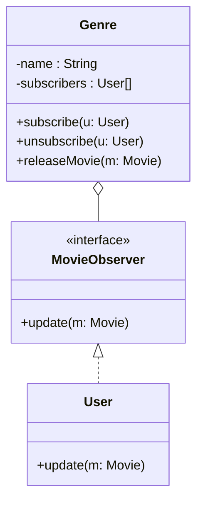

**(ii) jit version control (kommit, pussh, stashh) → ==Command==.** Each operation is a request that must be stored and executed later or undone: `kommit` creates a command object that is saved locally (in a queue of un-pushed commits) without being sent; `pussh` executes all queued commit commands against the remote receiver; `stashh` discards (undoes) every un-pushed commit and fetches the latest remote version. Turning each request into an object that can be **queued, executed later and undone** is exactly the intent of Command. `Repository`/`Remote` are receivers, `KommitCommand`, `PusshCommand`, `StashhCommand` are concrete commands, and the jit CLI is the invoker holding a pending-command queue.

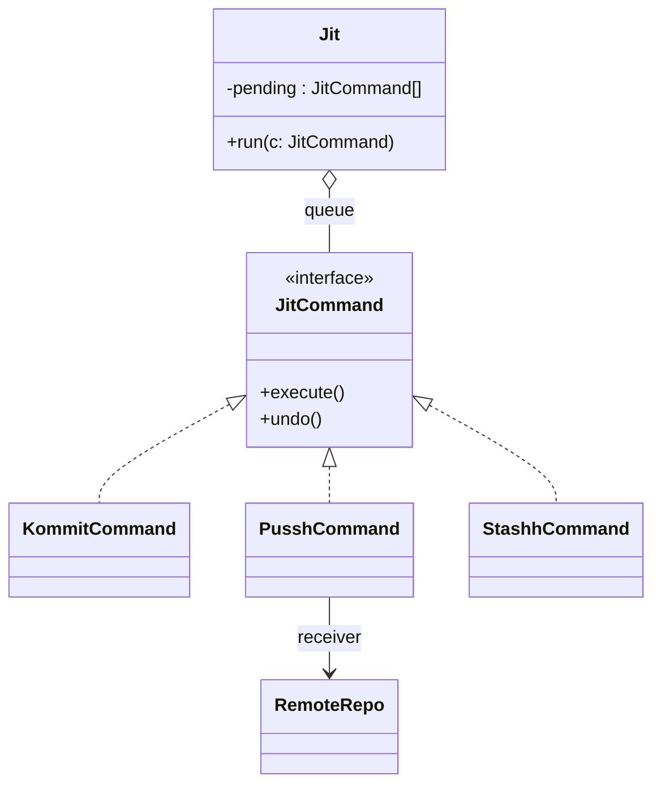

**(iii) BanglaPhone switching between two communication implementations → ==Strategy==.** There are two interchangeable algorithms for the same job (a stable, costly, slower one and a fast, cheap one that becomes unstable above a user threshold). The system must switch between them at runtime, based on the current number of users in a cell tower, **without affecting any other code**. The client code depends only on a `CommunicationStrategy` interface, and a context (`CellTower`) calls `setStrategy(...)` when the user count crosses the threshold. A student may also argue **State** (because the switch is triggered by an internal condition, the user count) or **Bridge** (abstraction "communication service" separate from implementation), but the most specific answer is Strategy, because the two implementations are independent alternatives for the same algorithm and do not know each other or trigger transitions themselves.

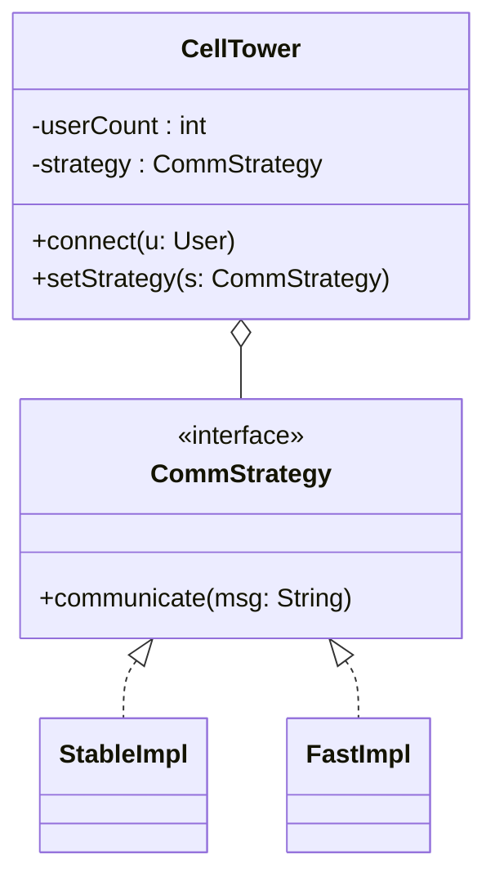

```java
void connect(User u) {
    userCount++;
    if (userCount > THRESHOLD) setStrategy(new StableImpl());   // switch at runtime
    else setStrategy(new FastImpl());
}
```

**(iv) R2-D2 peer-reviewed journal → ==Mediator==.** Authors and reviewers must communicate (submit, review, acknowledge, resubmit, accept/reject) but must never know each other's identity, and all communication goes through an internal team formed by the journal committee. That committee is the mediator: authors and reviewers hold a reference only to the `EditorialMediator`, which forwards articles to reviewers and reviews back to authors, removing direct (many-to-many) dependencies and keeping them anonymous.

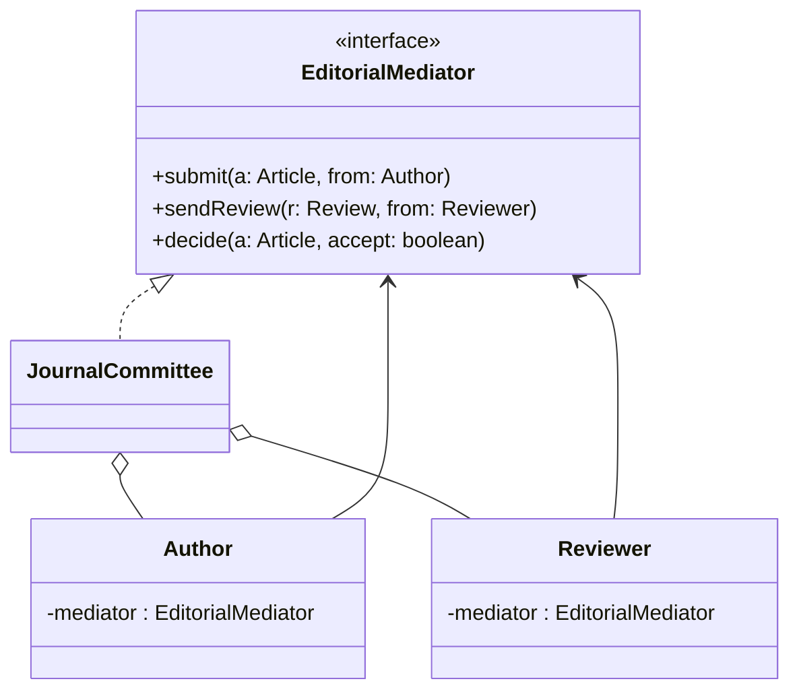

---

> [!example] ✍️ Worked TF question — 2020-21 Q2(b) [10] — Strategy pattern for selection, insertion and quick sort

The three sorting routines are a family of interchangeable algorithms for the same task, and the client should be able to choose one at runtime without changing its own code, so ==Strategy== fits.

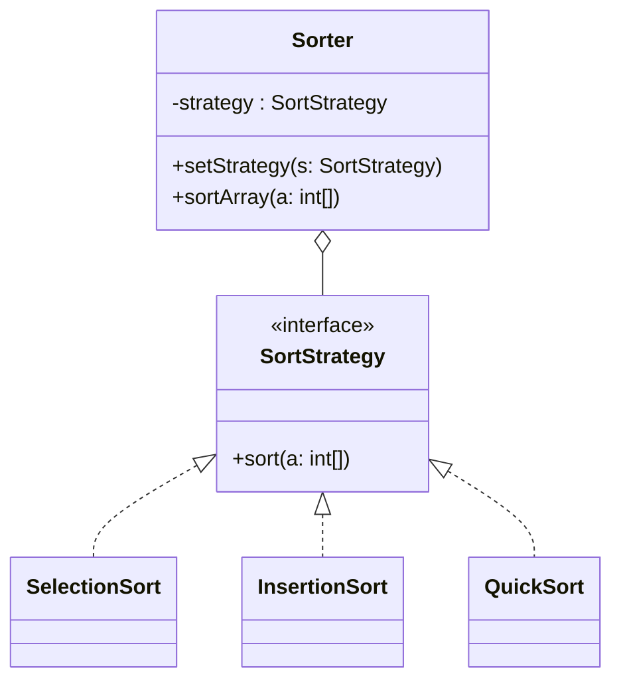

```java
interface SortStrategy { void sort(int[] a); }

class SelectionSort implements SortStrategy {
    public void sort(int[] a) {
        for (int i = 0; i < a.length - 1; i++) {
            int min = i;
            for (int j = i + 1; j < a.length; j++) if (a[j] < a[min]) min = j;
            int t = a[i]; a[i] = a[min]; a[min] = t;
        }
    }
}
class InsertionSort implements SortStrategy {
    public void sort(int[] a) {
        for (int i = 1; i < a.length; i++) {
            int key = a[i], j = i - 1;
            while (j >= 0 && a[j] > key) { a[j + 1] = a[j]; j--; }
            a[j + 1] = key;
        }
    }
}
class QuickSort implements SortStrategy {
    public void sort(int[] a) { qs(a, 0, a.length - 1); }
    private void qs(int[] a, int lo, int hi) {
        if (lo >= hi) return;
        int p = a[hi], i = lo - 1;
        for (int j = lo; j < hi; j++) if (a[j] < p) { i++; int t = a[i]; a[i] = a[j]; a[j] = t; }
        int t = a[i + 1]; a[i + 1] = a[hi]; a[hi] = t;
        qs(a, lo, i); qs(a, i + 2, hi);
    }
}

class Sorter {                                          // Context
    private SortStrategy strategy;
    Sorter(SortStrategy s) { strategy = s; }
    void setStrategy(SortStrategy s) { strategy = s; }   // switch at runtime
    void sortArray(int[] a) { strategy.sort(a); }
}

// Sorter s = new Sorter(new InsertionSort());   // small, nearly sorted data
// s.sortArray(data);
// s.setStrategy(new QuickSort());               // large data
// s.sortArray(bigData);
```

A new algorithm (merge sort) is added by writing one new class; `Sorter` and the client are never modified — this satisfies Open/Closed.

---

> [!example] ✍️ Worked TF question — 2020-21 Q2(c) [15] — merit list from student IDs and marks with a grading scheme

The grading scheme can change (absolute 80+ = A+, relative/curve, pass–fail), so the rule that converts marks to a grade is a **varying algorithm**. ==Strategy== encapsulates each grading scheme behind a `GradingStrategy` interface, and the `MeritListGenerator` (context) uses whichever scheme is supplied to compute grades and then picks the students with the highest grade.

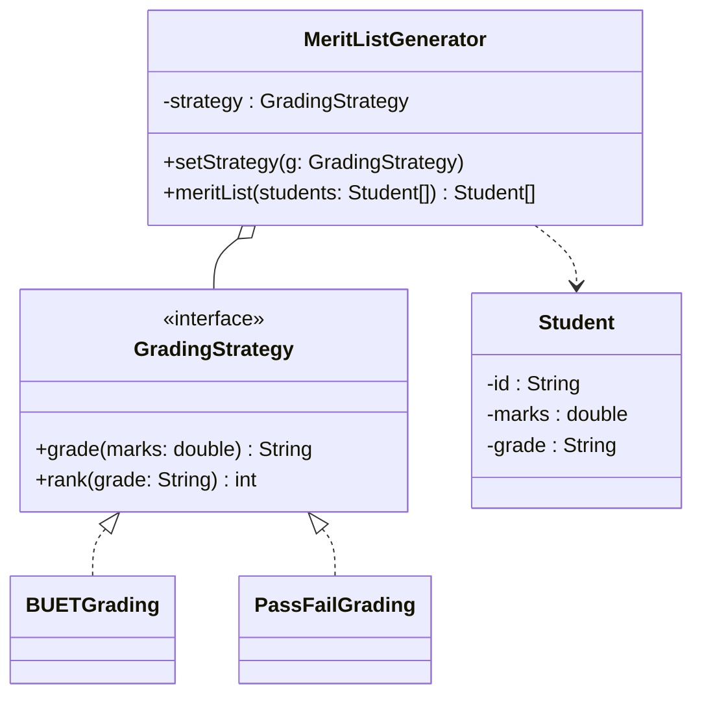

```java
class Student {
    private final String id; private final double marks; private String grade;
    Student(String id, double m) { this.id = id; marks = m; }
    String getId()          { return id; }
    double getMarks()       { return marks; }
    String getGrade()       { return grade; }
    void setGrade(String g) { grade = g; }
}

interface GradingStrategy {
    String grade(double marks);
    int rank(String grade);                 // bigger = better, used to find the top grade
}

class BUETGrading implements GradingStrategy {          // assumed scheme
    public String grade(double m) {
        if (m >= 80) return "A+"; if (m >= 75) return "A"; if (m >= 70) return "A-";
        if (m >= 65) return "B+"; if (m >= 60) return "B"; if (m >= 40) return "C"; return "F";
    }
    public int rank(String g) {
        return java.util.Arrays.asList("F","C","B","B+","A-","A","A+").indexOf(g);
    }
}

class MeritListGenerator {
    private GradingStrategy strategy;
    MeritListGenerator(GradingStrategy s) { strategy = s; }
    void setStrategy(GradingStrategy s) { strategy = s; }
    List<Student> meritList(List<Student> students) {
        int best = -1;
        for (Student s : students) {
            s.setGrade(strategy.grade(s.getMarks()));
            best = Math.max(best, strategy.rank(s.getGrade()));
        }
        List<Student> merit = new ArrayList<>();
        for (Student s : students) if (strategy.rank(s.getGrade()) == best) merit.add(s);
        merit.sort((a, b) -> Double.compare(b.getMarks(), a.getMarks()));   // order by marks
        return merit;
    }
}
```

Changing the grading scheme is only `generator.setStrategy(new PassFailGrading())`; the merit-list logic stays the same. (Template Method is an acceptable alternative answer if you treat "grade → find max → filter" as a fixed skeleton with an abstract `grade()` step; state the trade-off that Strategy allows changing the scheme at runtime.)

---

> [!example] ✍️ Worked TF question — 2020-21 Q3(b) [10] — dashboard of maximum and average temperature of last year

The temperature of the day is entered at the end of the day, and that **triggers updating the dashboard**. Several widgets (maximum, average, possibly more later) depend on the same data, so this is a one-to-many dependency → ==Observer==. `TemperatureRecord` is the subject; `MaxTemperatureWidget` and `AverageTemperatureWidget` are observers.

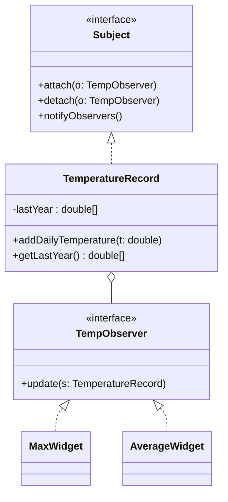

```java
interface TempObserver { void update(TemperatureRecord r); }

class TemperatureRecord {
    private Deque<Double> lastYear = new ArrayDeque<>();
    private List<TempObserver> observers = new ArrayList<>();
    void attach(TempObserver o) { observers.add(o); }
    void detach(TempObserver o) { observers.remove(o); }
    void addDailyTemperature(double t) {
        lastYear.addLast(t);
        if (lastYear.size() > 365) lastYear.removeFirst();   // keep one year only
        notifyObservers();                                   // the trigger
    }
    Collection<Double> getLastYear() { return Collections.unmodifiableCollection(lastYear); }  // read-only view
    private void notifyObservers() { for (TempObserver o : observers) o.update(this); }  // PULL model
}

class MaxWidget implements TempObserver {
    public void update(TemperatureRecord r) {
        double max = Double.NEGATIVE_INFINITY;
        for (double t : r.getLastYear()) max = Math.max(max, t);
        System.out.println("Max temperature (last year): " + max);
    }
}
class AverageWidget implements TempObserver {
    public void update(TemperatureRecord r) {
        double sum = 0; for (double t : r.getLastYear()) sum += t;
        System.out.println("Average temperature: " + sum / r.getLastYear().size());
    }
}
```

---

> [!example] ✍️ Worked TF question — 2019-20 Q1(b) [20] — central broker forwarding sorting requests to three servers, with a queue

Clients must not know which server sorts with which algorithm, and servers must not know the clients; everything goes through the **central broker**, which forwards each request to the appropriate server, returns the result, and queues requests that arrive together. This is ==Mediator==: the broker is the concrete mediator, and the requesting classes and the three servers are colleagues that communicate only through it.

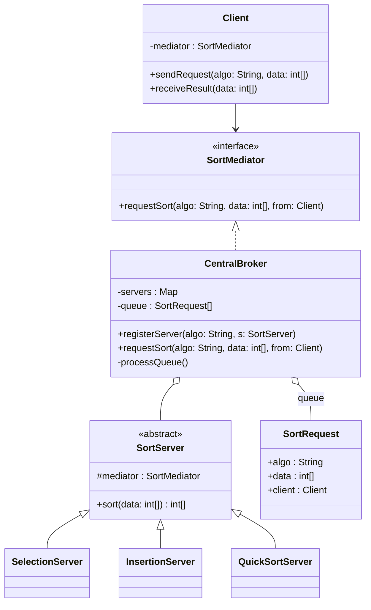

```java
interface SortMediator { void requestSort(String algo, int[] data, Client from); }

abstract class SortServer {
    abstract int[] sort(int[] data);          // each server implements one algorithm
}
class SelectionServer extends SortServer { int[] sort(int[] d) { /* selection sort */ return d; } }
class InsertionServer extends SortServer { int[] sort(int[] d) { /* insertion sort */ return d; } }
class QuickSortServer extends SortServer { int[] sort(int[] d) { /* quick sort */ return d; } }

class SortRequest {
    String algo; int[] data; Client client;
    SortRequest(String a, int[] d, Client c) { algo = a; data = d; client = c; }
}

class CentralBroker implements SortMediator {
    private Map<String, SortServer> servers = new HashMap<>();
    private Queue<SortRequest> queue = new LinkedList<>();
    private boolean busy = false;

    void registerServer(String algo, SortServer s) { servers.put(algo, s); }

    public synchronized void requestSort(String algo, int[] data, Client from) {
        queue.add(new SortRequest(algo, data, from));     // queue when many arrive together
        if (!busy) processQueue();
    }
    private void processQueue() {
        busy = true;
        while (!queue.isEmpty()) {
            SortRequest r = queue.poll();
            int[] sorted = servers.get(r.algo).sort(r.data);   // forward to the right server
            r.client.receiveResult(sorted);                    // return result to requester
        }
        busy = false;
    }
}

class Client {
    private SortMediator mediator;
    Client(SortMediator m) { mediator = m; }
    void sendRequest(String algo, int[] data) { mediator.requestSort(algo, data, this); }
    void receiveResult(int[] d) { System.out.println(java.util.Arrays.toString(d)); }
}

// CentralBroker broker = new CentralBroker();
// broker.registerServer("selection", new SelectionServer());
// broker.registerServer("insertion", new InsertionServer());
// broker.registerServer("quick", new QuickSortServer());
// new Client(broker).sendRequest("quick", new int[]{5, 2, 9, 1});
```

The colleagues (clients and servers) never reference each other; adding a fourth server or changing the forwarding policy only affects the broker.

---

> [!example] ✍️ Worked CT question (a) [7] — city graph with distance views in km and miles

==Observer.== The `Graph` of cities is the subject: whenever a new road is constructed, distances change and the graph calls `notifyObservers()`. `KmTableView` and `MilesTableView` implement `Observer`; in `update()` each view pulls the distances through `graph.getDistance(a, b)` and redraws its own table (miles = km × 0.621). Views can be added (for example a map view) or removed without changing `Graph`, which only knows the `Observer` interface.

> [!example] ✍️ Worked CT question (b) [6] — stock orders placed through an agent with an internal queue

==Command.== Each buy or sell order is a command object (`BuyStockOrder`, `SellStockOrder` implementing `Order.execute()`), which stores the stock and quantity and holds a reference to the receiver `StockTrade`, whose `buy()`/`sell()` methods do the real work. The client creates orders and gives them to the `Agent` (invoker), which keeps them in an internal queue (`Queue<Order>`) and later calls `execute()` on each one to place it. The agent does not need to know how buying or selling works — this is exactly the "queue a request's execution" use of Command (slide p.201).

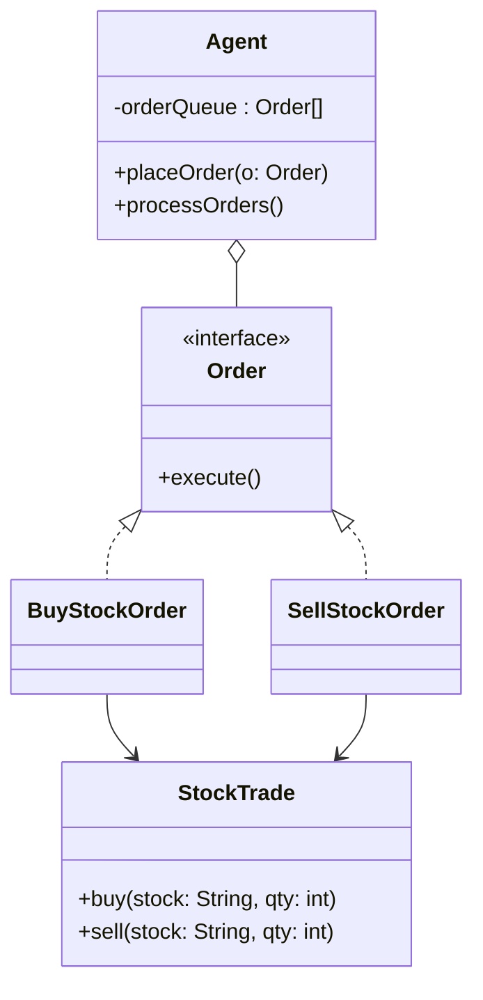

> [!example] ✍️ Worked CT question (c) [7] — social network groups notify members of new posts/comments

==Observer.== Each `Group` is a subject with `join(user)` (register), `leave(user)` (remove) and `notifyMembers(event)`. Each `User` implements `GroupObserver.update(group, post)`. When a post or comment is added, the group calls `notifyMembers`, so every current member is updated automatically. Joining and leaving at any time is exactly the dynamic subscription that Observer supports. (A Mediator is not needed because members are not talking to one another; it is a one-to-many broadcast.)

---

## Same type in the papers you will solve last

Try these yourself first, then check the solves:

2023-24 (May-2026 paper) Q5(b) — smart-home hub with motion sensor (Mediator) and record/queue/replay actions (Command); Q8(a) — DataParser: Strategy inside Template Method; Q8(b) — breaking-news displays (Observer); Q8(c) — State vs Strategy. See [[TF 2023-24 (May 2026 paper)]].

2023-24 (Feb-2025 paper) Q2(a) — StockMarket/StockGrabber/StockObserver (Observer, UML + code); Q2(b) — HelpHandler/Widget/Button/Dialog/Application (Chain of Responsibility UML). See [[TF 2023-24 (Feb 2025 paper)]].

2022-23 (CSE307) Q2(a) — air traffic controller (Mediator); Q4(a) — BUET alumni blog notifications (Observer). See [[TF 2022-23 (CSE307 May 2024)]].

🔗 Related notes: [[IJ-1 Structural Design Patterns]] · [[AI-2 Creational Design Patterns]] · [[00 Pattern Picker]] · [[AI-4 State Diagram]] · [[IJ-6 Refactoring and Code Smells]]
