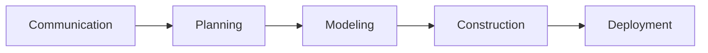
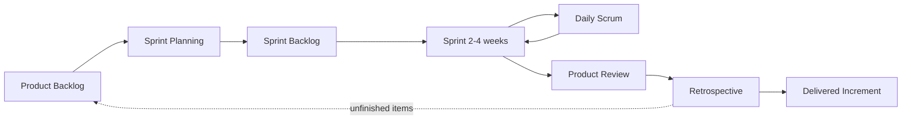

# IJ-3 Process Models and Agile Development

This note covers how a software project is organised into phases: the generic process model, the classic prescriptive models (Waterfall, Incremental, Prototyping, Spiral) and the agile family (XP, Scrum, Kanban). In the term final this topic is almost always asked as a **scenario question**: "here is a project, is model X suitable, or which model would you choose and why?" If you can read a scenario and pick the right model with two or three solid justifications, you will score well here.

**TF frequency:** May-2026 Q1(c) (incremental for a mental-health app), Feb-2025 Q8(a) (incremental better than agile), CSE307 2022-23 Q6(a)(b)(c) (waterfall, kanban, scrum), 2021-22 Q5(b), Q6(a), Q7(a), Q8(a)(b). Very high.

📑 **See:** *[2] IJ mam / 4 - Process Models and Agile Development .pdf* — whole deck (84 pages). Key pages are given in every section below.

---

## 1. What a process model is

Software is basically ==embodied knowledge that is initially scattered and incomplete==, so software development is an ==iterative social learning process==: the team slowly collects knowledge from clients and puts it into code (📑 p.3). A **process model** is a technique to ==divide the software development work into distinct phases==. It gives the project a visual road map so that both the project and the product can be organised and improved (📑 p.4).

### The generic process model and its five framework activities

The generic process model gives a definitive description of the process in a software project. It defines ==five core (framework) activities== (📑 p.6–8). You must memorise these five words in order, because almost every process-model answer refers to them.

> [!important] 🔑 Memorize — the 5 framework activities
> **Communication** — the project team communicates with the client and collects requirements.
> **Planning** — the team schedules the development and estimates the cost.
> **Modeling** — the team analyses the requirements and designs the algorithms, flowcharts and components.
> **Construction** — the team implements (codes) and tests the components.
> **Deployment** — the product is delivered to the client, feedback is taken and the product is improved/maintained.

### The four process flows

The same five activities can be arranged in four different ways, called process flows (📑 p.9–14). In a **linear flow** the five activities are executed one after another exactly once (Communication → Planning → Modeling → Construction → Deployment). In an **iterative flow** one or more activities are repeated before moving to the next activity. In an **evolutionary flow** the activities are executed in a circular fashion, and each cycle produces a more complete version of the software (an incremental release). In a **parallel flow** one or more activities are executed in parallel with other activities (for example, modeling of one part while constructing another part).

*Linear flow (📑 p.10). For the iterative, evolutionary and parallel pictures look at p.11, p.12–13 and p.14.*

**Prescriptive process models** are models that ==prescribe a fixed workflow among the framework activities== to guide a project from start to end (📑 p.15). The course covers Waterfall, Incremental, and the two Evolutionary models: Prototyping and Spiral (📑 p.16).

---

## 2. Waterfall Model

📑 **See:** p.17 (diagram), p.18–22.

The Waterfall model is the ==linear process flow==. It is normally used in ==small projects where the client's requirements are well-defined and known before the project starts==. The activities are executed in a strictly sequential and systematic manner. The process starts with communication, where requirements are collected and documented. In planning, the time and financial constraints are estimated, producing a schedule and a budget. In modeling, a design is made from the requirements while keeping the constraints in mind. In construction, the code is written and tested, and in deployment the product is delivered and maintained based on client feedback.

Its **advantages** are that it is simple to use and implement, its workflow is easily understandable, and it is easily manageable because all the requirements are known before starting. It also produces clear milestones and documentation at the end of each phase.

Its **disadvantages** are the reason every other model exists, so learn them well. First, ==it is tough for the client to give all the requirements beforehand==. Second, ==testing and client evaluation happen only in the last phases, so the risk is high== — a misunderstanding in the requirements is discovered only at the very end, when fixing it is most expensive. Third, ==iteration is not promoted==, so the team cannot go back and refine earlier work, which may be crucial for some projects.

> [!tip] 🎯 TF angle
> Pick Waterfall only when the scenario says: requirements are fixed and fully known, the project is small/simple or similar to a past project, and the client wants heavy documentation and a fixed plan (e.g. a payroll upgrade following a fixed law). If the scenario says "vague", "changing", "client wants to see something early" — Waterfall is the wrong answer.

---

## 3. Incremental Model

📑 **See:** p.23 (diagram), p.24–28.

In the Incremental model the product is developed and delivered as ==a series of versions called increments==. First a simple functioning system called the ==core product== is built and delivered; it handles only the basic requirements. Client feedback is collected after each delivery and used in the next increment. More functionality is added in every increment until the final version is released. It is normally used ==when the client wants a working product with primitive functionality quickly==. An important point (📑 p.29) is that ==in the incremental model the requirements are specified beforehand==, and they are only refined in each increment.

Its **advantages** are: it is flexible to changing requirements and modifications can be made throughout the process; errors are reduced because the client assesses the product after every increment; a functioning product is available at an early stage; the product is easy to test because of the many iterations; and the initial project cost is lower.

Its **disadvantages** are: ==breaking the problem into increments is difficult==; the total project cost is high; ==a complete planning of the project is required before committing==; and ==refining requirements in each iteration may damage the software architecture==.

---

## 4. Evolutionary Models (Prototyping and Spiral)

📑 **See:** p.29–30.

The evolutionary model suits a project where ==client requirements may change and a complete product cannot be delivered before the deadline, but a limited version can be==. The key difference from incremental is this: ==in incremental, the requirements are known up-front and only refined; in evolutionary, the requirements themselves are allowed to evolve over time==.

> [!warning] ⚠️ Common mistake
> Do not say "incremental and evolutionary are the same because both deliver versions". Both deliver versions, but incremental assumes requirements are already specified (it splits a known product into pieces), while evolutionary assumes requirements are unclear and grow with each cycle.

### 4.1 Prototyping Model

📑 **See:** p.31 (diagram), p.32–35.

When the client's requirements are ==vague and likely to change==, or when there is confusion about how some module should work, the team builds a **prototype** using the currently known requirements. The client evaluates the prototype and gives feedback plus more requirements, which go into the next prototype. This repeats until the prototype evolves into a complete product acceptable to the client.

Advantages: it promotes active client involvement; client feedback helps understand the product and detect errors early; and ==detailed requirements are not needed to start==. Disadvantages: prototyping can slow the process down; frequent changes may increase the complexity of the system; and client dissatisfaction may cause several prototypes to be thrown away.

### 4.2 Spiral Model

📑 **See:** p.36 (spiral diagram — look at it), p.37–40.

The Spiral model, like incremental, develops the product through a series of versions. But unlike incremental and prototyping, it ==deals with the uncertainties of the project by doing risk analysis in every loop of the spiral==. The first loop may produce only a basic prototype; later loops produce more mature versions, until an acceptable product is delivered.

Advantages: it ==rigorously tackles the risks== of a project, and any type of change can be incorporated even at a late stage. Disadvantages: the process is ==costly and complicated==, and it ==requires risk-assessment expertise==.

---

## 5. Choosing a model for a scenario (the most-asked skill)

When a question gives you a project and asks "is model X suitable?" or "which model?", read the scenario for four signals and reason in a paragraph.

The first signal is **how clear the requirements are**. If they are clear, complete and stable, Waterfall or Incremental fits. If they are vague or the client "has only a high-level idea", Prototyping, Spiral or Agile fits. The second signal is **risk**. If the domain is safety-critical, new technology is involved, or a mistake can harm people (health, finance, AI advice), the Spiral model fits because it has explicit risk analysis in every loop. The third signal is **how early the client wants something working**. If they want a core product quickly and then more features, Incremental fits. The fourth signal is **client availability and project size**. If the client can be involved continuously and the team is small and co-located, Agile (Scrum/XP) fits; if the client is available only at formal reviews, a fixed contract and heavy documentation are required, a plan-driven model (Waterfall/Incremental) fits better.

> [!tip] 🎯 TF angle — structure for "is model X suitable?" answers
> Write one paragraph listing the facts of the scenario (vague requirements? high risk? feedback wanted?). Write one paragraph on where model X fits (quote its advantages). Write one paragraph on where it does NOT fit (quote its disadvantages from the slides — e.g. incremental "requires complete planning before committing" and "refining requirements each iteration may affect the architecture"). Then propose the better model with justification, and end with a one-line conclusion. This shape fits May-2026 Q1(c) exactly.

---

## 6. Why Agile?

📑 **See:** p.41–51.

The prescriptive models bring order, but they are ==slow, extremely slow==, while the modern business environment is fast-paced and ever-changing (📑 p.44). **Agile** means ==moving quickly==. In agile, the focus is on ==rapid and incremental delivery== of the product, with ==delivery valued over analysis and design== and with ==active, continuous communication between the team and the client== (📑 p.46). Agile process models encourage more client involvement but ==discourage detailed analysis, planning and documentation==, and they are more flexible to changes in both the team and the product (📑 p.49).

The agile process is driven by client requirements that ==change quite frequently==, so the team must accept that ==plans are short-lived==: some features persist, some change, some are no longer needed (📑 p.50). To adapt, the team puts more focus on **construction** than on planning and modeling, and builds the product iteratively in many increments based on client feedback (📑 p.51).

Agile also depends on people. The process reshapes itself to the needs of the people and teams, not the other way around, and team members must be ==competent, skilful, knowledgeable, committed, collaborative, decisive, faithful, respectful and self-organised== (📑 p.56).

### The 12 Agile Principles (Agile Manifesto, Kent Beck et al., 2001)

📑 **See:** p.52–55. You do not need word-for-word text, but you should be able to quote four or five of them in an answer.

> [!important] 🔑 Memorize — the 12 agile principles (short form)
> 1. Highest priority is to satisfy the customer through ==early and continuous delivery== of valuable software.
> 2. ==Welcome changing requirements==, even late in development.
> 3. Deliver working software ==frequently== (a couple of weeks to a couple of months, shorter is better).
> 4. Client and developers ==work together regularly== throughout the project.
> 5. Build projects around ==motivated individuals==; give them support and trust them.
> 6. ==Face-to-face conversation== is the most efficient way to convey information.
> 7. ==Working software is the primary measure of progress.==
> 8. Promote ==sustainable development== at a constant pace.
> 9. Continuous attention to ==technical excellence and good design== enhances agility.
> 10. ==Simplicity== — the art of maximising the amount of work not done — is essential.
> 11. The best architectures and designs emerge from ==self-organising teams==.
> 12. At regular intervals the team ==reflects and adjusts== its behaviour.

---

## 7. Extreme Programming (XP)

📑 **See:** p.58–62 (p.60 shows the XP cycle diagram).

XP was developed by **Kent Beck**. Its name comes from the idea that ==whatever practices are beneficial should be taken to extreme levels, from day one==. It is lightweight because it explores ==the simplest thing that will work== without putting much weight on the long-term view. XP values communication with the client, simplicity, feedback, and mutual respect, and it ==prioritises customer satisfaction over everything else==. Problems are solved by the whole team, so teamwork is extremely important.

XP promotes **pair programming**: ==two developers work together on one computer to design, code and test the client requirements (called user stories)==. In a pair, one person is the **driver** and the other is the **navigator**.

> [!important] 🔑 Memorize — Driver vs Navigator
> The ==driver== holds the keyboard and writes the code, focusing on the immediate tactical task: syntax, the current line, the current method. The ==navigator== watches every line as it is typed and ==reviews it in real time==, thinking strategically: is the design right, are edge cases missed, is there a bug, what should be done next, are tests needed. They ==switch roles frequently==. Because the navigator reviews code at the moment it is written, pair programming is a form of ==continuous code review==.

Advantages of XP: it encourages simple code that can be modified at any time; it promotes testing from day one (test-first); and it maintains an energising environment. Disadvantages: the extreme focus on coding can lead to ==neglecting design==, which degrades quality, and the ==lack of documentation and monitoring== may cause the same error to be repeated in future.

---

## 8. Scrum

📑 **See:** p.64–72 (p.68 has the sprint cycle diagram — look at it).

In rugby, a scrum is a position where players pack closely to gain control of the ball. In project management, **Scrum** is a ==lightweight, iterative and incremental agile process model==. It prioritises simplicity and develops the product gradually with frequent delivery, and it is one of the most widely used models today.

> [!important] 🔑 Memorize — Scrum keywords
> ==Sprint==: the unit cycle (iteration) of development, usually **2 weeks to 1 month**, during which the team works on certain aspects of the project.
> ==Backlog==: the client requirements. There are **two types**: the ==Product Backlog== (all the client requirements of the whole project) and the ==Sprint Backlog== (the requirements chosen to be done in one particular sprint).
> ==Daily Scrum==: a short daily meeting for synchronisation, where plans and progress are discussed.
> ==Scrum Master==: usually the project manager. ==Product Owner==: basically the client.
> ==Tickets==: sub-tasks, tracked on a ==Scrum board==.

### Activities of a sprint

A sprint starts by ==analysing the product backlog and deciding which requirements to implement in this sprint==; those requirements are moved into the sprint backlog. Then the team works on the sprint backlog in ==four phases: planning, implementation, product review, and process review (retrospective)==. During implementation the daily scrum keeps everyone synchronised. Finally, the completed portion is ==delivered to the client for feedback==, and ==unfinished sprint-backlog items go back to the product backlog for the next sprint== (📑 p.69).

Advantages of Scrum: less authority and hierarchy, giving developers freedom; adaptability to rapidly changing requirements; products become deliverable in less time; more client involvement; and the retrospective review ensures fewer mistakes in the next sprint. The main disadvantage is that ==Scrum usually works well only with a small team==.

---

## 9. Kanban (看板)

📑 **See:** p.73–82 (p.76 board picture, p.79 board, p.81 cartoon about workload per card).

In Japanese, *Kanban* means ==signboard==, something visible to everyone around it. As an agile model, Kanban puts ==heavy focus on visualisation== of every aspect of the project so that ==everyone is kept up-to-date all the time==.

Tasks are divided into modular sub-tasks, and each sub-task is assigned to a ==Kanban card== containing the sub-task's details and the related user story. A ==Kanban board== with columns such as *To-Do → In Progress → Done* tracks the cards. Like Scrum, Kanban follows a ==pull system==: whenever a member is free, he/she pulls a card and moves it from left to right by working on it. There is an ==Agile coach==, daily stand-up meetings and retrospectives. But unlike Scrum, ==Kanban is a continuous process — there are no sprints or iterations==.

**Lead time** is the time a card takes from entering the board until it reaches *Done*. Teams usually also apply a **WIP (work-in-progress) limit**, i.e. a maximum number of cards allowed in the "In Progress" column, so that people finish work before pulling new work.

> [!example] ✍️ Explaining the slide statement (CSE307 2022-23 Q6(b) uses this exact sentence)
> The statement "Developers can adjust workload per kanban card by analyzing the kanban board to maintain a decent lead time" (📑 p.80–81) means this: because the board shows every card and its column, anyone can see where work is piling up. If many cards are stuck in "In Progress" and lead time is growing, a card is too big, so the team should ==split it into smaller cards (reduce workload per card)== to make flow faster. If cards move very quickly and the "To-Do" side is nearly empty, the team can ==put more work into each card== to finish the process. The visual board is therefore a feedback tool that lets the team tune card size and keep lead time steady.

Advantages of Kanban: it encourages leadership from every participant and quick decisions; it adapts to different team natures; and workload per card can be tuned to maintain lead time. Disadvantage: ==there is no fixed timeframe, which may delay the project==.

### Scrum vs Kanban (in a paragraph)

Both are agile, both use a board, both follow a pull system, and both hold daily stand-ups and retrospectives. The difference is time-boxing: ==Scrum works in fixed sprints with a sprint backlog and fixed roles (Scrum Master, Product Owner)==, and delivers at the end of each sprint, whereas ==Kanban is continuous with no sprints==, uses an Agile coach, and focuses on visualising flow and limiting work in progress. Scrum's risk is that it suits only small teams; Kanban's risk is that without a timeframe the project may get delayed.

📑 Jira (p.84) is the widely used tool for tracking these boards.

---

## 10. Incremental vs Agile — when is incremental better?

Agile itself is iterative and incremental, so the question "when is incremental better than agile?" is really about **plan-driven vs adaptive**. Agile assumes requirements change frequently, the client is available continuously, documentation and up-front planning are minimal, and the team is small and self-organising. Incremental assumes the ==requirements are known and stable up-front==, ==a complete plan is made before committing==, and delivery is still split into a core product plus increments.

So Incremental is the better choice when ==requirements are fixed by law, contract or regulation==, when ==the client (e.g. a government body) is available only at formal review meetings==, when a ==fixed-price contract, budget approval and full documentation/audit== are mandatory, when the team is large or distributed, and yet the client ==still wants a core part working early==. A typical example is a government tax-filing or land-records system where the law defines the rules: registration goes live first, payment second, reports third.

---

## 11. Manager vs Leader (not in slides, asked Feb-2025 Q8(b))

A **manager** focuses on ==planning, organising, controlling and getting the assigned work done on time and within budget==. Authority comes from the position; the manager sets tasks, tracks progress, and enforces processes and standards. A **leader** focuses on ==vision, motivation and influence==; authority comes from trust and respect. The leader inspires people, encourages innovation, coaches the team and helps them adapt to change.

A management approach is more beneficial when the work is ==well-defined, routine, deadline-critical or compliance-heavy== and needs control more than creativity. For example, a bank's year-end tax-compliance release must ship on a legally fixed date with strict audit trails; here a manager who assigns tasks precisely, tracks progress daily and enforces the review checklist is more useful than a visionary approach. Leadership is more beneficial in uncertain, innovative work (a new AI feature) where motivation and creativity matter. Agile models like Kanban explicitly encourage leadership from every member (📑 p.80).

---

## TF questions on this topic

> [!example] ✍️ Worked TF question — 2021-22 Q6(a) [10] — How incremental and evolutionary models address waterfall's shortcomings
> The Waterfall model has three major shortcomings. First, the client must give all requirements before the project starts. Second, testing and client evaluation happen only at the end, so errors and misunderstandings are discovered late and the risk is high. Third, it does not allow iteration, so earlier phases cannot be revisited.
>
> The **Incremental model** addresses these by delivering a working ==core product early== and then adding increments. Since the client evaluates every increment, ==errors are found early== instead of at the end, and feedback from one increment is used in the next, so ==requirements can be refined==. Testing happens in every increment, so the product is tested repeatedly. The initial cost is lower because only the core is built first.
>
> The **Evolutionary models** go further by ==allowing requirements to evolve==. In **Prototyping**, the project can start without detailed requirements: a prototype built from known requirements is shown to the client, whose feedback and new requirements shape the next prototype, solving the "all requirements up-front" problem and involving the client actively. In the **Spiral** model each loop includes ==risk analysis==, which directly attacks waterfall's high risk, and changes can be incorporated even at a late stage. Hence both families replace waterfall's single linear pass with repeated cycles of feedback, early testing and change.

> [!example] ✍️ Worked TF question — 2021-22 Q7(a) [10] — Reasons for the shift from traditional to agile models
> Traditional (prescriptive) models such as Waterfall were introduced to bring order and structure, but they are slow, while today's business environment is fast-paced and requirements change constantly. Several reasons drove the shift. First, ==requirements change frequently==, and traditional models assume they are fixed; agile welcomes change even late in development. Second, clients want ==early and frequent delivery== of working software to gain competitive advantage; agile delivers in short cycles of a few weeks. Third, traditional models discover problems late because testing and client evaluation come at the end; agile gets ==continuous client feedback== and tests from day one, reducing risk. Fourth, heavy up-front planning and documentation waste effort when plans are short-lived; agile focuses on ==working software as the primary measure of progress== and on simplicity. Fifth, agile gives ==self-organising, motivated teams== more freedom and uses face-to-face communication, which improves productivity. Finally, retrospectives let the team continuously improve its own process. For these reasons most modern projects adopt agile models like Scrum, XP and Kanban.

> [!example] ✍️ Worked TF question — 2021-22 Q5(b) [20] — Steps involved in a sprint of Scrum
> In Scrum, a **sprint** is a time-boxed iteration of 2 weeks to 1 month. The client requirements are kept in a ==product backlog==, owned by the Product Owner (client), and the Scrum Master (usually the project manager) facilitates the process.
>
> **Step 1 – Backlog analysis and selection (sprint planning):** at the start of the sprint the team analyses the product backlog together with the product owner, chooses the highest-priority requirements that can be finished in this sprint, and moves them into the ==sprint backlog==. These are broken down into tickets placed on the Scrum board.
>
> **Step 2 – Planning:** the team plans how to implement the selected items, estimates them, and distributes the tickets.
>
> **Step 3 – Implementation:** developers design, code and test the tickets. Every day a ==daily scrum== (stand-up) meeting is held where each member says what was done yesterday, what will be done today and what is blocking them, so that the team stays synchronised. Ticket status is tracked on the Scrum board.
>
> **Step 4 – Product review (sprint review):** the completed increment is demonstrated to the product owner/client, who gives feedback.
>
> **Step 5 – Process review (retrospective):** the team reflects on what went well and what went wrong in the process itself and decides improvements, ensuring fewer mistakes in the next sprint.
>
> **Step 6 – Delivery and carry-over:** the completed portion is delivered to the client, and ==unfinished sprint-backlog items return to the product backlog== to be considered in the next sprint. Then the next sprint begins.
>
> (Draw the sprint cycle: Product Backlog → Sprint Planning → Sprint Backlog → Sprint (with daily scrum loop) → Review → Retrospective → Increment. 📑 p.68.)

> [!example] ✍️ Worked TF question — 2021-22 Q8(a) [10] — Role of driver and navigator in the context of code review in pair programming
> In pair programming, an XP practice, two developers share one computer. The ==driver== controls the keyboard and writes the code, concentrating on the immediate details: correct syntax, the current statement, making the current test pass. The ==navigator== does not type; he/she ==reviews each line as it is written==, looking for typing mistakes, logic errors, missing edge cases, violations of the design or coding style, and also thinks ahead about the overall design and what to do next. In the context of code review, the navigator is therefore a ==real-time reviewer==: defects are caught immediately instead of in a later formal review, knowledge is shared between the two, and coding style stays consistent. The two ==swap roles frequently== so that both stay engaged and both understand the whole code. This continuous review is one reason XP can reduce separate review effort.

> [!example] ✍️ Worked TF question — 2021-22 Q8(b) [15] — "Kanban focuses on the visualization aspect of a project with kanban cards and kanban board"
> Kanban means "signboard" in Japanese, something visible to everyone, and the model is built around making work visible. Every task is broken into modular sub-tasks, and each sub-task is written on a ==Kanban card== containing its details and the related user story. All cards are placed on a ==Kanban board== whose columns represent workflow stages such as To-Do, In Progress and Done. Team members follow a ==pull system==: whoever is free pulls a card and moves it from left to right as the work progresses.
>
> Because of this board, ==everyone involved is kept up-to-date all the time== without long status reports: anyone can see which tasks are waiting, which are in progress, who is doing them and which are complete. Bottlenecks become obvious, because cards pile up in one column. This lets the team ==adjust workload per card== — splitting large cards when lead time grows, or putting more work into a card when flow is fast — to keep a decent lead time. A ==WIP limit== on columns can be applied to stop people starting too much at once. Daily stand-ups and retrospectives are held in front of the board. Unlike Scrum, there are no sprints; work flows continuously, so the board is the main control mechanism. Its weakness is that without a timeframe the project may get delayed. Tools like Jira provide digital boards.

---

## Same type in the papers you will solve last

May-2026 paper Q1(c) — suitability of the incremental model for a mental-health app, and alternatives. Feb-2025 paper Q8(a) — scenario where incremental beats agile; Q8(b) — manager vs leader. CSE307 2022-23 Q6(a) — core activities and waterfall; Q6(b) — kanban workload statement; Q6(c) — sprint activities and the two backlogs. See [[TF 2023-24 (May 2026 paper)]], [[TF 2023-24 (Feb 2025 paper)]], [[TF 2022-23 (CSE307 May 2024)]].
