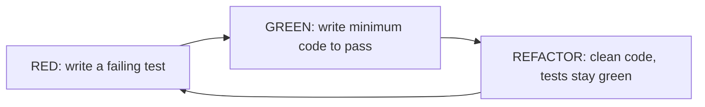

# IJ-4 Unit Testing and JUnit

This note teaches you what unit testing is, what makes a unit test "good", and how to write a complete JUnit test class by hand — with assertions, fixtures, exception tests and meaningful names. It also covers Test-Driven Development (TDD). In the term final you are often asked to **write a full JUnit test class** for a given method (May-2026 Q6(a): `isLeapYear`), to explain **fixtures**, or to describe **TDD**. Writing a clean test class is pure marks if you have practised the template below.

**TF frequency:** May-2026 Q6(a) (JUnit class for isLeapYear), Feb-2025 Q3(a) (TDD + benefits), 2019-20 Q7(a) (fixtures + unit test with BVA), 2020-21 Q6(b) (characteristics of good unit testing).

📑 **See:** *[2] IJ mam / 5 - Unit Testing.pdf* (24 pages). Also combine with [[AI-10 Equivalence Partitioning and BVA]] to choose WHICH inputs to test.

---

## 1. What is a unit test?

> [!important] 🔑 Memorize — Unit test (📑 p.1–2)
> ==Unit tests are white-box tests written by developers, and designed to verify small units of program functionality.== They are written ==by the developer, concurrently with implementation== (not at the end by a separate team).

A "unit" is the smallest testable piece — usually one method or one class. Because the developer knows the code, unit tests are white-box, but the test itself simply calls the method with an input and checks the output.

## 2. What makes a good unit test

📑 **See:** p.3. These five properties are frequently asked ("What are the characteristics of good unit testing?").

> [!important] 🔑 Memorize — Properties of a good unit test
> **Automatic** — runs completely by itself without any human input.
> **Atomic** — decides by itself whether the function passed or failed, without a human interpreting the result.
> **Single responsibility** — tests exactly one feature.
> **Independent** — runs in isolation, separate from any other test case, even ones that test the same function.
> **Repeatable** — running it many times always gives the same result.

To remember them, think "**A A S I R**" (Automatic, Atomic, Single-responsibility, Independent, Repeatable). In an answer, explain each in a sentence and say why it matters: for example, independence matters because if test 2 depends on the state left by test 1, a failure in test 1 will make test 2 fail too and you will not know where the real bug is.

## 3. JUnit

JUnit is the ==unit-testing framework for Java==. It is open source and provides a framework for both writing tests and running them automatically; it integrates with Eclipse/IntelliJ (📑 p.4–11 show the Eclipse steps and a `Math` class with `add`/`sub` tests).

### Assertion methods (📑 p.12)

Every check in a test is an assertion. If the assertion is false, the test fails immediately. The ones you must know are `assertTrue(test)` which fails if the condition is false, `assertFalse(test)` which fails if it is true, ==`assertEquals(expected, actual)`== which fails if the values are not equal, `assertSame(expected, actual)` and `assertNotSame(...)` which compare references using `==`, `assertNull(value)` and `assertNotNull(value)`, and `fail()` which makes the test fail immediately (used, for example, when an expected exception was not thrown). Every assertion can take a message as the first parameter: `assertEquals("message", expected, actual)`. For `double` values use a tolerance: `assertEquals(7.5, result, 0.001)`.

> [!warning] ⚠️ Common mistake (📑 p.19–20)
> ==The expected value goes on the LEFT==: `assertEquals(2050, d.getYear())`, not `assertEquals(d.getYear(), 2050)`. If you swap them, the failure message says "expected 19 but was 2050", which is backwards and confusing. Also give each assertion a message explaining what is checked, e.g. `assertEquals("day after +14 days", 1, d.getDay())`.

Other good habits from the slides: use an ==expected answer object== and compare whole objects (`assertEquals(expected, d)` where `expected = new Date(2050, 2, 19)`) so one assertion replaces three (📑 p.21); and ==give test methods long, descriptive names== such as `test_addDays_wrapToNextMonth()` and name variables `expected` and `actual` (📑 p.22–24).

### The JUnit framework features (📑 p.13–17)

JUnit provides four important features: **fixtures**, **test suites**, **test runners**, and the **JUnit classes** themselves.

> [!important] 🔑 Memorize — Fixture (📑 p.14)
> ==A fixture is a fixed state of a set of objects used as a baseline for running tests.== Its purpose is to make sure there is a ==well-known and fixed environment in which tests are run so that the results are repeatable==.

Fixtures are created with annotations. In **JUnit 4**, a method marked `@Before` runs ==before each test== (so each test gets its own fresh objects), `@After` runs ==after each test== (teardown, e.g. closing files or DB connections), `@BeforeClass` runs ==once before all tests== in the class (must be `static`, used for expensive setup like opening a DB connection), and `@AfterClass` runs once after all tests. `@Test` marks a method as a test case; without it JUnit treats the method as a helper. In **JUnit 5** the same ideas are named `@BeforeEach`, `@AfterEach`, `@BeforeAll`, `@AfterAll`, and `@Test` stays the same.

Three typical **examples of fixtures** (asked in 2019-20 Q7(a)): creating a fresh object under test (e.g. `calculator = new GradeCalculator()`) before each test; loading a fixed set of test data, such as a known list of students or a sample input file, so every test starts from the same data; and opening a database connection or creating a temporary file before the tests and closing/deleting it afterwards.

A **test suite** bundles several test classes and runs them together; in JUnit 4 this uses `@RunWith(Suite.class)` and `@Suite.SuiteClasses({A.class, B.class})`. A **test runner** is the component that executes the test cases and reports the results.

```java
import org.junit.runner.RunWith;
import org.junit.runners.Suite;

@RunWith(Suite.class)
@Suite.SuiteClasses({ DateTest.class, GradeCalculatorTest.class })
public class AllTests { }   // running this runs both test classes
```

### Testing exceptions

When the specification says a method must throw an exception (for example, "throws IllegalArgumentException if year ≤ 0"), you must test that too. There are three ways, and any one is acceptable in the exam.

```java
// JUnit 4 style 1
@Test(expected = IllegalArgumentException.class)
public void isLeapYear_zeroYear_throwsException() {
    LeapYear.isLeapYear(0);
}

// JUnit 5 style (preferred, clearer)
@Test
void isLeapYear_negativeYear_throwsException() {
    assertThrows(IllegalArgumentException.class, () -> LeapYear.isLeapYear(-4));
}

// Classic try/fail style (shown in AI sir Lec 13 p.4)
@Test
public void negativeBalance_throws() {
    try {
        calc.calculateSavingsInterest(-1.0);
        fail("Exception expected");      // reached only if no exception
    } catch (IllegalArgumentException ex) { /* test passes */ }
}
```

## 4. Template: a complete JUnit test class (memorise this shape)

When the exam says "write a complete JUnit test class", the marker looks for: the imports, a test class, a fixture, one test method per ==input class (partition)== plus boundary values, meaningful names, correct assertion direction with messages, and an exception test for invalid input. Use this skeleton every time.

```java
import org.junit.Before;
import org.junit.After;
import org.junit.Test;
import static org.junit.Assert.*;

public class CalculatorTest {

    private Calculator calc;            // object under test

    @Before                            // fixture: fresh object before EACH test
    public void setUp() {
        calc = new Calculator();
    }

    @After                             // teardown after each test
    public void tearDown() {
        calc = null;
    }

    @Test
    public void add_twoPositiveNumbers_returnsSum() {
        assertEquals("2 + 3 should be 5", 5, calc.add(2, 3));
    }

    @Test
    public void divide_byZero_throwsArithmeticException() {
        try {
            calc.divide(4, 0);
            fail("ArithmeticException expected");
        } catch (ArithmeticException e) { }
    }
}
```

> [!tip] 🎯 TF angle
> First derive the test inputs using equivalence classes and boundary values ([[AI-10 Equivalence Partitioning and BVA]]), then write **one test method per class**. Say in one line which class each test represents. That shows the examiner your tests are "logically distinct", which is exactly what May-2026 Q6(a) demands.

## 5. Test-Driven Development (TDD)

TDD is not in IJ ma'am's slides as a separate topic, but the refactoring slides say "you write tests before you write the code; after you refactor, you run the tests" (📑 *7 - Refactoring.pdf* p.10), and XP "promotes testing codes from day one" (📑 *4 - Process Models* p.61). Feb-2025 Q3(a) asks it directly.

> [!important] 🔑 Memorize — TDD
> ==Test-Driven Development is a practice in which the developer writes an automated unit test for a small piece of functionality BEFORE writing the code, then writes just enough code to pass that test, and then refactors.== It repeats in a short cycle called ==Red → Green → Refactor==.

In the **Red** step you write a test for the next small requirement and run it; it fails because the code does not exist yet. In the **Green** step you write the simplest code that makes the test pass, and run all tests. In the **Refactor** step you clean up the code (remove duplication, improve names, structure) while keeping all tests green. Then you pick the next small requirement and repeat.



The **benefits of TDD** are many, and you should write about six in an answer. Because tests are written first, the developer must ==understand the requirement clearly before coding==, which reduces misunderstood requirements. Every piece of code is covered by a test, so the project builds up ==a large automated regression suite== and gets ==high code coverage==. Bugs are ==caught immediately==, at the moment they are introduced, when they are cheapest to fix. The safety net of tests makes developers ==confident to refactor== and change code without fear of silently breaking it. Writing testable code first naturally leads to ==small, loosely coupled, modular designs== (you cannot easily test a giant tightly coupled class). The tests also act as ==living documentation== showing how each method is supposed to be used. Finally, it reduces debugging time, because when a test fails you know the bug is in the few lines you just changed.

---

## TF questions on this topic

> [!example] ✍️ Worked TF question — 2019-20 Q7(a) [20] — Fixtures (3 examples) + unit test for a grading policy using BVA
> **Fixtures:** A fixture is a fixed state of a set of objects used as a baseline for running tests, so that the environment is well known and results are repeatable. In JUnit, `@Before` methods build the fixture before each test and `@After` methods tear it down after each test (`@BeforeClass`/`@AfterClass` run once for the whole class). Three examples: (1) creating a fresh `GradeCalculator` object before each test so tests do not affect each other; (2) loading a fixed sample list of students and marks from a test file before the tests; (3) opening a test database connection in `@BeforeClass` and closing it in `@AfterClass`.
>
> **Partitions:** Grade A for mark > 80; B for 70 < mark ≤ 80; C for 60 < mark ≤ 70. The specification says nothing about marks ≤ 60, so assume they get "F" (state your assumption). The boundaries are at 60/61, 70/71 and 80/81 (taking integer marks). ==BVA test values: 60, 61, 70, 71, 80, 81== (plus 100 and 0 as the extreme valid values if marks are 0–100).

```java
import org.junit.Before;
import org.junit.Test;
import static org.junit.Assert.*;

public class GradeCalculatorTest {
    private GradeCalculator gc;

    @Before
    public void setUp() { gc = new GradeCalculator(); }   // fixture

    @Test public void mark60_justBelowC_returnsF()   { assertEquals("mark 60", "F", gc.getGrade(60)); }
    @Test public void mark61_lowerBoundaryC_returnsC(){ assertEquals("mark 61", "C", gc.getGrade(61)); }
    @Test public void mark70_upperBoundaryC_returnsC(){ assertEquals("mark 70", "C", gc.getGrade(70)); }
    @Test public void mark71_lowerBoundaryB_returnsB(){ assertEquals("mark 71", "B", gc.getGrade(71)); }
    @Test public void mark80_upperBoundaryB_returnsB(){ assertEquals("mark 80", "B", gc.getGrade(80)); }
    @Test public void mark81_lowerBoundaryA_returnsA(){ assertEquals("mark 81", "A", gc.getGrade(81)); }
}
```

> Each test checks exactly one boundary, uses expected-first assertions with a message, and the `@Before` fixture keeps every test independent.

> [!example] ✍️ Worked TF question — 2020-21 Q6(b) (part) — Characteristics of good unit testing
> A good unit test is **automatic** (runs without human input), **atomic** (decides pass/fail itself without human interpretation), has **single responsibility** (tests exactly one feature, so a failure points to one cause), is **independent** (runs in isolation from other tests, so the order of execution does not matter), and is **repeatable** (gives the same result every time it runs). In addition, it should be fast, have a descriptive name, and use clear assertion messages with the expected value first.

---

## Same type in the papers you will solve last

May-2026 paper Q6(a) — complete JUnit test class for `isLeapYear(int year)` covering all input classes including invalid year. Feb-2025 paper Q3(a) — TDD and its benefits. See [[TF 2023-24 (May 2026 paper)]] and [[TF 2023-24 (Feb 2025 paper)]].
