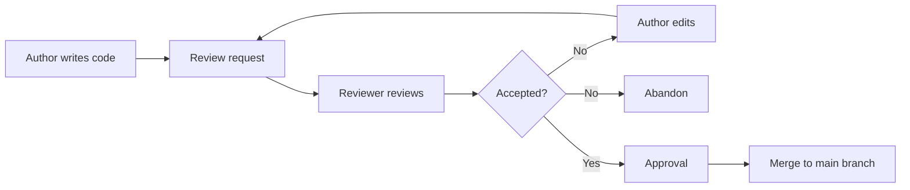

# IJ-5 Code Reviews

This note explains what code review (peer review) is, how the modern review workflow works, where it came from (Fagan inspection), what kinds of problems reviewers find, and the best practices for doing it well. In the term final the most common question is simply ==“What are the issues commonly identified during code review? Give examples.”== — it appeared in CSE307 2022-23 and 2020-21 with almost identical wording, so the list on slide p.12 must be at your fingertips with one example for each.

**TF frequency:** CSE307 2022-23 Q2(b) [12], 2020-21 Q6(c) [8], 2019-20 Q3(b) (reviewers vs testers) and Q8(b) (is code review black-box?).

📑 **See:** *[2] IJ mam / 6 - CodeReviews.pdf* (21 pages).

---

## 1. Definition

> [!important] 🔑 Memorize — Code review (📑 p.5)
> ==Code review is the process of analyzing code written by a teammate (i.e. a peer) to judge whether it is of sufficient quality to be integrated into the main project codebase.== It is like proofreading an essay before publishing it.

Code review is a ==static== quality-control technique: the code is read and analysed, not executed. That is why it is a **fault-avoidance** technique (it prevents errors before release — 📑 *Lec 11 - Software testing.pdf* p.1). It is ==neither black-box nor white-box testing in the strict sense, because nothing is run==; but since the reviewer reads the internal code, it is much closer to white-box examination, and it is certainly **not** black-box (black-box means you cannot see the internals at all).

## 2. The four opening examples (📑 p.1–4)

The deck opens with four snippets that show why review matters. The first shows a **style inconsistency** — for example, mixed naming conventions or indentation in the same file — which makes code hard to read and maintain. The second is a **silly mistake**, such as a wrong comparison or an off-by-one error, that the author did not notice but a second pair of eyes catches in seconds. The third is a **buffer overflow**: code that copies input into a fixed-size array without checking its length (for example `strcpy` into `char buf[8]`), which a reviewer flags as an *unsafe method / inadequate input validation*. The fourth is an **XSS vulnerability**: user input is printed into a web page without escaping, which a reviewer flags as a *critical security defect*. You only need to recognise these at the review level: "the reviewer should reject this and ask the author to validate the input / use a safe function / escape output."

## 3. The code review workflow (📑 p.6, p.11)

The author writes code and sends a ==review request==. The reviewer reviews it. If the reviewer does not accept it, the author edits the code and resubmits (or abandons the change). If the reviewer accepts and approves it, the change is ==merged== into the main codebase.



In practice with tools (📑 p.11): the developer works on a local branch, pushes the change to a review repository (Gerrit/GitHub pull request), reviewers are notified, they pull it to inspect, approve it, and then it is pushed to the main project branch and the developer is notified. Popular tools are Gerrit, Review Board, Phabricator and Crucible (📑 p.9).

## 4. History: Fagan inspection (📑 p.7–8)

Formal code review began as **code inspection**, also called ==Fagan inspection==, which greatly improved software quality. It is a heavy, meeting-based process with six steps: ==Planning → Overview → Preparation → Meeting → Rework → Follow-up==. In planning, the moderator selects material and participants; in overview, the author explains the code; in preparation, each inspector studies the code alone; in the meeting, defects are logged together; in rework, the author fixes them; and in follow-up, the moderator verifies the fixes. Its problems were that it is ==process heavy, meetings are hard to arrange, the cost is high, and therefore adoption was low==. Modern tool-based, lightweight code review replaced it.

The effort is still significant: reviews take on average ==6 hours per week, about 10–15% of a developer's time== (📑 p.10). For 50,000 developers at $50/hour that is $15 million per week — which is why reviews must be done efficiently.

## 5. Issues commonly identified during code review (📑 p.12) — MOST ASKED

> [!important] 🔑 Memorize — the nine issue types
> ==Coding style · Redundant checks · Project design violation · Misunderstood requirements · Critical security defects · Malicious code · Inadequate input validation · Unsafe methods · Lack of exception handling==

Learn one example for each, because the question always says "give examples". **Coding style** issues are inconsistent naming, indentation or formatting, such as mixing `user_name` and `userName`. **Redundant checks** are conditions that are already guaranteed, like checking `if (list != null)` right after `list = new ArrayList<>()`. A **project design violation** is code that breaks the agreed architecture, such as a UI class directly running SQL queries instead of going through the data-access layer. **Misunderstood requirements** means the code works but does the wrong thing — for example, giving a discount for orders `> 1000` when the requirement said `≥ 1000`. **Critical security defects** include SQL built by string concatenation of user input or passwords stored in plain text. **Malicious code** is code intentionally inserted to harm, such as a hidden backdoor login or code that sends data to an unknown server. **Inadequate input validation** is accepting user input without checking range, length or format, such as no check for negative age. **Unsafe methods** are calls known to be dangerous, like `strcpy`, `gets` or `scanf("%s")` in C, which cause buffer overflow. **Lack of exception handling** means ignoring possible failures, like opening a file or parsing an integer without catching the exception, or an empty `catch {}` block.

```java
// Example a reviewer would comment on (several issues in one)
public void saveAge(String input) {
    int age = Integer.parseInt(input);        // lack of exception handling (NumberFormatException)
    String q = "UPDATE user SET age=" + age;  // security defect pattern + UI doing SQL = design violation
    if (age != null) { ... }                  // redundant check (int can never be null) / compile error
}
```

## 6. Best practices for code reviews (📑 p.14–20)

The slides list practices from SmartBear. First, ==review fewer than 200–400 lines of code at a time==, because the ability to find defects drops sharply after that. Second, ==authors should annotate the source code before the review==, guiding reviewers to which files to look at first and explaining why each change was made. Third, ==set quantifiable goals and capture metrics==, for example "reduce support calls by 15%", and measure the **inspection rate** (how fast the review is done), the **defect rate** (bugs found per hour of review) and the **defect density** (bugs found per line of code). Fourth, ==use checklists==, because developers repeat the same mistakes, and omissions are the hardest defects to find since you cannot review something that is not there. Fifth, ==verify that defects are actually fixed== — log bugs, discuss them with the author and approve the corrected code. Sixth, ==foster a positive review culture==: finding a defect is an opportunity to improve, and defects found in review must never be used to evaluate or punish team members.

## 7. Other benefits of code review (📑 p.21)

Besides finding defects, code review gives ==project awareness== (everyone knows what is changing), ==peer impression formation== (team members learn each other's strengths), ==consistent coding style==, ==design discussion==, and ==knowledge dissemination== (junior developers learn from senior ones and knowledge is not locked in one person's head).

---

## TF questions on this topic

> [!example] ✍️ Worked TF question — 2020-21 Q6(c) [8] — Issues commonly identified during code review
> Code review is the analysis of a peer's code to judge whether it is good enough to be merged into the main codebase. Reviewers commonly identify the following issues. **Coding style** problems, such as inconsistent naming or indentation, which reduce readability. **Redundant checks**, such as testing a condition that is always true. **Project design violations**, where code bypasses the agreed architecture, for example a UI class accessing the database directly. **Misunderstood requirements**, where the logic does not match the specification (e.g. `>` used instead of `≥` for a discount limit). **Critical security defects**, like building SQL queries from raw user input or storing plain-text passwords. **Malicious code**, such as hidden backdoors. **Inadequate input validation**, such as accepting negative quantities or over-long strings. **Unsafe methods**, such as `strcpy`/`gets` which can overflow buffers. **Lack of exception handling**, such as unhandled file-not-found or number-format exceptions, or empty catch blocks.

> [!example] ✍️ Worked TF question — 2019-20 Q3(b) [15] — Limited budget: hire reviewers for SRS, design and code, or hire more testers?
> I would ==not replace reviews entirely with testers==; I would keep lightweight peer reviews and use the testers for what only testing can do. The justification is the cost of fixing defects: a defect introduced in the requirements or design and found only during testing (or after release) costs many times more to fix than one found at the stage where it was made, because all the design and code built on it must be redone. Reviews of the SRS and design are the **only** technique that can find such defects early, since there is no code yet to test. Reviews also catch issues testing rarely finds — misunderstood requirements, design violations, security defects, malicious code and maintainability/style problems.
>
> However, formal Fagan-style inspection with dedicated paid reviewers is process heavy and costly, which is the budget concern. So the balanced decision is: use ==modern lightweight peer review== done by the existing developers (review in small chunks of under 400 lines, use checklists, use tools like Gerrit/GitHub pull requests, or pair programming where the navigator reviews continuously), and focus review effort on the SRS and design, where it pays back most. Then spend the remaining budget on a few testers for system, regression and acceptance testing. This gives early, cheap defect removal plus thorough dynamic testing within the limited budget.

> [!example] ✍️ Worked TF question — 2019-20 Q8(b) (part) — Is code review black-box testing?
> No. Black-box testing ignores the internal mechanism of the system and only checks the outputs produced for chosen inputs, without knowledge of the code. In code review the reviewer reads and analyses the source code itself — its logic, structure, style and security — so the internals are fully visible. In fact code review is not "testing" in the dynamic sense at all, because the program is not executed; it is a static verification (fault-avoidance) technique, closer in spirit to white-box examination.

---

## Same type in the papers you will solve last

CSE307 2022-23 Q2(b) — issues commonly identified during code review, with 3 examples. The May-2026 Q7(c) login program is a security question (skipped scope), but spotting `strcpy` as an unsafe method is the code-review view. See [[TF 2022-23 (CSE307 May 2024)]].
