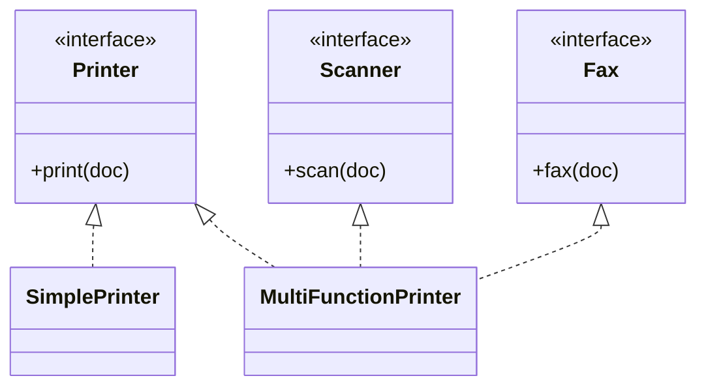
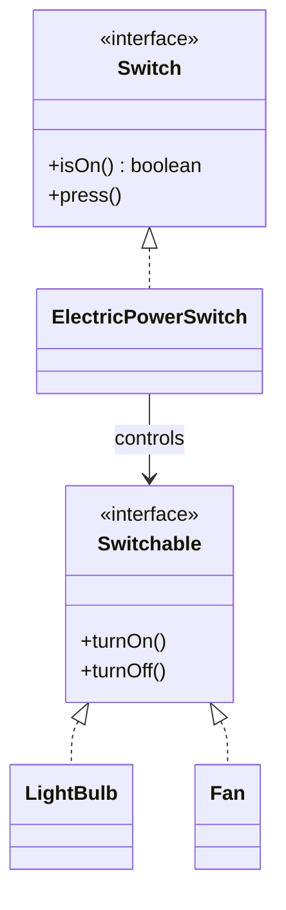

# AI-1 Design Principles (SOLID)

This note covers the design principles from AI sir's Lecture 1 (taken from Chapter 3 of *Dive Into Design Patterns*): encapsulating what varies, programming to an interface, favouring composition over inheritance, and the five SOLID principles. These principles are the "why" behind every design pattern you will write in the exam. When a TF question says "the design must support new types without modifying existing code", it is really asking you to apply the Open/Closed Principle, and when you justify a pattern choice, naming the principle it follows earns you the justification marks.

**TF frequency:** CSE307 2022-23 Q2(c) asked directly "Show an example of Interface Segregation Principle" (8 marks). Every design-pattern question in 2019-20 to 2023-24 expects you to justify your design, and the cleanest justification is a principle (OCP, DIP, SRP, composition over inheritance).

📑 **See:** *[1] AI sir/Lec 1 - Design Principle.pdf* → p.2–4 (encapsulation), p.6 (interface), p.7 (diamond problem), p.8–9 (tight coupling), p.10 (SOLID list), p.11–31 (each principle).

---

## 1. Encapsulate What Varies

The first and most basic principle says that you should ==identify the parts of your program that change and separate them from the parts that stay the same==. If a piece of logic keeps changing (for example, a tax calculation that depends on the country), and it is mixed inside a large method, then every change forces you to edit and re-test that large method. If you pull the changing part out, the rest of the code stays stable and the change only touches one small place.

At the **method level** (slides p.2–3), the example is an `getOrderTotal()` method that computes tax inline with a chain of `if (country == "US") ... else if (country == "EU") ...`. The fix is to extract the tax logic into a separate method `getTaxRate(country)`. Now the order total method never changes when tax rules change; only `getTaxRate` changes.

At the **class level** (slides p.4–5), the tax logic grows so large that it no longer belongs in the `Order` class at all. It is moved to a separate `TaxCalculator` class, and `Order` simply delegates to it. This is exactly the idea that later becomes the Strategy pattern.

```java
// Before: changing tax rules forces you to edit Order
class Order {
    double getOrderTotal() {
        double total = sumOfItems();
        if (country.equals("US")) total += total * 0.07;
        else if (country.equals("EU")) total += total * 0.20;
        return total;
    }
}

// After (class level): the varying part lives in its own class
class TaxCalculator {
    double getTaxRate(String country) { /* all tax rules here */ return 0.0; }
}
class Order {
    private TaxCalculator tax = new TaxCalculator();
    double getOrderTotal() {
        double total = sumOfItems();
        return total + total * tax.getTaxRate(country); // delegate the varying part
    }
}
```

## 2. Program to an Interface, Not an Implementation

This principle says that your code should ==depend on abstractions (interfaces or abstract classes), not on concrete classes==. If a `Cat` class has a method `eat(Sausage s)`, the cat can only eat sausages. If it instead has `eat(Food f)` where `Food` is an interface, it can eat anything that implements `Food`, and new foods can be added without changing `Cat`.

Slide p.6 gives an honest warning: right after you introduce an interface you may not feel any benefit, and the code even looks more complicated. You do it when you see a likely **extension point**, a place where new variants will be added later. In exams, the places where the question says "new types may be added in the future" are exactly such extension points.

## 3. Favour Composition Over Inheritance

Inheritance is the obvious way to reuse code, but it has real problems. A subclass cannot reduce the interface of its parent (it must implement all abstract methods even if they make no sense for it). A subclass is tightly coupled to its parent, so a change in the parent can break the child. And if things vary in more than one dimension, inheritance causes a ==combinatorial explosion of subclasses== (for example `ElectricTruck`, `ElectricCar`, `PetrolTruck`, `PetrolCar`, ...).

Composition means an object **has** another object and delegates work to it instead of **being** a subtype of it. A `Car` has an `Engine`; to change the engine you swap the object, even at runtime.

The **diamond problem** (slide p.7) is a specific danger of multiple inheritance. If class `D` inherits from both `A` and `B`, and both `A` and `B` implement `doSomething()`, then it is ambiguous which version `D` should use. Java avoids this by allowing only single class inheritance (but multiple interfaces), which is one more reason to prefer composition.

> [!tip] 🎯 TF angle
> Decorator, Strategy, Bridge, State and Composite all exist because of "favour composition over inheritance". When a question shows a subclass explosion (e.g. `BlueCircle`, `RedSquare`, ... or a coffee with every condiment combination), say: "Inheritance causes class explosion, so I use composition via the X pattern."

## 4. Tight Coupling vs Loose Coupling

Slides p.8–9 show a `Company` class that directly creates `Designer`, `Programmer` and `Tester` objects inside `createSoftware()`. The company class is **tightly coupled** to those concrete employee classes: if you add a new employee type, you must edit `Company`.

The fix is to introduce an `Employee` interface with a `doWork()` method, and let `Company` work only with `Employee`. Then make `Company` abstract with an abstract `getEmployees()` method; subclasses such as `GameDevCompany` and `OutsourcingCompany` return their own employees. Now `Company` is independent of concrete employee classes. This final design is literally the **Factory Method** pattern (see [[AI-2 Creational Design Patterns#Factory Method]]).

```java
interface Employee { void doWork(); }
class Designer implements Employee { public void doWork() { /* design */ } }
class Programmer implements Employee { public void doWork() { /* code */ } }

abstract class Company {
    abstract java.util.List<Employee> getEmployees();   // factory method
    void createSoftware() {
        for (Employee e : getEmployees()) e.doWork();    // depends only on the interface
    }
}
class GameDevCompany extends Company {
    java.util.List<Employee> getEmployees() {
        return java.util.List.of(new Designer(), new Programmer());
    }
}
```

---

## 5. SOLID Principles

SOLID is a mnemonic for five principles that make software designs ==more understandable, flexible and maintainable== (slide p.10). The slide also warns that applying them blindly can make a program more complicated than it needs to be, so use them where change is expected.

> [!important] 🔑 Memorize — the five SOLID names
> **S** – Single Responsibility Principle
> **O** – Open/Closed Principle
> **L** – Liskov Substitution Principle
> **I** – Interface Segregation Principle
> **D** – Dependency Inversion Principle

### 5.1 Single Responsibility Principle (SRP)

> [!important] 🔑 Memorize — SRP
> ==A class should have just one reason to change.== Every class should have a single responsibility, and that responsibility should be entirely encapsulated by the class.

The idea is that a class that does many unrelated jobs will be changed for many unrelated reasons, and every change risks breaking the other jobs. Slide p.11 lists the benefits you can write in an exam: ==less fragile code, low coupling, high cohesion, changeability, maintainability, and easier testing and debugging==.

A classic violation is an `Employee` class that stores employee data, prints a timesheet report, and saves itself to the database. The report format changes for the HR department, the database changes for the IT department, and the data changes for business reasons. Split it into `Employee` (data), `TimesheetReport` (printing) and `EmployeeRepository` (persistence).

```java
// Violation: three reasons to change
class Employee {
    String name; double salary;
    void printTimesheetReport() { /* formatting */ }
    void saveToDatabase()      { /* SQL */ }
}

// Fixed: one responsibility per class
class Employee           { String name; double salary; }
class TimesheetReport    { void print(Employee e) { /* formatting */ } }
class EmployeeRepository { void save(Employee e)  { /* SQL */ } }
```

This is the same smell as **Divergent Change** and **Large Class** in [[IJ-6 Refactoring and Code Smells]].

### 5.2 Open/Closed Principle (OCP)

> [!important] 🔑 Memorize — OCP
> ==Classes should be open for extension but closed for modification.== Once a class is completed and tested, it should only be modified to fix errors; new or changed features should be added by creating a new class (extension), not by editing the old one.

The slides (p.14–17) use an `AreaCalculator`. At first it only handles `Rectangle` and multiplies width by height. When `Circle` is added, the method must be edited to check `if (shape is Rectangle) ... else ...`. When `Ellipse` and `Triangle` come, it must be edited again. Each edit risks breaking working code. That is the violation.

```java
// Violation: every new shape forces an edit here
class AreaCalculator {
    double area(Object[] shapes) {
        double area = 0;
        for (Object s : shapes) {
            if (s instanceof Rectangle) { Rectangle r = (Rectangle) s; area += r.width * r.height; }
            else { Circle c = (Circle) s; area += c.radius * c.radius * Math.PI; }
        }
        return area;
    }
}
```

The fix is to make `Shape` abstract with an abstract `area()` method. Each shape computes its own area, and the calculator just calls `shape.area()`. Adding `Ellipse` now means writing a new class only; `AreaCalculator` never changes.

```java
abstract class Shape { abstract double area(); }
class Rectangle extends Shape { double w, h; double area() { return w * h; } }
class Circle    extends Shape { double r;    double area() { return r * r * Math.PI; } }
class Ellipse   extends Shape { double a, b; double area() { return a * b * Math.PI; } } // added with NO edit elsewhere

class AreaCalculator {
    double area(Shape[] shapes) {
        double total = 0;
        for (Shape s : shapes) total += s.area();   // closed for modification
        return total;
    }
}
```

> [!tip] 🎯 TF angle
> Whenever the question says "must support new X types **without modifying existing code**", write the sentence: "This follows the Open/Closed Principle." Factory Method, Abstract Factory, Decorator, Strategy, Observer and Template Method all satisfy OCP.

### 5.3 Liskov Substitution Principle (LSP)

> [!important] 🔑 Memorize — LSP
> ==Objects of a subclass must be usable in place of objects of the parent class without breaking the client code.== Every subclass must remain behaviourally compatible with its superclass. When overriding a method, extend the base behaviour rather than replacing it with something entirely different.

Slides p.18–20 list the checks behind LSP. A subclass method should accept parameter types that are the same as or more abstract than the parent's (a parent `feed(Cat)` should not become `feed(BengalCat)` in the child, because the client may pass any cat). The return type should be the same or a subtype of the parent's return type. A subclass should not throw new kinds of exceptions the parent did not throw. A subclass should not strengthen pre-conditions (for example, the parent accepts any `int` but the child rejects negatives), and should not weaken post-conditions (for example, the parent closes the database connection after the method but the child leaves it open). A subclass must keep the parent's invariants and must not change private fields of the parent.

The classic exam example is **Rectangle and Square**. Mathematically a square is a rectangle, so it is tempting to write `Square extends Rectangle`. But `Square` must keep width and height equal, so `setWidth(5)` also changes the height. Client code that does `r.setWidth(5); r.setHeight(4);` and expects `area() == 20` gets 16 when handed a `Square`. The subclass broke the client, so LSP is violated.

```java
class Rectangle {
    protected int w, h;
    void setWidth(int w)  { this.w = w; }
    void setHeight(int h) { this.h = h; }
    int area() { return w * h; }
}
class Square extends Rectangle {          // LSP violation
    void setWidth(int w)  { this.w = w; this.h = w; }
    void setHeight(int h) { this.w = h; this.h = h; }
}
// Client: r.setWidth(5); r.setHeight(4); assert r.area() == 20;  -> fails for Square

// Fix: do not make Square a subtype of Rectangle; both implement Shape
interface Shape { int area(); }
class Rect   implements Shape { int w, h; public int area() { return w * h; } }
class Sq     implements Shape { int side;  public int area() { return side * side; } }
```

The book's own example (p.19–20) is a document class with a `save()` method and a `ReadOnlyDocument` subclass that throws an exception in `save()`. Client code that saves all documents now crashes on read-only ones, so the client has to check types, which violates both LSP and OCP. The fix is to make `ReadOnlyDocument` the base class and `WritableDocument` a subclass that adds `save()`.

> [!warning] ⚠️ Common mistake
> Refused Bequest (a subclass that throws `UnsupportedOperationException` for an inherited method) is a code smell and an LSP violation at the same time. See [[IJ-6 Refactoring and Code Smells]].

### 5.4 Interface Segregation Principle (ISP)

> [!important] 🔑 Memorize — ISP
> ==Clients shouldn't be forced to depend on methods they do not use.== Make interfaces narrow enough that client classes don't have to implement behaviours they don't need. Break "fat" interfaces into smaller, more specific ones.

The slide example (p.21–22) is a cloud-provider library. The first version has one fat interface `CloudProvider` with `storeFile`, `getFile`, `createServer`, `listServers`, `getCDNAddress`. Amazon supports everything, but Dropbox only supports file storage, so the `Dropbox` class is forced to implement server and CDN methods with empty bodies or exceptions. The fix splits the fat interface into `CloudHostingProvider`, `CDNProvider` and `CloudStorageProvider`. Amazon implements all three; Dropbox implements only `CloudStorageProvider`.

Here is a complete exam-ready ISP example you can write for CSE307 2022-23 Q2(c). A multi-function printer can print, scan and fax, but a simple printer can only print.

```java
// Violation: one fat interface
interface Machine {
    void print(String doc);
    void scan(String doc);
    void fax(String doc);
}
class SimplePrinter implements Machine {
    public void print(String doc) { System.out.println("Printing " + doc); }
    public void scan(String doc)  { throw new UnsupportedOperationException(); } // forced!
    public void fax(String doc)   { throw new UnsupportedOperationException(); } // forced!
}

// Fixed: segregated (role) interfaces
interface Printer { void print(String doc); }
interface Scanner { void scan(String doc); }
interface Fax     { void fax(String doc); }

class SimplePrinter implements Printer {
    public void print(String doc) { System.out.println("Printing " + doc); }
}
class MultiFunctionPrinter implements Printer, Scanner, Fax {
    public void print(String doc) { System.out.println("Printing " + doc); }
    public void scan(String doc)  { System.out.println("Scanning " + doc); }
    public void fax(String doc)   { System.out.println("Faxing " + doc); }
}
```



When you explain it, say that after segregation `SimplePrinter` no longer depends on `scan` and `fax`, so a change in the fax interface never forces a recompile or change in `SimplePrinter`, and no method throws "not supported" anymore (which would also have violated LSP).

### 5.5 Dependency Inversion Principle (DIP)

> [!important] 🔑 Memorize — DIP
> ==High-level classes shouldn't depend on low-level classes. Both should depend on abstractions. Abstractions shouldn't depend on details; details should depend on abstractions.== In short: depend upon abstractions, not upon concretions.

High-level classes contain the business logic (what to do); low-level classes do basic work (disk, database, network, a particular device). Normally you write low-level classes first and the high-level class directly uses them, so the dependency arrow points from high-level to low-level. DIP "inverts" this: the high-level module defines the interface it needs, and the low-level modules implement that interface (p.25–26). Both now depend on the abstraction.

The slide example (p.27–31) is an `ElectricPowerSwitch` that holds a `LightBulb` field and calls `lightBulb.turnOn()`. The switch can only ever control a light bulb; to control a fan you must rewrite the switch.

```java
// Without DIP: switch depends on the concrete LightBulb
class LightBulb {
    public void turnOn()  { System.out.println("LightBulb: on"); }
    public void turnOff() { System.out.println("LightBulb: off"); }
}
class ElectricPowerSwitch {
    public LightBulb lightBulb;          // concrete dependency
    public boolean on;
    public ElectricPowerSwitch(LightBulb b) { lightBulb = b; on = false; }
    public void press() {
        if (on) { lightBulb.turnOff(); on = false; }
        else    { lightBulb.turnOn();  on = true; }
    }
}
```

```java
// With DIP: both sides depend on abstractions
interface Switch     { boolean isOn(); void press(); }
interface Switchable { void turnOn(); void turnOff(); }

class ElectricPowerSwitch implements Switch {
    public Switchable client;            // abstraction, not LightBulb
    public boolean on;
    public ElectricPowerSwitch(Switchable client) { this.client = client; on = false; }
    public boolean isOn() { return on; }
    public void press() {
        if (isOn()) { client.turnOff(); on = false; }
        else        { client.turnOn();  on = true; }
    }
}
class LightBulb implements Switchable {
    public void turnOn()  { System.out.println("LightBulb: on"); }
    public void turnOff() { System.out.println("LightBulb: off"); }
}
class Fan implements Switchable {
    public void turnOn()  { System.out.println("Fan: on"); }
    public void turnOff() { System.out.println("Fan: off"); }
}
```



> [!warning] ⚠️ Common mistake
> DIP (a design principle about which way dependencies point) is not the same as "dependency injection" (a technique of passing a dependency in through the constructor). The constructor `ElectricPowerSwitch(Switchable client)` uses injection to achieve DIP, but the principle itself is about depending on the `Switchable` abstraction.

---

## 6. Principles Behind the Patterns

It helps a lot in the exam to connect each pattern with the principle it follows, because "justify your choice" questions are graded on this. The **Factory Method** and **Abstract Factory** follow DIP and OCP, because the client depends on a product interface and new products are added as new classes. **Strategy** and **State** follow "encapsulate what varies", composition over inheritance, and OCP. **Decorator** follows OCP (add behaviour by wrapping, not by editing) and composition over inheritance. **Observer** follows loose coupling and DIP, because the subject only knows the `Observer` interface. **Adapter** follows OCP, because you plug in an incompatible class without changing the client. **Bridge** follows composition over inheritance and SRP, because abstraction and implementation are separate hierarchies. **Template Method** follows the "Hollywood principle" (don't call us, we'll call you) and keeps the invariant algorithm closed for modification. **Singleton** famously *violates* SRP, because the class both does its job and controls its own instance count.

See [[AI-2 Creational Design Patterns]], [[IJ-1 Structural Design Patterns]] and [[IJ-2 Behavioral Design Patterns]].

---

## TF questions on this topic

> [!example] ✍️ How to answer a "show an example of principle X" question
> The scoring structure is always the same: one or two sentences stating the principle exactly (the memorize box), a short code (or class diagram) that **violates** it with one sentence explaining what goes wrong, then the **fixed** code and one sentence explaining what is now better. For SRP use the Employee report/database split, for OCP the shape area calculator, for LSP Rectangle/Square, for ISP the printer/scanner/fax machine, and for DIP the switch with light bulb and fan.

The older papers (2019-20 to 2021-22) did not ask a pure principle question, but every pattern question there asks you to justify the design. Use the "Principles behind the patterns" section above for those justifications.

## Same type in the papers you will solve last

CSE307 2022-23 Q2(c) — show an example of the Interface Segregation Principle [8]. See [[TF 2022-23 (CSE307 May 2024)]].
2023-24 (May-2026 paper) Q1(a) — "must support new package types without modifying any existing code" is an OCP justification inside a Factory Method question. See [[TF 2023-24 (May 2026 paper)]].
