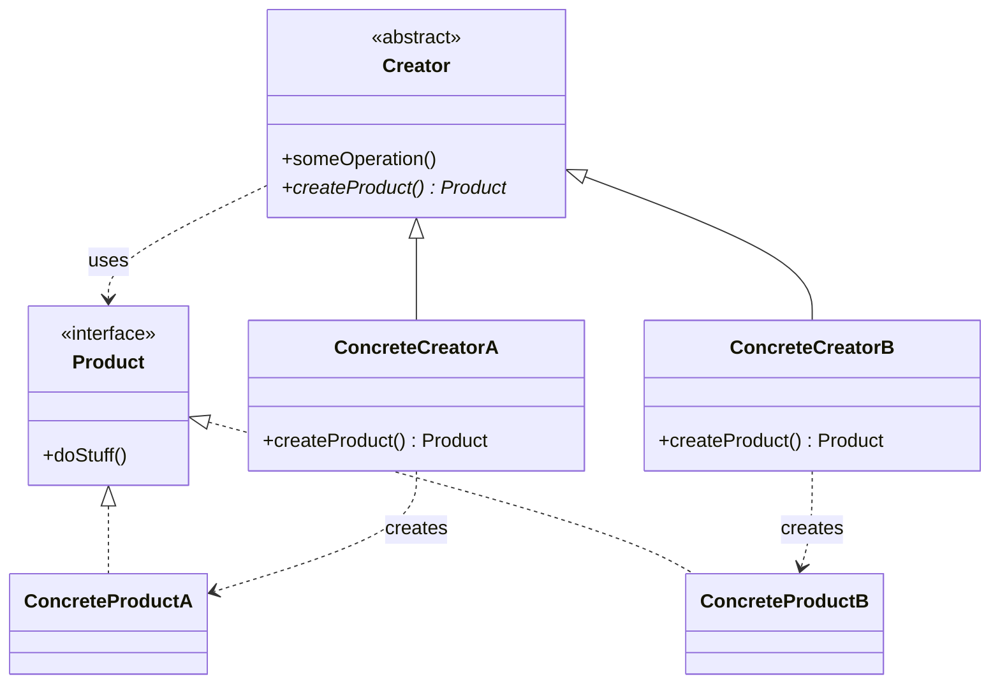
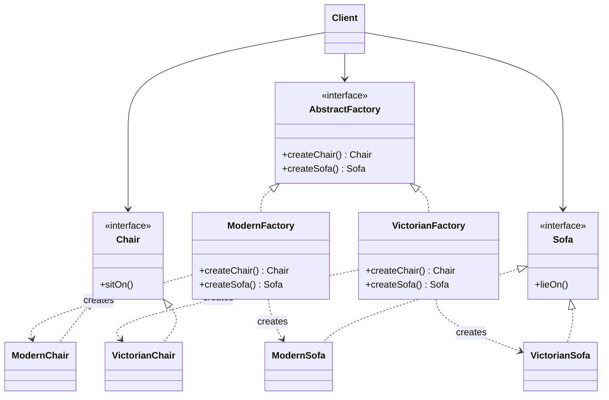
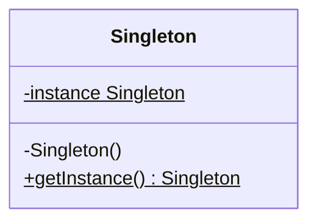
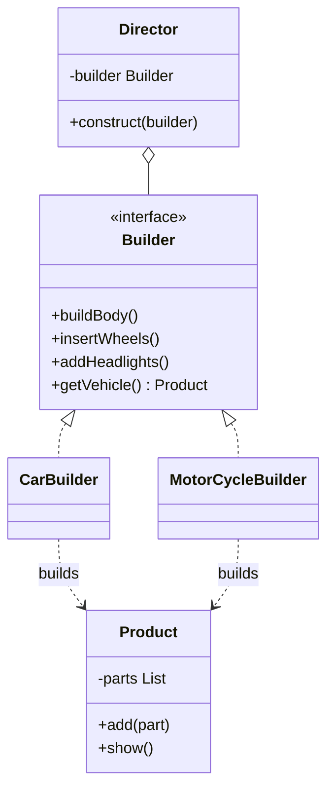
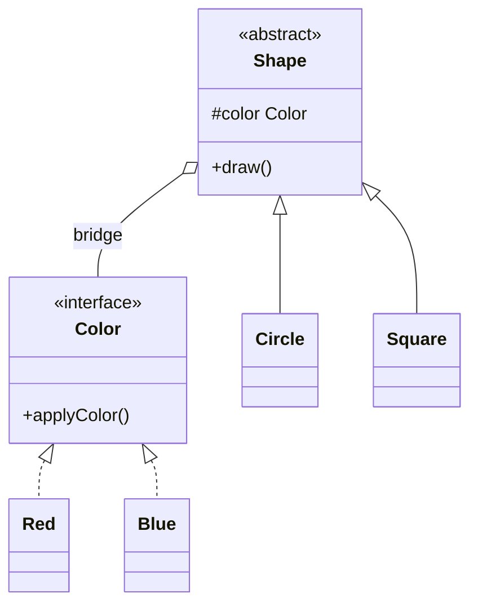

# AI-2 Creational Design Patterns

This note covers AI sir's Lecture 2 (what a design pattern is and why we need it) and Lecture 3 (the creational patterns: Factory Method, Abstract Factory, Singleton and Builder, plus Prototype briefly). Creational patterns answer one question: ==how should objects be created so that the client code does not depend on the concrete classes it creates?== In almost every recent term final there is one 15-mark question where you must pick a creational pattern for a scenario, draw its class diagram and write Java code, so this note is one of the highest-value notes in the vault.

**TF frequency:** 2023-24 (May-2026) Q1(a) Factory Method; 2023-24 (Feb-2025) Q5(a) Abstract Factory; CSE307 2022-23 Q3(a) Builder; 2021-22 Q1(a) compare FM/AF/Builder/Bridge, Q1(b) factory-style refactor, Q3(a) Builder; 2020-21 Q1(a) Builder inside burger shop, Q2(a) Factory; 2019-20 Q1(a) Singleton. That is at least one creational question in **every one of the five priority years**.

📑 **See:** *[1] AI sir/Lec 2 - Basics of Design Pattern.pdf* → p.2–10; *[1] AI sir/Lec 3 - Creational Design Patterns.pdf* → p.2 (UML arrows), p.4–15 (Factory Method), p.17–34 (Abstract Factory), p.36–42 (Singleton), p.43–53 (Builder).

---

## What Is a Design Pattern? (Lec 2)

> [!important] 🔑 Memorize — Design pattern
> A design pattern is ==a standard (general, reusable) solution to a commonly recurring problem in software design==. It is not finished code but a description or template for how to solve a problem that can be used in many different situations. It is a technique for making code more flexible (it reduces coupling among program components) and gives developers a shorthand vocabulary for describing a design.

The "Gang of Four" (Gamma, Helm, Johnson, Vlissides) catalogued **23 patterns** in **three categories** (slides p.3–6). It is worth memorizing which pattern belongs to which category, because a question may say "use a suitable *behavioral* pattern" and you lose marks if you answer with a structural one.

> [!important] 🔑 Memorize — The 23 GoF patterns
> **Creational (5)** — how objects are instantiated: Factory Method, Abstract Factory, Builder, Prototype, Singleton.
> **Structural (7)** — how classes/objects are combined into larger structures: Adapter, Bridge, Composite, Decorator, Façade, Flyweight, Proxy.
> **Behavioral (11)** — how objects communicate and share responsibility: Interpreter, Template Method, Chain of Responsibility, Command, Iterator, Mediator, Memento, Observer, State, Strategy, Visitor.

Every pattern is described with **four essential elements** (p.7). The **intent** is the design goal of the pattern. The **problem** describes when to apply the pattern and the context. The **solution** gives the elements that make up the design, their relationships and collaborations. The **consequences** are the benefits and trade-offs of using it. When a TF question says "justify your choice", answer using exactly these four headings in a few sentences each: what the problem in the scenario is, why this pattern's intent matches it, how the solution maps to the scenario's classes, and what you gain.

**Why do we need design patterns?** (p.8–10) Requirements always change: users' view of their needs changes after talking to developers, developers' understanding of the domain grows, and the environment changes. Instead of complaining, we design software so that it can absorb change easily, and patterns are proven ways of doing that. Studying patterns also lets us reuse high-quality solutions, gives a team a common vocabulary, raises our thinking to a higher level of abstraction, improves modifiability, and helps us find alternatives to large inheritance hierarchies.

### UML arrows used in pattern diagrams (Lec 3 p.2)

You will draw a class diagram in every pattern answer, so the arrows must be correct. **Generalization** (inheritance) is a solid line with a hollow triangle pointing to the parent; **realization** (implementing an interface) is the same triangle with a dashed line. **Aggregation** ("is part of") is a hollow diamond on the whole's side; **composition** ("is entirely made of", parts die with the whole) is a filled diamond. **Association** is a plain solid line (often with an arrow for navigability). **Dependency** ("uses temporarily", e.g. a factory creates a product) is a dashed arrow. Full details are in [[AI-3 Class Diagram]].

---

## Factory Method

> [!important] 🔑 Memorize — Factory Method (intent)
> ==Define an interface for creating an object, but let subclasses decide which class to instantiate. Factory Method lets a class defer instantiation to subclasses.==

### The problem it solves

Slide p.12 tells the logistics story. Your app first handles only trucks, so all the code is coupled to the `Truck` class. Then sea companies want to use the app. Adding `Ship` would require changes all over the codebase, and adding a third transport later would require the same changes again. You end up with code full of conditionals that switch behaviour depending on the transport class.

The solution is to stop calling `new Truck()` directly. Instead, creation goes through a special **factory method**. The objects are still created with `new`, but inside the factory method. The objects returned are called **products**, and they all share a common interface (`Transport` with `deliver()`). The client works only with the interface, so it does not care whether it got a truck or a ship.

### Simple Factory vs Factory Method (very important for the TF)

AI sir's first example (p.6–7) is the drawing example: a `Shape` interface with `Circle`, `Square`, `Rectangle`, and a `ShapeFactory` with a method `getShape(type)` that uses `if/else` on a string to return the right object. The kiosk example (p.8) is the same idea with `PaymentProcessor` and `Cash`, `CreditCard`, `Coupon`. This is called a ==Simple Factory== (or static factory): **one** centralized class decides which concrete class to create.

The full GoF ==Factory Method== (p.5, p.13–14) uses **inheritance**: an abstract `Creator` class declares an abstract `createProduct()` method, and each `ConcreteCreator` subclass overrides it to return one particular concrete product (`RoadLogistics.createTransport()` returns a `Truck`, `SeaLogistics.createTransport()` returns a `Ship`). The UI framework example (p.14) is the same: you subclass `UIFramework` as `UIWithRoundButtons` and override `createButton()` to return a `RoundButton`.

The difference matters for one exam phrase: "**support new types without modifying any existing code**". A Simple Factory with `if/else` must be edited every time a new type is added, so it does not fully satisfy OCP. The GoF Factory Method does: a new product gets a new concrete creator, and nothing old is touched. A practical middle path (also accepted) is a factory that holds a **registry map** from type name to creator, so new types register themselves instead of editing an `if/else` chain.

> [!tip] 🎯 TF angle
> If the question says "the client must not construct the concrete class directly, objects are instantiated through a **centralized creation component**, and new types must be added **without modifying existing code**", answer **Factory Method**. Draw Product interface + concrete products + Creator abstract class with abstract factory method + concrete creators. Mention that a simple `if/else` factory would violate OCP, which is why you use subclass creators (or a registry). This exact wording appears in the 2023-24 (May-2026) paper.

### Structure



The **Product** declares the interface common to all objects the creator can produce. **Concrete Products** are the different implementations. The **Creator** declares the factory method returning the Product type; it usually also contains core business logic (`someOperation()`) that uses the product, which is the real point: that logic works for every product. **Concrete Creators** override the factory method to return a specific product.

### Java code (logistics example)

```java
// Product
interface Transport { void deliver(); }

// Concrete products
class Truck implements Transport { public void deliver() { System.out.println("Deliver by land in a box"); } }
class Ship  implements Transport { public void deliver() { System.out.println("Deliver by sea in a container"); } }

// Creator
abstract class Logistics {
    public abstract Transport createTransport();   // the factory method

    public void planDelivery() {                   // business logic that works for any product
        Transport t = createTransport();
        t.deliver();
    }
}

// Concrete creators
class RoadLogistics extends Logistics { public Transport createTransport() { return new Truck(); } }
class SeaLogistics  extends Logistics { public Transport createTransport() { return new Ship(); } }

// Client
public class Main {
    public static void main(String[] args) {
        Logistics l = new SeaLogistics();  // choose creator once (config/user input)
        l.planDelivery();                  // client never writes "new Ship()"
    }
}
```

### Simple factory version (AI sir's ShapeFactory, p.6–7)

```java
interface Shape { void draw(); }
class Circle    implements Shape { public void draw() { System.out.println("Inside Circle::draw()"); } }
class Rectangle implements Shape { public void draw() { System.out.println("Inside Rectangle::draw()"); } }

class ShapeFactory {
    public Shape getShape(String type) {
        if (type == null) return null;
        if (type.equalsIgnoreCase("CIRCLE"))    return new Circle();
        if (type.equalsIgnoreCase("RECTANGLE")) return new Rectangle();
        return null;
    }
}
// Client: Shape s = new ShapeFactory().getShape("CIRCLE"); s.draw();
```

### Consequences (p.15)

The factory pattern lets you ==code for an interface rather than an implementation==. It removes the instantiation of concrete classes from client code, which makes the code more robust, less coupled and easy to extend: you can change the lower-level implementation and the client never knows. It provides abstraction between implementation and client classes through inheritance. The cost is that you get many small subclasses (one creator per product).

---

## Abstract Factory

> [!important] 🔑 Memorize — Abstract Factory (intent)
> ==Provide an interface for creating **families of related or dependent objects** without specifying their concrete classes.==

### The problem it solves

The furniture shop simulator (p.19–20) has a **family** of products — `Chair`, `Sofa`, `CoffeeTable` — and several **variants** of the family — `Modern`, `Victorian`, `ArtDeco`. You need to create furniture objects so that ==they match other objects of the same family==; customers get quite mad when a modern sofa arrives with a Victorian chair. You also do not want to change existing code when new products or families are added, because vendors update catalogs often.

The solution (p.21–22) has two steps. First declare an interface for each distinct product (`Chair`, `Sofa`, `CoffeeTable`) and make every variant implement it. Second declare the **Abstract Factory** — an interface with one creation method per product (`createChair()`, `createSofa()`, `createCoffeeTable()`). For each variant create a concrete factory (`ModernFurnitureFactory` creates only `ModernChair`, `ModernSofa`, `ModernCoffeeTable`). The client receives one factory object and uses only the abstract interfaces, so it is guaranteed to get a matching set. The GUI example (p.24) is the same: the app checks the OS at startup, creates a `WinFactory` or `MacFactory`, and the rest of the code creates buttons and checkboxes through it.

The Honda car example (p.30) uses `HondaFactory` with `createEngine()` and `createTrans()`, and concrete factories `CivicFactory` and `AccordFactory` that produce `CivicEngine`+`CivicTrans` or `AccordEngine`+`AccordTrans`. You never get an Accord engine in a Civic.

### Structure



### Java code

```java
interface Chair { void sitOn(); }
interface Sofa  { void lieOn(); }

class ModernChair    implements Chair { public void sitOn() { System.out.println("Modern chair"); } }
class VictorianChair implements Chair { public void sitOn() { System.out.println("Victorian chair"); } }
class ModernSofa     implements Sofa  { public void lieOn() { System.out.println("Modern sofa"); } }
class VictorianSofa  implements Sofa  { public void lieOn() { System.out.println("Victorian sofa"); } }

interface FurnitureFactory {          // the abstract factory
    Chair createChair();
    Sofa  createSofa();
}
class ModernFactory implements FurnitureFactory {
    public Chair createChair() { return new ModernChair(); }
    public Sofa  createSofa()  { return new ModernSofa(); }
}
class VictorianFactory implements FurnitureFactory {
    public Chair createChair() { return new VictorianChair(); }
    public Sofa  createSofa()  { return new VictorianSofa(); }
}

class Client {
    private Chair chair; private Sofa sofa;
    Client(FurnitureFactory f) {      // whole family comes from ONE factory -> always matching
        chair = f.createChair();
        sofa  = f.createSofa();
    }
}
// new Client(new ModernFactory());
```

### Consequences (p.34)

Abstract Factory ==isolates concrete classes== from the client, makes ==exchanging a whole product family easy== (change one line: which factory you create), and ==promotes consistency among products==. It is sometimes called a "factory of factories" and avoids the conditional logic of a simple factory. Its main drawback is that ==supporting a new *kind* of product is difficult==: adding `createTable()` means changing the abstract factory interface and every concrete factory. Adding a new *variant* (a new family) is easy: just add one new factory and its products.

> [!tip] 🎯 TF angle — recognising Abstract Factory
> Look for **two dimensions**: several *kinds* of products that must be used *together* (crust + toppings + sauce; engine + transmission; button + checkbox) and several *variants/regions/brands* (Italy vs America; Civic vs Accord; Windows vs Mac). Words like "region-specific ingredients", "must match", "consistent", "family" point to Abstract Factory. The Feb-2025 pizza question (Italy and America, crust type and toppings differ by region, extendable to more countries) is exactly this.

> [!warning] ⚠️ Common mistake — Factory Method vs Abstract Factory
> Factory Method creates **one** product through **one** method that subclasses override (inheritance). Abstract Factory creates a **family** of related products through **several** methods on a factory **object** that the client is given (composition). Internally, each creation method of an abstract factory is often implemented as a factory method.

---

## Singleton

> [!important] 🔑 Memorize — Singleton (intent)
> ==Ensure a class has only one instance, and provide a global point of access to it.== It uses "just-in-time initialization" (lazy initialization, "initialization on first use").

Use it when the application needs exactly one object of something — a database connection manager (p.38), a configuration object, a logger, an ID generator — and that object must be reachable from anywhere. Unlike a global variable, the Singleton ==guarantees there is just one instance==; nothing except the class itself can replace the cached instance (p.41).

### How it works

There are three ingredients, shown in the class diagram on p.37. First, the **constructor is private**, so no other class can call `new`. This is the whole trick: if the constructor were public, anybody could make a second object. Second, a **private static field** `instance` holds the one object. Third, a **public static method** `getInstance()` creates the object the first time it is called (lazy initialization) and returns the same object every time after that.



```java
// Basic lazy singleton (AI sir's DbConnection, p.38)
public class DbConnection {
    private static DbConnection instance = null;   // the one instance
    private SQLConnection connection;

    private DbConnection() {                         // private: nobody else can "new" it
        connection = connectToDatabase(dbUser, dbPassword, dbName);
    }
    public static DbConnection getDbConnection() {   // global access point
        if (instance == null)
            instance = new DbConnection();           // created only on first use
        return instance;
    }
}
// usage: DbConnection c = DbConnection.getDbConnection();
```

### Thread safety (write this for full marks)

The basic version breaks with multiple threads. If two threads call `getInstance()` at the same moment, both may see `instance == null` and both create an object. The safe version uses **double-checked locking** with a `volatile` field:

```java
public class Singleton {
    private static volatile Singleton instance;      // volatile: all threads see the latest value
    private Singleton() { }
    public static Singleton getInstance() {
        if (instance == null) {                      // 1st check: avoid locking after creation
            synchronized (Singleton.class) {
                if (instance == null)                // 2nd check: only one thread creates it
                    instance = new Singleton();
            }
        }
        return instance;
    }
}
```

A simpler alternative is **eager initialization** — `private static final Singleton instance = new Singleton();` — which is thread-safe because the JVM creates it when the class loads, at the cost of losing laziness.

### Consequences (p.42)

Singleton gives ==controlled access to the sole instance==, a ==reduced namespace== (better than polluting the program with global variables), and it ==permits a variable number of instances== if you later change your mind (the `getInstance()` method can be changed to manage, say, a pool of three). The drawbacks are that it violates the Single Responsibility Principle, can hide dependencies, and makes unit testing harder because the global state is shared.

---

## Builder

> [!important] 🔑 Memorize — Builder (intent)
> ==Separate the construction of a complex object from its representation so that the same construction process can create different representations.==

### The problem it solves

Some objects are built from many parts in several steps, and different customers want different combinations. Slide p.45 gives the computer example: one customer wants a 500 GB disk with an Intel processor, another wants 250 GB with AMD. The kids' meal picture on the same slide shows the classic restaurant analogy: the **customer** (client) orders a kid's meal from the **cashier** (director), the **restaurant crew** (builder) builds the burger, drink, fries and toy, and then the customer "gets meal" (the product). Without Builder you end up with a huge constructor with many optional parameters, or many subclasses for every combination.

### Participants (p.44)

The **Builder** is an interface declaring the step methods to build the parts (`buildPart()`), plus a method to get the result. A **ConcreteBuilder** implements those steps for one specific representation and keeps track of the product it is building; it provides `getResult()`. The **Director** knows the *order* of the steps; its `construct()` method calls `builder.buildPart()` for all parts in sequence. The **Product** is the complex object being built. The client creates a concrete builder, passes it to the director, asks the director to construct, and then gets the result from the builder.



### Java code (AI sir's car/motorcycle example, p.47–49)

```java
import java.util.*;

class Product {                                   // the complex object
    private List<String> parts = new LinkedList<>();
    public void add(String part) { parts.add(part); }
    public void show() {
        System.out.println("Product completed as below:");
        for (String p : parts) System.out.println(p);
    }
}

interface IBuilder {                              // common builder interface
    void buildBody();
    void insertWheels();
    void addHeadlights();
    Product getVehicle();
}

class Car implements IBuilder {                   // concrete builder 1
    private Product product = new Product();
    public void buildBody()     { product.add("This is a body of a Car"); }
    public void insertWheels()  { product.add("4 wheels are added"); }
    public void addHeadlights() { product.add("2 Headlights are added"); }
    public Product getVehicle() { return product; }
}

class MotorCycle implements IBuilder {            // concrete builder 2
    private Product product = new Product();
    public void buildBody()     { product.add("This is a body of a Motorcycle"); }
    public void insertWheels()  { product.add("2 wheels are added"); }
    public void addHeadlights() { product.add("1 Headlight has been added"); }
    public Product getVehicle() { return product; }
}

class Director {                                  // knows the ORDER of steps
    public void construct(IBuilder builder) {
        builder.buildBody();
        builder.insertWheels();
        builder.addHeadlights();
    }
}

public class BuilderPatternEx {
    public static void main(String[] args) {
        Director director = new Director();
        IBuilder carBuilder = new Car();
        director.construct(carBuilder);           // same process...
        carBuilder.getVehicle().show();
        IBuilder bikeBuilder = new MotorCycle();
        director.construct(bikeBuilder);          // ...different representation
        bikeBuilder.getVehicle().show();
    }
}
```

The second slide example (p.50–53) is the CD builder: a `Packing` interface (`pack()`, `price()`), an abstract `CD` and `Company`, concrete `Sony` and `Samsung`, a `CDType` that holds a list of items, and a `CDBuilder` with `buildSonyCD()` and `buildSamsungCD()` that each add the right item to a `CDType`. Here the builder methods themselves act as the director (they know which parts make up each CD type).

### Consequences (p.46)

Builder ==lets you vary a product's internal representation== (different builders produce different products from the same steps), ==isolates construction code from representation code==, and ==gives you finer control over the construction process== because the product is built step by step under the director's control, rather than in one shot.

> [!tip] 🎯 TF angle — recognising Builder
> Look for "a director tells the builder what to build", "assemble the parts", "step by step", "final assembly", "set menu / meal / combo made of items", "page made of title + heading + lines of text". The CSE307 2022-23 `HTMLPageDirector` / `HTMLPageBuilder` question literally names the roles for you. Always draw Director → Builder interface → ConcreteBuilder(s) → Product.

---

## Prototype (brief)

Prototype is the fifth creational pattern; it is not in AI sir's covered list (p.3) but you should be able to define it. ==Prototype creates new objects by copying (cloning) an existing object, the prototype, instead of building from scratch with `new`.== Each prototype class implements a `clone()` method. It is useful when creating an object is expensive (for example it needs a database read) or when the client should not depend on the concrete class of the object it copies.

```java
abstract class Shape implements Cloneable {
    String color;
    public Shape clone() {
        try { return (Shape) super.clone(); } catch (CloneNotSupportedException e) { return null; }
    }
}
```

---

## Comparison: Factory Method vs Abstract Factory vs Builder vs Bridge

This exact comparison was asked in 2021-22 Q1(a) for 16 marks. The key idea is that each one solves a different **kind of variation**.

**Factory Method** is used when a class cannot anticipate which **single** object it must create and you want subclasses to decide. There is one product hierarchy and one creation method. Example: a logistics app that must create a `Truck` or a `Ship` (or a document editor that creates a `PdfDocument` or `WordDocument`). The variation is "which one class of product".

**Abstract Factory** is used when you must create a **family of related products** that must be used together and must match, and you want to switch the whole family at once. There are several product hierarchies and one factory per family. Example: a UI toolkit producing a matching `Button` + `Checkbox` for Windows or for Mac; furniture where chair + sofa + table must all be Modern or all Victorian. The variation is "which family".

**Builder** is used when **one complex object** must be assembled **step by step** from many parts, and the same assembly steps must be able to produce different representations. Example: building a `Car` vs a `MotorCycle` through `buildBody()`, `insertWheels()`, `addHeadlights()`; building a kid's meal or a computer with chosen parts. The variation is "how the parts of one product are built", and the focus is on the **construction process**, while factories focus on **which class** is returned in one call.

**Bridge** is a **structural** pattern, not a creational one. It is used when a class varies in **two independent dimensions**, and inheritance would make every combination a subclass (`RedCircle`, `BlueCircle`, `RedSquare`, ...). Bridge splits them into two hierarchies — **abstraction** (Shape, or a GUI/remote control) and **implementation** (Color, or OS API / device) — and the abstraction holds a reference to an implementation object. Example: `Shape` has a `Color`; a `Notification` (Alert, OTP, Promotion) has a `MessageSender` (Email, SMS, Push). It is about long-lived structure, not about creating objects. Bridge is often combined with Abstract Factory: the factory creates the right matching implementation for an abstraction.



> [!important] 🔑 Memorize — one-line distinctions
> Factory Method = **one product, subclass decides** (inheritance). Abstract Factory = **family of matching products, factory object decides** (composition). Builder = **one complex product, built step by step, director controls the order**. Bridge = **two independent dimensions, split into abstraction + implementation hierarchies joined by composition** (structural).

See also the Bridge section in [[IJ-1 Structural Design Patterns]] and the scenario-to-pattern table in [[00 Pattern Picker]].

---

## TF questions on this topic

> [!example] ✍️ Worked TF question — 2021-22 Q1(a) [16]: Differentiate the use cases of Factory Method, Abstract Factory, Builder and Bridge with examples/figures
> Write section 7 above as your answer. For each pattern write: one sentence of intent, one sentence of "use it when ...", one concrete example, and a small figure (the four class diagrams above, drawn small). Finish with the one-line distinctions box. Spend about 4 marks' worth of writing on each pattern, and make sure you state explicitly that **Bridge is structural** while the other three are creational, and that Factory Method uses inheritance while Abstract Factory uses an object (composition).

> [!example] ✍️ Worked TF question — 2021-22 Q1(b) [13]: Rewrite `GetSuperHeroItem` (if/else chain on hero name) so it is easier to read/maintain and runs in constant (amortized) time
> **Problems in the given code.** The method compares the input against every hero name with `equalsIgnoreCase` in a long `if/else if` chain. Lookup time grows linearly with the number of heroes (O(n) string comparisons). Adding a new hero means editing the method, which violates the Open/Closed Principle. The four public fields expose internal state, and returning `null` for unknown heroes forces every caller to null-check.
>
> **Solution idea.** Replace the conditional chain with a `HashMap` registry from the (lower-cased) hero name to the item. A hash map lookup is O(1) amortized, the method shrinks to one line, and a new hero is added by one `register(...)` call (data) instead of new code. This is a registry-based factory, and is also the refactoring "Replace Conditional with a lookup table".
>
> ```java
> import java.util.HashMap;
> import java.util.Map;
>
> class SuperHeroItem {
>     private final String name;
>     SuperHeroItem(String name) { this.name = name; }
>     public String getName() { return name; }
> }
>
> class GetSuperHeroItem {
>     private final Map<String, SuperHeroItem> items = new HashMap<>();
>
>     public GetSuperHeroItem() {                       // registration, done once
>         register("IronMan",        new SuperHeroItem("suit"));
>         register("Thor",           new SuperHeroItem("hammer"));
>         register("CaptainAmerica", new SuperHeroItem("shield"));
>         register("Hawkeye",        new SuperHeroItem("arrow"));
>     }
>
>     public void register(String heroName, SuperHeroItem item) {
>         items.put(heroName.toLowerCase(), item);      // normalise -> keeps "ignore case" behaviour
>     }
>
>     public SuperHeroItem getItem(String heroName) {   // O(1) amortized
>         if (heroName == null) return null;
>         return items.get(heroName.toLowerCase());     // null if unknown, same as original
>     }
> }
> ```
> **Why this is better.** The lookup is a single hash computation and bucket access, so the time is constant amortized regardless of how many heroes exist. The method has no branching, so it is easier to read and test. Fields are private, so internal state is encapsulated. New heroes need only a new `register` line (or can be loaded from a file), so the class is open for extension and closed for modification. Optionally return `Optional<SuperHeroItem>` or a "null object" item instead of `null` (refactoring *Introduce Null Object*).

> [!example] ✍️ Worked TF question — 2021-22 Q3(a) [20]: Restaurant with four set menus and three kitchens — identify the pattern, UML and code ("users are very sensitive to their orders")
> **Pattern: Builder.** Each set menu is a **complex product made of three parts** (a rice item, a main dish, a fried item). The parts are prepared by different kitchens, and the restaurant must **assemble** them in a fixed process and then deliver. The assembly process is the same for every menu (rice → main → fried → assemble), but the representation differs (which exact items). This is precisely "separate the construction of a complex object from its representation so the same construction process can create different representations". Because customers are sensitive to their orders, each concrete builder **hard-codes the exact three items of its menu**, so a Chicken Delight can never contain a beef item — the builder guarantees correctness, and the director guarantees no part is skipped.
>
> **Mapping.** Product = `SetMenu` (list of `Item`). Builder interface = `SetMenuBuilder` with `buildRice()`, `buildMain()`, `buildFried()`, `getMenu()`. Concrete builders = `VeggieHarvestBuilder`, `ChickenDelightBuilder`, `BeefFiestaBuilder`, `SeaShantyBuilder`. Director = `Restaurant` (takes the order, runs the steps, delivers). The three kitchens `RiceStation`, `MainMania`, `FryMore` are the part-producers that the builders use.
>
> ```mermaid
> classDiagram
>     class Restaurant {
>         +takeOrder(menuName) SetMenu
>         -construct(builder)
>     }
>     class SetMenuBuilder {
>         <<interface>>
>         +buildRice()
>         +buildMain()
>         +buildFried()
>         +getMenu() SetMenu
>     }
>     class SetMenu {
>         -name String
>         -items List
>         +addItem(item)
>         +show()
>     }
>     class RiceStation {
>         +prepare(name) Item
>     }
>     class MainMania {
>         +prepare(name) Item
>     }
>     class FryMore {
>         +prepare(name) Item
>     }
>     Restaurant o-- SetMenuBuilder
>     SetMenuBuilder <|.. VeggieHarvestBuilder
>     SetMenuBuilder <|.. ChickenDelightBuilder
>     SetMenuBuilder <|.. BeefFiestaBuilder
>     SetMenuBuilder <|.. SeaShantyBuilder
>     SetMenuBuilder ..> SetMenu : builds
>     SetMenu *-- Item
>     VeggieHarvestBuilder ..> RiceStation
>     VeggieHarvestBuilder ..> MainMania
>     VeggieHarvestBuilder ..> FryMore
> ```
>
> ```java
> import java.util.*;
>
> class Item {
>     private final String name;
>     Item(String name) { this.name = name; }
>     public String toString() { return name; }
> }
>
> // Kitchens: each prepares only its own category of items
> class RiceStation { Item prepare(String n) { System.out.println("Rice Station prepares " + n); return new Item(n); } }
> class MainMania   { Item prepare(String n) { System.out.println("Main Mania prepares "  + n); return new Item(n); } }
> class FryMore     { Item prepare(String n) { System.out.println("Fry More prepares "    + n); return new Item(n); } }
>
> class SetMenu {                                    // Product
>     private final String name;
>     private final List<Item> items = new ArrayList<>();
>     SetMenu(String name) { this.name = name; }
>     void addItem(Item i) { items.add(i); }
>     void show() { System.out.println(name + " = " + items); }
> }
>
> interface SetMenuBuilder {                         // Builder
>     void buildRice(); void buildMain(); void buildFried(); SetMenu getMenu();
> }
>
> abstract class AbstractMenuBuilder implements SetMenuBuilder {   // shared kitchen references
>     protected final RiceStation rice = new RiceStation();
>     protected final MainMania   main = new MainMania();
>     protected final FryMore     fry  = new FryMore();
>     protected SetMenu menu;
>     public SetMenu getMenu() { return menu; }
> }
>
> class VeggieHarvestBuilder extends AbstractMenuBuilder {
>     VeggieHarvestBuilder() { menu = new SetMenu("Veggie Harvest"); }
>     public void buildRice()  { menu.addItem(rice.prepare("Mushroom Rice")); }
>     public void buildMain()  { menu.addItem(main.prepare("Paneer Masala")); }
>     public void buildFried() { menu.addItem(fry.prepare("Fried Vegetable Pakora")); }
> }
> class ChickenDelightBuilder extends AbstractMenuBuilder {
>     ChickenDelightBuilder() { menu = new SetMenu("Chicken Delight"); }
>     public void buildRice()  { menu.addItem(rice.prepare("Chicken Fried Rice")); }
>     public void buildMain()  { menu.addItem(main.prepare("Butter Chicken")); }
>     public void buildFried() { menu.addItem(fry.prepare("Fried Chicken Wings")); }
> }
> class BeefFiestaBuilder extends AbstractMenuBuilder {
>     BeefFiestaBuilder() { menu = new SetMenu("Beef Fiesta"); }
>     public void buildRice()  { menu.addItem(rice.prepare("Beef Fried Rice")); }
>     public void buildMain()  { menu.addItem(main.prepare("Beef Chili Onion")); }
>     public void buildFried() { menu.addItem(fry.prepare("Fried Beef Bacon")); }
> }
> class SeaShantyBuilder extends AbstractMenuBuilder {
>     SeaShantyBuilder() { menu = new SetMenu("Sea Shanty"); }
>     public void buildRice()  { menu.addItem(rice.prepare("Rice with Shrimp")); }
>     public void buildMain()  { menu.addItem(main.prepare("Crab Masala")); }
>     public void buildFried() { menu.addItem(fry.prepare("Fried Calamari")); }
> }
>
> class Restaurant {                                 // Director
>     private SetMenu construct(SetMenuBuilder b) {  // fixed, complete process
>         b.buildRice(); b.buildMain(); b.buildFried();
>         return b.getMenu();
>     }
>     public SetMenu takeOrder(String menuName) {
>         SetMenuBuilder b;
>         switch (menuName) {
>             case "Veggie Harvest":  b = new VeggieHarvestBuilder();  break;
>             case "Chicken Delight": b = new ChickenDelightBuilder(); break;
>             case "Beef Fiesta":     b = new BeefFiestaBuilder();     break;
>             case "Sea Shanty":      b = new SeaShantyBuilder();      break;
>             default: throw new IllegalArgumentException("Unknown menu: " + menuName);
>         }
>         SetMenu m = construct(b);
>         System.out.println("Delivered:"); m.show();
>         return m;
>     }
> }
>
> public class Main {
>     public static void main(String[] a) { new Restaurant().takeOrder("Chicken Delight"); }
> }
> ```
> **Note for the examiner (write 2–3 lines).** The careful part ("users are very sensitive") is handled because the item set of each menu is fixed inside one builder class and the director always runs all three steps, so no order can come out with a wrong or missing item. A new set menu needs only a new builder class (OCP). An Abstract Factory answer (one factory per menu creating rice/main/fried "family") is also defensible, but Builder fits better because the scenario stresses **assembling** parts into one order, which is the Builder's construction process.

> [!example] ✍️ Worked TF question — 2020-21 Q2(a) [10]: Decouple the UI programmers from the classes implementing talk-time schemes (new schemes added frequently)
> **Pattern: Factory Method** (with the UI depending only on a `Scheme` interface). The UI must show a list of schemes and the cost of the selected one. If the UI code wrote `new StudentScheme()` or `new NightScheme()`, every new scheme would force UI programmers to change their code. Instead, the UI talks only to the `Scheme` interface, and object creation is moved into a creator. When a new scheme arrives, the scheme team adds one scheme class and one creator (or registers it), and the UI code is untouched. This follows DIP (the UI depends on an abstraction) and OCP.
>
> ```mermaid
> classDiagram
>     class Scheme {
>         <<interface>>
>         +getName() String
>         +calculateCost(minutes) double
>     }
>     class SchemeCreator {
>         <<abstract>>
>         +createScheme() Scheme*
>         +showCost(minutes)
>     }
>     Scheme <|.. RegularScheme
>     Scheme <|.. NightScheme
>     SchemeCreator <|-- RegularSchemeCreator
>     SchemeCreator <|-- NightSchemeCreator
>     RegularSchemeCreator ..> RegularScheme
>     NightSchemeCreator ..> NightScheme
>     TalkTimeUI --> SchemeCreator
>     TalkTimeUI --> Scheme
> ```
>
> ```java
> import java.util.*;
>
> interface Scheme { String getName(); double calculateCost(int minutes); }
>
> class RegularScheme implements Scheme {
>     public String getName() { return "Regular"; }
>     public double calculateCost(int m) { return m * 1.00; }
> }
> class NightScheme implements Scheme {
>     public String getName() { return "Night Owl"; }
>     public double calculateCost(int m) { return m * 0.50; }
> }
>
> abstract class SchemeCreator {
>     public abstract Scheme createScheme();                 // factory method
>     public String showCost(int minutes) {                  // logic the UI calls
>         Scheme s = createScheme();
>         return s.getName() + " : Tk " + s.calculateCost(minutes);
>     }
> }
> class RegularSchemeCreator extends SchemeCreator { public Scheme createScheme() { return new RegularScheme(); } }
> class NightSchemeCreator   extends SchemeCreator { public Scheme createScheme() { return new NightScheme(); } }
>
> class SchemeRegistry {                                     // list shown in the UI; schemes team edits only this data
>     private static final Map<String, SchemeCreator> creators = new LinkedHashMap<>();
>     static void register(String key, SchemeCreator c) { creators.put(key, c); }
>     static Set<String> available() { return creators.keySet(); }
>     static SchemeCreator get(String key) { return creators.get(key); }
> }
>
> class TalkTimeUI {                                         // UI knows only Scheme / SchemeCreator
>     void onSchemeSelected(String key, int minutes) {
>         System.out.println(SchemeRegistry.get(key).showCost(minutes));
>     }
> }
> ```
> The UI never names a concrete scheme class, so UI programmers and scheme programmers work independently. A new scheme = one new `Scheme` class + one creator + one `register` call.

> [!example] ✍️ Worked TF question — 2019-20 Q1(a) [15]: Create serial, never-duplicate identifiers (userID, home district ID, qualification ID, TxID) starting from 1 in the back end
> **Pattern: Singleton.** Each kind of identifier must be unique and serial from 1, and is used as a primary key. If two generator objects existed for the same identifier, each would start counting from 1 and produce duplicates. Therefore the generator must have **exactly one instance** that all back-end classes share through a global access point — the definition of Singleton. Because a web back end serves many requests concurrently, the singleton creation and the counters must be **thread-safe** (`synchronized`/`AtomicLong`), otherwise two requests could receive the same ID.
>
> ```mermaid
> classDiagram
>     class IdGenerator {
>         -instance IdGenerator$
>         -userSeq AtomicLong
>         -districtSeq AtomicLong
>         -qualificationSeq AtomicLong
>         -txSeq AtomicLong
>         -IdGenerator()
>         +getInstance() IdGenerator$
>         +nextUserId() long
>         +nextDistrictId() long
>         +nextQualificationId() long
>         +nextTxId() long
>     }
>     RegistrationService ..> IdGenerator : uses
>     TransactionService ..> IdGenerator : uses
> ```
>
> ```java
> import java.util.concurrent.atomic.AtomicLong;
>
> public final class IdGenerator {
>     private static volatile IdGenerator instance;          // the single instance
>     private final AtomicLong userSeq          = new AtomicLong(0);
>     private final AtomicLong districtSeq      = new AtomicLong(0);
>     private final AtomicLong qualificationSeq = new AtomicLong(0);
>     private final AtomicLong txSeq            = new AtomicLong(0);
>
>     private IdGenerator() { }                               // nobody else can create one
>
>     public static IdGenerator getInstance() {               // thread-safe lazy init
>         if (instance == null) {
>             synchronized (IdGenerator.class) {
>                 if (instance == null) instance = new IdGenerator();
>             }
>         }
>         return instance;
>     }
>     // incrementAndGet is atomic: 1, 2, 3, ... never duplicated even under concurrency
>     public long nextUserId()          { return userSeq.incrementAndGet(); }
>     public long nextDistrictId()      { return districtSeq.incrementAndGet(); }
>     public long nextQualificationId() { return qualificationSeq.incrementAndGet(); }
>     public long nextTxId()            { return txSeq.incrementAndGet(); }
> }
>
> class RegistrationService {
>     public long register(String name, String district, String qualification) {
>         IdGenerator gen = IdGenerator.getInstance();
>         if (!districtExists(district))           saveDistrict(gen.nextDistrictId(), district);
>         if (!qualificationExists(qualification)) saveQualification(gen.nextQualificationId(), qualification);
>         long userId = gen.nextUserId();
>         saveUser(userId, name, district, qualification);
>         saveTransaction(gen.nextTxId(), "REGISTER " + userId);  // every transaction gets a TxID
>         return userId;                                           // returned to the registration page
>     }
>     // persistence helpers omitted
>     private boolean districtExists(String d) { return false; }
>     private boolean qualificationExists(String q) { return false; }
>     private void saveDistrict(long id, String d) { }
>     private void saveQualification(long id, String q) { }
>     private void saveUser(long id, String n, String d, String q) { }
>     private void saveTransaction(long id, String desc) { }
> }
> ```
> **Points to state.** Private constructor + static `getInstance()` guarantee one generator, so one counter per identifier, so no duplicates. `AtomicLong.incrementAndGet()` makes each counter safe under concurrent requests and makes IDs start at 1. (In a real system the last used value would be loaded from the database at start-up so numbering continues after a restart.) An acceptable variation is four separate singleton classes, one per identifier type.

> [!example] ✍️ Creational part of 2020-21 Q1(a) — burger shop
> The full burger-shop question (pizza with extra cheese, drinks, appetizers, combo meals; "construct the class using three different patterns") is solved in [[IJ-1 Structural Design Patterns]] because its main pattern is Decorator. The **Builder** part of it — building a combo meal from an appetizer, a pizza and drinks step by step — uses exactly the Director/Builder/Product structure from section 5 of this note, and a **Factory Method** can create the pizza type (Veggi/Beef/Chicken) from a name.

## Same type in the papers you will solve last

2023-24 (May-2026 paper) Q1(a) — Factory Method for Adventure/Regular travel packages through a centralized creation component, extensible without modification. See [[TF 2023-24 (May 2026 paper)]].
2023-24 (Feb-2025 paper) Q5(a) — Abstract Factory for region-specific (Italy/America) pizzas with crust and toppings. See [[TF 2023-24 (Feb 2025 paper)]].
CSE307 2022-23 Q3(a) — Builder with `HTMLPageDirector` and `HTMLPageBuilder` (title, heading, lines of text, final assembly). See [[TF 2022-23 (CSE307 May 2024)]].
