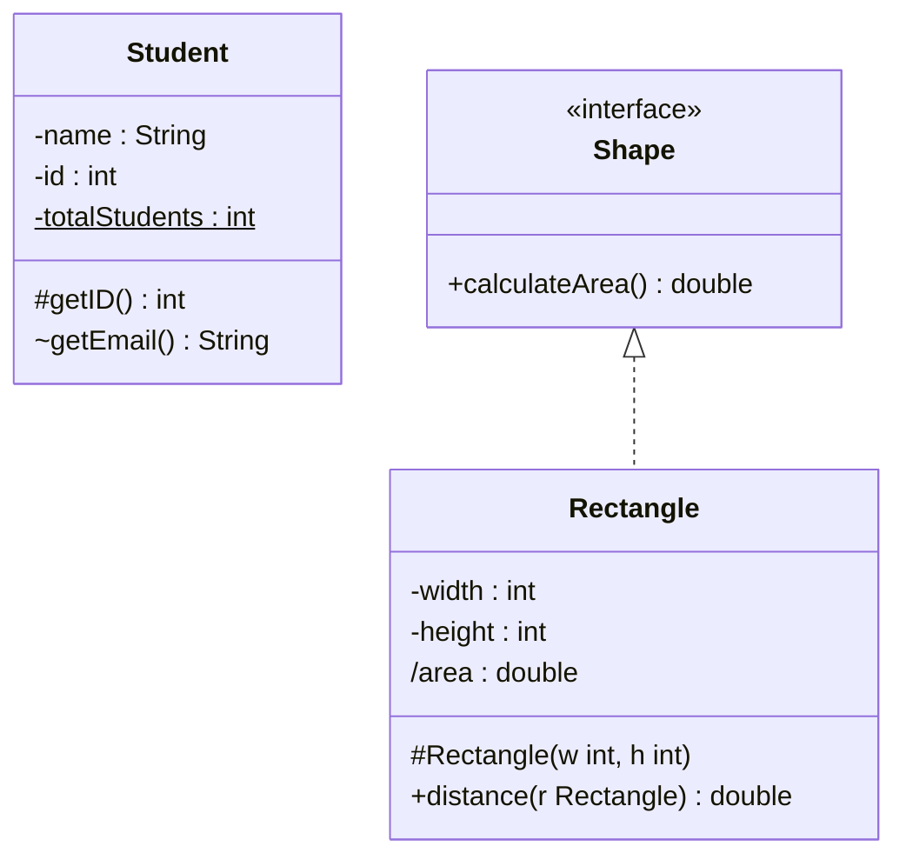
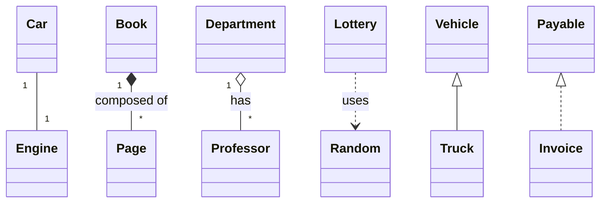
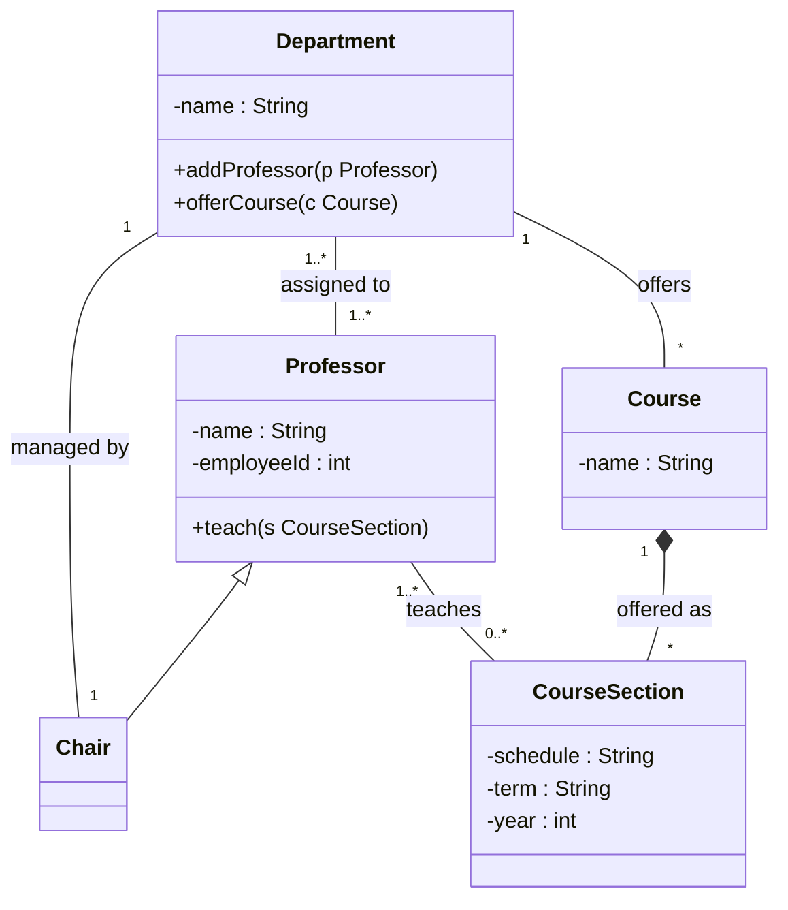

# AI-3 Class Diagram

This note covers AI sir's class diagram lectures (Lec 4, Lec 5, the `class diagram.pptx`, and Lec 6 "ERD to class"). A UML class diagram is the drawing you need in almost every design question: every design-pattern answer needs one, and in several years a whole 12–20 mark question asked you to read a long business scenario and draw its class diagram. The marks come from three things — finding the right classes, using the right relationship symbols, and writing correct multiplicities — so this note teaches the notation precisely and then gives a reliable step-by-step method for scenarios.

**TF frequency:** CSE307 2022-23 Q4(b) accounting software class diagram [12]; 2021-22 Q2(b) university class diagram [10]; 2020-21 Q5(a) media agency class diagram [16]; 2019-20 Q5(a) hospital wards and teams class diagram [20]; plus a UML class diagram inside every pattern question (2023-24 Feb Q2(a)(i) asks "draw the appropriate UML diagram" for 6 marks; Q5(b) asks for a class diagram for a class that is both Adapter and Facade).

📑 **See:** *[1] AI sir/Lec 4 - class diagram.pdf* → p.3 (single class), p.4 (attributes), p.5 (operations), p.6–7 (generalization), p.8–9 (association, multiplicity), p.10 (aggregation, composition, dependency), p.11 (association class), p.12 (video rental example), p.13–14 (inheritance, multiple inheritance); *Lec 5 - class diagram-final.pdf* → same content plus extra worked diagrams p.15–24; *Lec 6 - ERD to class.pdf* → p.2–10 (university example).

---

## 1. What a Class Diagram Shows

> [!important] 🔑 Memorize — Class diagram
> A UML class diagram is ==a picture of the classes in an object-oriented system, their fields and methods, and the connections between classes that interact with or inherit from each other.== It does **not** show the details of how the classes interact over time (that is a sequence diagram) or algorithmic details of how a behaviour is implemented.

The benefits (Lec 4 p.2) are worth one exam sentence each: it illustrates data models of even very complex information systems; it gives an overview of how the application is structured before reading code, which reduces maintenance time; it helps everyone understand the general schematics; it highlights the code that must be written; and it is useful for developers and other stakeholders alike.

## 2. Drawing a Single Class (Lec 4 p.3–5)

A class is a rectangle with three compartments. The **top** holds the class name. Write `<<interface>>` above the name of an interface, and write the name of an **abstract class in italics** (in a hand-drawn exam, also write `{abstract}` or `<<abstract>>` because italics are hard to see). The **middle** compartment holds the attributes, and the **bottom** holds the operations. Both lower compartments are optional, but you must never omit methods of an interface, and you should not repeat inherited methods in a subclass. You may omit trivial getters and setters.

> [!important] 🔑 Memorize — Attribute and operation syntax
> Attribute: `visibility name : type [count] = default_value` — e.g. `- balance : double = 0.0`, `~ courses[100] : Course`.
> Operation: `visibility name(param : type, ...) : return_type` — e.g. `+ calculateGPA(crs : Course[]) : float`. Omit the return type for constructors and for `void`.
> Visibility: `+` public, `-` private, `#` protected, `~` package (default). A `/` before an attribute marks a **derived** attribute (computed from others, e.g. `/ age : int` from date of birth, `/ area : double` from width and height).
> **Underline** static attributes and static methods.



## 3. Relationships Between Classes (Lec 4 p.6–10)

UML splits relationships into two families. **Generalization** is the inheritance family (class inheritance and interface implementation). **Association** is the usage family, which includes plain association, aggregation, composition and dependency.

### 3.1 Generalization and realization

Hierarchies are drawn top-down with the arrow pointing **upward to the parent** and a **hollow triangle** head. Lec 4 p.7 gives the line rules: for a parent **class**, a solid line; for a parent **abstract class**, a solid line with a white (hollow) arrow; for a parent **interface**, a ==dashed line with a white arrow== (this is called *realization*). In practice everyone draws inheritance as a solid line with a hollow triangle and realization as a dashed line with a hollow triangle, which is what you should do in the exam.

Use generalization only for a true "**is-a**" relationship where the subclass can be used wherever the parent is expected (Liskov Substitution, see [[AI-1 Design Principles (SOLID)#5.3 Liskov Substitution Principle (LSP)]]). Lec 4 p.14 shows multiple inheritance (one class with two parent arrows), which UML allows even though Java does not for classes.

### 3.2 Association

A plain association is a **solid line** between two classes, meaning objects of one class are connected to (know about, use) objects of the other for a longer time — typically one class holds a field referring to the other. You may write a **name** on the line (a verb such as "teaches", "contains"), an arrowhead for **navigability** (which side knows about the other; no arrow means both directions), and a **multiplicity** at each end (Lec 4 p.8).

> [!important] 🔑 Memorize — Multiplicity
> `1` exactly one; `*` (or `0..*`) zero or more; `0..1` zero or one; `1..*` one or more; `2..4` between 2 and 4 inclusive; `3..*` three or more.
> The multiplicity is written at the **far end** from the class you are reading from. To read `Book 1 —— * Page`: "each Book has many (*) Pages, and each Page belongs to exactly 1 Book" (Lec 4 p.9). Car 1 —— 1 Engine reads "each car has exactly one engine and each engine belongs to exactly one car".

### 3.3 Aggregation, composition and dependency (Lec 4 p.10)

> [!important] 🔑 Memorize — Association types
> **Aggregation** — "is part of"; a **hollow (white) diamond** on the side of the **whole**. The part can exist without the whole and can be shared (a Department has Professors; if the department closes, the professors still exist).
> **Composition** — "is entirely made of"; a stronger form of aggregation; a **filled (black) diamond** on the whole's side. ==The parts live and die with the whole==, and a part belongs to only one whole at a time (a House is made of Rooms; delete the house and its rooms are gone; an Order is made of OrderLines).
> **Dependency** — "uses temporarily"; a **dashed arrow** from the user to the used class. It is often an implementation detail, not part of the object's state — e.g. `Lottery` uses `Random` inside one method, a factory method creates a product, a method takes a class as a parameter.



> [!warning] ⚠️ Common mistake
> Students often put the diamond on the wrong end. The diamond always touches the **whole** (container), never the part. Also do not use composition just because something "has" something: ask "if I delete the whole, must the part be deleted too, and can the part belong to two wholes?" Only "yes, and no" means composition.

### 3.4 Association class (Lec 4 p.11)

Sometimes the **link itself** has data. In the relationship between `Company` and `Person`, the salary, start date and title belong neither to the person (a person can have several jobs) nor to the company (it has many employees); they belong to *this person's job at this company*. UML draws a class `Job` connected by a **dashed line to the middle of the association line** between Company and Person. The slide stresses that modelling it as Company–Job plus Job–Person associations is not the same, because that does not tie one Job to exactly one specific Company–Person pair. In exams, association classes appear naturally for things like `Enrollment` (Student–Course with a grade), `Admission` (Patient–Ward with dates), or `Transaction` entries between accounts.

Mermaid cannot draw the dashed attachment, so in a Mermaid sketch the association class is shown as a middle class with two associations; on paper, draw the dashed line to the association.

---

## 4. ERD to Class Diagram (Lec 6)

Lec 6 turns a textual description into a class diagram in a fixed sequence, and this is the method you should follow for any long scenario. The University of Toronto scenario (p.2) says: the university has several departments; each department is managed by a chair and at least one professor; professors must be assigned to one, but possibly more, departments; at least one professor teaches each course, but a professor may be on sabbatical and teach none; each course may be taught more than once by different professors; and we know department name, professor name and employee id, course names, schedule, term/year, and which department offers the course.

The first step (p.3) is **finding class candidates** from the nouns: Department, Chair, Professor, Course, and CourseSection (because "taught more than once by different professors" with "schedule" and "term/year" means each offering is its own object). The second step (p.4–6) is **finding relationships**: a chair *is a* professor (generalization), a department *has* professors, a professor *teaches* sections, a section *is an offering of* a course, a department *offers* courses. The third step (p.7) is **finding associations with multiplicities** from words like "at least one" (`1..*`), "one, but possibly more" (`1..*`), "may ... not teach any" (`0..*`), "managed by a chair" (`1`). The fourth step (p.8) draws the basic class diagram, the fifth (p.9) adds attributes, and the last (p.10) adds operations (behaviours).



## 5. Step-by-Step Method for Any Scenario Question

> [!tip] 🎯 TF angle — the 7-step recipe (write the diagram, not the steps)
> 1. Underline every **noun** in the scenario. Nouns that have their own data or behaviour become **classes**; nouns that are just a value (name, date, capacity, price) become **attributes**.
> 2. Look for "**kinds of**" / "differentiated by" / "is a" / "either ... or" → **generalization** (abstract parent + subclasses). If the subtypes have no different behaviour or data, an attribute (e.g. `gender`) is enough.
> 3. Underline every **verb phrase** between two nouns ("visits", "prescribes", "offers", "is headed by") → **association**, with the verb as its name.
> 4. Decide **whole–part** links: "consists of / made of / contains" with lifetime dependence → **composition**; "has / is a member of / groups" with independent lifetime → **aggregation**.
> 5. Translate quantity words into **multiplicities**: "each/exactly one" = 1, "may be empty / one or more" = 0..*, "at least one" = 1..*, "no more than one" = 0..1, "fixed capacity" = attribute + constraint note `{count <= capacity}`.
> 6. If a link carries its own data (date, amount, grade, position) → **association class** (or an intermediate class).
> 7. Add key **attributes** and **operations** (the verbs the scenario says the system does). Write **constraints** in curly braces near the relevant line (e.g. `{patient.gender = ward.gender}`).
> Examiners give most marks for correct classes, correct relationship types and correct multiplicities; visibility symbols are a bonus.

---

## TF questions on this topic

> [!example] ✍️ Worked TF question — 2021-22 Q2(b) [10]: University with departments, faculties, department head, courses offered by departments, students attend courses taught by faculties
> **Reasoning.** The nouns that become classes are `University`, `Department`, `Faculty`, `Course` and `Student`. A university *has multiple departments* and a department cannot exist without the university, so University ◆— Department is **composition** (1 to 1..*). Each department *can have a number of faculties*: aggregation Department ◇— Faculty (1 to 0..*), because faculty members exist as people independently. "A department must have one department head" is a separate association `head` with multiplicity exactly 1 on the Faculty side (the head is one of the faculty; alternatively `DepartmentHead` could be a subclass of Faculty, but an association role is simpler and correct). "Courses are offered by the departments" and "departments have the full freedom not to offer any course" gives Department 1 —— 0..* Course. "Students are also members of the university": University ◇— Student (1 to 0..*). "Students attend course(s) which is instructed by the faculties": Student 0..* —— 1..* Course (attends) and Faculty 1..* —— 0..* Course (instructs). Visibility is not required, so attributes and methods are written without symbols.
>
> ```mermaid
> classDiagram
>     class University {
>         name : String
>         addDepartment(d Department)
>         enrollStudent(s Student)
>     }
>     class Department {
>         name : String
>         offerCourse(c Course)
>         assignHead(f Faculty)
>     }
>     class Faculty {
>         id : String
>         name : String
>         designation : String
>         instruct(c Course)
>     }
>     class Course {
>         code : String
>         title : String
>         credit : double
>     }
>     class Student {
>         id : String
>         name : String
>         attend(c Course)
>     }
>     University "1" *-- "1..*" Department : has
>     University "1" o-- "0..*" Student : member of
>     Department "1" o-- "0..*" Faculty : has
>     Department "1" -- "1" Faculty : head
>     Department "1" -- "0..*" Course : offers
>     Faculty "1..*" -- "0..*" Course : instructs
>     Student "0..*" -- "1..*" Course : attends
> ```

> [!example] ✍️ Worked TF question — 2020-21 Q5(a) [16]: Media agency — newspapers with page rates and discounts, readership database, media plan, approval, release order
> **Reasoning.** The key nouns are `Newspaper`, `Page`, `Rate` (standard unit rate per page, which *may change over time*, so it needs its own class with an effective date), `Discount` (different per newspaper and changes over time), `Readership` (expected readership per page), `Product`/`Client`, `Employee` (two roles: the **planner** who prepares the media plan and the **release officer** who generates the release order), `MediaPlan` (for one product and a budget, made of several ad placements), `AdPlacement` (page, size in column-inches, date, newspaper), `ReleaseOrder` (generated from an approved plan, lists ads with positions, dates and cost).
>
> A Newspaper is composed of Pages (composition). Each Page has a history of Rates (1 to 1..*) and an expected Readership. Each Newspaper has Discounts over time. A MediaPlan is made of AdPlacements (composition) and is for one Product of one Client, prepared by one Employee and approved by the Client. A ReleaseOrder is generated from exactly one approved MediaPlan by one Employee and is made of ReleaseItems (each with position, date and computed cost). Cost of an item = size × current page rate × (1 − current discount).
>
> ```mermaid
> classDiagram
>     class Newspaper {
>         name : String
>         currentDiscount(date) double
>     }
>     class Page {
>         pageNo : int
>         currentRate(date) double
>     }
>     class Rate {
>         ratePerColumnInch : double
>         effectiveFrom : Date
>     }
>     class Discount {
>         percent : double
>         effectiveFrom : Date
>     }
>     class Readership {
>         expectedReaders : long
>     }
>     class Client {
>         name : String
>         approve(p MediaPlan)
>     }
>     class Product {
>         name : String
>     }
>     class Employee {
>         empId : String
>         name : String
>     }
>     class MediaPlan {
>         budget : double
>         status : String
>         totalReadership() long
>         totalCost() double
>     }
>     class AdPlacement {
>         sizeColumnInch : double
>         publishDate : Date
>         cost() double
>     }
>     class ReleaseOrder {
>         orderNo : String
>         issueDate : Date
>         totalCost() double
>     }
>     class ReleaseItem {
>         position : String
>         publishDate : Date
>         cost : double
>     }
>     Newspaper "1" *-- "1..*" Page
>     Newspaper "1" -- "0..*" Discount : offers
>     Page "1" -- "1..*" Rate : priced by
>     Page "1" -- "1" Readership : expected
>     Client "1" -- "1..*" Product : owns
>     MediaPlan "0..*" -- "1" Product : for
>     Employee "1" -- "0..*" MediaPlan : prepares
>     MediaPlan "1" *-- "1..*" AdPlacement
>     AdPlacement "0..*" -- "1" Page : placed on
>     ReleaseOrder "0..1" -- "1" MediaPlan : generated from
>     Employee "1" -- "0..*" ReleaseOrder : generates
>     ReleaseOrder "1" *-- "1..*" ReleaseItem
>     ReleaseItem "0..*" -- "1" Page
> ```
> Add a note on the diagram: `{MediaPlan.totalCost() <= budget}` and `{ReleaseOrder only for MediaPlan.status = approved}`. The Rate and Discount classes with `effectiveFrom` dates are what capture "may change over time" — mention this explicitly, it is the subtle point of the question.

> [!example] ✍️ Worked TF question — 2019-20 Q5(a) [20]: Hospital — wards (male/female, capacity), patients, doctor teams headed by a consultant, junior doctors, daily visits, prescriptions, release advice
> **Reasoning.** `Hospital` is made of `Ward`s (composition). Each ward has a unique `name`, a fixed `capacity`, and a `gender`; "wards are differentiated by gender" can be modelled either with subclasses `MaleWard`/`FemaleWard` or with a `gender` attribute plus a constraint — the subclass version shows the generalization the examiner is looking for. A ward holds 0..* patients and a patient is on at most one ward (0..1 → 1 when admitted), with the constraints `{patients count <= capacity}` and `{patient.gender = ward gender}`. Doctors are organised into `Team`s; each team has a unique name/code and is **headed by exactly one** `ConsultantDoctor`. Doctor is abstract with subclasses `ConsultantDoctor` and `JuniorDoctor`; junior doctors are further fellows, residents or medical students (shown as a `level` attribute or further subclasses). "Each doctor could be a member of no more than one team" gives Doctor 0..* —— 0..1 Team. A consultant "visits the patients admitted under him/her" — so Patient * —— 1 ConsultantDoctor (admitted under) — and during each `Visit` (an association class / intermediate class with date) prescribes a `Prescription` or modifies a previous one, and may advise release.
>
> ```mermaid
> classDiagram
>     class Hospital {
>         name : String
>     }
>     class Ward {
>         <<abstract>>
>         name : String
>         capacity : int
>         admit(p Patient) boolean
>         freeBeds() int
>     }
>     class MaleWard
>     class FemaleWard
>     class Patient {
>         patientId : String
>         name : String
>         gender : String
>         admittedOn : Date
>     }
>     class Team {
>         code : String
>         name : String
>     }
>     class Doctor {
>         <<abstract>>
>         doctorId : String
>         name : String
>     }
>     class ConsultantDoctor {
>         visit(p Patient) Visit
>         adviseRelease(p Patient)
>     }
>     class JuniorDoctor {
>         level : String
>     }
>     class Visit {
>         date : Date
>         notes : String
>     }
>     class Prescription {
>         treatment : String
>         issuedOn : Date
>         modify(t String)
>     }
>     Hospital "1" *-- "1..*" Ward
>     Ward <|-- MaleWard
>     Ward <|-- FemaleWard
>     Ward "0..1" o-- "0..*" Patient : on
>     Hospital "1" *-- "1..*" Team
>     Doctor <|-- ConsultantDoctor
>     Doctor <|-- JuniorDoctor
>     Team "0..1" o-- "1..*" Doctor : members
>     Team "1" -- "1" ConsultantDoctor : headed by
>     ConsultantDoctor "1" -- "0..*" JuniorDoctor : supervises
>     ConsultantDoctor "1" -- "0..*" Patient : admitted under
>     ConsultantDoctor "1" -- "0..*" Visit : makes
>     Visit "0..*" -- "1" Patient : of
>     Visit "1" -- "0..*" Prescription : prescribes or modifies
> ```
> Write the constraints near the Ward–Patient link: `{number of patients <= capacity}` and `{MaleWard holds only male patients; FemaleWard only female}`, and near Team: `{a doctor belongs to at most one team}`. Mention that `Visit` acts as the link between the consultant and the patient on a specific day, which is where prescriptions and release advice are recorded.

## Same type in the papers you will solve last

CSE307 2022-23 Q4(b) — Accounting software: Account hierarchy (parent/child, leaf accounts), Debtor/Creditor, transactions authenticated by password/OTP, deletion constraints. See [[TF 2022-23 (CSE307 May 2024)]].
2023-24 (Feb-2025 paper) Q2(a)(i) — UML for the StockMarket observer design; Q2(b) — UML for HelpHandler chain; Q5(b) — class diagram for one class acting as both Adapter and Facade. See [[TF 2023-24 (Feb 2025 paper)]].
