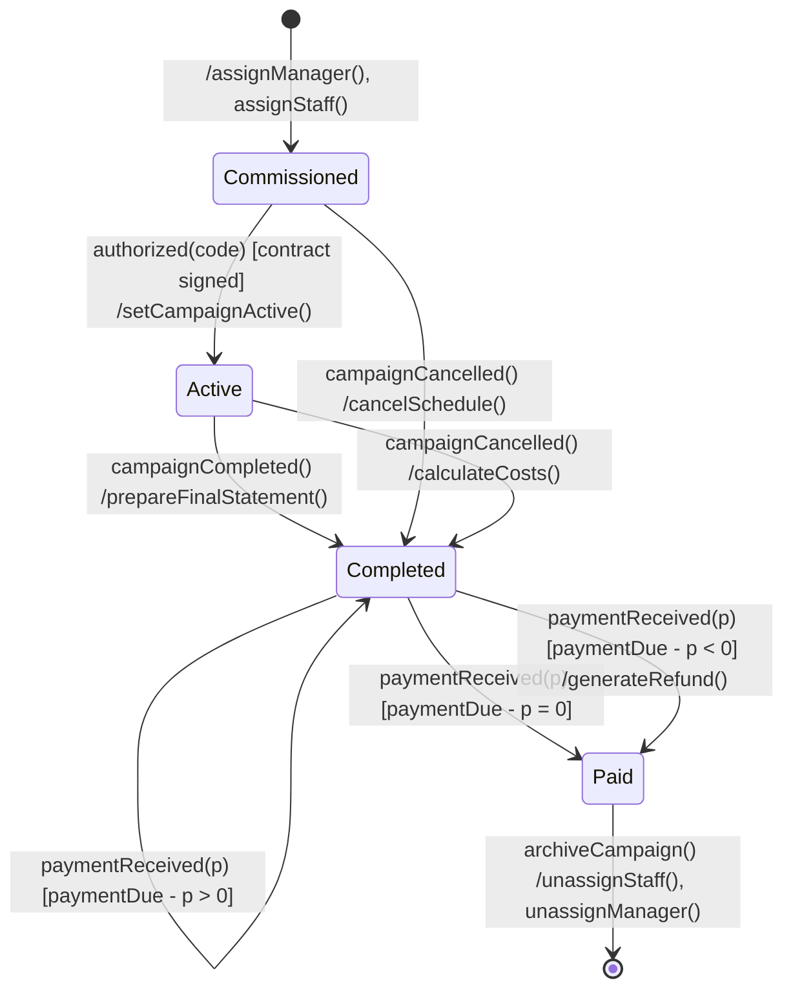
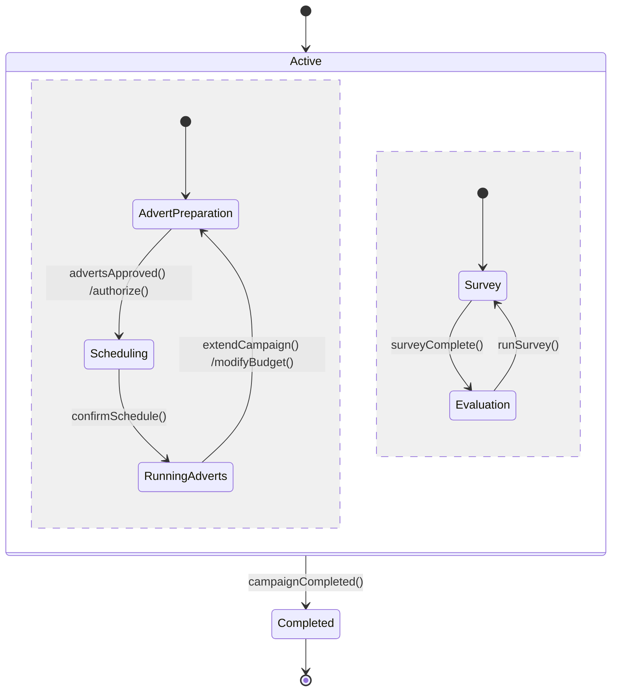
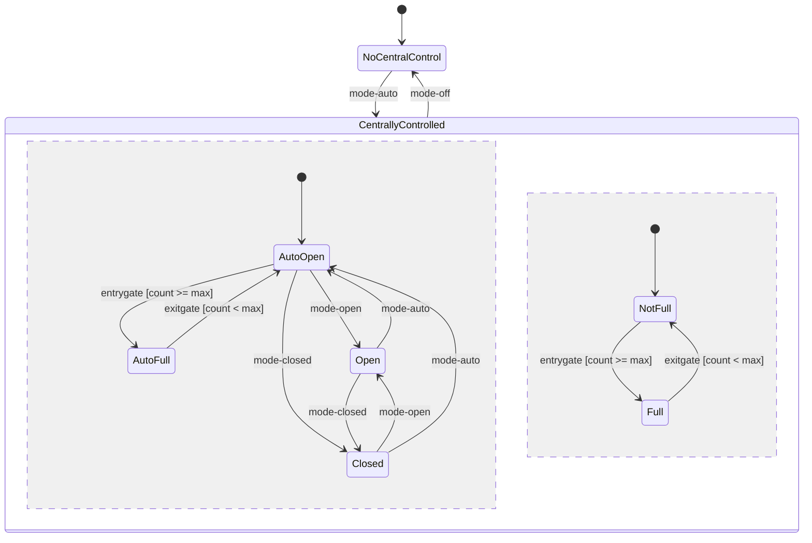

# AI-4 State Diagram (Statechart)

This note covers AI sir's Lecture 7 on UML state diagrams (also called statechart diagrams). A state diagram shows the life of **one object** (or a subsystem) as a set of states, and the events that move it from one state to another. None of the five priority papers asked a stand-alone state diagram question, but the concept is needed in two places that do appear: the **State design pattern** (2023-24 May-2026 Q8(c) asks "State vs Strategy", and the Gumball machine in IJ ma'am's slides starts from a state diagram), and any question that asks you to model an object's behaviour. It is a lower-priority note: read it once, understand the notation, and be able to draw a small statechart from a scenario.

**TF frequency:** No direct question in 2019-20 to 2023-24. Indirectly used for the State pattern in [[IJ-2 Behavioral Design Patterns]].

📑 **See:** *[1] AI sir/Lec 7 - state diagram.pdf* → p.1–2 (state, statechart), p.3 (GradeRate example), p.4 (event types), p.5–7 (events, actions, entry/exit/do), p.10–11 (Campaign statechart), p.12–17 (nested and concurrent states), p.18–20 (how to prepare), p.22–24 (Campaign initial → final), p.25–26 (garage scenario and its solution), p.27–29 (order processing examples).

---

## 1. State and Statechart

> [!important] 🔑 Memorize — State
> ==A state is a condition during the life of an object, or an interaction, during which it satisfies some condition, performs some action, or waits for some event.== The current state of an object is determined by the current values of its attributes and the links it has with other objects.

For example (p.1), a `StaffMember` object has a `startDate` attribute, and that value decides whether the staff member is in the *probationary* state or not. So a state is not a separate piece of data; it is a meaningful interpretation of the object's data.

A **state diagram** (statechart) captures the behaviour of a class, a subsystem, a package or a whole system (p.2). It is used to model **event-based** systems: the state of an object changes only when an event happens. It describes the various states an entity passes through during its life in the application.

## 2. Notation

A **state** is a rounded rectangle with the state name. The **initial state** is a filled black circle (a pseudo-state; the object enters the first real state from here). The **final state** is a filled circle inside a ring (bullseye). A **transition** is an arrow from one state to another, labelled with the trigger.

> [!important] 🔑 Memorize — Transition label syntax
> `event(parameters) [guard condition] / action-expression`
> The **event** triggers the transition. The **guard** is a boolean condition in square brackets; the transition fires only if the guard is true when the event occurs. The **action** after the slash is a quick, non-interruptible operation executed during the transition. Example from p.5: `authorized(authorizationCode) [contract signed] / setCampaignActive()`.

The event on a transition must correspond to an operation of the class (p.5): `authorized()` must be a method of `Campaign`. This is one of the consistency rules between the statechart and the class diagram.

### 2.1 Four types of event (p.4)

> [!important] 🔑 Memorize — Event types
> A ==change event== occurs when a condition becomes true, written `when [condition]` (e.g. `when [rateStartDate <= currentDate]`).
> A ==call event== occurs when an object receives a call to one of its operations, from another object or itself (e.g. `paymentReceived(payment)`).
> A ==signal event== occurs when an object receives a signal — an asynchronous communication.
> An ==elapsed-time event== is caused by the passage of a designated time after a specified event, usually entry into the current state, written `after [1 year]`.

The `GradeRate` example on p.3 uses all of these ideas: it starts in **Pending**, moves to **Active** by the change event `when [rateStartDate <= currentDate]`, moves to **Lapsed** when `[rateFinishDate <= currentDate]`, and reaches the final state by the elapsed-time event `after [1 year]`.

### 2.2 Actions and activities inside a state (p.6–7)

A state box may have an **internal transition compartment** below its name, with these entries. `entry / action` runs every time the object enters the state. `exit / action` runs every time it leaves. `do / activity` is an **ongoing** activity that runs while the object stays in the state and can be interrupted by an event. `include / submachine` refers to a nested statechart drawn elsewhere. An internal transition `event / action` handles an event without leaving the state (so entry and exit are not re-run).

The `DropDownMenu` example on p.7 shows all of them in the state **Menu Visible**: `entry / displayMenu`, `exit / hideMenu`, `do / playSoundClip`, and the internal transition `itemSelected() / highlightItem()`.

> [!warning] ⚠️ Common mistake — action vs activity
> An **action** is instantaneous and cannot be interrupted (on a transition, or entry/exit). An **activity** (`do/`) takes time and is interrupted when a transition leaves the state.

A **self-transition** (recursive transition) is an arrow that leaves and re-enters the same state. On p.10, `paymentReceived(payment) [paymentDue - payment > 0]` loops on **Completed**, modelling any payment that does not clear the debt. Unlike an internal transition, a self-transition does run the exit and entry actions.

## 3. The Campaign Example (p.10–11, p.22–24)

This is the lecture's main example, and it is a good model answer to imitate. A `Campaign` is created (initial state, with action `/assignManager(); assignStaff()`) in state **Commissioned**. The call event `authorized(authorizationCode)` with guard `[contract signed]` and action `/setCampaignActive()` moves it to **Active**. When the campaign finishes, `campaignCompleted() / prepareFinalStatement()` moves it to **Completed**. In Completed, payments arrive: `paymentReceived(payment)` with guard `[paymentDue - payment > 0]` is a self-transition; with guard `[paymentDue - payment <= 0]` (later split into `= 0` and `< 0 / generateRefund()` when the requirement changes, p.11) it moves to **Paid**. Finally `archiveCampaign() / unassignStaff(); unassignManager()` reaches the final state. The final version (p.24) adds `campaignCancelled() / calculateCosts(); prepareFinalStatement()` from Active, and `/cancelSchedule()` from Commissioned.

Notice how the change in user requirements (overpayment must generate a refund) is handled by simply **adding a guarded transition** (p.11). This is why guards are useful: they let you split one event into several outcomes.

## 4. Nested (Composite) and Concurrent States (p.12–17)

A **nested state** (composite state, superstate) contains its own small statechart of **substates**. On p.12, the **Active** state of a Campaign contains **Advert Preparation**, **Scheduling** and **Running Adverts**, connected by `advertsApproved() / authorize()`, `confirmSchedule()` and `extendCampaign() / modifyBudget()`. The inner initial state must not be labelled with an event (it may have an action). If the detail is too big, hide it: write `include / Running` in the composite state and draw the decomposition indicator icon (p.13).

A transition **into** a composite state enters its inner initial substate. A transition **out of** a composite state applies to **all** its substates, however deeply nested (p.16) — this is the main benefit: one `campaignCancelled()` arrow out of Active replaces one arrow from each substate.

**Concurrent states** (p.14–17) are drawn by splitting a composite state with a **dashed line** into regions that run at the same time. On p.14, Active has two regions: **Running** (the advert substates) and **Monitoring** (**Survey** → `surveyComplete()` → **Evaluation**, with `runSurvey()` back). Entering Active means entering the initial substate of **each** region simultaneously, so each region must have its own initial state to avoid ambiguity (p.15). A transition inside one region does not affect the other region. A **synchronization bar** (fork/join) can show explicitly which concurrent substates are entered, and that the composite state is left only when both regions finish (p.17).

## 5. How to Prepare a Statechart (p.18–20)

There are two approaches. The **behavioural approach** starts from the interaction (sequence/collaboration) diagrams: examine all interaction diagrams involving a class that receives many messages; identify incoming messages that correspond to events and the states they lead to; put these on a statechart; elaborate it for additional interactions and exceptions; develop nested statecharts; review it against the use cases; iterate; and finally check consistency with the class diagram, interaction diagrams and other statecharts. Slide p.21 shows the sequence diagram for *Set Campaign Completed*, where messages such as `completeCampaign()` reveal implicit states. The **life-cycle approach** instead thinks about the object's life from creation to deletion and lists the states it naturally goes through (created → active → completed → paid → archived), then adds the events between them.

## 6. Worked Example from the Slides — Garage Control (p.25–26)

The garage has four operator modes (off, auto, closed, open), and events `exitgate`, `entrygate`, plus `count` and `max`. Entry gates are locked in closed mode, unlocked in open mode, in no particular state in off mode, and in auto mode locked when full. The solution (p.26) has a top state **NoCentralControl** (mode-off) and a composite **CentrallyControlled** with two concurrent regions. The first region has substates **Manual** (with **Open**: `entry/unlock entry gates`, and **Closed**: `entry/lock entry gates`) and **Automatic** (with **AutoOpen**: `entry/unlock entry gates`, and **AutoFull**: `entry/lock entry gates`; `entrygate [count >= max]` goes to AutoFull and `exitgate [count < max]` comes back). The second region tracks the sign: **NotFull** (`entry/turn off sign`) and **Full** (`entry/light sign`) with the same guarded events. This example is a good illustration of entry actions, guards, nested states and concurrency together.

(Entry actions — unlock gates in Open/AutoOpen, lock gates in Closed/AutoFull, light sign in Full, turn off sign in NotFull — are written inside the state boxes on paper.)

> [!tip] 🎯 TF angle — link to the State pattern
> A statechart translates directly into the **State design pattern**: each state box becomes a concrete `State` class, each event becomes a method in the `State` interface, and each transition becomes code inside a state's method that calls `context.setState(new NextState())`. Guards become `if` checks inside those methods. That is exactly how the Gumball machine is built in IJ ma'am's slides. See [[IJ-2 Behavioral Design Patterns#State Pattern]].

## TF questions on this topic

The priority papers (2019-20 to 2023-24) did not ask a stand-alone statechart question. Practise by drawing the statechart of a Gumball machine (No Quarter, Has Quarter, Sold, Sold Out, Winner) and of an order (Authorizing → Authorized/Rejected → Delivered, p.29), then turn one of them into State-pattern code.

## Same type in the papers you will solve last

2023-24 (May-2026 paper) Q8(c) — compare State and Strategy patterns (the State pattern is a coded statechart). See [[TF 2023-24 (May 2026 paper)]].
