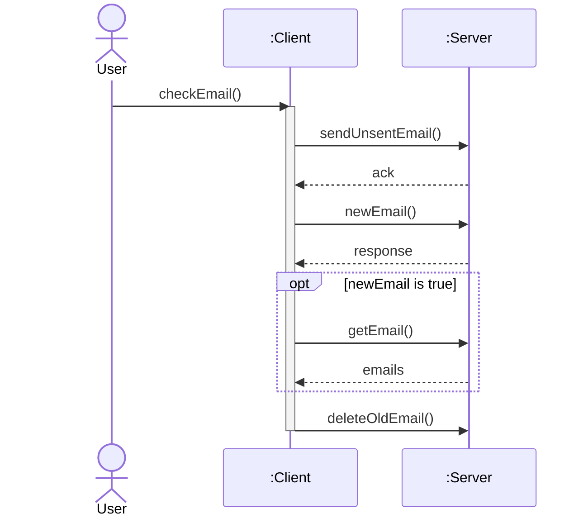
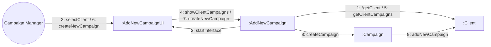

# AI-5 Sequence and Collaboration Diagram

This note covers AI sir's Lecture 8 (sequence diagrams), Lecture 9 (sequence and collaboration diagrams for the course-registration use case) and Lecture 10 (additional collaboration diagrams from Bennett's Chapter 9). Both diagrams are **interaction diagrams**: they show how objects send messages to each other to carry out one scenario of a use case. A sequence diagram puts time on the vertical axis; a collaboration (communication) diagram drops the time axis and numbers the messages instead. The priority papers did not ask a stand-alone sequence diagram question, but you need the notation to explain how a pattern works at run time (for example, how a Mediator or Observer passes messages), and it is the bridge between use cases and class diagrams.

**TF frequency:** No direct question in 2019-20 to 2023-24 (older papers asked it). Useful as a supporting figure in pattern answers (Observer notify flow, Mediator, Chain of Responsibility).

📑 **See:** *[1] AI sir/Lec 8 - sequence diagram.pdf* → p.1–2 (definition, key parts), p.3 (email example), p.4–7 (syntax), p.8 (frames), p.9 (StoreFront/Cart/Inventory example); *Lec 9 - seq-collaboration.pdf* → p.1 (registration use case description), p.2–3 (sequence diagrams), p.4–5 (annotated diagrams), p.6–7 (collaboration diagram), p.8 (model consistency); *Lec 10 - additional collaboration.pdf* → p.2–7 (campaign examples with boundary/control/entity objects).

---

## 1. Sequence Diagram

> [!important] 🔑 Memorize — Sequence diagram
> A sequence diagram is ==an interaction diagram that models a single scenario executing in a system==. It shows what messages are sent between objects and **when**, and so it visualizes the execution sequence of a use case.

It has two axes (Lec 8 p.2). The **horizontal** axis shows which participant is acting; the **vertical** axis is **time**, flowing downward. The participants are objects or actors. The scenario usually begins with an unattached "**found message**" arrow from outside, or from an actor.

### 1.1 Syntax

A **participant (object)** is a box at the top with an underlined label `objectName:ClassName` (p.4). The object name is optional; `:Student` means "some Student object". Write the name when it clarifies the diagram, for example when two objects of the same class take part.

The **lifeline** is the dashed vertical line below each object, representing the life of that object during the scenario.

A **message** is a horizontal arrow from the sender's lifeline to the receiver's lifeline, labelled with the method name and arguments (p.5). The arrow style shows the message type.

> [!important] 🔑 Memorize — Message arrows
> **Synchronous** message (caller waits for the answer, a normal method call): solid line with a **filled (solid) arrowhead**.
> **Asynchronous** message (caller does not wait; a signal): solid line with an **open (stick) arrowhead**.
> **Return** message: **dashed** line with an open (stick) arrowhead.
> **Object creation**: an arrow labelled `new` (or `<<create>>`) pointing to the new object's box, which is drawn **lower** than the others because it did not exist at the start (p.7).
> **Object deletion**: a large **X** at the bottom of the object's lifeline (in Java objects are not explicitly deleted; they go out of scope and are garbage-collected).

An **activation** (execution occurrence) is a thin tall rectangle on the lifeline, drawn while that object's method is on the call stack — either running its own code or waiting for another object's method to return (p.6). When an object calls one of its own methods, draw a **nested activation** (a second box slightly offset) with a self-arrow.

A **guard** written in square brackets before a message, like `[newEmail] getEmail`, means the message is sent only if the condition is true (p.3). An asterisk before the message, like `*getCourseList()`, means it is sent repeatedly (iteration), as in Lec 9 p.3.

### 1.2 Frames (combined fragments) — p.8

A **frame** is a box drawn around part of the diagram with an operator in the top-left corner. ==`opt [condition]`== is an **if** with no else: the content runs only when the condition holds. ==`alt [condition]`== is **if/else**: the box is split by a horizontal dashed line into sections, each with its own guard, and exactly one section runs. ==`loop [condition or items]`== repeats its content, e.g. `loop [for all client's campaigns]` around `getCampaignDetails` (Lec 10 p.7).

### 1.3 Example — checking email (Lec 8 p.3)

The use case says: the user presses "check email"; the client first sends all unsent email to the server; after the acknowledgement it asks the server whether there is new email; if so it downloads it; next it deletes old trashed email from the server.

The StoreFront example (p.9) shows a `loop` frame in which `:StoreFront` sends `AddItem` to `:Cart`, which sends `ReserveItem` to `:Inventory`; after the loop, `Checkout` → `ProcessOrder` (a self-call on Cart) → `ConfirmOrder` back to StoreFront → `PlaceItemInOrder` to Inventory.

### 1.4 The registration example (Lec 9 p.1–3)

Lec 9 first writes the use case's **typical course of events** as two columns, actor action vs system response (p.1): the student opens the registration interface, the system asks for ID and password, the student provides them, the system shows unfinished courses, the student selects a course, the system gets the prerequisite list and checks results, deselects with a message if prerequisites are not passed, then the student finalizes, the system checks total credit hours, notifies the adviser, the adviser asks for details, authorizes, the system updates state and prints the course card.

The sequence diagram then turns each system response into messages between objects: `:MainMenuUI` receives `itemSelected()` with `[selectedItem=register]`, creates `:Register` (the controller), which creates `:RegisterUI` and calls `showLogin()`; the student sends `login(id,pw)`; Register calls `verifyLogin(id,pw)` and `getStudentInfo(id)` on `:Student`; with `[pwAccepted=true]` it calls `*getCourseList()` on `:Courses` and `*getRegInfo(id)` on `:RegInfos`, prepares the unfinished course list and calls `showCourseList(*Courses)`. Inside a **loop**, `selectCourse(Cid)` → `checkPreRequisite()` → either `showError(type)` or `[PRcompleted=true]/addToList(RegInfo)`.

> [!tip] 🎯 TF angle — how to draw one from a use case
> Put the actor at the far left, then a **boundary** object (the UI), then a **control** object (one per use case, e.g. `:Register`), then the **entity** objects (`:Student`, `:Course`). Go through the use-case steps in order and turn each "system does X" into a message to the object that owns the data for X. Use `alt` for "if not passed ... otherwise", `loop` for "for each course", and return arrows for answers. Keep message names identical to the operation names in your class diagram.

### 1.5 Boundary, control and entity objects (Lec 10)

Bennett's diagrams in Lec 10 draw three kinds of objects with special icons. A **boundary** object (a circle with a vertical bar on its left, e.g. `:AddNewCampaignUI`) is the interface between an actor and the system. A **control** object (a circle with an arrow on top, e.g. `:AddNewCampaign`) coordinates one use case. An **entity** object (a circle with a line under it, e.g. `:Client`, `:Campaign`) holds persistent business data. The actor talks only to the boundary; the boundary talks to the control; the control talks to the entities.

---

## 2. Collaboration (Communication) Diagram

> [!important] 🔑 Memorize — Collaboration diagram
> A collaboration diagram ==holds the same information as a sequence diagram== but emphasises the **links** between the objects that take part, instead of time. There is **no time dimension**; the order of messages is shown by **sequence numbers**, written in a **nested decimal style** (1, 2, 3.1, 3.1.1) to show nesting of control — message 3.1 is sent by the object while it is handling message 3 (Lec 9 p.6).

Objects are placed freely on the page and connected by plain lines (links). Each message is written next to a link as `number: messageName(args)` with a small arrow showing its direction. A `*` before a message means iteration, and a `[guard]` means a condition. Letters such as `14a` and `14b` denote **alternative** (or concurrent) messages at the same step.

In the registration collaboration diagram (Lec 9 p.7), the `Student` actor is linked to `RegisterUI` (messages `2. showLogin()`, `3. login()`, `7. showCourseList()`, `8. selectCourse()`, `11. showPRError()`, `12. finalize()`, `14b. showTCError()`, `18. showConfirmation()`), `RegisterUI` is linked to the `Register` controller (`4. verifyLogin()`, `9. verifyPreReq()`, `13. finalize()`), `Register` is linked to `Course` and `Result` (`10. getResult()`) and to `RegistrationInfo` (`18. updateRegInfo()`), and the `Adviser` works through `AuthorizeRegistrationUI` (`14a. showRegInfo()`, `15./16. authorize()`).

In Lec 10 p.2, *Add a new campaign*: the Campaign Manager sends `3. selectClient` and `6. createNewCampaign` to `:AddNewCampaignUI`; the UI sends `4. showClientCampaigns` and `7. createNewCampaign` to the control `:AddNewCampaign`; the control receives `2. startInterface`, calls `1. *getClient` and `5. getClientCampaigns` on `:Client`, `8. createCampaign` on `:Campaign`, and `9. addNewCampaign` links the client to the new campaign.

> [!warning] ⚠️ Common mistake — sequence vs collaboration
> They contain the **same** information and can be converted into each other. Choose the **sequence** diagram when the **order and timing** of messages matters (it is easier to read for long scenarios). Choose the **collaboration** diagram when you want to show **which objects are linked** to which (it shows the structure and is compact). Numbers like 3.1.2 are only used in collaboration diagrams.

## 3. Model Consistency (Lec 9 p.8)

Interaction diagrams must agree with the class diagram, and an examiner may ask for these rules. ==The allocation of operations to objects must be consistent with the class diagram, and each message signature must match the signature of the receiving class's operation.== ==Every sending object must have an object reference to the destination object== — either an association exists between their classes, or another object passes the reference to the sender (as a parameter or return value). Message pathways should therefore be analysed carefully: if your sequence diagram has `:Register` calling `:Course`, your class diagram must have an association (or dependency) from `Register` to `Course`.

## TF questions on this topic

The five priority papers did not ask a stand-alone sequence or collaboration diagram. Practise by drawing the sequence diagram of the **Observer** pattern at run time (`setPrice()` → `notifyAllObservers()` → `loop` over observers → `update()`), and of the **Mediator** air-traffic example (Flight → Tower → other flights). These figures strengthen pattern answers in [[IJ-2 Behavioral Design Patterns]].

## Same type in the papers you will solve last

No direct question. The 2023-24 (Feb-2025 paper) Q2 Observer and Chain-of-Responsibility answers can use a small sequence diagram to show the notification / request-forwarding flow. See [[TF 2023-24 (Feb 2025 paper)]].
