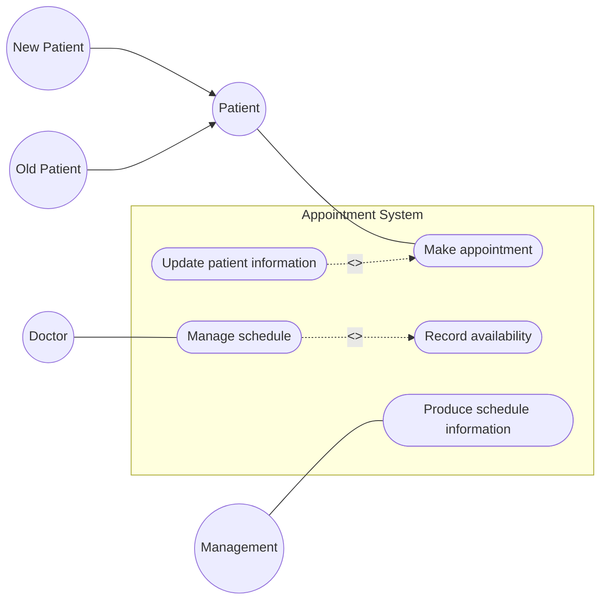
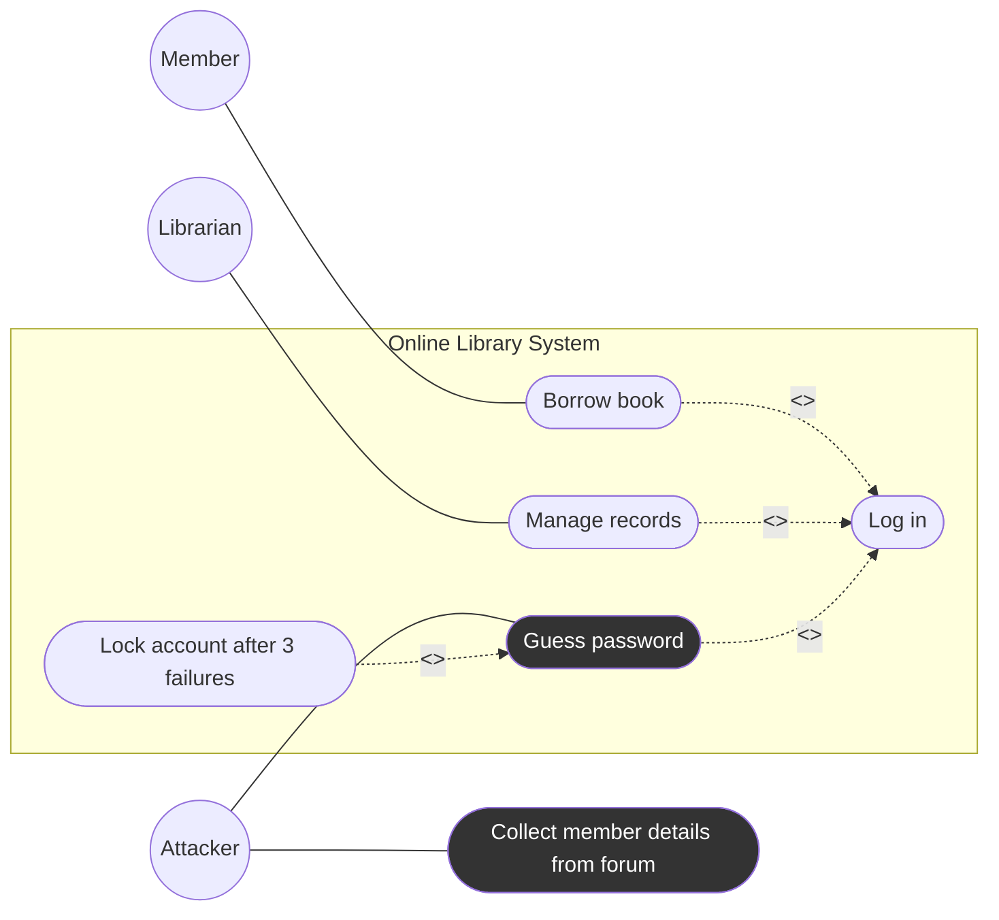

# AI-6 Use Case Diagram

This note covers AI sir's Lecture 15 on use cases: what a use case is, actors and stakeholders, the system boundary, and the three relationships between use cases (include, extend, generalization). A use case diagram describes **what** a system does from the point of view of an outside observer, so it is usually the first diagram drawn from a requirement description. The recent papers ask you to draw one from a case study, including one where an **unauthorised person (attacker)** interacts with the system, so this note ends with a reliable method for drawing a use case diagram from any scenario, including "misuse" actors.

**TF frequency:** 2023-24 (Feb-2025 paper) Q1(a) — draw a use case diagram for the Mentcare case study and show where the criminal can get access [7]. Use cases are also a "system representation technique" in [[IJ-8 Requirement Analysis]].

📑 **See:** *[1] AI sir/Lec 15 - Use case.pdf* → p.1–2 (UML, list of UML diagrams), p.3 (what is a use case), p.4 (actor, primary/supporting actor, stakeholder), p.5 (how to identify actors), p.6 (use case diagram), p.7 (actors), p.8 (use cases), p.9 (association), p.10 (system boundary), p.11 (hospital sample), p.12 (actor generalization), p.13 (extend), p.14 (include), p.15 (hospital diagram with relationships).

---

## 1. What Is a Use Case?

> [!important] 🔑 Memorize — Use case
> A use case is ==a formal way of representing how a business system interacts with its environment==. It illustrates the activities performed by the users of the system. It is a scenario-based technique in UML: ==a sequence of actions a system performs that yields a valuable result for a particular actor== (Lec 15 p.3).

A **use case diagram** describes what a system does from the standpoint of an external observer; the emphasis is on **what** the system does, not **how** (p.6). Use case diagrams are closely connected to **scenarios**: a scenario is one example of what happens when someone interacts with the system. Each use case describes **one and only one function** in which users interact with the system, but it may contain several "paths" a user can take; each path is a scenario (p.8). A use case is drawn as an **ellipse** with its name (a verb phrase, e.g. "Make appointment") inside or below.

## 2. Actors and Stakeholders

> [!important] 🔑 Memorize — Actor, primary actor, supporting actor, stakeholder
> An **actor** is ==anything with behaviour that acts on the system== — a human, a peripheral hardware device, an external system or subsystem, or a time-based event (p.4, p.7). Actors are **outside** the system boundary.
> A **primary actor** initiates an interaction with the system to achieve a goal (when the system is a software product, the primary actor is often the computer user).
> A **supporting actor** performs sub-goals to help the use case (e.g. a payment gateway, an SMS service, a printer).
> A **stakeholder** is anyone interested in the system (e.g. a supplier, a stock agency, a vendor). The difference: ==a stakeholder might not "act" in any scenario==, while an actor always interacts with the system.

An actor is drawn as a **stick figure**, whether it is human or not, and must be **labelled** with its name (p.7). An actor represents a **role**, not a person: a single actor may represent many physical users, and one person may play several roles. Slide p.5 gives the questions to ask when identifying actors: who is interested in the scenario; where in the organization it will be used; who will benefit from it; who will supply, use or remove information; does one person play several different roles (then you may need one actor for each role); and do several people play the same role (then use only **one** actor for that role, however many people play it). Identifying actors is iterative: describing how each actor interacts often reveals duplicate actors.

## 3. Relationships

**Association** (p.9) is the communication between an actor and a use case, drawn as a **plain solid line** (sometimes with an arrow) between the stick figure and the ellipse. It means "this actor takes part in this use case".

**System boundary** (p.10) is a **rectangle** drawn around all the use cases, with the system's name at the top. Actors are drawn **outside** it. It defines the scope of the system: a system cannot have infinite functionality, so the boundary shows exactly what is inside. For a large system, each module (personnel, payroll, accounting of an ERP) may have its own boundary.

> [!important] 🔑 Memorize — Include, extend, generalization
> **«include»** (p.14): the base use case **always** uses the behaviour of another use case. ==Arrow drawn from the base use case to the included use case==, dashed, labelled `<<include>>`. Example: *Manage schedule* includes *Record availability*. Use it to pull out a common step shared by several use cases (e.g. *Login*, *Verify password*).
> **«extend»** (p.13): the extension use case adds **optional** behaviour to the base use case under some condition. ==Arrow drawn from the extension use case to the base use case==, dashed, labelled `<<extend>>`. Example: *Update patient information* extends *Make appointment*.
> **Generalization** (p.12): from **child to parent**, solid line with a **hollow triangle** at the parent. It works for actors (*New Patient* and *Old Patient* are kinds of *Patient*) and for use cases (*Pay by card* is a kind of *Pay*).

> [!warning] ⚠️ Common mistake — the arrow directions
> Include points **to** the included (reused) use case: base ──include──▶ part. Extend points **to** the base: optional ──extend──▶ base. A quick check: the arrow always starts at the use case whose description *mentions* the other one. The base mentions what it includes; the extension mentions which base it extends.

### Hospital example (p.11, p.15)

The appointment system has actors *Management*, *Patient* (specialised into *New Patient* and *Old Patient*) and *Doctor*. Use cases include *Make appointment*, *Produce schedule information*, *Record availability* and *Manage schedule*. *Update patient information* «extends» *Make appointment* (only sometimes needed), and *Manage schedule* «includes» *Record availability*.

(On paper, draw the actor generalization arrows with hollow triangles, and the use cases as ellipses inside a labelled rectangle.)

---

## 4. Method: Drawing a Use Case Diagram From a Case Study

> [!tip] 🎯 TF angle — the recipe
> 1. Draw the **system boundary** rectangle and write the system's name on top.
> 2. Read the case and list every **role** that interacts with the system — people (staff, receptionist, customer), external systems (national database, payment gateway, SMS service) and time triggers. Each becomes an actor **outside** the box. One actor per role, not per person.
> 3. For each actor, list the **goals** it achieves with the system ("log on", "view record", "transfer data"). Each goal is a use case ellipse **inside** the box, named with a verb phrase.
> 4. Connect actors to their use cases with association lines.
> 5. Find steps that several use cases share and must always happen (*Log in*, *Authenticate*) → «include». Find optional or conditional additions → «extend». Find kinds of actors or use cases → generalization.
> 6. If the question mentions a person who **misuses** the system (a criminal, an attacker, an unauthorised user), add that role as an actor too, and show **which use cases he reaches and how** (see below).
> 7. Label everything; examiners deduct for unlabelled actors and missing boundaries.

### Showing an attacker (misuse) on a use case diagram

A use case diagram can also show **misuse cases**: actions an unwanted actor performs against the system. The technique (Sindre and Opdahl's *misuse case diagram*) is a normal use case diagram with two additions. The hostile actor, often called **Misuser** or **Attacker**, is drawn as a stick figure (traditionally filled black or labelled clearly), and the hostile actions are drawn as **misuse cases** — ellipses (often shaded) named with the bad action, such as *Guess password* or *Impersonate staff*. Two extra dashed relations connect them: a misuse case ==«threatens»== the normal use case it attacks, and a defensive use case ==«mitigates»== the misuse case. Even without this special vocabulary, the minimum the examiner wants is: the criminal appears as an actor, connected to the use cases or entry points he actually uses (for example the normal *Log on* use case, because he logs on with a stolen identity), with a short note explaining how he gets there.

Here is a general example (not the exam case): an online library where an attacker tries to read other users' accounts. Members *Log in* and *Borrow book*; *Borrow book* includes *Log in*. The attacker *Collects member details* from a public forum, then *Guesses passwords*, which threatens *Log in*; the system's *Lock account after 3 failures* mitigates the guessing.

Notice two details. The information-gathering step (*Collect member details from forum*) happens **outside** the system boundary, because it does not use the system — in a case study, things like talking to staff or reading name badges are outside the system too. And the attacker enters the system through the **same** *Log in* use case that legitimate users use, which is exactly the point the examiner wants you to show: the weakness is in that use case.

## TF questions on this topic

The older priority papers (2019-20 to 2021-22) did not ask a use case diagram. Practise with the hospital example above and with the course registration use case from [[AI-5 Sequence and Collaboration Diagram]] (actors Student and Adviser; use cases *Login*, *Select courses*, *Check prerequisites* (included), *Finalize registration*, *Authorize registration*, *Print course card* (extends finalize)).

## Same type in the papers you will solve last

2023-24 (Feb-2025 paper) Q1(a) — use case diagram of the Mentcare system showing the processes where the criminal gains access [7]. See [[TF 2023-24 (Feb 2025 paper)]].
