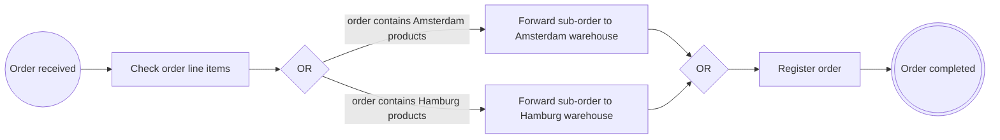
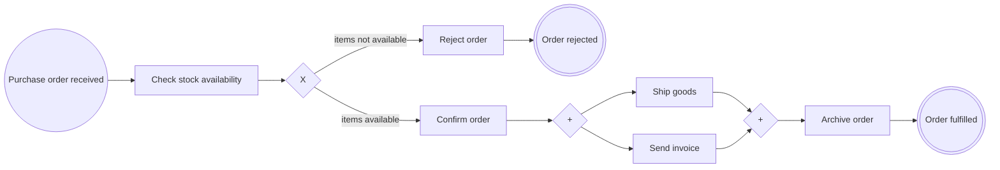

# AI-7 BPMN (Business Process Model and Notation)

This note covers AI sir's Lecture 14 on BPMN, the standard notation for drawing **business processes**: who does what, in which order, with which decisions, and which documents flow between the steps. A BPMN diagram is like a flowchart with precise meanings for every symbol, so the marks depend on using the right gateway (XOR, AND or OR) and the right flow (sequence flow inside a pool, message flow between pools). BPMN is also listed in IJ ma'am's requirement-analysis slides as a system representation technique. No priority paper asked a BPMN diagram, so this is a lower-priority note, but you should be able to read and draw a small process correctly.

**TF frequency:** No direct question in 2019-20 to 2023-24. Mentioned as a representation technique in [[IJ-8 Requirement Analysis]].

📑 **See:** *[1] AI sir/Lec 14 - BPMN.pdf* → p.2–5 (core elements, first order process, triggers and outcomes), p.6–10 (XOR gateway, invoice checking example, default flow), p.11–13 (AND gateway, airport security, revised order-to-cash), p.14–18 (XOR vs AND vs OR, order distribution solutions), p.19 (beginner's mistake), p.20 (naming conventions), p.21–25 (pools, lanes, message flow, syntactic rules), p.26–29 (data objects, data stores, text annotations).

---

## 1. The Core Elements

A BPMN process model is built from four kinds of things. **Events** are things that *happen* (they have no duration) and are drawn as **circles**: a **start event** (thin circle) is the trigger of the process, and an **end event** (thick circle) is an outcome. **Activities** are units of work that *take time* and are drawn as **rounded rectangles** (a *task* is an atomic activity). **Gateways** are **diamonds** that split or merge the flow. **Sequence flows** are **solid arrows** that give the order in which activities are performed.

Slide p.5 makes an important reading point: by looking only at the start and end events you already see the process's triggers and possible outcomes. The first order process has one trigger (*Purchase order received*) and two outcomes (*Order fulfilled*, a positive outcome, and *Order rejected*, a negative one). For the seller the goal is the positive outcome, because that delivers value to the customer.

> [!important] 🔑 Memorize — Naming conventions (p.20)
> Give a name to **every** event and task. Name a **task** with a ==verb followed by a business object== (e.g. *Issue driver licence*, *Check stock availability*). Name a **message event** with ==object + past participle== (e.g. *Invoice received*, *Claim settled*). Avoid generic verbs such as *Handle* or *Record*. Label each **XOR-split** with a **condition** on each outgoing branch.

## 2. Gateways

> [!important] 🔑 Memorize — The three gateways
> **XOR gateway** (diamond with **X**, or an empty diamond) — exclusive decision. The **XOR-split** takes ==exactly one== outgoing branch, chosen by the conditions. The **XOR-join** passes on each incoming branch as soon as it arrives (it merges alternative paths without waiting).
> **AND gateway** (diamond with **+**) — parallel. The **AND-split** takes ==all== outgoing branches. The **AND-join** proceeds only when ==all incoming branches have completed== (synchronisation).
> **OR gateway** (diamond with **O**, a circle) — inclusive. The **OR-split** takes ==one or more== branches depending on conditions. The **OR-join** proceeds when all ==active== incoming branches have completed (it waits only for the branches that were actually started).

A gateway is a gating mechanism that allows or disallows the passage of **tokens**; as tokens arrive they can be split apart on output or merged on input (p.9). A **default flow** (marked with a small slash at its start) is the branch taken from an XOR- or OR-split when all other conditions evaluate to false (p.10, p.18).

The **XOR example** (p.6–10) is invoice checking: after *Check invoice for mismatches*, an XOR-split goes to *Post invoice* (no mismatches), *Re-send invoice to customer* (mismatches exist but can be corrected), or *Block invoice* (cannot be corrected), and an XOR-join merges them before *Park invoice*.

The **AND example** (p.12) is airport security: after *Proceed to security check*, an AND-split leads to *Pass security screening* and *Pass luggage screening*; an AND-join waits for both before *Proceed to departure level*. Slide p.19 adds an important note: activities on two parallel paths **need not happen at the same time** — "parallel" means they are **independent** and can happen in any order.

### Choosing between XOR, AND and OR (p.14–18)

The order distribution example explains the choice. A company has two warehouses (Amsterdam and Hamburg) storing different products. When an order arrives, a sub-order is sent to Amsterdam **if** some products are kept there, and a sub-order to Hamburg **if** some are kept there; afterwards the order is registered. Here the number of branches varies: sometimes one warehouse, sometimes both. Solution 1 (p.15) and Solution 2 (p.16) model this awkwardly by combining XOR and AND gateways to cover every case. The clean solution (p.18) uses an **OR-split** with the two conditions and an **OR-join** that waits only for the active branches.

> [!warning] ⚠️ Beginner's mistake (p.19)
> Never join two **alternative** (XOR) branches with an **AND-join**: the AND-join would wait forever for a branch that was never started (deadlock). And never join two **parallel** branches with an XOR-join: the next activity would run twice. Match each split with a join of the **same type**.

## 3. Pools, Lanes and Message Flow (p.21–25)

A **pool** captures a resource class and is generally used to model a **business party**, such as a whole company or the customer. A **lane** is a resource sub-class within a pool, used to model departments (shipping, finance), internal roles (manager, associate) or software systems (ERP, CRM). Lanes can be nested. A pool is the container of the sequence flow between its activities.

A **message flow** represents a flow of information between **two pools** (two process parties). It is drawn as a ==dashed line with an open arrowhead== (and a small circle at its start). It can connect directly to the boundary of a pool (an informative message to/from that party) or to a specific activity or event in the pool (a message that triggers that activity or event).

> [!important] 🔑 Memorize — Syntactic rules (p.25)
> ==A sequence flow cannot cross the boundary of a pool== (use a message flow between pools). Both sequence flows and message flows **can** cross the boundaries of **lanes** inside a pool. ==A message flow cannot connect two elements within the same pool.==

In the order-to-cash process (p.22–24), the seller's pool has lanes for *Sales*, *Warehouse & Distribution* and *ERP system*, while the customer is drawn as a separate **black-box pool** (an empty pool, because we do not model the customer's internal process). Purchase orders, invoices and notices travel as message flows between the two pools. Slide p.21 also suggests complementing BPMN models with organisational charts, role–responsibility matrices and RACI diagrams.

## 4. Artifacts (p.26–29)

A **data object** (a page with a folded corner) captures an artifact required (input) or produced (output) by an activity, and can be physical or electronic; its state can be shown in square brackets, such as *Purchase order [approved]* or *[rejected]*. In the order-to-cash example, the purchase order is an input to *Check stock availability*, its status is updated to approved or rejected, and if approved an invoice and a shipment notice are produced. A **data store** (a cylinder) is a place containing data objects that must persist beyond the duration of one process instance, such as a database or a filing cabinet; activities store data in it or retrieve data from it. A **text annotation** (an open-ended rectangle linked by a **dotted, undirected** line, called an *association*) gives extra information to the reader, such as "includes packaging" on *Ship goods* or "by blocked invoices" on *Clear vendor line items*. Annotations do **not** affect the flow of the process.

## 5. Order-to-Cash Example (putting it together)

The full example (p.24–26): a purchase order is received from the customer (a message start event). The task *Check stock availability* is followed by an XOR-split. If the items are not available, *Reject order* leads to the end event *Order rejected*. If available, *Confirm order*, then an AND-split runs *Ship goods* and *Send invoice* in parallel (in any order); an AND-join waits for both, then *Archive order* leads to the end event *Order fulfilled*.

> [!tip] 🎯 TF angle
> When drawing BPMN from a scenario: list the start trigger and the outcomes first; write every task as verb + object; use XOR when the text says "if/otherwise", AND when it says "both / at the same time / meanwhile", and OR when it says "if some ... and/or if some ..."; put each participant organisation in its own pool and connect pools only with dashed message flows; close every split with a join of the same type.

## TF questions on this topic

No BPMN question appeared in the priority papers. Practise by redrawing the order distribution process with an OR gateway and the order-to-cash process with lanes (Sales, Warehouse, Finance) and a black-box Customer pool.

## Same type in the papers you will solve last

No direct question in the 2023-24 or 2022-23 papers.
