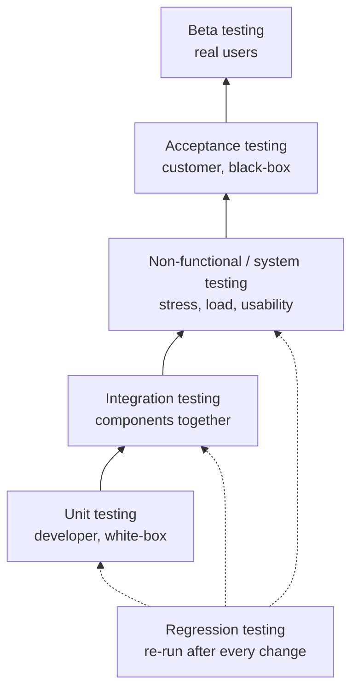
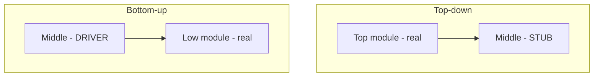

# AI-8 Software Testing Fundamentals

This note covers AI sir's Lecture 11, which explains what testing is, the words used to describe bugs, the two basic testing models (black-box and white-box), and the six types of testing. It also covers several topics that the slides only touch on but the term finals ask directly: integration strategies with stubs and drivers, the family of performance tests (with a JMeter setup), smoke versus regression testing, and whether a code review counts as black-box testing. Almost every recent paper has at least one 8 to 15 mark question from this note, so read it fully.

**TF frequency:** six testing types (2021-22 Q3b), integration testing (2019-20 Q5b, CSE307 2022-23 Q1c, May-2026 Q6c), load vs stress (2019-20 Q8b), performance testing plan with JMeter (May-2026 Q7a), smoke vs regression (2020-21 Q8c), code review as black-box (2019-20 Q8b).

📑 **See:** *[1] AI sir / Lec 11 - Software testing.pdf* → p.1–22 (whole lecture is short; p.14 lists the six types, p.21 has the testing hierarchy picture).

---

## 1. Quality control: fault avoidance and fault tolerance

Software quality is protected in two very different ways. The first way is to stop errors from getting into the released product at all. This is called ==fault avoidance==, and it includes reviews, inspections, walkthroughs, good development methodologies, testing and formal verification. Testing belongs here because its job is to find faults before the users do.

The second way accepts that some faults will survive and designs the system so that it can recover from them by itself. This is called ==fault tolerance==, and it uses techniques such as rollbacks, redundancy and mirroring. A database that rolls back a half-finished transaction after a crash is tolerating a fault, not avoiding it.

> [!important] 🔑 Memorize — Fault avoidance vs fault tolerance
> **Fault avoidance** prevents errors before the system is released (reviews, inspections, walkthroughs, methodologies, testing, verification).
> **Fault tolerance** lets the system recover from (some classes of) errors by itself (rollbacks, redundancy, mirroring).

📑 **See:** Lec 11 → p.1

## 2. Verification and validation

These two words sound alike but answer two different questions, and examiners love to see the two famous one-line questions written correctly.

==Verification== checks whether the output of a development phase satisfies the conditions that were set at the start of that phase. It asks "**Are we building the product right?**" Testing and reviews are verification activities, because they check the work against the design and the specification.

==Validation== checks, during or at the end of development, whether the system satisfies the specified requirements of the customer. It asks "**Are we building the right product?**" It is done by comparing the product against the requirements, for example through acceptance testing with the client.

> [!important] 🔑 Memorize — V&V
> **Verification:** "Are we building the product *right*?" — evaluate whether the products of a phase satisfy the conditions imposed at the start of that phase (testing, reviews).
> **Validation:** "Are we building the *right* product?" — evaluate whether the system satisfies the specified requirements (comparison against requirements).

> [!tip] 🎯 TF angle
> White-box testing is mainly useful for **verification** and black-box testing is mainly useful for **validation** (Lec 11 p.9 and p.12). Mention this link whenever you compare the two models.

## 3. Mistake, fault, failure and error

The slides define four terms that describe the life of a bug. A ==mistake== is the human action that produces an incorrect result, for example the programmer forgetting a case. A ==fault== (also called a ==defect==) is the incorrect step, process or data definition that is now sitting inside the program because of that mistake. A ==failure== is what the user sees: the system is unable to perform its required function within the required performance. An ==error== is the measurable difference between the computed or observed value and the true, correct value.

The slide example uses a recursive factorial function:

```java
int factorial(int a) {
    if (a == 1)          // only stops at exactly 1
        return 1;
    return a * factorial(a - 1);
}
```

The **mistake** is that the programmer did not consider numbers less than 1. The **defect** is the missing input validation in the code. If someone calls `factorial(0)` or `factorial(-3)`, the recursion never reaches 1, the stack overflows and the program crashes; that crash is the **failure**. The **error** is the difference between what we got (overflow/crash) and what was expected (an exception or an error message for invalid input).

> [!important] 🔑 Memorize — the chain
> ==Mistake (human) → Fault/Defect (in code) → Failure (visible wrong behaviour); Error = difference between observed and correct value.==

📑 **See:** Lec 11 → p.3 (definitions), p.4 (factorial diagram — look at the picture, it labels each term)

## 4. What testing is and when to do it

Software testing is the process of analysing a software item to detect the differences between existing and required conditions (that is, bugs) and to evaluate the features of the software item. Testing should be done ==throughout the whole development process==, not only at the end. The goal of testing is to write test cases that *cause failures*, because a test that never fails tells you nothing new. However, no amount of testing can guarantee that all faults have been found, so we "work smart": we write as few test cases as possible that still cause failures, and we avoid having more than one test that causes the same failure.

📑 **See:** Lec 11 → p.5–7

## 5. Black-box testing and white-box testing

### Black-box testing

In ==black-box testing== the tester ignores the internal mechanism of the component and looks only at the outputs produced for selected inputs and conditions. The interface is visible but the internals are unknown. You know what the system is supposed to do, so you test its functionality against the specification from the outside. The three questions you ask are: what is the input to the system, what can you do from outside to change the system, and what is the output.

Black-box testing has four advantages. The testing process is not influenced by the component being tested, so assumptions hidden in the code do not leak into the test data. It is robust to changes in implementation, because the test data need not change when the code changes. It allows independent testers who do not need to know the code. And it is useful for validation, that is, checking that we are building the right software. Its main disadvantage is that it will miss bugs in the implementation that the specification does not mention, such as control-flow details, performance optimizations and alternate algorithms used for different cases.

### White-box testing

==White-box testing== takes the internal mechanism into account. Because the tester knows the code, they test what happens inside: the logical paths through the code, conditionals, loops and branches, and they check the program state against expected values.

White-box testing finds an important class of boundaries (the ones written in the code), yields useful test cases, is very useful for examining important data structures, and is useful for verification (building the software right). Its disadvantages are that the tests may contain the same misunderstanding as the implementation (the same person thinks the same wrong way), and that it is impossible to exercise every path thoroughly because the number of paths grows without bound.

> [!important] 🔑 Memorize — one-line definitions
> **Black-box:** ignores internal mechanism; focuses solely on outputs generated in response to selected inputs and execution conditions. Good for **validation**.
> **White-box:** takes into account the internal mechanism; logical paths, conditionals, loops and branches are tested. Good for **verification**.

The techniques that belong to each model are worth remembering, because exam questions often say "design black-box test cases" or "design white-box test cases". Black-box techniques are equivalence partitioning, boundary value analysis, positive and negative testing (see [[AI-10 Equivalence Partitioning and BVA]]). White-box techniques are statement, branch, condition and path coverage (see [[AI-9 Code Coverage and White-box Testing]]).

📑 **See:** Lec 11 → p.8–13

## 6. The six types of testing

The slides list exactly six types: unit, integration, non-functional, acceptance, regression and beta. Learn them in this order, because they also show the order in which a product grows from small pieces to a released system (look at the testing hierarchy picture on p.21).

==Unit testing== is the testing of individual hardware or software units or groups of related units. It is done by the programmer, is generally white-box, verifies that the code does what it is intended to do at a very low structural level, and should be automated so it can be repeated. JUnit is the standard tool (see [[IJ-4 Unit Testing and JUnit]]).

==Integration testing== combines software components, hardware components or both and tests them to evaluate the *interaction* between them. It is done by programmers as they integrate their code into the code base. Its whole reason for existing is that ==components that work individually do not necessarily work together==. It is generally white-box with some black-box.

==Non-functional testing== (the slides also describe it as system testing on the complete, integrated system) evaluates the system's compliance with its specified requirements, especially quality requirements. It includes **stress testing** (evaluating the system *beyond* the limits of its specification), **performance/load testing** (evaluating compliance with specified performance requirements) and **usability testing** (how easily a user can learn to operate the system, prepare inputs and interpret outputs). It is recommended to be done by an external test group and is mostly black-box, so that testing is not "corrupted" by too much knowledge of the code.

==Acceptance testing== is formal testing to decide whether the system satisfies its acceptance criteria, so that the customer can decide whether to accept it. It is generally done by the customer or a customer representative, in their own environment, through the GUI, and it is ==definitely black-box==.

==Regression testing== is selective retesting of a system or component to verify that modifications have not caused unintended effects and that the system still complies with its requirements. It uses a subset of the original test cases: a core group re-run after any significant change, chosen to exercise all existing functionality plus extra tests most likely to be affected by the change. A ==smoke test== is a subset of the regression tests that establishes that the system is stable and all major functionality is present and works under normal conditions.

==Beta testing== means the organization gives an advance partial or full version free to one or more potential users, who use it as they wish and report errors back. Its advantages are the identification of unexpected errors, low cost and a wider population and environment. Its disadvantages are the lack of systematic testing and low-quality error reports.

> [!important] 🔑 Memorize — the six types (Lec 11 p.14)
> Unit · Integration · Non-functional (stress, performance/load, usability) · Acceptance · Regression · Beta.
> Who does it: unit and integration → programmers; non-functional → external test group; acceptance → customer; beta → real potential users.
> Box type: unit → white; integration → mostly white; non-functional → mostly black; acceptance → definitely black.



📑 **See:** Lec 11 → p.14–21 (p.21 hierarchy diagram)

### Alpha versus beta (extra, often useful)

The slides only define beta testing, but it is good to contrast it with alpha testing in one sentence. ==Alpha testing== is done by users or internal testers *at the developer's site* in a controlled environment before release, while ==beta testing== is done by real users *in their own environment* before the final release. Alpha finds problems under supervision; beta finds problems in the wild.

## 7. Test plan

A ==test plan== is a document describing the scope, approach, resources and schedule of the intended testing activities. It identifies the test items, the features to be tested, the testing tasks, who will do the testing, and any risks that need contingency plans. The plan should be written early in the development cycle, because if you wait until the end you will be working in a chaotic, hurried environment, and testing should happen throughout the cycle.

📑 **See:** Lec 11 → p.22

---

## 8. Integration testing strategies (asked in TF, not detailed in slides)

The slides define integration testing but not *how* to integrate. The May-2026 paper (Q6c) asks exactly this, so learn the four strategies and the two helper pieces of code, stubs and drivers.

A ==stub== is a small fake version of a **lower-level** module that the module under test *calls*. It returns fixed or simple answers so that the higher module can be tested before the real lower module exists. A ==driver== is a small fake version of a **higher-level** module that *calls* the module under test. It feeds inputs into the lower module and collects outputs so the lower module can be tested before the real caller exists.

> [!important] 🔑 Memorize — Stub vs Driver
> **Stub** = replaces a missing *called* (lower) module → used in **top-down** integration.
> **Driver** = replaces a missing *calling* (higher) module → used in **bottom-up** integration.

**Big-bang integration** puts all modules together at once and tests the whole thing. It needs no stubs or drivers, but when a test fails it is very hard to tell which interface caused it, so it only suits small systems.

**Top-down integration** starts from the top-level module (for example, the user interface) and adds lower modules one by one. Missing lower modules are replaced by stubs. Its advantage is that the main control flow and an early skeleton of the system can be shown to users quickly; its disadvantage is that low-level modules, which often hold the real processing, are tested late, and writing realistic stubs can be hard.

**Bottom-up integration** starts from the lowest-level modules (for example, sensor reading or database access) and moves upward. Missing higher modules are replaced by drivers. Its advantage is that the basic, critical low-level logic is tested early and thoroughly; its disadvantage is that no working skeleton of the whole program exists until the end.

**Sandwich (hybrid) integration** combines both: the top layers are integrated top-down and the bottom layers bottom-up at the same time, meeting at a middle target layer. It is useful for large systems and also when the *middle* layer is the one that is late, because the top can be tested with stubs standing in for the middle and the bottom can be tested with drivers standing in for the middle.



### Internal versus external integration testing

==Internal integration testing== checks the interaction between components *inside* your own system, for example the Ride Booking component calling the Fare Calculation component of a ride-sharing app, or the Payroll component of an HRM module calling the Promotion component. ==External integration testing== checks the interaction between your system and *another system you do not control*, such as a payment gateway, Google Maps API, an SMS service or a different module owned by another team (for example the HRM module talking to the Accounts module). External integration testing usually involves network calls, data format agreements and failure handling (timeouts, wrong responses), so the test cases must include what happens when the external side is slow or returns an error.

## 9. The performance testing family (asked in TF, beyond slides)

The slides only name stress, performance/load and usability testing. The May-2026 paper asks you to pick the right performance test for different operational risks and to give a JMeter configuration, so you need the full family. All of these are ==non-functional, black-box== tests on the complete system.

==Load testing== checks how the system behaves under the *expected* normal and peak load (for example, the expected 2,000 simultaneous users). Its goal is to confirm that response time and throughput meet the requirements at that load.

==Stress testing== pushes the system *beyond* its specified limits until it breaks. Its goal is to find the breaking point and to check that the system fails gracefully (shows an error, does not lose data) and recovers afterwards.

==Spike testing== applies a *sudden*, very sharp increase in users over a very short time (for example 10,000 users within a few seconds when registration opens). Its goal is to check whether the system can absorb a burst and recover when the burst ends.

==Endurance (soak) testing== keeps a normal load running for a *long time* (for example 8 to 24 hours). Its goal is to discover problems that only appear over time, such as memory leaks, connection pool exhaustion and gradual slowdown.

==Scalability testing== increases the load step by step (or adds hardware) to see how well performance scales, and ==volume testing== feeds a very large amount of *data* (for example millions of database rows) to see how the system copes with data size rather than user count.

> [!important] 🔑 Memorize — match the risk to the test
> Sudden burst → **Spike**. Beyond capacity / collapse → **Stress**. Slowdown after hours → **Endurance (Soak)**. Expected traffic meets SLA? → **Load**. Huge data → **Volume**. Growth → **Scalability**.

### Load versus stress in one paragraph

Load testing asks "does the system meet its performance requirements under the load we *expect*?" while stress testing asks "what happens when the load goes *beyond* what we designed for, where does it break, and does it recover?" Load testing stays within the specification; stress testing deliberately leaves it. The slide wording is the one to quote: stress testing is "evaluating a system beyond the limits of its specification", performance/load testing is "evaluating the compliance of a system with specified performance requirements".

### A simple JMeter configuration

Apache JMeter simulates users with a ==Thread Group==, which has four main settings. **Number of Threads** is the number of virtual users. **Ramp-Up Period** is the time in seconds JMeter takes to start all those threads; a short ramp-up creates a burst and a long ramp-up creates gradual growth. **Loop Count** is how many times each user repeats the test steps (or "infinite"). **Duration** (with the scheduler) is how long the test should run in total, which matters for long-running tests.

The pattern to remember is simple. A spike test uses many threads with a very small ramp-up (for example 10,000 threads, ramp-up 10 s, loop count 1). A stress test uses a number of threads above the known capacity, increased gradually (for example 15,000 threads, ramp-up 300 s, loop count infinite, duration 30 min) so you can watch where it breaks. An endurance test uses a normal number of threads with an infinite loop and a long duration (for example 1,000 threads, ramp-up 120 s, loop infinite, duration 8–10 hours). A load test uses the expected peak number of threads with a moderate ramp-up and moderate duration.

## 10. Smoke testing versus regression testing

A ==smoke test== is a small, quick subset of tests run on a new build to check that the system is stable enough to test further, meaning the major functions start and work under normal conditions. It is broad but shallow. A ==regression test== is a larger selective retest run after a change, to make sure the change did not break anything that used to work. It is deeper and covers existing features plus those most likely to be affected. The slides say a smoke test is a *subset* of the regression test cases. So the order in practice is: a new build arrives → run the smoke test → if it passes, run the regression suite.

## 11. Is code review a black-box test?

==No.== A code review (see [[IJ-5 Code Reviews]]) is a static examination of the source code by a peer. The reviewer reads the internal logic, structure, conditions and data handling, so the reviewer clearly *knows the internals*. Black-box testing by definition ignores the internal mechanism and only checks outputs for given inputs. Therefore code review is closer to a ==white-box, static verification technique== (it is part of fault avoidance), not black-box testing. It also does not even execute the program, while testing (black or white) normally runs the code.

---

## TF questions on this topic

> [!example] ✍️ Worked TF question — 2021-22 Q3(b) [10] — Briefly discuss the six types of testing
> **Unit testing** tests individual units (a method or class) in isolation. It is done by the programmer, is generally white-box and is automated (for example with JUnit) so it can be repeated after every change. Example: testing `calculateBill()` of a restaurant `Order` class alone.
>
> **Integration testing** combines components and tests the interaction between them, because units that work individually may not work together. It is done by programmers as they merge code, mostly white-box. Example: testing that `Order` correctly passes items to the `Kitchen` component.
>
> **Non-functional testing** evaluates the complete integrated system against non-functional requirements: stress testing (beyond the limits of the specification), performance/load testing (meeting specified performance requirements) and usability testing (how easily users learn and use it). It should be done by an external group and is mostly black-box.
>
> **Regression testing** is selective retesting after modifications to check that no unintended effect was introduced and the system still meets its requirements. It re-runs a core subset of the old test cases plus those most affected by the change; the smoke test is a subset of it.
>
> **Acceptance testing** is formal testing done by the customer, in their environment, through the GUI, to decide whether the system meets its acceptance criteria and should be accepted. It is definitely black-box.
>
> **Beta testing** gives an advance version free to potential users who use it freely and report errors. It finds unexpected errors cheaply in a wide range of environments, but the testing is not systematic and error reports are often poor.

> [!example] ✍️ Worked TF question — 2020-21 Q8(c) [8] — Smoke vs regression testing, with an example
> Smoke testing is a quick, shallow check on a fresh build that confirms the system is stable and its major functions work under normal conditions; if it fails, the build is rejected and no further testing is done. Regression testing is a deeper selective retest, done after a modification, to confirm that the change has not broken previously working features and the system still meets its requirements. A smoke test is a subset of the regression suite.
>
> Example (online result portal): after a new build adds a "download PDF" feature, the **smoke test** checks only that the site opens, a student can log in, and a result page loads. If that passes, the **regression test** re-runs the full set of earlier tests — login with wrong password, result search by roll, GPA calculation, admin upload of marks — plus the tests near the changed area (the result page and printing), to make sure the new feature broke nothing.

> [!example] ✍️ Worked TF question — 2019-20 Q8(b) [15] — Load vs stress testing in the context of BIIS; is code review black-box?
> **Load testing** evaluates whether BIIS meets its specified performance requirements under the *expected* load. Suppose the requirement is that BIIS must support 3,000 concurrent students during course registration with each page loading within 3 seconds. A load test simulates 3,000 students logging in, viewing the course list and submitting registration, and measures response time and throughput to confirm the requirement is met.
>
> **Stress testing** evaluates BIIS *beyond* the limits of its specification. We keep increasing the simulated users to 5,000, 8,000, 12,000 (for example, all students hitting the server when results are published) until the system slows down badly or crashes. The goal is to find the breaking point, and to check that BIIS fails gracefully — showing a "server busy, try again" message instead of corrupting registration data — and recovers when the load goes down.
>
> The key difference: load testing stays inside the specified load and checks compliance; stress testing deliberately exceeds it to find the breaking point and recovery behaviour.
>
> **Is code review black-box?** No. In a code review a peer reads the source code and examines its internal logic, conditions, style, error handling and security. Black-box testing, by definition, ignores the internal mechanism and checks only outputs for selected inputs. Since the reviewer depends completely on knowing the internals, code review is a white-box *static* verification activity (fault avoidance), and it does not even execute the program.

> [!example] ✍️ Worked TF question — 2019-20 Q5(b) [15] — Integration testing requirements for the HRM module of an ERP
> Integration testing checks that components which work individually also work correctly together. In the HRM module the components are Employment Record, Promotion Management, Payroll & Loan Management, Disciplinary Action Management and Pension Management, and HRM must also talk to the Accounts module.
>
> **Four inter-component integrations (inside HRM — internal integration):**
> First, **Disciplinary Action → Payroll:** when an employee is suspended, the Disciplinary component must notify Payroll, and Payroll must start paying exactly half salary from the suspension date; we test that the suspension flag and date reach Payroll correctly. Second, **Disciplinary Action → Payroll (reinstatement):** when the investigation proves the employee innocent, Payroll must compute and pay back the withheld half salary for exactly the suspension period, and if guilty no refund is generated. Third, **Promotion → Employment Record and Payroll:** an approved promotion must update the designation and grade in the Employment Record, and Payroll must use the new salary from the effective date. Fourth, **Employment Record → Pension:** on retirement, the service length and last basic salary must flow from Employment Record to Pension Management so the pension is computed correctly (and a suspension period should be handled according to the rule). A fifth useful one is **Loan → Payroll:** loan instalments must be deducted from the monthly salary.
>
> **Two inter-module integrations (HRM ↔ Accounts — external to HRM):**
> First, **Payroll → Accounts:** every monthly salary disbursement (full, half during suspension, and the paid-back arrear) must generate correct journal entries in Accounts (salary expense debited, bank credited), and the totals must match. Second, **Pension / Loan → Accounts:** pension payments and loan disbursements/repayments must post to the correct ledger accounts, and Accounts must confirm the posting back to HRM so that the employee's record shows paid status.
>
> For each integration, the test checks that data is passed in the right format, at the right time, with correct values, and that errors (for example Accounts not responding) are handled without losing or duplicating payments.

## Same type in the papers you will solve last

Do not solve these now; they are the same kinds of questions as above, and you will meet them at the very end.

2023-24 (May-2026 paper) Q6(c) — integration testing when the middle module (Temperature Controller) is not ready (use the sandwich idea with stubs and drivers). 2023-24 (May-2026 paper) Q7(a) — choosing spike/stress/endurance tests and a JMeter configuration. CSE307 2022-23 Q1(c) — internal and external integration testing examples for a ride-sharing app. See [[TF 2023-24 (May 2026 paper)]] and [[TF 2022-23 (CSE307 May 2024)]].

Related notes: [[AI-9 Code Coverage and White-box Testing]] · [[AI-10 Equivalence Partitioning and BVA]] · [[IJ-4 Unit Testing and JUnit]] · [[IJ-5 Code Reviews]]
