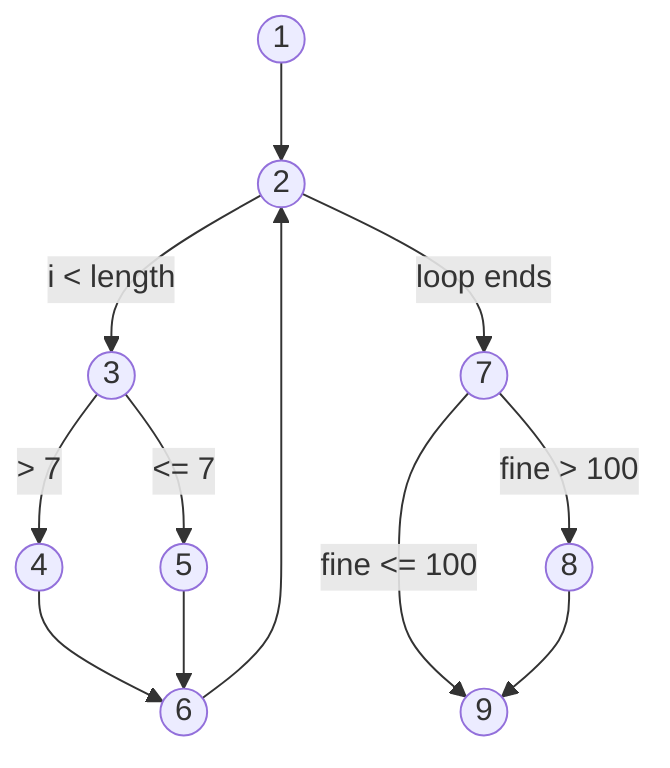

# AI-9 Code Coverage and White-box Testing

This note covers AI sir's Lecture 12 on code coverage, and it extends it into a complete method for writing white-box test cases: building a control-flow graph, computing cyclomatic complexity, listing basis paths and choosing minimal input sets for each coverage criterion. Term finals give you a small code segment and say "generate white-box test cases" or "show a minimal dataset that achieves condition coverage", and they also ask why high coverage matters. If you can do the getTriangle example below by hand without looking, you can answer every coverage question in the last five papers.

**TF frequency:** example test execution with method, branch and condition coverage (2020-21 Q6b), white-box test cases for a loop program (Feb-2025 Q3b), importance of high coverage and risks of low coverage (Feb-2025 Q5c), minimal dataset for condition coverage (CSE307 2022-23 Q4c).

📑 **See:** *[1] AI sir / Lec 12 - Coverage.pdf* → p.1–2 (definitions), p.3–6 (the getTriangle example, one slide per criterion — look at the red test lines, they show what each criterion adds), p.7 (benefits and limitations), p.8 (tools).

---

## 1. What code coverage means

==Code coverage== is a measure used to describe the degree to which the source code of a program is tested by a particular test suite. High code coverage means the program has been more thoroughly tested and has a lower chance of containing undiscovered bugs. Coverage is a *white-box* idea, because you can only measure which lines, branches or conditions ran if you can see the code.

> [!important] 🔑 Memorize — Coverage criteria (Lec 12 p.2)
> **Method coverage:** Have all methods been called?
> **Statement coverage:** Have all statements in a method been executed?
> **Decision / Branch coverage:** Have all decisions been executed in both the true and false paths?
> **Condition coverage:** Has every individual (atomic) condition inside each decision evaluated to both true and false?

The difference between a *decision* and a *condition* is the single most important idea in this note. A decision is the whole boolean expression of an `if` or `while`, such as `(a == b && b == c)`. A condition is one atomic piece of it, such as `a == b` or `b == c`. Branch coverage only cares that the whole decision went true once and false once. Condition coverage cares that each piece went true once and false once.

## 2. The getTriangle example from the slides, worked completely

All four slides use the same function. Copy it into your memory because you can reuse it in any "explain with an example" question.

```java
String getTriangle(int a, int b, int c) {
    if (a == b && b == c) {          // Decision D1: conditions C1 (a==b), C2 (b==c)
        success();
        return "Equilateral";
    }
    if (a == b || b == c || c == a) { // Decision D2: conditions C3 (a==b), C4 (b==c), C5 (c==a)
        return "Isosceles";
    }
    return "Scalene";
}

void success() {
    printf("Got it!");
}
```

### Method coverage (p.3)

The test suite starts with `getTriangle(1,1,2)`. This calls `getTriangle` but never calls `success()`, because the triangle is not equilateral. So method coverage is incomplete. The slide adds `getTriangle(2,2,2)` (shown in red), which enters the first `if` and calls `success()`. Now ==every method has been called==, so method coverage is 100%. Notice how weak this is: we still never reached "Scalene".

### Condition coverage (p.4)

The slide's suite is `(2,2,3)`, `(2,2,2)`, `(1,2,2)` and `(2,1,2)`. The idea is that each atomic condition of the second decision must have its own chance to be the one that makes the decision true. With `(2,2,3)` the condition `a==b` is true. With `(1,2,2)` the condition `a==b` is false but `b==c` is true. With `(2,1,2)` both `a==b` and `b==c` are false but `c==a` is true. And `(2,2,2)` makes both conditions of the first decision true, while `(2,2,3)` makes `b==c` false in the first decision and `(1,2,2)` makes `a==b` false there.

> [!warning] ⚠️ Common mistake — Java short-circuit evaluation
> Java's `&&` and `||` stop evaluating as soon as the answer is known. In `a==b || b==c || c==a`, if `a==b` is true the other two are never evaluated. So when you claim a condition was "false", make sure it was actually *evaluated*. In the slide's four tests, `c==a` is only ever evaluated as true; it becomes evaluated-false only when we add `(2,3,4)`. For a strict answer, say that strict condition coverage needs each condition to be *evaluated* both true and false, and add the test that does it.

### Branch coverage (p.5)

Condition coverage did not guarantee branch coverage here: the second decision never became false, so `return "Scalene"` never executed. The slide adds `getTriangle(2,3,4)` (in red), which makes D2 false. Now D1 has been true `(2,2,2)` and false `(2,2,3)`, and D2 has been true `(2,2,3)` and false `(2,3,4)`. That is 100% ==branch (decision) coverage==.

> [!important] 🔑 Memorize — Condition coverage does not imply branch coverage
> You can make every atomic condition true and false and still never make the whole decision false (or true). The getTriangle slides prove it: after the condition-coverage tests, "Scalene" was still unreached. That is why the slide adds (2,3,4) for branch coverage.

### Statement coverage (p.6)

With all five tests `(2,2,3)`, `(2,2,2)`, `(1,2,2)`, `(2,1,2)`, `(2,3,4)` every statement — `success()`, all three `return`s and the `printf` — has executed, so statement coverage is 100%. The slides build the suite cumulatively, but in an exam you should also be able to give the ==minimal== set. For statement coverage only three tests are needed: `(2,2,2)` for Equilateral and `success()`, `(2,2,3)` for Isosceles and `(2,3,4)` for Scalene. The same three tests also achieve branch coverage here.

### Summary of the example in one paragraph

Method coverage needed `(2,2,2)` to call `success()`. Condition coverage needed tests where each of `a==b`, `b==c`, `c==a` is individually responsible for the result. Branch coverage needed `(2,3,4)` so the second `if` goes false. Statement coverage is satisfied by the same three tests that give branch coverage. The general strength order is: ==method < statement < branch < (branch + condition) < multiple-condition < path==, but note that plain condition coverage is *not* stronger than branch coverage, as the example showed.

## 3. Two stronger criteria: multiple-condition and path coverage

==Multiple-condition coverage== requires every *combination* of truth values of the atomic conditions in each decision to be tested. A decision with *n* atomic conditions needs up to 2ⁿ combinations, so `a==b && b==c` needs 4 combinations (TT, TF, FT, FF) and `a==b || b==c || c==a` needs up to 8, although some combinations are impossible (for example a==b true, b==c true and c==a false cannot happen) and short-circuiting hides others. A combined criterion that is often asked is ==branch + condition coverage== (also called decision/condition coverage): every decision goes true and false, *and* every condition goes true and false.

==Path coverage== requires every distinct path from entry to exit to be executed. With loops the number of paths can be infinite, which is exactly the slide's point that "it is impossible to thoroughly exercise all paths". In practice we use ==basis path testing== instead, which tests a set of linearly independent paths.

## 4. Basis path testing: control-flow graph and cyclomatic complexity

This is the systematic method to use when the question says "generate test cases for white-box testing from the following code". It is not written out in the slides, but it is the standard answer and examiners accept it fully.

Step one is to number the statements and draw a ==control-flow graph (CFG)==: each node is a statement or a block of statements that always run together, and each edge is a possible transfer of control. An `if` node has two outgoing edges (true and false). A `while` node has two outgoing edges (enter the body, or exit the loop), and the end of the loop body has an edge back to the `while` node.

Step two is to compute the ==cyclomatic complexity== V(G), which tells you how many independent paths (and therefore at least how many test cases) you need for basis path coverage.

> [!important] 🔑 Memorize — Cyclomatic complexity
> ==V(G) = E − N + 2== (E = edges, N = nodes of the CFG)
> ==V(G) = P + 1== (P = number of decision/predicate nodes; count each `if`, `while`, `for`, `case`)
> V(G) = number of bounded regions of the planar graph + 1 (the outer region counted)
> If a decision is compound (`a && b`), counting each atomic condition as a predicate gives the stricter value.

Step three is to list V(G) ==linearly independent paths==, where each new path adds at least one edge that no earlier path used. Step four is to choose input data that forces each path and to write the expected output. Step five, for loops, is to add ==loop tests==: zero iterations (skip the loop), exactly one iteration, two iterations, a typical number, and the maximum (or a large number).

### A worked generic example (a loop with an inner if and a final if)

The following function has the same shape as the loop programs that appear in papers: a loop, a decision inside the loop, and a decision after the loop.

```java
int totalFine(int[] lateDays) {
    int fine = 0;  int i = 0;              // node 1
    while (i < lateDays.length) {          // node 2  (decision)
        if (lateDays[i] > 7)               // node 3  (decision)
            fine += 10;                    // node 4
        else
            fine += 5;                     // node 5
        i++;                               // node 6  (back to node 2)
    }
    if (fine > 100)                        // node 7  (decision)
        fine = 100;                        // node 8
    return fine;                           // node 9
}
```



The graph has 9 nodes and 11 edges (1-2, 2-3, 2-7, 3-4, 3-5, 4-6, 5-6, 6-2, 7-8, 7-9, 8-9). So V(G) = 11 − 9 + 2 = ==4==. Checking with predicates: there are three decisions (nodes 2, 3 and 7), so V(G) = 3 + 1 = 4. Both formulas agree, which is a good self-check to write in the script.

The four independent paths and their test data are as follows. Path P1 is 1-2-7-9: the loop is skipped, so the input is an empty array `{}` and the expected output is 0. Path P2 is 1-2-3-4-6-2-7-9: one book that is late by more than 7 days, input `{10}`, expected 10. Path P3 is 1-2-3-5-6-2-7-9: one book late by 7 days or less, input `{3}`, expected 5. Path P4 must reach node 8, which needs a fine above 100, so it goes round the loop several times; input eleven books each 10 days late gives 110, which is capped, expected 100. Notice that P4 cannot be taken with only one loop iteration; when a basis path is infeasible as written, you make it feasible by repeating the loop, and you say so.

To these we add loop tests: zero iterations (P1 already), one iteration (P2 already), two iterations such as `{10, 3}` expecting 15, and many iterations as in P4. Finally we add boundary inputs around the decisions: `{7}` expecting 5 and `{8}` expecting 10 test the `> 7` boundary, and a total of exactly 100 (ten books late by 10 days) expecting 100 without the cap tests the `> 100` boundary.

> [!tip] 🎯 TF angle — how to present white-box test cases
> Write the numbered code, draw the CFG, compute V(G) two ways, list the independent paths, then give a small test-case list where each line is: test ID, input, path covered, expected output. Finish with loop tests (0, 1, 2, many iterations) and boundary inputs. This structure earns full marks even if the code is different.

## 5. How to design a minimal test set for each criterion

For ==statement coverage==, find the statements that are only reached under special conditions (inside `if` bodies, `else` parts, after loops) and pick one input that reaches each group; often one test can cover several. For ==branch coverage==, list every decision and pick inputs so that each one goes true once and false once; a loop decision must both enter and skip (or exit). For ==condition coverage==, list every atomic condition and make each one *evaluated* true and *evaluated* false, remembering short-circuiting. For ==branch + condition coverage==, satisfy both lists at once. For ==method coverage==, make sure every method, including helpers like `success()`, is called at least once. In all cases, start with the fewest tests and add one only when something is still uncovered, then state why each test is needed.

## 6. Benefits and limitations of coverage

The benefits are that coverage gives a measure of how complete your test cases are and it can identify paths through the code that you have missed. The limitations are equally important and are frequently asked. ==High coverage does not guarantee code correctness.== It is wrong to assume you are done testing because coverage is high. Coverage tools only tell you whether you have covered *what is there*; they cannot tell you about requirements that were never coded, so missing features stay invisible. You should not write test cases only to make the coverage tool happy, and you should inspect the surrounding code for other errors and missed requirements.

The tools named on the slides are djUnit (an Eclipse plug-in measuring statement and branch coverage), EclEmma (instruction, block, line, method and type coverage at bytecode level) and Clover (a commercial tool measuring method, statement and decision coverage).

📑 **See:** Lec 12 → p.7 (benefits/limitations), p.8 (tools)

## 7. Why high coverage matters, and the risks of low coverage

High coverage matters because code that has never run in a test is code whose behaviour nobody has checked. Every untested line, branch or condition is a place where a bug can sit silently until a real user triggers it, when it is far more expensive to fix. High coverage gives the team confidence that the main logic, error handling and edge branches have at least been exercised; it makes regression testing meaningful, since a change that breaks a covered line will be caught immediately; and it acts as a measurable quality goal that can be tracked over time.

When coverage is too low, several risks appear. Bugs in untested branches — very often the error-handling and rare-case branches — reach production. Dead or unreachable code goes unnoticed. Refactoring becomes dangerous, because there are no tests to show that behaviour stayed the same (see [[IJ-6 Refactoring and Code Smells]]). Security holes in unvalidated input paths may go undetected. And the team gets a false sense of quality from tests that all pass but only touch a small part of the code. At the same time, remember the balancing point from the slides: high coverage is necessary but not sufficient, because it cannot detect missing requirements.

---

## TF questions on this topic

> [!example] ✍️ Worked TF question — 2020-21 Q6(b) [15] — Example test execution ensuring method, branch and condition coverage; characteristics of good unit testing
> **Code under test**
> ```java
> double shippingCost(double weight, boolean express) {
>     double cost = 50;
>     if (weight > 5 && express)        // D1: C1 = weight>5, C2 = express
>         cost += surcharge(weight);
>     if (weight > 10 || express)       // D2: C3 = weight>10, C4 = express
>         cost += 20;
>     return cost;
> }
> double surcharge(double w) { return w * 10; }
> ```
> **Test execution**
> T1: `shippingCost(6, true)` → D1 true (C1 T, C2 T), so `surcharge(6)` = 60 is added; D2: C3 F, C4 T → true, add 20. Expected **130**.
> T2: `shippingCost(2, false)` → D1 false (C1 F, C2 not evaluated); D2: C3 F, C4 F → false. Expected **50**.
> T3: `shippingCost(12, false)` → D1: C1 T, C2 F → false; D2: C3 T → true, add 20. Expected **70**.
>
> **Method coverage:** both `shippingCost` and `surcharge` are called (T1) — 100%.
> **Branch coverage:** D1 is true in T1 and false in T2/T3; D2 is true in T1/T3 and false in T2 — 100%. (T1 and T2 alone already give branch coverage.)
> **Condition coverage:** C1 is T in T1/T3 and F in T2; C2 is T in T1 and F in T3 (evaluated because C1 was true); C3 is T in T3 and F in T1/T2; C4 is T in T1 and F in T2 (evaluated because C3 was false) — 100%. T3 is the test that was added purely to make `express` evaluate false in D1.
>
> **Characteristics of good unit testing** (from the IJ unit-testing slides): a good unit test is ==automatic== (runs completely by itself without human input), ==atomic== (decides by itself whether the function passed or failed, with no human interpreting the result), has ==single responsibility== (tests exactly one feature), is ==independent== (runs in isolation from all other tests, even those testing the same function) and is ==repeatable== (multiple runs always give the same result). It should also be fast and have a descriptive name and assertion messages. See [[IJ-4 Unit Testing and JUnit]].

## Same type in the papers you will solve last

Do not solve these now. Feb-2025 paper Q3(b) — white-box test cases for the FindMean loop program (use section 4 exactly). Feb-2025 paper Q5(c) — importance of high coverage and the risks of low coverage (section 7). CSE307 2022-23 Q4(c) — minimal dataset for condition coverage (section 2 and section 5; watch the `||` short-circuit). See [[TF 2023-24 (Feb 2025 paper)]] and [[TF 2022-23 (CSE307 May 2024)]].

Related notes: [[AI-8 Software Testing Fundamentals]] · [[AI-10 Equivalence Partitioning and BVA]] · [[IJ-4 Unit Testing and JUnit]]
