# AI Sir Diagram Questions — CSE 325 (2017-18 to 2023-24)

These are every UML diagram question from the seniors' **CSE 325 (Information System Design / Information Systems Development and Management)** term finals, the course AI sir's diagram part comes from. Seven papers were checked: 2017-18, 2018-19, 2019-20, 2020-21, 2021-22, 2022-23 and 2023-24. Only the five diagram types below are collected; BPMN, ERD, DFD, PERT and mock-dashboard questions are left out.

The questions are grouped by diagram type, and inside each type they go from the oldest paper to the newest. Every question gives the **year, question number and marks**, the **full question**, and then a **solution**. On paper, draw the diagrams with proper UML symbols (stick-figure actors, ellipses, lifelines, rounded states); the Mermaid figures here show the same content.

🔗 Concepts: [[AI-6 Use Case Diagram]] · [[AI-3 Class Diagram]] · [[AI-5 Sequence and Collaboration Diagram]] · [[AI-4 State Diagram]]

> [!tip] 🎯 What repeats
> ==State diagram and collaboration diagram come almost every year==, usually 12–16 marks each. A sequence diagram came in 2018-19, 2019-20, 2020-21, 2022-23 and 2023-24. Some scenarios are reused word for word: the **inventory product** state diagram (2018-19 and 2020-21), the **tourism package** (state in 2019-20, sequence in 2020-21), the **MPO teacher eligibility** (collaboration in 2022-23), the **garage** state diagram (the exact example from Lec 7 p.25), and "show an example of extends" (2018-19 and 2020-21).

| # | Diagram | Year · Question · Marks |
|---|---|---|
| 1 | Use case | 2017-18 Q3(a) [24], 2018-19 Q1(b) [8], 2019-20 Q1(b) [25], 2020-21 Q3(c) [8], 2021-22 Q3(a)(b) [16], 2023-24 Q6(a) [15], 2023-24 Q7(c) [15] |
| 2 | Class | 2017-18 Q1(a) [20], 2017-18 Q3(b) [11], 2018-19 Q1(a) [22], 2019-20 Q1(a) [10], 2019-20 Q2(a)(b) [27], 2020-21 Q2(a) [13], 2023-24 Q6(b) [5] |
| 3 | Sequence | 2017-18 Q2(c) [10], 2018-19 Q3(a) [21], 2019-20 Q6(b) [12], 2020-21 Q3(a) [15], 2022-23 Q3(a) [15], 2023-24 Q3(a) [15] |
| 4 | Collaboration | 2017-18 Q2(a) [13], 2019-20 Q7(a) [15], 2020-21 Q2(b) [14], 2021-22 Q3(c) [19], 2022-23 Q2(a) [15], 2023-24 Q1(a) [16] |
| 5 | State | 2018-19 Q4(a) [22], 2019-20 Q5(b) [12], 2020-21 Q4(a) [12], 2021-22 Q8(a) [13], 2022-23 Q4(a) [14], 2023-24 Q2(a) [15] |

---

## 1. Use Case Diagram

### 2017-18 · Q3(a) · 24 marks — Multi-seller shopping site (complete the diagram)

> [!question] Question
> Consider the following scenario: Suppose, you want to design an information system for a multi-seller online shopping site. Anyone can search for products, or view some exciting sale offers. In both cases, you will be shown a product list. After you click on a product from the list, you can view the details. Also, in that page, there has to be options for adding the product to the cart (provided that it is available), ranking the supplier of that particular product, and writing a review. After a user has added something to his cart, he can proceed to checkout. In this phase, the system needs to check whether the user is logged in. If the user is an unregistered one, he needs to be requested to sign in. When the user has successfully ordered his product, and is logged into the system, he can view or handle his order status.
> Now, complete the Use-case Diagram given below. In case of any extends use-case, clearly mention the extension point. In addition to labeling the existing relationships, you can also add new ones. However, you must not rename the existing use cases. Note that, you can add new use-cases to the diagram, but it is not strictly required.
>
> *Given diagram:* actor **Customer** is linked to *Search Product*, *Navigate Deals*, *Checkout* and *Handle Order Status*. *Search Product* and *Navigate Deals* are joined to *View Product Details*; *Rank Supplier*, *Write Review* and *Add to Cart* are joined to *View Product Details*; *Checkout* and *Handle Order Status* are joined to *Login*; *Register* has an arrow to *Login*. None of the lines are labelled.

**Solution.** The job is to put the right stereotype on every unlabelled line and write the extension points. The rule to remember is that an «include» is a step that **always** happens (arrow from the base to the included part), and an «extend» is a step that **only sometimes** happens (arrow from the optional use case to the base, with the condition at an extension point).

Viewing details happens only *if* the customer clicks a product, so ==View Product Details «extend» Search Product== and ==View Product Details «extend» Navigate Deals==, at extension point *product selected*. On the details page, adding to the cart, ranking the supplier and writing a review are all options the user may or may not take, so ==Add to Cart, Rank Supplier and Write Review each «extend» View Product Details==, at extension points *add to cart [product available]*, *rank supplier* and *write review*. At checkout the system **must always** check the login, so ==Checkout «include» Login==; handling order status is allowed only to a logged-in user, so ==Handle Order Status «include» Login== as well. Registration happens only for an unregistered user, so ==Register «extend» Login== at extension point *user not registered* (the given arrow from Register to Login already points the right way for extend). The Customer keeps plain associations to the four use cases it starts. I added one new use case, *Place Order*, which Checkout includes, because the scenario says "when the user has successfully ordered"; this is optional.

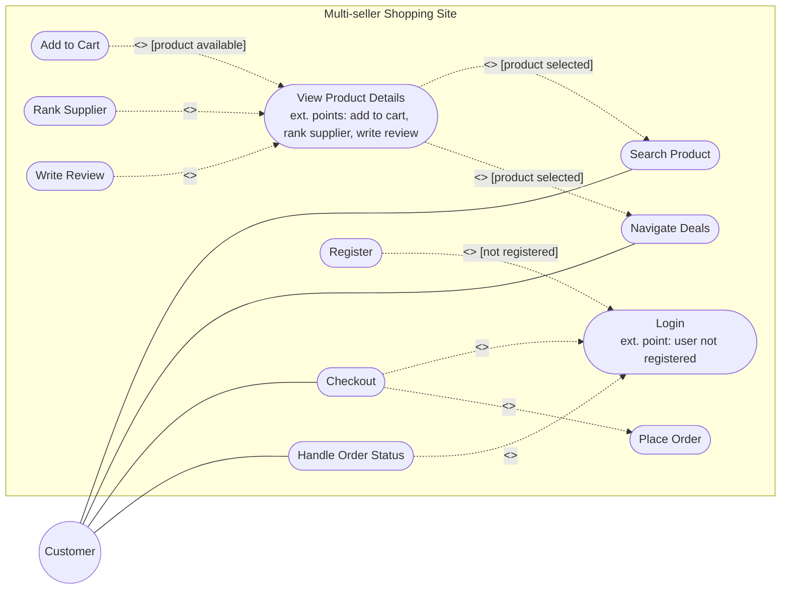

On paper, write the extension points inside the base ellipse under a line, for example `View Product Details — extension points: addToCart, rankSupplier, writeReview`, and attach a small note with the condition to each «extend» arrow.

---

### 2018-19 · Q1(b) · 8 marks — and 2020-21 · Q3(c) · 8 marks — Example of «extends»

> [!question] Question
> Show an example of "extends" in a Use Case diagram.

**Solution.** ==An «extend» relationship adds optional behaviour to a base use case. The extending use case runs only when a condition holds at a named extension point in the base; the base is complete without it.== The arrow is dashed, labelled «extend», and points **from the extending use case to the base**.

Example (ATM). The base use case is *Withdraw Cash*. After the cash is dispensed, the machine asks "Do you want a receipt?". Printing a receipt happens only if the customer says yes, so *Print Receipt* «extend» *Withdraw Cash* at extension point *receipt requested*. A second example on the same diagram: *Pay Fine* «extend» *Return Book* with condition `[book is overdue]` in a library system.

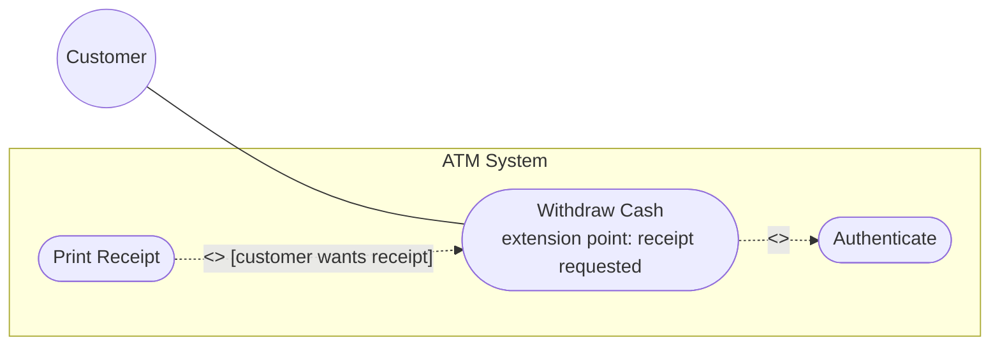

The *Authenticate* «include» is shown only for contrast: authentication happens **every** time (include), while printing happens **sometimes** (extend).

---

### 2019-20 · Q1(b) · 6+12+7 = 25 marks — Microwave oven

> [!question] Question
> Consider a microwave oven that uses microwave technology for the purpose of heating foods. If you want to heat food items you must enter the food item in the heating chamber and then set the timer using the key pad in the front panel located on the door of micro wave oven. You have to press the start button to start heating. The oven will give a beep signal when the heating is complete. You can stop heating by pressing the Stop button any time. Do the following for the micro wave oven system:
> (i) Draw the use case diagram by identifying the actors and use cases for this micro wave oven system. (6)
> (ii) Write down the detailed use case scenarios related to setting the timer and heating. (12)
> (iii) Write down the acceptance test cases for these use cases as well. (7)

**(i) Use case diagram.** The primary actor is the **User**. The internal **Timer** (clock) is a secondary actor, because it is the thing that signals "time is up" and ends heating. The use cases are *Place Food*, *Set Timer*, *Heat Food*, *Stop Heating* and *Give Beep Signal*. Heating always ends with a beep, so *Heat Food* «include» *Give Beep Signal*. Stopping happens only if the user presses Stop, so *Stop Heating* «extend» *Heat Food* at extension point *stop button pressed*.

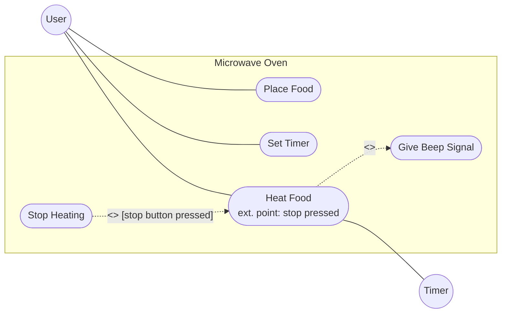

**(ii) Use case scenarios.**

*Use case: Set Timer.* Actor: User. Precondition: the oven is idle and plugged in. Main flow: (1) The user presses the timer key on the front panel. (2) The system shows `00:00` and waits for digits. (3) The user types the minutes and seconds on the keypad. (4) The system validates the value (greater than 0 and within the maximum, say 99:59). (5) The system displays the set time. Alternative flow 4a: if the value is 0 or over the maximum, the system shows "Err" and returns to step 2. Alternative flow 3a: the user presses Clear, and the system resets the display to `00:00`. Postcondition: a valid cooking time is stored.

*Use case: Heat Food.* Actor: User (primary), Timer (secondary). Precondition: food is inside, the door is closed, and a timer value is set. Main flow: (1) The user presses Start. (2) The system checks that the door is closed. (3) The system turns on the magnetron, the light and the turntable. (4) The Timer counts down and the display shows the remaining time. (5) When the time reaches zero, the system turns the magnetron off. (6) The system gives the beep signal (include *Give Beep Signal*). Alternative flow 2a: the door is open, so the system does not start and shows "Close door". Alternative flow 4a (extension point *stop pressed*): the user presses Stop, the system turns off heating at once, keeps the remaining time on the display, and the use case ends (extend *Stop Heating*). Alternative flow 4b: the door is opened during heating, which is handled like Stop. Postcondition: heating is off and the food is heated for the set time.

**(iii) Acceptance test cases.**

| ID | Use case | Steps / input | Expected result |
|---|---|---|---|
| AT1 | Set Timer | Press timer, type 01:30 | Display shows 01:30 |
| AT2 | Set Timer | Type 00:00 | "Err" shown, timer not set |
| AT3 | Set Timer | Type 120:00 (over max) | "Err" shown, timer not set |
| AT4 | Set Timer | Type 02:00 then Clear | Display resets to 00:00 |
| AT5 | Heat Food | Food in, door closed, timer 00:10, press Start | Heating starts, countdown runs, beep at 00:00, heating stops |
| AT6 | Heat Food | Door open, press Start | Does not start, "Close door" shown |
| AT7 | Heat Food | No timer set, press Start | Does not start (or asks for time) |
| AT8 | Stop Heating | During heating at 00:40, press Stop | Heating stops at once, no beep, 00:40 remains on display |

---

### 2021-22 · Q3(a) · 8 marks and Q3(b) · 8 marks — ATM operations

> [!question] Question
> (a) Consider an Automated Teller Machine (ATM) of a Bank. You can have the following banking operations using the ATM card: (i) Withdrawing money (ii) Checking Balance from Core Banking System (iii) Changing PIN (Personal Identification Number) (iv) Depositing money (v) Transferring money to another account (vi) Recharging your mobile phone. Draw a use case diagram showing the actors and use cases. (8)
> (b) Write down the use case for withdrawing money and changing PIN. (8)

**(a) Use case diagram.** The primary actor is the **Card Holder (Customer)**. The secondary actors are the **Core Banking System** (it holds balances and does every money operation) and the **Mobile Operator** (it receives the recharge). Every operation starts with inserting the card and entering the PIN, so all six use cases «include» *Authenticate (Card + PIN)*. A receipt is optional, so *Print Receipt* «extend» *Withdraw Money*.

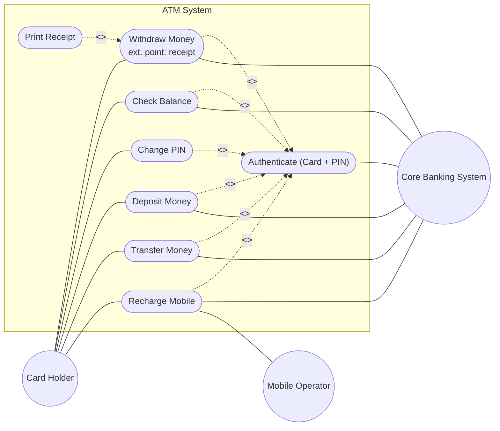

**(b) Use case descriptions.**

*Use case: Withdraw Money.* Primary actor: Card Holder. Secondary actor: Core Banking System. Precondition: the ATM is in service and has cash. Main flow: (1) The card holder inserts the card. (2) The ATM reads the card and asks for the PIN. (3) The card holder enters the PIN; the ATM verifies it with the Core Banking System (include *Authenticate*). (4) The ATM shows the menu and the card holder chooses Withdraw. (5) The card holder enters the amount. (6) The ATM sends the request to the Core Banking System, which checks the balance and the daily limit. (7) The Core Banking System debits the account and approves. (8) The ATM dispenses the cash. (9) The ATM asks about a receipt (extension point *receipt*). (10) The ATM ejects the card. Alternative flows: 3a wrong PIN, retry up to 3 times, then the card is retained; 6a insufficient balance or limit crossed, show a message and return to step 5; 8a ATM lacks cash for the amount, cancel and show a message. Postcondition: the account is debited by the amount and the cash is given.

*Use case: Change PIN.* Primary actor: Card Holder. Secondary actor: Core Banking System. Precondition: the card holder is authenticated (steps 1–3 above). Main flow: (1) The card holder chooses Change PIN. (2) The ATM asks for the new PIN. (3) The card holder enters a new 4-digit PIN. (4) The ATM asks to re-enter it. (5) The card holder re-enters it. (6) The ATM checks that both match and the PIN is valid (not the same as the old one, not all the same digit). (7) The ATM sends the new PIN to the Core Banking System, which stores it. (8) The ATM shows "PIN changed" and ejects the card. Alternative flow: 6a the PINs do not match or are invalid, show a message and return to step 2. Postcondition: the new PIN is active.

---

### 2023-24 · Q6(a) · 15 marks — Playdom fantasy game (Quest & Player Interaction Subsystem)

> [!question] Question
> Playdom, Inc. develops social games for social network platforms, such as Facebook and MySpace. They are developing a new *Fantasy Adventure Game Management System* for an online role-playing game. The management system needs to handle the following situations: (1) players can create accounts, join quests, view their achievements, and purchase in-game items, (2) game masters can view player profiles, assign quests, and update mission outcomes, (3) healers can update player health status and view active missions, (4) item merchants can view purchase requests and deliver virtual items, (5) lobby managers can register new players and schedule tournament matches, (6) the system must verify payment eligibility through an external payment gateway system before confirming premium purchases, (7) all users must log in through a centralized Authentication System, and (8) the reward system automatically generates bonus points after each completed quest.
> Draw a use case diagram for the **Quest & Player Interaction Subsystem** that handles player activities related to quests, including joining, completing, and interacting with other roles and services. Your use case diagram must include the following: (1) all actors (primary and secondary), (2) at least SIX use cases, (3) at least TWO examples of «include» relationships, and (4) at least ONE example of «extend» relationship.

**Solution.** The diagram is only for the quest subsystem, so I keep the roles that touch quests and leave out account creation and tournament scheduling. The **primary actors** are **Player**, **Game Master**, **Healer** and **Item Merchant**. The **secondary actors** (external systems that the subsystem calls) are the **Authentication System**, the **Payment Gateway** and the **Reward System**. The Lobby Manager is not part of this subsystem because registering players and scheduling tournaments are not quest activities; I mention this on the answer so the examiner sees it was a decision.

The use cases are *Join Quest*, *Complete Quest*, *View Achievements*, *Purchase In-game Item*, *Assign Quest*, *Update Mission Outcome*, *View Player Profile*, *Update Health Status*, *View Active Missions*, *Deliver Virtual Item*, *Log In*, *Generate Bonus Points* and *Verify Payment Eligibility*. The three «include» relationships are: *Join Quest* «include» *Log In* (every user must log in), *Complete Quest* «include» *Generate Bonus Points* (points come after **each** completed quest), and *Purchase Premium Item* «include» *Verify Payment Eligibility* (always before confirming). The «extend» relationship is *Purchase Premium Item* «extend» *Purchase In-game Item* at extension point *item is premium*, because only premium items need the payment check.

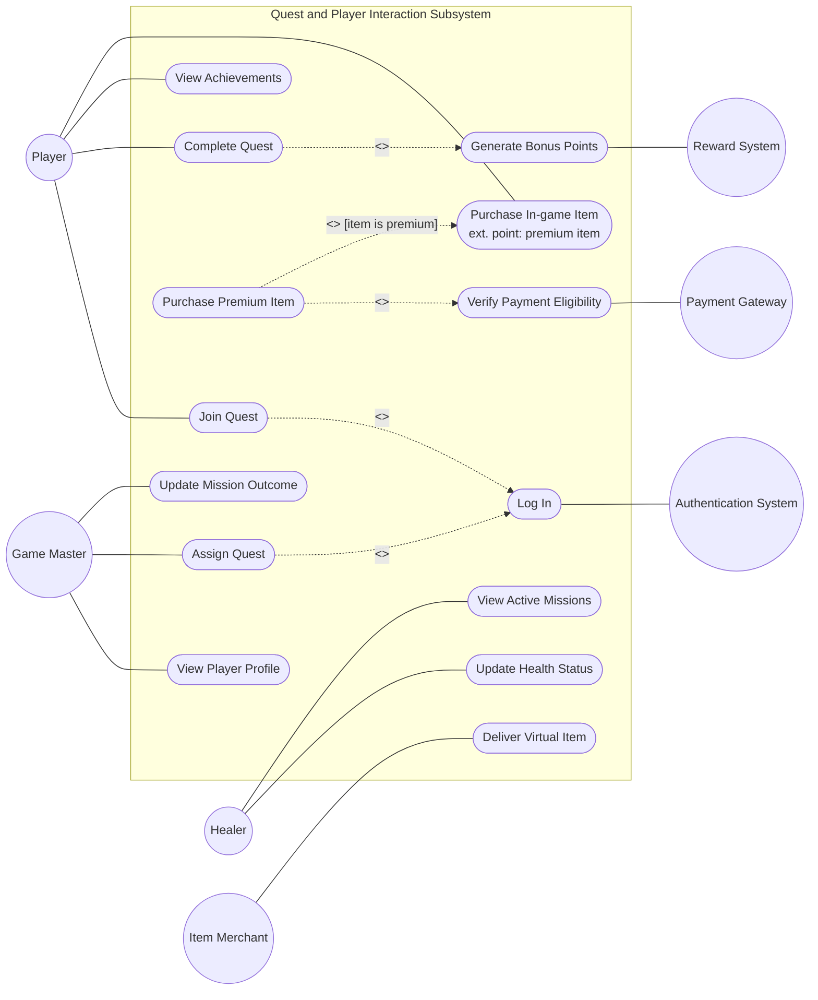

On paper, put the primary actors on the left and the secondary (system) actors on the right of the boundary, and draw the Log In include from every use case or write a note "all use cases include Log In".

---

### 2023-24 · Q7(c) · 15 marks — Choosing the right diagram

> [!question] Question
> You are a senior software architect at SiFive. You are currently leading three projects which are at different stages of systems development life cycle. You need to guide your team in preparing diagrams to illustrate different needs for each project.
> • **Project 1:** The intern on your team has been tasked with explaining to investors what users will be able to do with your proposed fitness tracking app. Since the investors are non-technical, the explanation must clearly and quickly convey the app's functionality.
> • **Project 2:** The business analyst on your team needs to demonstrate to stakeholders how different user roles (e.g., admin, manager, employee) interact with the system and how access and permissions differ across different roles.
> • **Project 3:** Your development team is gearing to develop a CRM (Customer Relationship Management) software for Salesforce. Your team needs to understand how data flows through the customer order fulfillment process, including which departments are responsible for which tasks, and where bottlenecks might occur.
> For each project, you must choose the most appropriate diagram (e.g., BPMN, Use Case, Class). You need to justify why the selected diagram is best suited for the project. You need to mention one key limitation of using the selected diagram for the project.

**Project 1 — Use case diagram.** Investors want to know **what** users can do, not how it is built. A use case diagram shows the user as an actor and each feature (log workout, track steps, set goals, view progress) as one ellipse, so a non-technical reader sees the whole functionality on one page in a minute. *Limitation:* it shows no order of steps, no screens and no detail of how a feature works, so it cannot show the user experience or the value of a feature by itself.

**Project 2 — Use case diagram with actor generalization.** Each role (Admin, Manager, Employee) is drawn as a separate actor, and the lines from each actor show exactly which use cases that role may perform, so the permission difference is visible directly. Actor generalization (Manager inherits Employee, Admin inherits Manager) shows that a higher role gets everything the lower role has plus more. *Limitation:* it cannot show fine-grained or conditional permissions (for example "a manager can approve only his own team's leave"), data-level access, or the order of interactions.

**Project 3 — BPMN diagram with pools and lanes.** The need is a **process flow across departments**. In BPMN each department (Sales, Warehouse, Billing, Delivery) is a lane, so responsibility for every task is clear; sequence flows and gateways show the path of an order; message flows and data objects show how data moves between departments; and places where work waits on another lane (or many flows converge) reveal bottlenecks. *Limitation:* BPMN does not show the system's internal structure (classes, database), and it does not measure time or load, so bottlenecks must be found by reading the flow, not calculated; a large process also becomes cluttered.

---

## 2. Class Diagram

### 2017-18 · Q1(a) · 20 marks — Find inconsistencies in the course-assignment class diagram

> [!question] Question
> Consider the following scenario: A language teacher wants to register a particular student for an online French course. After he logs in, he is shown a list of students. When he selects a particular student, a list of languages is displayed. After he selects a language (say, French), he is shown a list of course on French that the selected student has not taken yet. When he selects a course, the course assignment is complete.
> Make a list of the inconsistencies in the class diagram given below. Don't redraw the diagram.
>
> *Given diagram:* «boundary» **AssignCourseUI** — operations `SelectStudent()`, `SelectLanguage()`, `AssignCourse()`. «control» **AssignCourse** — `StartInterface()`, `GetLanguages()`, `GetLanguageCourses()`, `GetLanguageInfo()`. «entity» **Student** — `StudentID, StudentName, Address`; `GetStudents()`, `AssignCourse()`, `GetStudentCourses()`. «entity» **Language** — `LanguageID, LanguageName, CourseID`; `GetLanguages()`, `GetLanguageInfo()`. «entity» **Course** — `CourseID, LanguageID, CourseName, StudentName`; `GetCourses()`, `GetCourseInfo()`. «entity» **CourseAssignmentInfo** — `StudentID, CourseID, RegistrationDate`; `GetStudentCourses()`. Student and Course are each joined to CourseAssignmentInfo by a plain line; there are no other lines.

**Solution.** Walk through the scenario step by step and check that each step has an operation in the right class, then check the attributes and the relationships.

1. **The boundary cannot display anything.** The scenario shows three lists to the teacher (students, languages, courses), but `AssignCourseUI` has no `showStudentList()`, `showLanguageList()` or `showCourseList()` operation.
2. **No operation to select a course on the boundary.** The teacher "selects a course", but the UI has `AssignCourse()` instead of `SelectCourse(courseID)`.
3. **The control cannot get the students.** The first list shown is the student list, but the control `AssignCourse` has no `GetStudents()`.
4. **The control cannot complete the assignment.** There is no operation in the control that creates the `CourseAssignmentInfo` record (e.g. `AssignCourse(studentID, courseID)`), although that is the goal of the use case.
5. **`GetLanguageInfo()` is not needed.** The scenario never shows details of a language, so this operation in both the control and `Language` has no use in this use case.
6. **`GetLanguageCourses()` cannot filter "not taken yet".** It needs both `languageID` and `studentID` as parameters, and the control needs to call `GetStudentCourses(studentID)` to remove the courses already taken.
7. **`AssignCourse()` is in the wrong entity.** The assignment is a fact about a student *and* a course, so it belongs to `CourseAssignmentInfo` (or is created by the control), not to `Student`.
8. **`GetStudentCourses()` is duplicated** in `Student` and `CourseAssignmentInfo`; it should be in only one place (the class that holds the data, `CourseAssignmentInfo`).
9. **`Language` has a `CourseID` attribute.** A language has many courses, so one `CourseID` cannot be stored in it; the foreign key already exists the right way round as `Course.LanguageID`. This is redundant and wrong.
10. **`Course` has a `StudentName` attribute.** A course is taken by many students; who took which course is stored in `CourseAssignmentInfo`. A student's name inside Course is wrong and duplicates `Student.StudentName`.
11. **`Language` has no association with `Course`.** The two are related one-to-many (one Language — many Courses), but no line is drawn; `Language` is isolated.
12. **`CourseAssignmentInfo` should be an association class.** Student–Course is a many-to-many association and `CourseAssignmentInfo` holds its data (`RegistrationDate`), so it should hang from the Student–Course line by a dashed line, not be two plain lines.
13. **No multiplicities** are written on any association (e.g. Student 1 — 0..* CourseAssignmentInfo).
14. **The boundary, control and entities are not connected.** The UI must have an association to the control, and the control to every entity it calls; otherwise ==the sending object has no reference to the receiver== (model-consistency rule, Lec 9 p.8).
15. **`GetCourses()` has no parameter** to fetch the courses of one language; it should be `GetCourses(languageID)`.
16. **The login step is missing.** The teacher logs in first, but there is no Teacher entity or login operation (or the use case should state "teacher is logged in" as a precondition).

---

### 2017-18 · Q3(b) · 7+4 = 11 marks — UML structural things and relationships

> [!question] Question
> (i) Name the types of structural things in UML. (7)
> (ii) Name four types of relationships in UML class diagram. (4)

**(i)** The seven structural things are ==class, interface, collaboration, use case, active class, component and node==. A class describes objects with the same attributes and operations; an interface is a set of operations a class or component offers; a collaboration is a group of elements working together to give a behaviour; a use case is a set of actions that gives a result to an actor; an active class is a class whose objects own a thread of control; a component is a replaceable physical part of the system (a jar, a DLL); and a node is a physical computing resource at run time (a server).

**(ii)** The four relationships are ==dependency, association, generalization and realization==. Aggregation and composition are special kinds of association.

---

### 2018-19 · Q1(a) · 22 marks — Employee loan system

> [!question] Question
> In an office XYZ, the employees can apply for loans which are approved by the management if all the requirements are met. The requirements include age, certain years of experience, clean disciplinary record, etc. The loans can be created in the system by the user specifying relevant parameters such as interest rate, years to repay, maximum allowed amount based on salary of the applicant, etc. These conditions may change over time.
> Design a Class diagram to implement the scenario described above.

**Solution.** Three facts drive the design. First, a *loan type* (scheme) is created by a user with parameters, so `LoanScheme` is its own class, separate from one employee's loan. Second, the eligibility requirements are a list that "may change over time", so each requirement is an object, with an abstract `EligibilityRule` and one subclass per kind of rule; a new rule is a new subclass and no old class changes (Open/Closed). Each rule and each scheme has `effectiveFrom`/`effectiveTo` dates so old applications keep the rules that applied when they were made. Third, the application, the management decision and the approved loan with its repayments are separate objects with their own data.

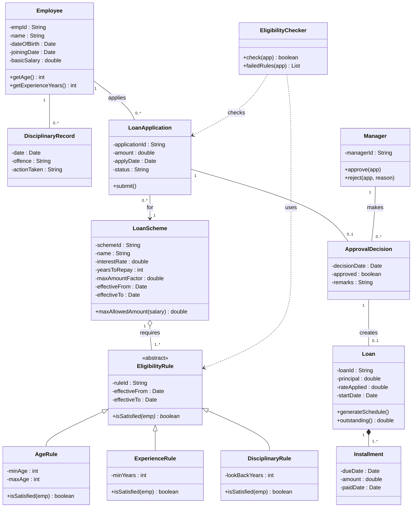

Explain on paper in two lines: `maxAllowedAmount(salary)` implements "maximum allowed amount based on salary"; a new requirement (say, "no other running loan") is added as a new `EligibilityRule` subclass and attached to the scheme, without changing `EligibilityChecker`.

---

### 2019-20 · Q1(a) · 10 marks — How UML is used

> [!question] Question
> Describe briefly how Unified Modeling Language is used for visualizing, specifying, constructing and documenting.

**Solution.** ==UML is a language for visualizing, specifying, constructing and documenting the artifacts of a software-intensive system.== *Visualizing:* a picture of the model (a class or sequence diagram) shows structure and behaviour that are hard to see in code, and gives everyone the same well-defined symbols, so a model drawn by one developer is read the same way by another. *Specifying:* UML builds precise, unambiguous and complete models of the analysis and design decisions, such as attributes with types, operation signatures, multiplicities and state transitions with guards. *Constructing:* UML models can be mapped directly to a programming language (forward engineering, for example generating Java classes from a class diagram) and code can be turned back into models (reverse engineering). *Documenting:* the diagrams record requirements, architecture, design, tests and releases, so they serve as the documentation of the system for maintenance and for new team members.

---

### 2019-20 · Q2(a) · 7 marks and Q2(b) · 20 marks — Class vs instance, and identifying classes for the ATM

> [!question] Question
> (a) Explain the concept for Class and Instance with necessary examples. (7)
> (b) An account holder of Sonali Bank can withdraw an amount from his or her account through debit card with the help of ATM (Automatic Teller Machine) booth. The account holder must insert the card into the machine and then after authorization through PIN (Personal Identification Number) the amount of money to be withdrawn will be entered through keypad of the ATM machine. The requested amount will be checked against the balance of the bank account and the amount will be dispensed from the machine if there is available balance to satisfy the request. There must be a notification to the registered phone number to the account holder from central server of the bank. Finally, the ATM machine ejects the card after the transactions. Show the steps of identifying the classes from this use case scenario. (20)

**(a)** ==A class is a description (template) of a set of objects that share the same attributes, operations, relationships and meaning. An instance (object) is one concrete member of a class, with its own values for the attributes and its own identity.== For example, `BankAccount` is a class with attributes `accountNo` and `balance` and operations `deposit()` and `withdraw()`. The account `1023-55` with balance 50,000 Tk is an instance of it, and account `2048-11` with balance 3,000 Tk is another instance. In UML the class is drawn as `BankAccount`; an instance is drawn with the name underlined, `acc1 : BankAccount`.

**(b) Step 1 — Noun-phrase analysis.** Underline every noun in the scenario: account holder, Sonali Bank, amount, account, debit card, ATM, ATM booth, card, machine, authorization, PIN, money, keypad, balance, bank account, request, notification, registered phone number, central server, transaction.

**Step 2 — Remove redundant nouns** (same thing, different words): *ATM = ATM booth = machine = ATM machine*; *account = bank account*; *card = debit card*; *money = amount*.

**Step 3 — Remove vague or out-of-scope nouns:** *Sonali Bank* is the whole organisation (there is only one), so it is not a class in this system.

**Step 4 — Turn attributes into attributes, not classes:** *PIN* (of the card), *amount* (of a transaction), *balance* (of an account), *registered phone number* (of the account holder).

**Step 5 — Turn actions and events into operations:** *authorization* becomes `verifyPIN()`; *request* becomes `requestWithdrawal(amount)`; *dispense* becomes `dispenseCash()`; *eject* becomes `ejectCard()`. *Notification* is kept as a class because it is a record that is created and sent.

**Step 6 — Remove implementation details or turn them into boundary parts:** *keypad* is part of the ATM's user interface, so it is folded into the `ATMInterface` boundary class (together with card reader and cash dispenser).

**Step 7 — The candidate classes and their stereotypes.** Entity classes: `AccountHolder`, `Account`, `DebitCard`, `Transaction` (withdrawal), `Notification`. Boundary classes: `ATMInterface` (card reader, keypad, screen, cash dispenser) and `CentralServerInterface` (link to the bank's central server and SMS). Control class: `WithdrawController` (one per use case).

**Step 8 — Add attributes, operations and relationships and draw the diagram.**

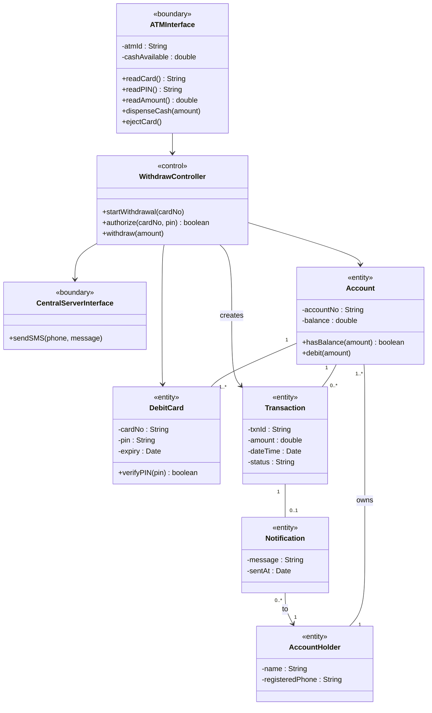

---

### 2020-21 · Q2(a) · 13 marks — Course offering and grading

> [!question] Question
> In an educational institution, the teachers offer different course in different semesters. Some courses are jointly offered by multiple teachers. Students enroll in multiple offerings and receive grades at the end of the course. The grades are computed following some grading rule from the marks of different test items. Draw a Class Diagram to reflect the scenario discussed above. Apart from model classes, show the classes that would implement business logic and store computed values. You are not required to show any Boundary or Controller class.

**Solution.** A *course* (CSE 213) is different from an *offering* of that course in one semester, so `Course` and `CourseOffering` are separate, and an offering belongs to one `Semester`. Teacher–Offering is many-to-many ("jointly offered"). Student–Offering is many-to-many with data of its own, so it is the association class `Enrollment` (on paper, hang it from the Student–CourseOffering line with a dashed line; Mermaid cannot draw that, so it is shown linked to both). Each offering has `TestItem`s (CT, mid, final, each with full marks and weight), and a `Mark` records what one enrolled student got in one test item. The `GradingRule` holds grade ranges. The **business-logic** class is `GradeCalculator`, and the **computed values** are stored in `Result` (total, letter grade, grade point), so they are not recalculated every time.

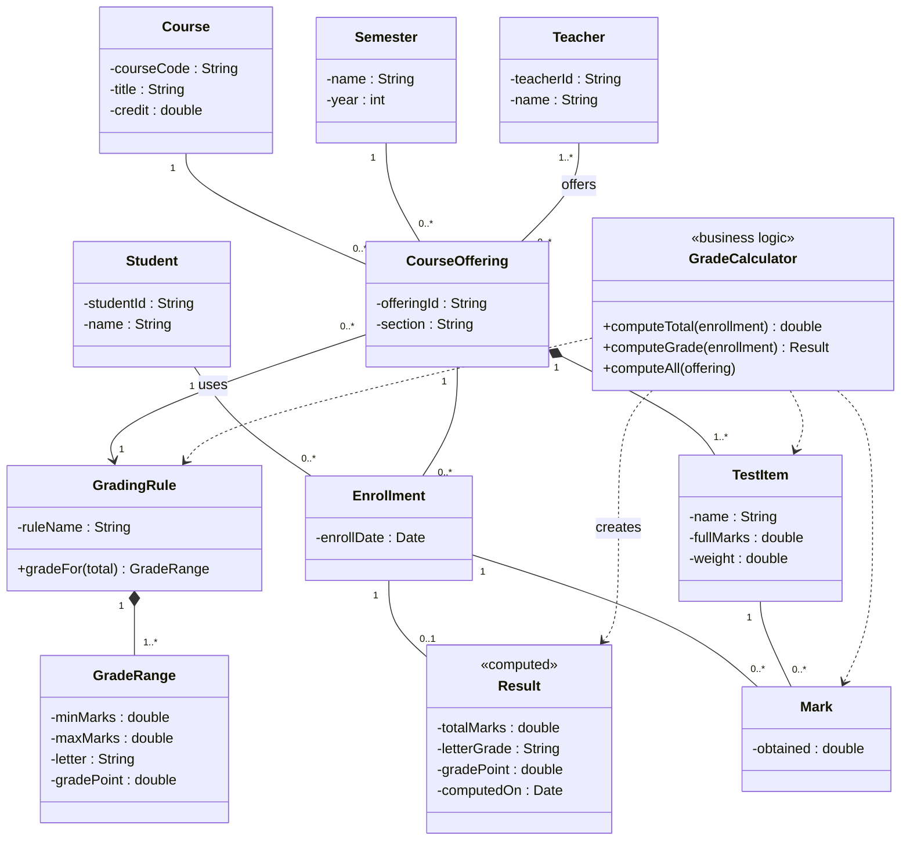

---

### 2023-24 · Q6(b) · 5 marks — Aggregation, composition, dependency

> [!question] Question
> In a class diagram, we demonstrate various relationships among classes and interfaces. Briefly show the three relationships with appropriate examples: (1) aggregation, (2) composition, and (3) dependency.

**Solution.** ==Aggregation== is a whole–part relationship where the part **can exist without the whole** and may be shared; it is drawn with a hollow diamond at the whole. Example: a `Department` has `Teacher`s; if the department closes, the teachers still exist. ==Composition== is a strong whole–part relationship where the part **cannot exist without the whole** and belongs to only one whole; it is drawn with a filled diamond at the whole. Example: a `House` has `Room`s; destroying the house destroys its rooms. ==Dependency== means one class **uses** another temporarily (as a parameter, local variable or return type) and is affected if it changes; it is drawn as a dashed arrow towards the used class. Example: `Order.print(Printer p)` depends on `Printer`.

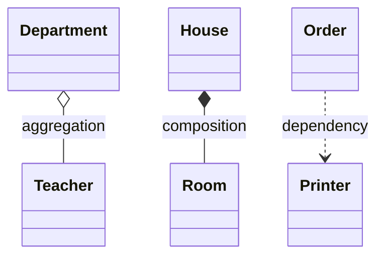

---

## 3. Sequence Diagram

### 2017-18 · Q2(c) · 2×5 = 10 marks — One-word answers

> [!question] Question
> Write one/two word answers to the following questions on Sequence Diagrams.
> (i) The execution of an operation in a sequence diagram is shown by ______.
> (ii) An asynchronous message is drawn with ______.
> (iii) Returns are drawn with ______.
> (iv) Is focus of control the same as activation?
> (v) What is the one major difference between sequence diagrams and collaboration diagrams?

**Solution.** (i) An ==activation bar== (a thin rectangle on the lifeline, also called execution occurrence). (ii) An ==open (stick) arrowhead== on a solid line. (iii) A ==dashed line with an open arrowhead==. (iv) ==Yes==, focus of control is another name for activation. (v) A sequence diagram shows the ==time order== of messages along a vertical time axis, while a collaboration diagram has no time axis and shows the ==links between objects==, with the order given by sequence numbers.

---

### 2018-19 · Q3(a) · 21 marks — Bank (normal and foreign users)

> [!question] Question
> Design a Sequence diagram for the scenario of a bank described in Question 2(a).
>
> *Scenario of Q2(a):* There are two types of users in a Bank: Normal user and Foreign User. Both users can create account, deposit money and withdraw money. For money withdrawal there are certain rules. A user can make a withdrawal of maximum 3,00,000 taka per day. At each transaction the highest limit of withdrawal is 1,00,000 taka. A user can make a maximum of 5 withdrawals per day. After every three months, interest is added to the account balance. If an account balance reaches 20,00,000 taka, for every deposit to that account 2% bonus is applied. The foreign user has one extra capability. He can convert his taka to foreign currency.

**Solution.** The scenario has four flows, so I draw them as four parts of one sequence diagram (or four small diagrams with the same participants): create account, deposit with bonus, withdraw with the three rules, and the quarterly interest started by a timer. The foreign-user currency conversion is shown in an `opt` frame because only a foreign user can do it. The participants are the actor *User*, the boundary `:BankUI`, the control `:AccountController`, and the entities `:Account`, `:Transaction` and `:WithdrawalPolicy`, plus `:CurrencyService` and a `Scheduler` actor (time trigger).

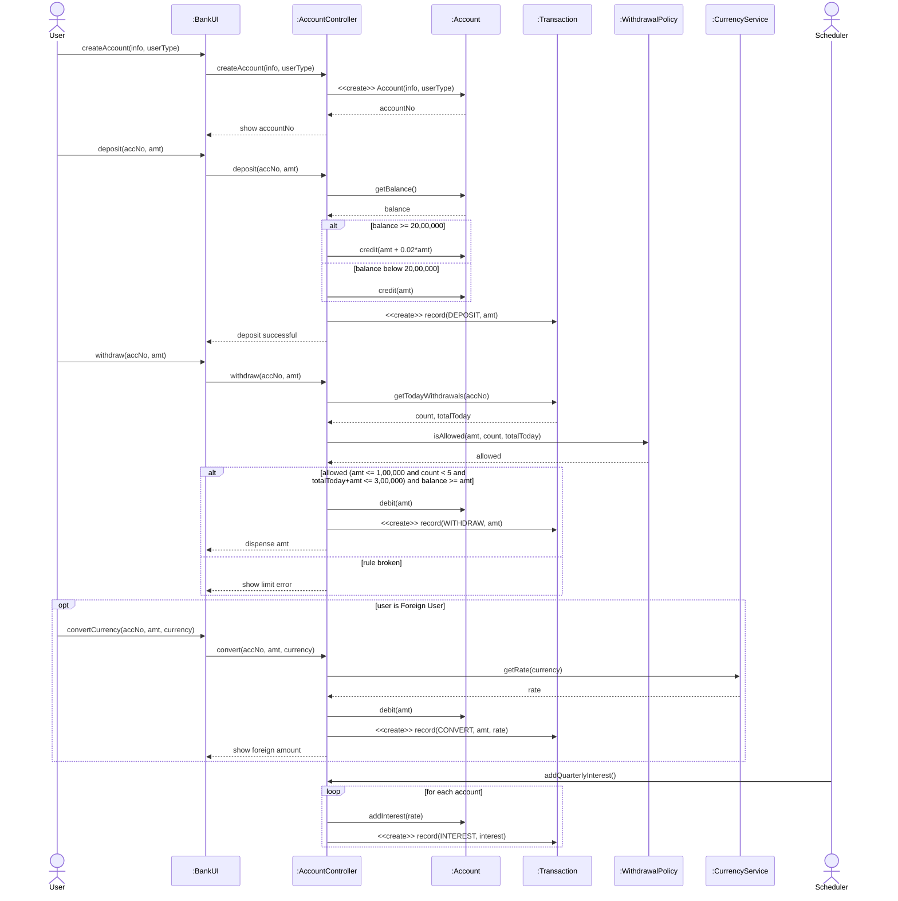

On paper, mention under the diagram: the three withdrawal rules are checked in `WithdrawalPolicy.isAllowed()`, and the timer message comes every three months.

---

### 2019-20 · Q6(b) · 12 marks — Bulk salary increment (payroll)

> [!question] Question
> In a Payroll Management System, the salary of every company is managed. The salary comprises several components such as basic, house rent (a certain percentage of basic), medical allowance, etc. and deductible components like PF contribution, insurance subscription, etc. If an employee takes loan, the repayment is adjusted. At the beginning of a financial year, basic of all employees are incremented following a rule which defines the percentage of increment. However, each salary grade has a maximum bound. The increment will be applicable within this bound.
> Based on the scenario discussed above: (b) Draw Sequence diagram for the bulk salary increment usecase.

**Solution.** The payroll admin starts the increment at the start of the financial year. The controller reads the increment rule, then in a `loop` over all employees reads each employee's salary grade, calculates the new basic, caps it at the grade's maximum bound with an `alt`, saves it, and finally recalculates the dependent components (house rent is a percentage of basic).

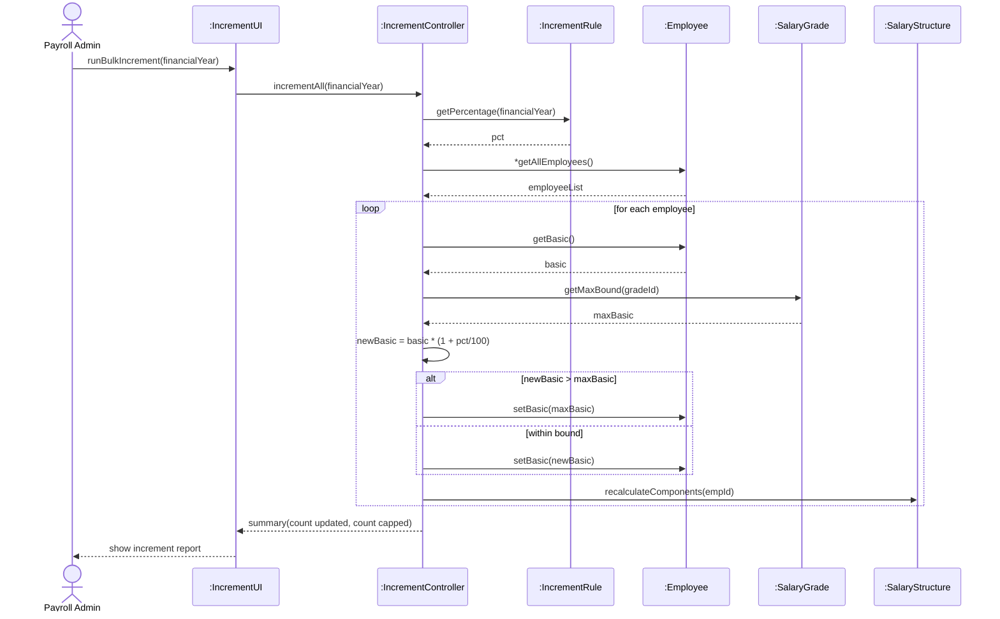

---

### 2020-21 · Q3(a) · 15 marks — Tour package booking

> [!question] Question
> If you want to make a tour with a tourism operator, you have to select a package from their website. Each package presents a combination of site visit, hotels, food, activities. Depending on these components and number of days to spend, the price of the packages varies. A package can be customized for a group of tourists with size larger than 10 and price adjustment is made accordingly. The customer has to book a package with partial advance payment. The remaining payment is made prior to the tour to confirm all the components of the tour. If any activity is not available, the refund is made later. Draw a Sequence diagram to model the scenario discussed above.

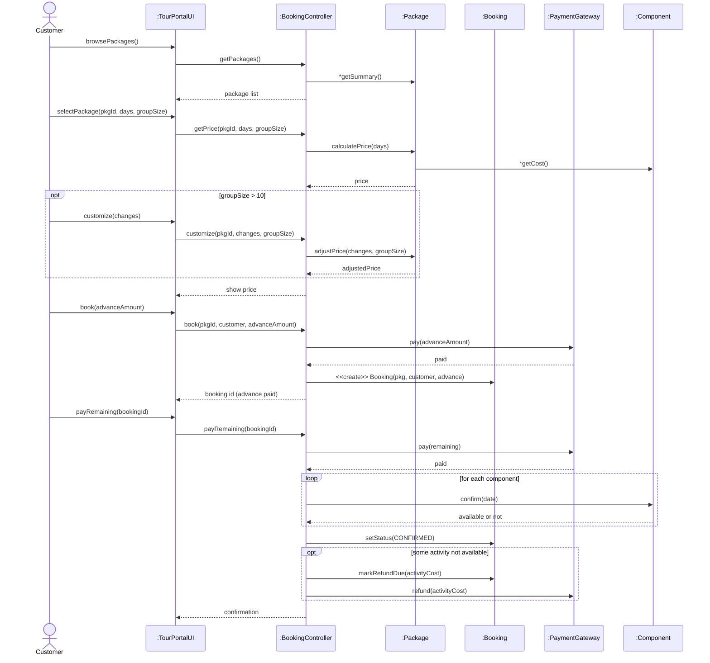

---

### 2022-23 · Q3(a) · 15 marks — Scheduler app (add appointment)

> [!question] Question
> Let's consider a scheduler app. The scenario begins when the user chooses to add a new appointment in the UI. The UI notices which part of the calendar is active and pops up an Add Appointment window for that date and time. The user enters information about the appointment's name, location, start and end times. The UI will prevent the user from entering an appointment that has invalid information, such as an empty name or negative duration. The calendar records the new appointment in the user's list of appointments. Any reminder selected by the user is added to the list of reminders. If the user already has an appointment at that time, the user is shown a message and asked to choose an available time or replace the appointment. If the user enters an appointment with the same name and duration as an existing meeting, the calendar asks the user whether he/she intended to join that meeting instead. If so, the user is added to that meeting's list of participants. Draw Sequence Diagram to model the scenario above.

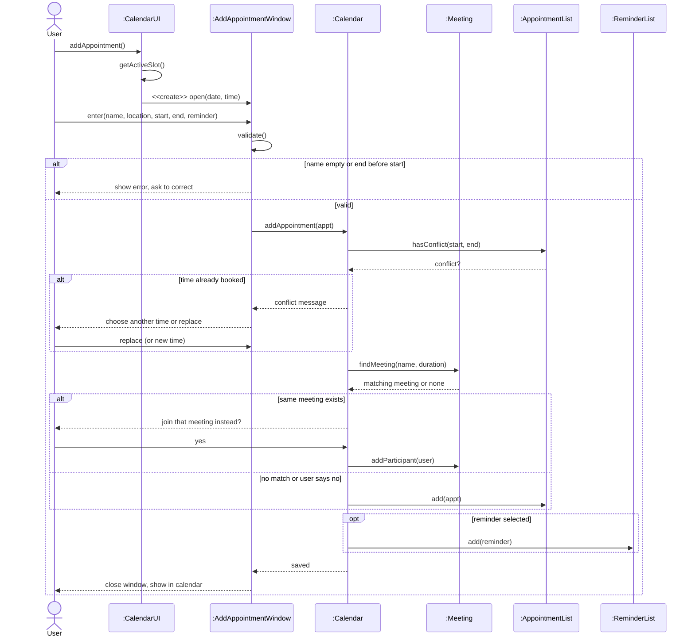

---

### 2023-24 · Q3(a) · 15 marks — Ride sharing app

> [!question] Question
> A Ride Sharing Application allows passengers to book rides through a mobile app. When a passenger requests a ride, the app sends the ride request to the backend server. The backend searches for nearby available drivers. A ride offer is sent to drivers one by one until one accepts. When a driver accepts, the passenger is notified and the ride details are stored in the database. If no driver accepts within the timeout period, the passenger is informed that no driver is available. Draw Sequence Diagram to model the scenario above.

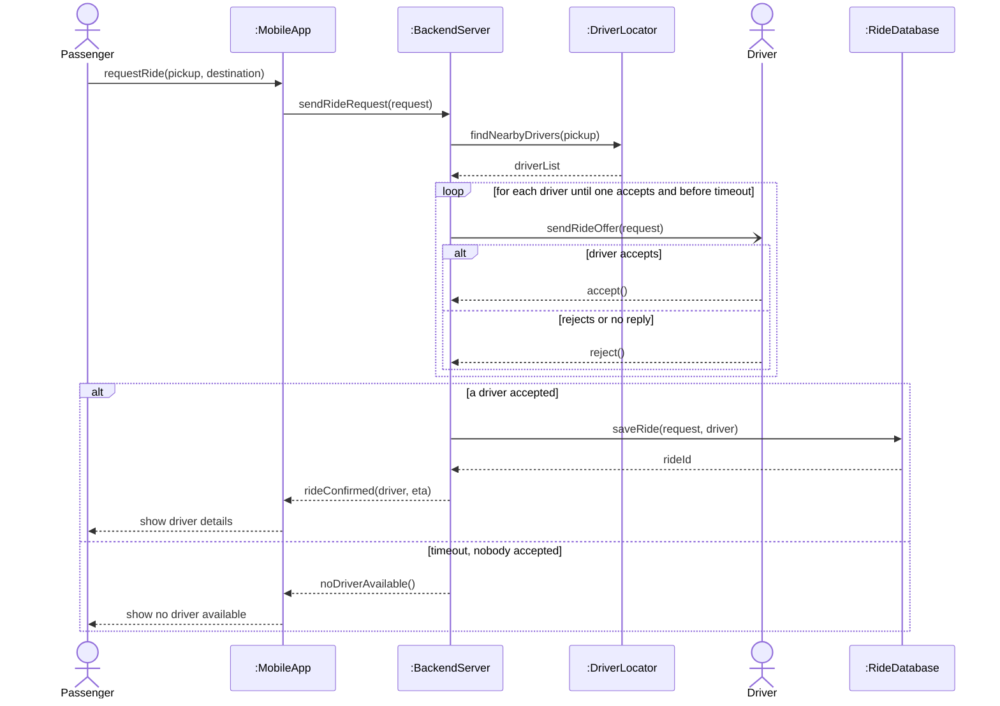

The offer to a driver is drawn as an **asynchronous** message (open arrowhead), because the server does not block waiting; it reacts to the driver's reply or to the timeout.

---

## 4. Collaboration (Communication) Diagram

In these Mermaid figures, each box is an object and each line is a link; the numbered messages written on a link are what you write beside an arrow on paper. Remember: ==no time axis, order by sequence numbers==, nested numbers (2.1, 2.2) for calls made while handling message 2, `*` for iteration, `[guard]` for conditions, and letters (5a / 5b) for alternatives.

### 2017-18 · Q2(a) · 13 marks — Teacher assigns a language course

> [!question] Question
> Refer to the scenario mentioned in 1(a). Now, draw a collaboration diagram which accurately represents the scenario. Note that, solving 1(a) is not mandatory for this step. However, make sure that the function names accurately represent the tasks they perform.
>
> *Scenario of 1(a):* A language teacher wants to register a particular student for an online French course. After he logs in, he is shown a list of students. When he selects a particular student, a list of languages is displayed. After he selects a language (say, French), he is shown a list of course on French that the selected student has not taken yet. When he selects a course, the course assignment is complete.

**Solution.** Precondition: the teacher is logged in. The control object starts the use case, fetches the students and opens the UI, exactly in the style of Lec 10's *Add a new campaign*.

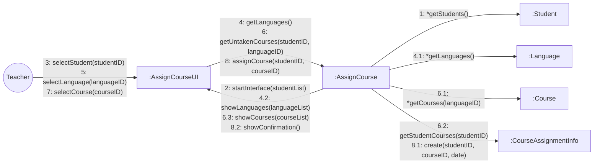

Message 6.3 shows the courses of 6.1 minus those returned by 6.2, which is how "not taken yet" is satisfied. Message 8.1 creates the `CourseAssignmentInfo` record, which completes the assignment.

---

### 2019-20 · Q7(a) · 15 marks — Gym membership renewal

> [!question] Question
> Create a Collaboration diagram for the following scenario descriptions for a Gym Center's customer management system. When members join the Gym Center, they pay a fee for a certain length of time (in months). The club wants to send SMS to members, asking them to renew their memberships one week before their memberships expire. About one-third of the members do not renew their memberships. These members are sent follow-up surveys to complete about why they decided not to renew so that the Center can learn how to increase retention. If the member did not renew because of cost, a special discount is offered to that customer. Typically, 12% of accounts are reactivated because of this offer.

**Solution.** A daily `Scheduler` (time actor) triggers the control object. Message 1 sends reminders a week before expiry; message 2 sends surveys to members whose membership expired without renewal; message 3 is the member's survey reply, and if the reason is cost a discount offer is created; message 4 is a member renewing (with or without the discount).

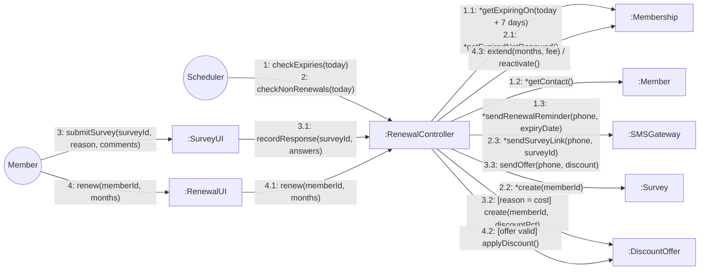

The "one-third" and "12%" figures are statistics, not behaviour, so they do not appear as messages; write that in one line under the diagram.

---

### 2020-21 · Q2(b) · 14 marks — Computing grades

> [!question] Question
> Draw Collaboration diagram for the scenario described in Q 2(a) to show the computation of grade. You are required to show relevant Boundary and Controller classes.
>
> *Scenario of Q2(a):* In an educational institution, the teachers offer different course in different semesters. Some courses are jointly offered by multiple teachers. Students enroll in multiple offerings and receive grades at the end of the course. The grades are computed following some grading rule from the marks of different test items.

**Solution.** The teacher opens the grade-computation screen (boundary), picks the offering and presses *Compute*. The controller uses the entity classes of the class diagram above and the `GradeCalculator` business-logic object.

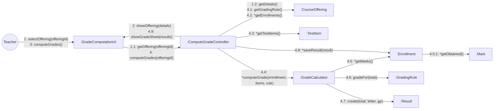

---

### 2021-22 · Q3(c) · 19 marks — ATM withdrawal, and deriving the class diagram

> [!question] Question
> Draw collaboration diagram for the use case for withdrawing money using ATM Card. Show the steps of deriving class diagram from the collaboration diagram.

**Collaboration diagram.**

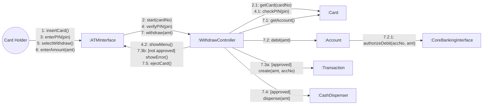

**Steps of deriving the class diagram from the collaboration diagram** (this is the model-consistency rule of Lec 9 p.8, used in reverse):

1. ==Every object becomes a class==: `:ATMInterface` → `ATMInterface`, `:WithdrawController` → `WithdrawController`, and so on. Keep the stereotype (boundary, control, entity).
2. ==Every message received becomes an operation of the receiver's class==: `Card` gets `checkPIN(pin)` and `getAccount()`; `Account` gets `debit(amt)`; `CashDispenser` gets `dispense(amt)`; `ATMInterface` gets `showMenu()`, `ejectCard()`, `showError()`.
3. ==Message parameters suggest attributes== of the class that owns the data: `pin` and `cardNo` in `Card`; `accNo` and `balance` in `Account`; `amount` and `dateTime` in `Transaction`.
4. ==Every link becomes an association==, directed from the sender to the receiver (the sender must hold a reference): `ATMInterface → WithdrawController`, `WithdrawController → Card`, `WithdrawController → Account`, `Account → CoreBankingInterface`, etc.
5. Add multiplicities from the domain (one account has many cards and many transactions), and replace a link that exists only for one call with a dependency if it is not stored.

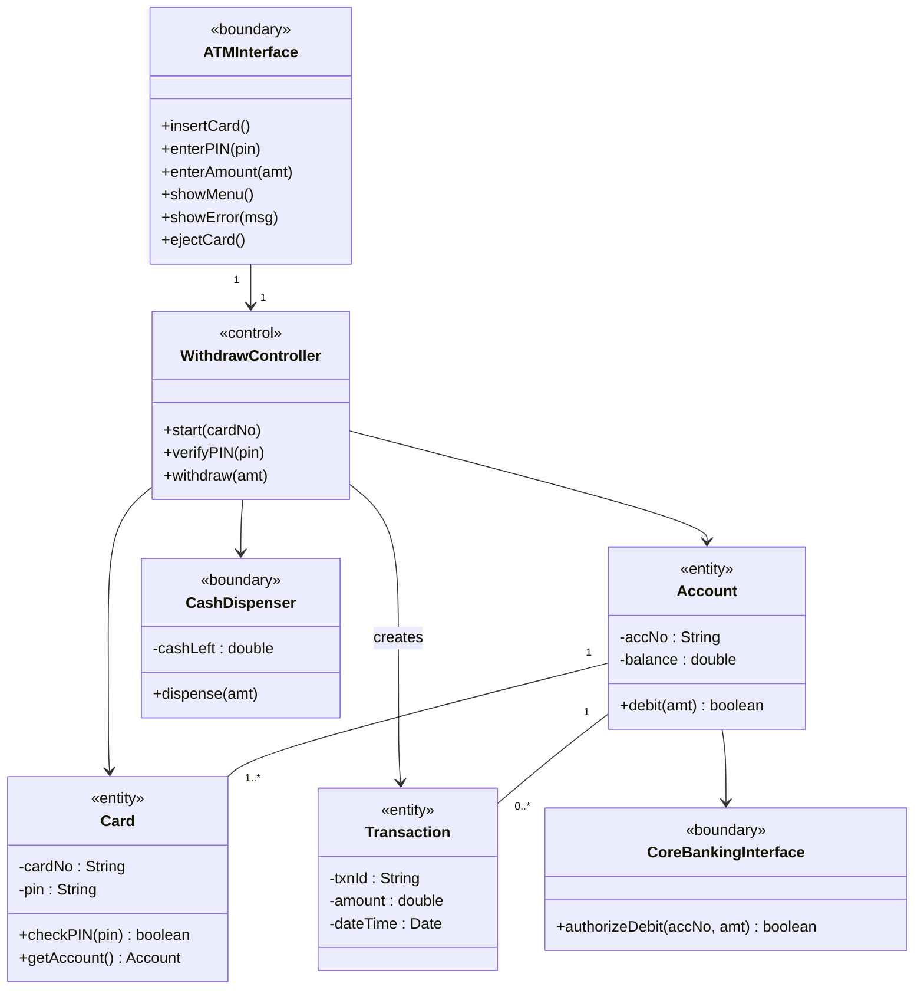

---

### 2022-23 · Q2(a) · 15 marks — MPO teacher eligibility

> [!question] Question
> In Bangladesh, every school teacher is appointed based on MPO regulation. According to this regulation, each candidate has to meet certain qualification criteria defined for each post (of a particular subject) of a certain salary grade. The qualifications are stated in terms of age, subject of graduation, and result at different levels. Example of such requirement is shown in Table for Q 2(a). This is for a particular type of institution, e.g., school, college, etc. When a candidate applies for a post, his/her qualifications are matched against such requirements. If the qualification criteria satisfy, he/she is eligible to sit for a recruitment test.
> *Table for Q 2(a) (in Bangla, translated):* Post 13, **Assistant Teacher (Social Science)** — qualification: (1) bachelor's (honours) degree with the relevant subject from a recognised university **and** a B.Ed degree, **or** (2) bachelor's (honours) degree with the relevant subject; not more than one 3rd division/class in the whole academic life. Age: at most 35 years (relaxed for existing index holders). Salary: (1) Grade-10 (16000–38640), (2) Grade-11 (12500–30230). Post 14, **Assistant Teacher (Mathematics)** — same, but the bachelor's degree must be in science with Mathematics; same age limit and grades.
> Draw a collaboration diagram to check eligibility of an applicant according to the scenario discussed above.

**Solution.** The candidate applies for a post through the application screen. The controller loads the post and its criteria for the institution type, loads the candidate's profile and results, and checks age, degree subject, B.Ed (which decides Grade-10 vs Grade-11) and the "at most one third class" rule. If all pass, an admit card for the recruitment test is created; otherwise the failed criteria are returned.

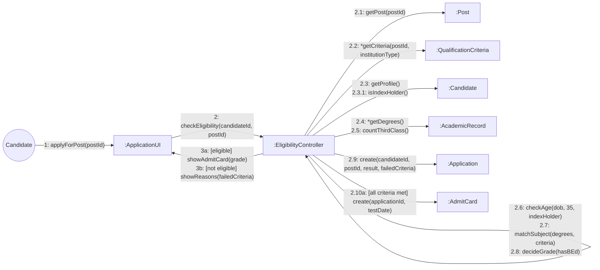

`decideGrade` gives **Grade-10** when the candidate has a B.Ed (option 1) and **Grade-11** otherwise (option 2). Messages 2.6–2.8 are self-calls, drawn on paper as a loop link on the controller.

---

### 2023-24 · Q1(a) · 16 marks — Hospital emergency admission

> [!question] Question
> A Hospital Emergency Management System handles patient admission in the emergency department. When a patient arrives, Reception registers the patient. Then the system verifies insurance details. Next, a nurse assesses the patient's severity level. If the patient is critical, an emergency doctor is assigned immediately. Otherwise, the patient is added to the waiting queue. In both cases admission details are stored in the hospital database and SMS notification is sent to the patient's emergency contact. Design a Collaboration Diagram for the scenario discussed above.

```mermaid
flowchart LR
    Rc((Receptionist))
    Nu((Nurse))
    RUI[":RegistrationUI"]
    TUI[":TriageUI"]
    AC[":AdmissionController"]
    Pt[":Patient"]
    Ins[":InsuranceService"]
    Doc[":DoctorRoster"]
    WQ[":WaitingQueue"]
    Adm[":AdmissionRecord"]
    SMS[":SMSGateway"]
    Rc -- "1: registerPatient(details)" --> RUI
    RUI -- "1.1: register(details)" --> AC
    AC -- "1.2: create(details)<br/>3.2: setSeverity(level)<br/>3.5: getEmergencyContact()" --> Pt
    AC -- "2: verifyInsurance(policyNo)" --> Ins
    Nu -- "3: assessSeverity(patientId, level)" --> TUI
    TUI -- "3.1: recordSeverity(patientId, level)" --> AC
    AC -- "3.3a: [critical] assignEmergencyDoctor(patientId)" --> Doc
    AC -- "3.3b: [not critical] enqueue(patientId, level)" --> WQ
    AC -- "3.4: create(patientId, severity, doctorOrQueue)" --> Adm
    AC -- "3.6: sendSMS(contactPhone, admissionInfo)" --> SMS
```

The letters `3.3a` and `3.3b` mark the two **alternative** messages (critical vs not critical), and 3.4 to 3.6 run in both cases, as the scenario says.

---

## 5. State Diagram

### 2018-19 · Q4(a) · 22 marks — and 2020-21 · Q4(a) · 12 marks — Inventory product

> [!question] Question
> In an automatic Inventory Management System, an office stocks different products that are expected to be used by the users. When a user needs something, s/he makes a Requisition. If that is in the stock, the requisition is approved by the management and becomes ready to Issue. If the stock-level of a product reaches below a threshold, a re-order request is generated. If the product is not consumable, it has to be returned when the employee is retired or transferred. Design a State diagram to show different status of a product in the context discussed above.

**Solution.** A product has two independent aspects, so the best answer is a composite state with **two concurrent regions**: one tracks an item's journey (stock → requisition → issue → consumed or returned), the other tracks the product's stock level (normal vs below threshold, which raises the re-order request). If the question is worth fewer marks, the first region alone with the re-order shown as an action is acceptable.

```mermaid
stateDiagram-v2
    [*] --> Product
    state Product {
        [*] --> InStock
        InStock --> Requisitioned : requisition(user)
        Requisitioned --> ReadyToIssue : approve() [inStock]
        Requisitioned --> AwaitingStock : [not inStock]
        AwaitingStock --> ReadyToIssue : stockReceived() / approve()
        Requisitioned --> InStock : reject()
        ReadyToIssue --> Issued : issue(user) / decreaseStock()
        Issued --> Consumed : [consumable] used()
        Issued --> Returned : employeeRetiredOrTransferred() [not consumable]
        Returned --> InStock : receiveBack() / increaseStock()
        Consumed --> [*]
        --
        [*] --> StockNormal
        StockNormal --> BelowThreshold : when [stockLevel < threshold] / generateReorderRequest()
        BelowThreshold --> StockNormal : stockReceived() [stockLevel >= threshold]
    }
```

On paper, separate the two regions with a dashed line inside the big `Product` box. The event `when [stockLevel < threshold]` is a **change event**.

---

### 2019-20 · Q5(b) · 12 marks — Customer booking (tour package)

> [!question] Question
> Draw state diagram for a customer booking considering the scenario described for Q.5a.
>
> *Scenario of Q5(a):* If you want to make a tour with a tourism operator, you have to select a package from their website. Each package presents a combination of site visit, hotels, food, activities. Depending on these components and number of days to spend, the price of the packages varies. A package can be customized for a group of tourists with size larger than 10 and price adjustment is made accordingly. The customer has to book a package with partial advance payment. The remaining payment is made prior to the tour to confirm all the components of the tour. If any activity is not available, the refund is made later.

**Solution.** The object is one **Booking**. I assume a deadline for the remaining payment (if not paid, the booking is cancelled), since the scenario says it must be paid "prior to the tour".

```mermaid
stateDiagram-v2
    [*] --> PackageSelected : selectPackage(pkg, days) / calculatePrice()
    PackageSelected --> Customized : customize(changes) [groupSize > 10] / adjustPrice()
    Customized --> AdvancePaid : book(advance) / createBooking()
    PackageSelected --> AdvancePaid : book(advance) / createBooking()
    AdvancePaid --> FullyPaid : payRemaining(amount)
    AdvancePaid --> Cancelled : after(payment deadline) / forfeitOrRefundAdvance()
    FullyPaid --> Confirmed : [all components available] / confirmComponents()
    FullyPaid --> PartiallyConfirmed : [some activity not available] / confirmAvailable()
    PartiallyConfirmed --> Confirmed : refund(activityCost)
    Confirmed --> OnTour : tourStarts()
    OnTour --> Completed : tourEnds()
    Completed --> [*]
    Cancelled --> [*]
```

---

### 2021-22 · Q8(a) · 13 marks — Seminar

> [!question] Question
> A university department organizes seminars on a number of research topics. These seminars take place in September each year. There is a computer program to help with the administration of these seminars. In the program there is an object representing a seminar, and this Seminar Class has a number of possible states. A seminar is first proposed by a professor. Once dates, times and rooms for the seminar have been arranged, it is considered as scheduled. On the second Monday in August the seminar is advertised and it becomes open for enrolment to the students. When all places are taken, the seminar is full and cannot allow any more enrolment. If a student drops out (cancels his/her application) the seminar reverts to the Open For Enrolment position. Two days before the start of the seminar, enrolment will be closed (no more applicants will be considered). Design a State diagram to show different states of a Seminar in the context discussed above.

**Solution.** *Open For Enrolment* and *Full* are grouped in a composite state **Enrolment**, so that the single change event "two days before start" closes enrolment from either sub-state (this is the nested-state idea of Lec 7). Enrolling while places remain is a self-transition.

```mermaid
stateDiagram-v2
    [*] --> Proposed : propose(topic) [by professor]
    Proposed --> Scheduled : arrange(dates, times, rooms)
    Scheduled --> Enrolment : when [date = second Monday of August] / advertise()
    state Enrolment {
        [*] --> OpenForEnrolment
        OpenForEnrolment --> OpenForEnrolment : enrol(student) [placesLeft > 1]
        OpenForEnrolment --> Full : enrol(student) [placesLeft = 1]
        Full --> OpenForEnrolment : dropOut(student)
    }
    Enrolment --> ClosedForEnrolment : when [date = startDate - 2 days]
    ClosedForEnrolment --> BeingTaught : seminarStarts()
    BeingTaught --> Finished : seminarEnds()
    Finished --> [*]
```

A drop-out while *Open* is a self-transition `dropOut(student)` on OpenForEnrolment; I left it off the figure to keep it readable, but write it on paper.

---

### 2022-23 · Q4(a) · 14 marks — Garage control

> [!question] Question
> You Need to develop a system for a garage that experiences the following events:
> • mode-XXX: the operator sets the garage control mode to XXX (off, auto, closed, open).
> • exitgate: an exit gate signals that a car has left.
> • entrygate: an entry gate signals that a car has entered.
> • The garage counts the number of cars it hold (count), and knows its maximum capacity (max).
> • The entry gates should be locked in closed mode; unlocked in open mode; are in no particular state in off mode; and in auto mode, should be locked if the garage is full.
> • The operator may set any mode at any time.
> Design a State diagram for this system.

**Solution.** This is the exact example from **Lec 7 p.25–26**. In off mode there is no central control. Every other mode is inside the composite **CentrallyControlled**, which has two concurrent regions: the gate control (Manual: Open / Closed; Automatic: AutoOpen / AutoFull) and the "Full" sign. Because the operator can set any mode at any time, `mode-off` leaves the whole composite from any sub-state, and `mode-open`, `mode-closed`, `mode-auto` move between the gate sub-states. The `count` is updated on every `entrygate` / `exitgate` (internal action `count++` / `count--`).

```mermaid
stateDiagram-v2
    [*] --> NoCentralControl
    NoCentralControl --> CentrallyControlled : mode-auto, mode-open, mode-closed
    CentrallyControlled --> NoCentralControl : mode-off
    state CentrallyControlled {
        state "Open (entry / unlock entry gates)" as Open
        state "Closed (entry / lock entry gates)" as Closed
        state "AutoOpen (entry / unlock entry gates)" as AutoOpen
        state "AutoFull (entry / lock entry gates)" as AutoFull
        [*] --> AutoOpen
        AutoOpen --> AutoFull : entrygate [count + 1 >= max] / count++
        AutoFull --> AutoOpen : exitgate [count - 1 < max] / count--
        Open --> Closed : mode-closed
        Closed --> Open : mode-open
        AutoOpen --> Open : mode-open
        AutoOpen --> Closed : mode-closed
        AutoFull --> Open : mode-open
        AutoFull --> Closed : mode-closed
        Open --> AutoOpen : mode-auto
        Closed --> AutoOpen : mode-auto
        --
        state "NotFull (entry / turn off sign)" as NotFull
        state "Full (entry / light sign)" as Full
        [*] --> NotFull
        NotFull --> Full : entrygate [count + 1 >= max]
        Full --> NotFull : exitgate [count - 1 < max]
    }
```

On paper, group Open and Closed inside a sub-state **Manual** and AutoOpen and AutoFull inside a sub-state **Automatic** (as on Lec 7 p.26); then the mode arrows can be drawn once between Manual and Automatic instead of from every box. Separate the two concurrent regions with a dashed line.

---

### 2023-24 · Q2(a) · 15 marks — Online food delivery order

> [!question] Question
> In an Online Food Delivery Order System, when an order is placed, the order enters pending state. If payment succeeds, the order is confirmed. If payment fails 3 times, the order is cancelled. After confirmation, the restaurant prepares the food and at the same time, the system assigns a delivery rider. Once both food is ready and rider is assigned, the order is out for delivery. If delivery is not completed within 60 minutes, the system marks the order as escalated. If delivery is successful, it is recorded. Design a State Diagram for the scenario.

**Solution.** "At the same time" means **concurrency**, so *Confirmed* is a composite state with two regions (food and rider), entered by a fork and left by a join when both regions finish. The 60-minute rule is an **elapsed-time event** `after(60 min)`. The retry counter is shown with a guarded self-transition.

```mermaid
stateDiagram-v2
    [*] --> Pending : placeOrder() / attempts = 0
    Pending --> Pending : paymentFailed() [attempts < 2] / attempts++
    Pending --> Cancelled : paymentFailed() [attempts = 2]
    Pending --> Confirmed : paymentSucceeded()
    state Confirmed {
        [*] --> Preparing
        Preparing --> FoodReady : foodPrepared()
        FoodReady --> [*]
        --
        [*] --> AssigningRider
        AssigningRider --> RiderAssigned : riderAccepted(rider)
        RiderAssigned --> [*]
    }
    Confirmed --> OutForDelivery : [food ready and rider assigned] / pickUp()
    OutForDelivery --> Delivered : deliverySucceeded() / recordDelivery()
    OutForDelivery --> Escalated : after(60 min)
    Escalated --> Delivered : deliverySucceeded() / recordDelivery()
    Delivered --> [*]
    Cancelled --> [*]
```

`attempts` counts failures before the current one, so the third failure (`attempts = 2`) cancels the order. On paper, draw the fork (a thick bar) after *Confirmed* is entered and the join bar before *Out For Delivery*.
