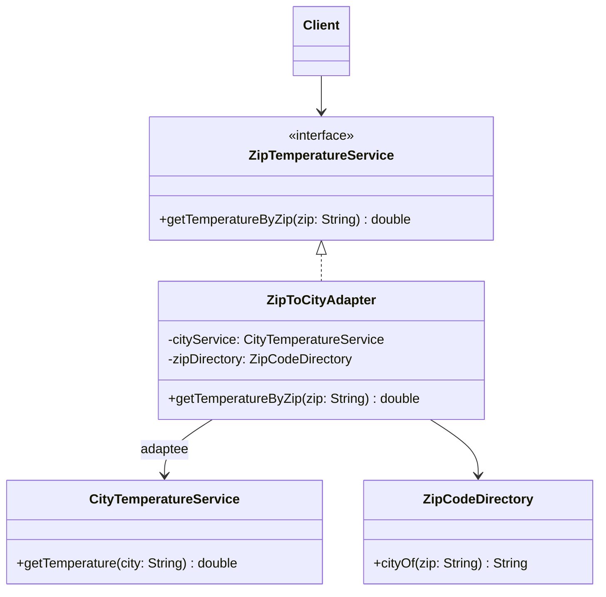
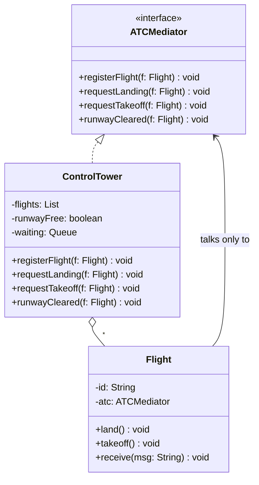
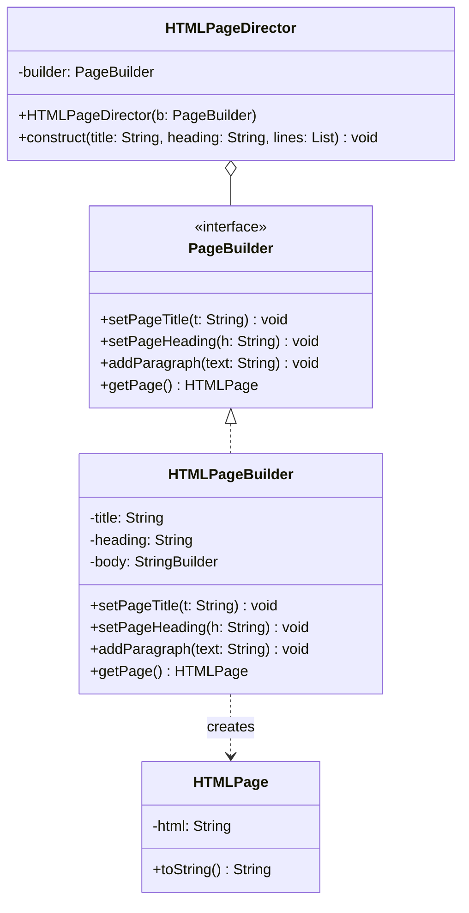
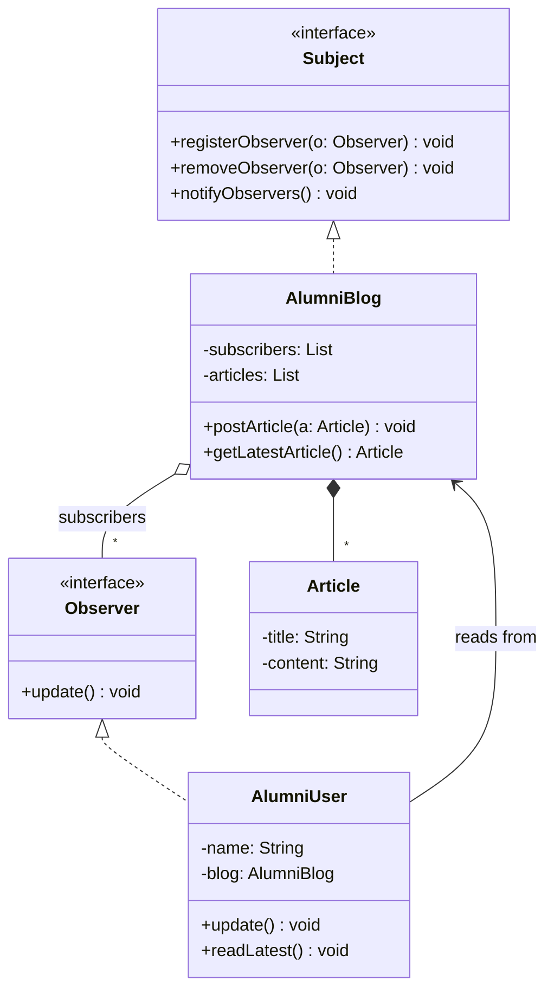
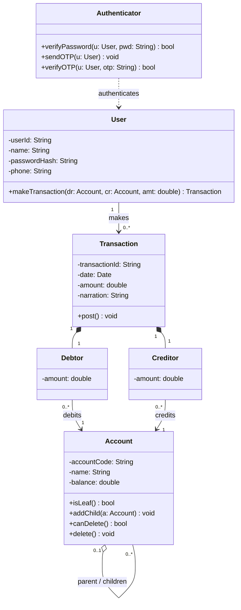

# TF 2022-23 — CSE 307 (paper dated 05/05/2024)

This is the L-3/T-1 CSE 307 (Software Engineering) term final of session 2022-2023, held on 05 May 2024. It is the old course code for the same course, so its question style is very close to what CSE 213 asks now. It carries 210 marks in 3 hours. Each section has four questions; ==Q1 and Q5 are compulsory==, and you answer any two of the remaining three in each section. Questions are not repeated here; each heading names the part and its topic.

**What to attempt.** In Section A everything except Q3(b) (caching) and Q3(c) (CI/CD) is in scope. Since Q1 is compulsory, ==pick Q2 (Mediator, code review, ISP) and Q4 (Observer, class diagram, condition coverage)==; Q3 is also fine if you are comfortable losing 20 marks of (b)+(c). In Section B, Q5 is compulsory and fully in scope, ==Q6 (process models, Kanban, Scrum) is fully in scope==, but Q7 (risk, EVM, CPM) and Q8 (security, performance) are fully outside your chosen scope. So in a real exam with these questions you would have to attempt one of Q7/Q8; here they are skipped by your decision.

---

## Section A

## Q1(a) — Zip code instead of city name: Adapter [15]

The appropriate pattern is ==Adapter==. The existing temperature service works with a city name, and we cannot (or should not) change it. The client now wants to call it with a zip code. Adapter "converts the interface of a class into another interface clients expect", so we write an adapter that offers the zip-code interface the client wants, converts the zip code to a city name, and then delegates to the existing service. We use an ==object adapter== (composition), which works in Java.



```java
// Existing service (adaptee) — unchanged
class CityTemperatureService {
    public double getTemperature(String city) {
        // calls weather backend; dummy value here
        return city.equalsIgnoreCase("Dhaka") ? 31.5 : 25.0;
    }
}

// What the client now expects (target)
interface ZipTemperatureService {
    double getTemperatureByZip(String zip);
}

// Helper that maps zip -> city
class ZipCodeDirectory {
    private final java.util.Map<String, String> map = new java.util.HashMap<>();
    ZipCodeDirectory() { map.put("1000", "Dhaka"); map.put("4000", "Chattogram"); }
    String cityOf(String zip) {
        String city = map.get(zip);
        if (city == null) throw new IllegalArgumentException("Unknown zip: " + zip);
        return city;
    }
}

// Adapter
class ZipToCityAdapter implements ZipTemperatureService {
    private final CityTemperatureService cityService;   // wrapped adaptee
    private final ZipCodeDirectory zipDirectory;
    ZipToCityAdapter(CityTemperatureService s, ZipCodeDirectory d) { cityService = s; zipDirectory = d; }

    @Override
    public double getTemperatureByZip(String zip) {
        String city = zipDirectory.cityOf(zip);          // translate request
        return cityService.getTemperature(city);         // delegate to old service
    }
}

public class WeatherClient {
    public static void main(String[] args) {
        ZipTemperatureService service =
            new ZipToCityAdapter(new CityTemperatureService(), new ZipCodeDirectory());
        System.out.println(service.getTemperatureByZip("1000"));   // 31.5
    }
}
```

The old service is reused without modification (open/closed principle), and the client depends only on the `ZipTemperatureService` interface.

🔗 Concept: [[IJ-1 Structural Design Patterns#Adapter Pattern]]

## Q1(b) — Test cases for the income tax application [10]

**Assumption (state it in the script).** Tax is computed by applying the slab's rate to the whole income: 0% if income < 4,00,000; 10% if 4,00,000 ≤ income ≤ 10,00,000 ("4–10 lac", so 10 lac itself is in the 10% slab); 20% if income > 10,00,000. Income must be a non-negative number. (If the examiner intends progressive slabs, only the expected values change; the partitions and boundaries stay the same.)

**Equivalence partitions.** Invalid: income < 0 (negative) and non-numeric/empty input. Valid: P1 = [0, 4,00,000) with 0% tax; P2 = [4,00,000, 10,00,000] with 10% tax; P3 = (10,00,000, ∞) with 20% tax. One representative per partition gives the EP tests, and the edges of each partition give the BVA tests.

| ID | Technique | Income (Tk) | Expected tax (Tk) |
|---|---|---|---|
| T1 | EP invalid | −5,000 | Error: "income cannot be negative" |
| T2 | EP invalid | "abc" / empty | Error: "invalid input" |
| T3 | BVA | −1 | Error |
| T4 | BVA | 0 | 0 |
| T5 | EP P1 | 2,00,000 | 0 |
| T6 | BVA | 3,99,999 | 0 |
| T7 | BVA | 4,00,000 | 40,000 |
| T8 | BVA | 4,00,001 | 40,000.10 |
| T9 | EP P2 | 7,00,000 | 70,000 |
| T10 | BVA | 9,99,999 | 99,999.90 |
| T11 | BVA | 10,00,000 | 1,00,000 |
| T12 | BVA | 10,00,001 | 2,00,000.20 |
| T13 | EP P3 | 20,00,000 | 4,00,000 |

T1, T2, T5, T9, T13 are the ==equivalence class tests (one per partition)== and the rest are ==boundary value tests just below, on and just above each boundary (0, 4 lac, 10 lac)==, because most defects (for example writing `<` instead of `<=`) occur exactly at these points.

🔗 Concept: [[AI-10 Equivalence Partitioning and BVA]]

## Q1(c) — Internal and external integration testing in a ride-sharing app [10]

==Integration testing== combines units/components that have already been unit-tested and checks that they work correctly together, because components that work individually may still fail when they exchange data.

==Internal integration testing== checks the interfaces between components that belong to our own system. Example: in the ride-sharing app, the *Ride Request* module, the *Driver Matching* module and the *Fare Calculation* module are integrated. Test: a rider requests a ride from Banani to Motijheel; the Ride Request module must pass the correct pickup and drop coordinates to Driver Matching; the matched driver id and route distance must reach Fare Calculation; and the fare shown on the rider's screen must equal the fare recorded in the trip record. A failure here (for example kilometres passed but metres expected) is an internal integration defect.

==External integration testing== checks the interaction between our system and outside systems that we do not control. Example: the app integrates with a third-party *maps API* for distance and ETA, a *payment gateway* (card or mobile wallet) for paying the fare, and an *SMS gateway* for OTP. Test: when the trip ends, the app sends the fare to the payment gateway; on a successful response the trip must be marked "Paid" and a receipt generated; on a timeout or "insufficient balance" response the app must show an error and keep the trip "Unpaid" without charging twice. Similarly, if the maps API returns an error, the app must fall back gracefully instead of crashing. These tests are usually done against the provider's sandbox or with stubs that simulate the external system.

🔗 Concept: [[AI-8 Software Testing Fundamentals]]

---

## Q2(a) — Air traffic controller: Mediator [15]

The appropriate pattern is ==Mediator==. Flights must not talk to each other directly and have no dependency on each other; all coordination of landing and take-off goes through the ATC. Mediator "restricts direct communications between objects and forces them to collaborate only via a mediator object", turning a many-to-many web of dependencies into one-to-many dependencies on the mediator. The ATC is exactly the example used in the slides.



```java
import java.util.*;

interface ATCMediator {
    void registerFlight(Flight f);
    void requestLanding(Flight f);
    void requestTakeoff(Flight f);
    void runwayCleared(Flight f);
}

class ControlTower implements ATCMediator {
    private final List<Flight> flights = new ArrayList<>();
    private final Queue<Flight> waiting = new LinkedList<>();
    private boolean runwayFree = true;

    public void registerFlight(Flight f) { flights.add(f); }

    public void requestLanding(Flight f) { allocate(f, "LAND"); }
    public void requestTakeoff(Flight f) { allocate(f, "TAKEOFF"); }

    private void allocate(Flight f, String op) {
        if (runwayFree) { runwayFree = false; f.receive("Cleared to " + op); }
        else { waiting.add(f); f.receive("Hold: runway busy"); }
    }

    public void runwayCleared(Flight f) {
        runwayFree = true;
        Flight next = waiting.poll();
        if (next != null) { runwayFree = false; next.receive("Runway now cleared for you"); }
        for (Flight other : flights)                       // tower informs the others
            if (other != f) other.receive(f.getId() + " has cleared the runway");
    }
}

class Flight {
    private final String id;
    private final ATCMediator atc;                          // only dependency
    Flight(String id, ATCMediator atc) { this.id = id; this.atc = atc; atc.registerFlight(this); }
    String getId() { return id; }
    void land()    { atc.requestLanding(this); }
    void takeoff() { atc.requestTakeoff(this); }
    void done()    { atc.runwayCleared(this); }
    void receive(String msg) { System.out.println(id + " <- ATC: " + msg); }
}

public class Airport {
    public static void main(String[] args) {
        ATCMediator tower = new ControlTower();
        Flight bg101 = new Flight("BG101", tower);
        Flight ek585 = new Flight("EK585", tower);
        bg101.land();      // cleared
        ek585.takeoff();   // hold
        bg101.done();      // EK585 gets clearance via the tower
    }
}
```

No `Flight` holds a reference to another `Flight`; adding a new kind of aircraft or rule changes only the mediator.

🔗 Concept: [[IJ-2 Behavioral Design Patterns#Mediator Pattern]]

## Q2(b) — Issues commonly identified during code review, with 3 examples [12]

==Code review== is the process of analysing code written by a teammate to judge whether it is of sufficient quality to be merged into the main codebase. The issues commonly identified are: coding style violations, redundant checks, violation of the project's design, misunderstood requirements, critical security defects, malicious code, inadequate input validation, use of unsafe methods, and lack of exception handling.

Example 1 — ==style inconsistency== (from the slides). A method named `Get_user_Data()` and variables like `x1`, `tmp2` in a project whose convention is camelCase with meaningful names. The reviewer asks to rename to `getUserData()` and `retryCount`, because inconsistent style makes the code harder to read and maintain.

Example 2 — ==security defect: buffer overflow / unsafe method==.

```c
char name[16];
strcpy(name, userInput);          // no length check: overflow if input > 15 chars
```

The reviewer flags `strcpy` as an unsafe method and asks for `strncpy(name, userInput, sizeof(name) - 1); name[15] = '\0';` together with input validation.

Example 3 — ==lack of exception handling / silly mistake==.

```java
FileReader fr = new FileReader(path);
int ch = fr.read();               // IOException not handled, file never closed
```

The reviewer asks for try-with-resources so that the file is always closed and errors are reported. Other typical examples are a redundant `if (list != null && list != null)` check, or an XSS vulnerability where user input is written into an HTML page without escaping.

📑 **See:** *6 - CodeReviews.pdf* → p.1–4 (examples), p.12 (list of issues)
🔗 Concept: [[IJ-5 Code Reviews]]

## Q2(c) — Example of the Interface Segregation Principle [8]

The ==Interface Segregation Principle== says: clients should not be forced to depend on methods they do not use; interfaces should be narrow enough that implementing classes do not have to provide behaviour they do not need.

Violation: a "fat" interface for office machines.

```java
interface Machine {
    void print(Document d);
    void scan(Document d);
    void fax(Document d);
}
class SimplePrinter implements Machine {
    public void print(Document d) { /* prints */ }
    public void scan(Document d) { throw new UnsupportedOperationException(); } // forced
    public void fax(Document d)  { throw new UnsupportedOperationException(); } // forced
}
```

`SimplePrinter` is forced to implement `scan` and `fax`, which it cannot do. Any change to faxing also forces it to be recompiled, and a client calling `fax` on it crashes at run time (also an LSP problem).

Applying ISP: split the fat interface into small role interfaces.

```java
interface Printer { void print(Document d); }
interface Scanner { void scan(Document d); }
interface Fax     { void fax(Document d); }

class SimplePrinter implements Printer {
    public void print(Document d) { /* prints */ }
}
class MultiFunctionMachine implements Printer, Scanner, Fax {
    public void print(Document d) { }  public void scan(Document d) { }  public void fax(Document d) { }
}
```

Now every class implements only what it really supports, and clients depend only on the small interface they use.

📑 **See:** *Lec 1 - Design Principle.pdf* → p.21–22
🔗 Concept: [[AI-1 Design Principles (SOLID)]]

---

## Q3(a) — HTMLPageDirector and HTMLPageBuilder: Builder [15]

The appropriate pattern is ==Builder==: it separates the construction of a complex object (an HTML page made of title, heading and several paragraphs) from its representation, and a ==Director== controls the order of construction steps while the ==Builder== knows how to build each part and finally assembles and returns the ==Product==. Using an abstract builder lets the same director create other representations later (for example a Markdown page).



```java
import java.util.List;

class HTMLPage {                                         // Product
    private final String html;
    HTMLPage(String html) { this.html = html; }
    @Override public String toString() { return html; }
}

interface PageBuilder {                                  // abstract Builder
    void setPageTitle(String title);
    void setPageHeading(String heading);
    void addParagraph(String text);
    HTMLPage getPage();                                  // final assembly
}

class HTMLPageBuilder implements PageBuilder {           // concrete Builder
    private String title = "", heading = "";
    private final StringBuilder body = new StringBuilder();
    public void setPageTitle(String t)   { title = t; }
    public void setPageHeading(String h) { heading = h; }
    public void addParagraph(String text) { body.append("<p>").append(text).append("</p>\n"); }
    public HTMLPage getPage() {
        String html = "<html>\n<head><title>" + title + "</title></head>\n<body>\n"
                    + "<h1>" + heading + "</h1>\n" + body + "</body>\n</html>";
        return new HTMLPage(html);
    }
}

class HTMLPageDirector {                                 // Director
    private final PageBuilder builder;
    HTMLPageDirector(PageBuilder builder) { this.builder = builder; }
    public void construct(String title, String heading, List<String> lines) {
        builder.setPageTitle(title);                     // director decides WHAT and in what ORDER
        builder.setPageHeading(heading);
        for (String line : lines) builder.addParagraph(line);
    }
}

public class BuilderDemo {
    public static void main(String[] args) {
        HTMLPageBuilder builder = new HTMLPageBuilder();
        HTMLPageDirector director = new HTMLPageDirector(builder);
        director.construct("CSE 307", "Builder Pattern", List.of("Line one.", "Line two."));
        HTMLPage page = builder.getPage();               // builder returns the product
        System.out.println(page);
    }
}
```

🔗 Concept: [[AI-2 Creational Design Patterns#Builder]]

## Q3(b) — Write-through/read-through vs write-around/read-through caching [12]

> [!note] ⏭ Skipped — caching strategies (outside your chosen scope)

## Q3(c) — CI/CD in DevOps [8]

> [!note] ⏭ Skipped — DevOps / CI-CD (outside your chosen scope)

---

## Q4(a) — BUET alumni blog notifications: Observer [15]

The appropriate pattern is ==Observer==: the blog (subject) keeps a list of registered alumni (observers); when a new article is posted (state change), all registered users are notified automatically (one-to-many dependency), and users can register or unregister at any time. The notification only says that a new article is posted, and the user then accesses the blog to read it, so this is the ==pull model== (the observer pulls the data from the subject).



```java
import java.util.*;

interface Observer { void update(); }
interface Subject {
    void registerObserver(Observer o);
    void removeObserver(Observer o);
    void notifyObservers();
}

class Article {
    final String title, content;
    Article(String title, String content) { this.title = title; this.content = content; }
}

class AlumniBlog implements Subject {
    private final List<Observer> subscribers = new ArrayList<>();
    private final List<Article> articles = new ArrayList<>();

    public void registerObserver(Observer o) { subscribers.add(o); }
    public void removeObserver(Observer o)   { subscribers.remove(o); }
    public void notifyObservers() { for (Observer o : subscribers) o.update(); }

    public void postArticle(Article a) {           // state change
        articles.add(a);
        notifyObservers();                          // "a new article is posted"
    }
    public Article getLatestArticle() { return articles.get(articles.size() - 1); }
}

class AlumniUser implements Observer {
    private final String name;
    private final AlumniBlog blog;
    AlumniUser(String name, AlumniBlog blog) { this.name = name; this.blog = blog; blog.registerObserver(this); }

    public void update() {
        System.out.println(name + ": notified that a new article is posted");
        readLatest();                               // user then accesses the blog
    }
    void readLatest() {
        Article a = blog.getLatestArticle();        // pull model
        System.out.println(name + " reads: " + a.title);
    }
}

public class BlogDemo {
    public static void main(String[] args) {
        AlumniBlog blog = new AlumniBlog();
        new AlumniUser("Rahim (CSE'05)", blog);
        new AlumniUser("Nadia (EEE'10)", blog);
        blog.postArticle(new Article("Reunion 2024", "..."));
    }
}
```

🔗 Concept: [[IJ-2 Behavioral Design Patterns#Observer Pattern]]

## Q4(b) — Class diagram for the accounting software [12]

The chart of accounts is a ==tree==: an account may have child accounts, and an account without children is a leaf account. This is modelled with a self-association on `Account` (a parent has 0..* children, a child has 0..1 parent), which is the Composite idea. Every `Transaction` debits one account and credits another at the same time, so a transaction has exactly one `Debtor` entry and one `Creditor` entry, each pointing to an account and an amount. Each transaction is made by a `User` who is authenticated by a two-step process (password, then OTP).



The constraints of the scenario are placed as operations and written as constraints next to the diagram: `isLeaf()` returns true when the account has no children; ==`canDelete()` returns true only if the account has no children and no Debtor/Creditor entry (no transaction)==, written as the constraint {cannot delete if children ≠ ∅ or transactions ≠ ∅}; and a transaction can be posted only after `verifyPassword` and `verifyOTP` both succeed. Debtor and Creditor are composed into Transaction (black diamond) because they cannot exist without the transaction.

🔗 Concept: [[AI-3 Class Diagram]]

## Q4(c) — Minimal dataset for condition coverage [8]

The decision `if (x < 0 || y < x)` has two atomic conditions: ==C1 = (x < 0)== and ==C2 = (y < x)==. Condition coverage requires that ==each atomic condition evaluates to both true and false== at least once. Here `y` is not a parameter, so it is treated as a field/global whose value is set before the call.

The minimal dataset has ==2 test cases==:

Test 1: x = −1, y = −5. C1: −1 < 0 is TRUE; C2: −5 < −1 is TRUE. The decision is true, so `y` becomes 5, `x` becomes 1, and z = 1.

Test 2: x = 1, y = 5. C1: 1 < 0 is FALSE; C2: 5 < 1 is FALSE. The decision is false and z = 1.

Each condition has taken both TRUE and FALSE, so condition coverage is 100% with only two tests. This choice also makes the whole decision true once and false once, so it achieves ==condition/decision coverage== as a bonus.

> [!warning] ⚠️ Short-circuit note
> In Java/C, `||` is short-circuit: in Test 1, C1 is true, so C2 is never actually evaluated. If the examiner counts only evaluated conditions, add Test 3: x = 3, y = 1 (C1 FALSE, C2: 1 < 3 TRUE). Then C2 is evaluated as TRUE (Test 3) and FALSE (Test 2), and the minimal set becomes 3 tests. Mention this in one line in the script to show understanding.

🔗 Concept: [[AI-9 Code Coverage and White-box Testing]]

---

## Section B

## Q5(a) — Shotgun Surgery, Parallel Inheritance Hierarchies, Refused Bequest, Feature Envy [15]

==Shotgun Surgery==: one kind of change requires many small edits spread over many different classes. Example: the minimum order amount 500 is hard-coded in several classes, so changing the business rule means "shooting" edits everywhere.

```java
class Cart     { boolean canCheckout(double t) { return t >= 500; } }
class Checkout { void validate(double t) { if (t < 500) throw new RuntimeException("Min 500"); } }
class Banner   { String msg() { return "Free delivery on orders over 500"; } }
// Fix: Move Method/Field into one OrderPolicy class with MIN_ORDER = 500.
```

==Parallel Inheritance Hierarchies==: every time you create a subclass in one hierarchy you are forced to create a matching subclass in another hierarchy (a special case of shotgun surgery).

```java
abstract class Employee { }          abstract class EmployeePayCalculator { }
class Engineer extends Employee { }  class EngineerPayCalculator extends EmployeePayCalculator { }
class Manager  extends Employee { }  class ManagerPayCalculator  extends EmployeePayCalculator { }
// Adding Intern requires InternPayCalculator too. Fix: move pay calculation into Employee (Move Method).
```

==Refused Bequest==: a subclass inherits methods/data from its parent that it does not want or cannot support, so it ignores them or throws exceptions; the inheritance is wrong.

```java
class Bird { void fly() { System.out.println("Flying"); } void eat() { } }
class Penguin extends Bird {
    @Override void fly() { throw new UnsupportedOperationException(); } // refuses the bequest
}
// Fix: Replace Inheritance with Delegation, or split into Bird and FlyingBird.
```

==Feature Envy==: a method uses the data of another class more than the data of its own class.

```java
class Invoice {
    double discount(Customer c) {                       // envies Customer
        if (c.getTotalSpent() > 1000 && c.getYearsAsMember() > 2) return c.getTotalSpent() * 0.15;
        return 0;
    }
}
// Fix: Move Method — put discount() inside Customer.
```

📑 **See:** *7 - Refactoring.pdf* → p.20–24 (shotgun surgery, feature envy)
🔗 Concept: [[IJ-6 Refactoring and Code Smells]]

## Q5(b)(i) — renderBanner: Extract Variable [6]

The condition is long and hard to read; each part has a meaning that is hidden in an expression. Apply ==Extract Variable (Introduce Explaining Variable)==: put each sub-expression into a well-named final variable.

```java
void renderBanner() {
    final boolean isMacOs     = platform.toUpperCase().indexOf("MAC") > -1;
    final boolean isIE        = browser.toUpperCase().indexOf("IE") > -1;
    final boolean wasResized  = resize > 0;

    if (isMacOs && isIE && wasInitialized() && wasResized) {
        // do something
    }
}
```

The behaviour is identical, but the condition now reads like a sentence. (Extract Method, e.g. `isMacIE()`, is an acceptable further step.)

## Q5(b)(ii) — getSalary: Replace Conditional with Polymorphism [7]

The `switch` on a type code (`"Football"`, `"Cricket"`, `"Badminton"`) is the ==Switch Statements== smell. Apply ==Replace Type Code with Subclasses== and ==Replace Conditional with Polymorphism==: each leg of the switch becomes an overriding method in a subclass, and the original method becomes abstract.

```java
abstract class Player {
    double baseSalary() { return 30000; }          // existing helpers stay in the parent
    double getWeeklyIncrement()  { return 1000; }
    double getMonthlyIncrement() { return 3000; }
    abstract double getSalary();
}
class FootballPlayer extends Player {
    @Override double getSalary() { return baseSalary() + getWeeklyIncrement() * 4; }
}
class CricketPlayer extends Player {
    @Override double getSalary() { return baseSalary() + getMonthlyIncrement(); }
}
class BadmintonPlayer extends Player {
    @Override double getSalary() { return baseSalary(); }
}
// Client: Player p = new CricketPlayer(); double s = p.getSalary();  // no switch anywhere
```

A new sport now means adding one subclass; no existing switch must be edited (open/closed principle).

## Q5(b)(iii) — getPayAmount: Replace Nested Conditional with Guard Clauses [7]

The nested `if-else` hides the normal path; the special cases (dead, separated, retired) are really early exits. Apply ==Replace Nested Conditional with Guard Clauses==: handle each special case first and return immediately, which also removes the temporary `result`.

```java
double getPayAmount() {
    if (isDead)      return deadAmount();
    if (isSeparated) return separatedAmount();
    if (isRetired)   return retiredAmount();
    return normalPayAmount();
}
```

The order of the checks is the same as in the original, so the observable behaviour does not change.

🔗 Concept: [[IJ-6 Refactoring and Code Smells]]

---

## Q6(a) — Core activities of a generic process model; Waterfall with pros and cons [10]

A generic process model has ==five core (framework) activities==. In ==Communication==, the project team communicates with the client to collect and understand the requirements. In ==Planning==, the team schedules the development and estimates the project cost. In ==Modeling==, the team analyses the requirements and designs the algorithms, flowcharts and architecture of the software components. In ==Construction==, the team implements (codes) and tests the components. In ==Deployment==, the team delivers the product to the client and takes feedback to improve quality if required.

The ==Waterfall model== is a linear process model in which these five activities are executed once, sequentially and systematically; a phase starts only when the previous one is finished. It is normally used for small projects whose requirements are well defined and known before the project starts. The requirements are collected and documented in communication, a schedule and budget are made in planning, the design is made in modeling, code is written and tested in construction, and the product is delivered and maintained in deployment.

Its advantages are that it is a ==simple model to use and implement==, its ==workflow is easily understandable==, and the project is ==easily manageable because the requirements are known before starting==. Its disadvantages are that it may be ==hard for the client to give all requirements beforehand==, ==testing and client evaluation happen only in the last phases, which makes the project high-risk== (errors are found late), and ==iteration of activities is not supported==, although some projects need it.

📑 **See:** *4 - Process Models and Agile Development .pdf* → p.6–8 (core activities), p.17–22 (waterfall)
🔗 Concept: [[IJ-3 Process Models and Agile]]

## Q6(b) — "Developers can adjust workload per kanban card … lead time" [10]

In ==Kanban==, every task is broken into small subtasks, and each subtask is written on a ==Kanban card== that holds its details and the related user story. The cards sit on a ==Kanban board== with columns such as To-Do, In Progress and Done, and team members ==pull== a card from left to right whenever they are free. Because the board is visible to everyone, it shows at any moment how many cards are waiting, how many are in progress and how fast cards reach Done.

==Lead time== is the time a card takes from entering the board until it is Done. The statement means that developers can read the board and tune how much work they put on each card to keep this lead time healthy. If cards are piling up in "In Progress" and moving slowly, each card carries too much work, so the team splits the work into smaller cards (reduces workload per card) to make the flow faster. If cards fly through and the Done column grows quickly while little is waiting, the team can safely put more work on each card to finish the process. This ==self-regulation through visualization== keeps a steady, predictable workflow without fixed sprints, and it reflects the Kanban advantage that leadership and decisions come from every participant rather than only from a manager. The slides illustrate this with two board pictures: a crowded board ("reduce workload per card") and an empty board ("increase workload per card").

📑 **See:** *4 - Process Models and Agile Development .pdf* → p.75–81 (p.80–81 for this exact statement)
🔗 Concept: [[IJ-3 Process Models and Agile]]

## Q6(c) — Activities of a Scrum sprint; the two backlogs [15]

A ==sprint== is the unit cycle of development in Scrum and usually lasts 2 weeks to 1 month. A sprint starts by ==analysing the product backlog and selecting the requirements== to implement in this sprint; the selected items are moved into the sprint backlog. The team then works on the sprint backlog in ==four phases: planning, implementation, product review and process review (retrospective)==. In planning, the team breaks the selected items into tickets (subtasks), estimates them and assigns them; the tickets are tracked on the scrum board. In implementation, the developers design, code and test the tickets, and a short ==daily scrum== meeting is held every day to synchronize — each member tells what was done, what will be done next and what is blocking. In product review, the completed increment is demonstrated to the product owner (client) for feedback. In the process review (retrospective), the team reflects on how the sprint went and what to improve, so that fewer mistakes are made in the next sprint. Finally the completed portion of the product is delivered to the client, and ==unfinished sprint backlog items are sent back to the product backlog== for the next sprint. The scrum master (usually the project manager) facilitates the process and the product owner represents the client.

The ==two types of backlog== are: the ==product backlog==, which is the complete, prioritized list of all client requirements for the whole product, owned by the product owner and changing throughout the project; and the ==sprint backlog==, which is the subset of product backlog items that the team has committed to deliver in one particular sprint, broken down into tasks.

📑 **See:** *4 - Process Models and Agile Development .pdf* → p.65–72
🔗 Concept: [[IJ-3 Process Models and Agile]]

---

## Q7 — Risk strategies, EVM (SPI, CPI, EAC, SV, CV), critical path

> [!note] ⏭ Skipped — Q7(a) risk management, Q7(b) earned value, Q7(c) CPM are all outside your chosen scope.

## Q8 — SQL poisoning, XSS, federated identity, encryption, performance bottlenecks

> [!note] ⏭ Skipped — Q8(a)(b) security and Q8(c) performance optimization are outside your chosen scope.
