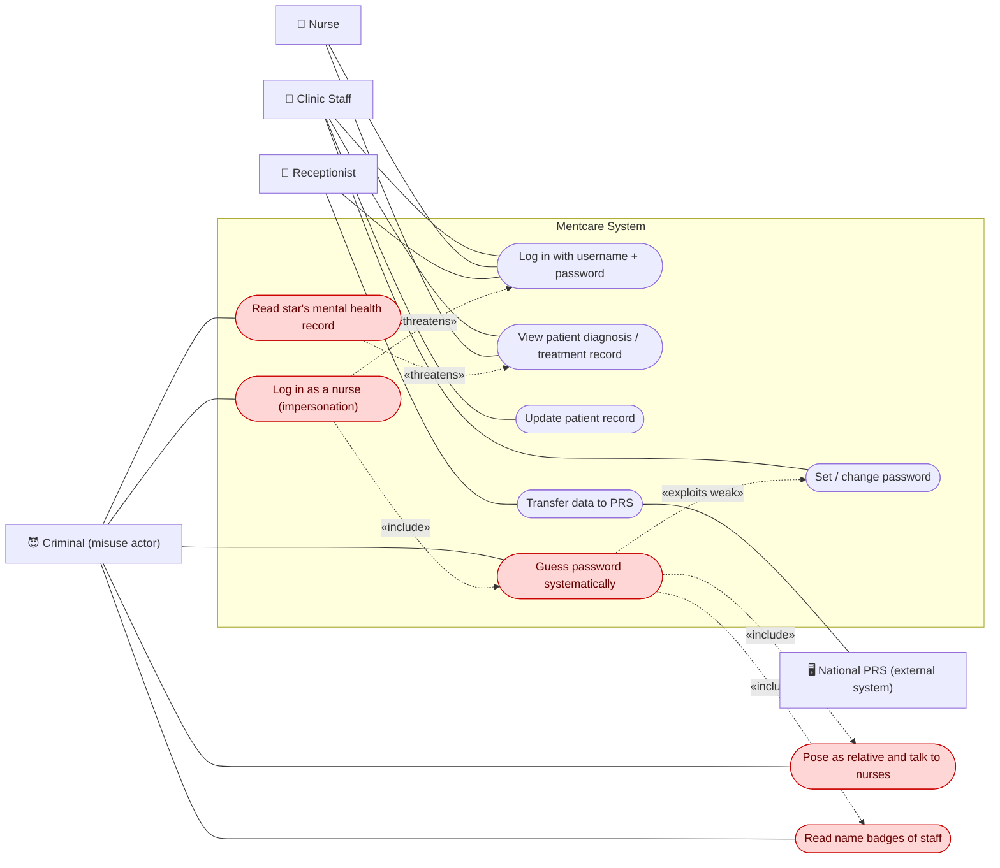
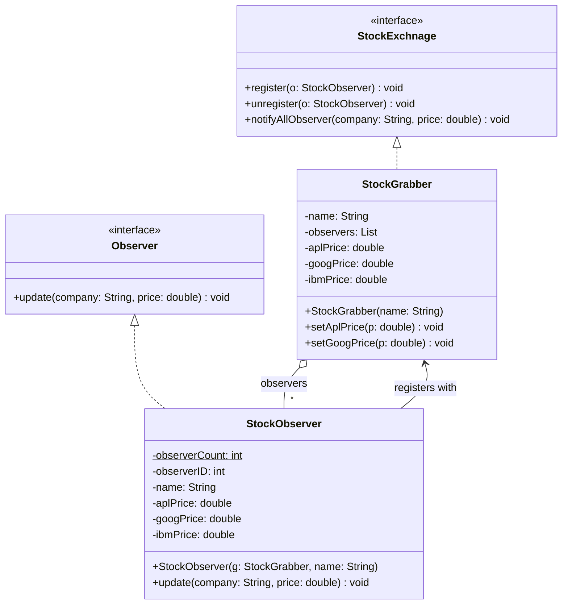
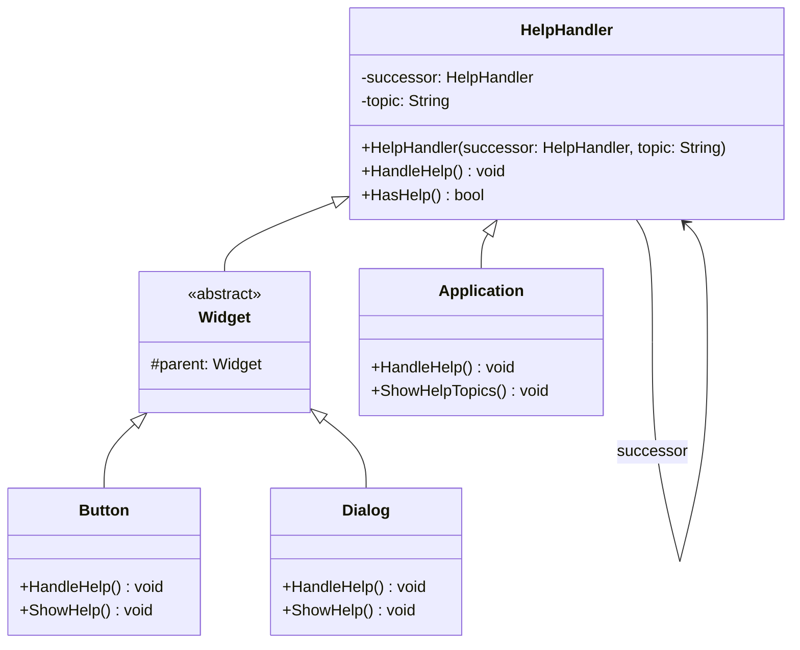
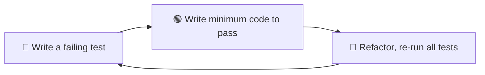
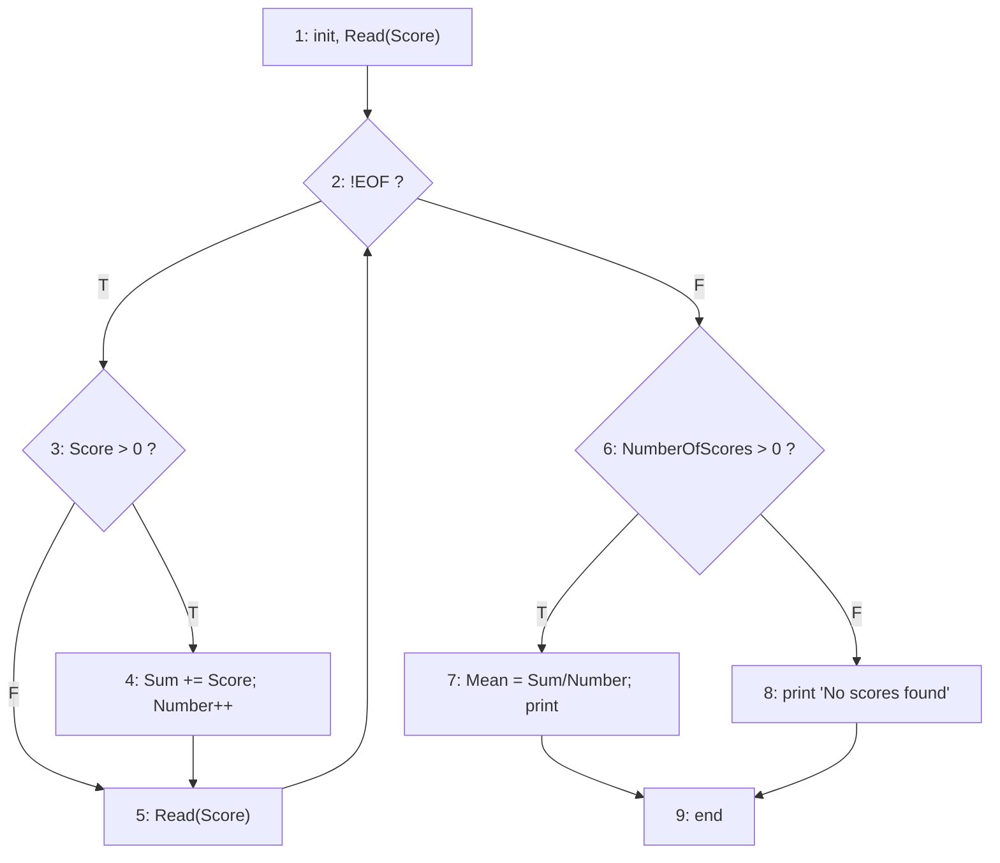
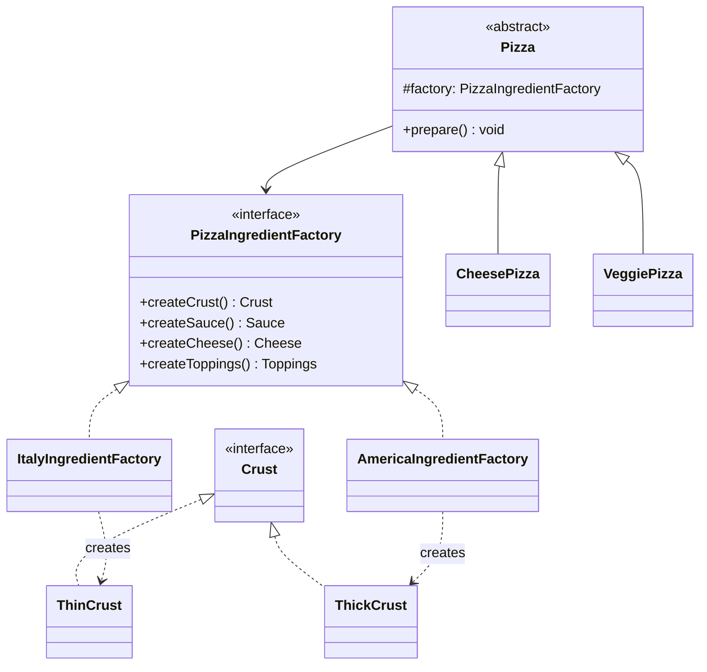
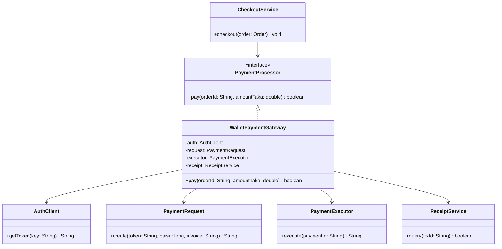

# TF 2023-24 — CSE 213 (paper dated 09/02/2025)

This is the CSE 213 (Software Engineering) term final with "2023-2024" printed on top and dated 09 February 2025. It is a 210-mark, 3-hour paper. Each section has four questions. ==Q1 and Q5 are mandatory==, and from the rest you answer any two in each section. Questions are not repeated here because you have the printed paper; each heading only names the part and what it is about.

**What to attempt.** In Section A, Q1 is mandatory but mostly security; you can score the use case diagram (a) and the password test cases (c), which are testing and UML, and the rest is outside your chosen scope. For the two optional questions, ==pick Q2 (Observer + Chain of Responsibility) and Q3 (TDD, white-box testing, EP)==, because Q4 is entirely security. In Section B, Q5 is mandatory and fully in scope. For the two optional questions, ==pick Q8 (process models, manager vs leader, refactoring) and Q6 ((a) and (b) are ethics)==. Q6(c) is EVM and Q7 is risk/performance, both skipped.

---

## Section A

## Q1(a) — Use case diagram with the criminal as a misuse actor [7]

The diagram below shows the normal actors of the Mentcare system together with the criminal, who is drawn as a ==misuse actor== (an actor with harmful intentions). The ordinary use cases sit inside the system boundary. The criminal's harmful activities are drawn as ==misuse cases== (red). A misuse case is connected to a normal use case with «threatens», which shows exactly which process the criminal attacks. The social engineering steps (talking to nurses, reading name badges) happen outside the software, but they feed the password guessing, so they are shown as misuse cases that the "Guess password" misuse case «includes».



The points where the criminal gets engaged are: (1) the social engineering process with nurses, where he collects personal information about staff and their families; (2) reading badges, where he learns valid usernames; (3) the ==login process==, which he threatens by guessing passwords such as children's names, made possible by the weak "Set password" use case that accepts any 8-letter password without checking; and (4) the ==view record process==, where, once logged in as a nurse, he reads the sports star's diagnosis to blackmail him. The data transfer to PRS is also an asset that becomes exposed once he is inside.

🔗 Concept: [[AI-6 Use Case Diagram]]

## Q1(b) — IT security policy for passwords [14]

> [!note] ⏭ Skipped — security policy design (outside your chosen scope)

## Q1(c) — Test cases for the password policy [10]

Since Q1(b) is skipped, ==state the policy you are testing first== (the examiner accepts any reasonable policy as long as the test cases match it). Assumed policy: a password must be 8 to 64 characters long; it must contain at least one uppercase letter, one lowercase letter, one digit and one special character; it must not contain the username or any name stored in the staff's profile (such as family members' names) or a dictionary word; an account is locked for 15 minutes after 5 consecutive failed logins; a password expires after 90 days; and the last 5 passwords cannot be reused.

The test cases are designed with ==equivalence partitioning== (one test per valid/invalid class) and ==boundary value analysis== on the length (7, 8, 64, 65) and on the failed-attempt counter (4 and 5). Positive tests check that a valid password is accepted; negative tests check that each rule rejects a password that violates only that rule, so that a failure points to exactly one rule.

| ID | Input / situation | Expected result |
|---|---|---|
| T1 (positive, valid class) | `Blue#Sky42` (10 chars, all classes) | Accepted |
| T2 (BVA lower, invalid) | `Ab#4efg` — 7 characters | Rejected: "minimum 8 characters" |
| T3 (BVA lower, valid) | `Ab#4efgh` — exactly 8 characters | Accepted |
| T4 (BVA upper, valid) | 64-character password with all classes | Accepted |
| T5 (BVA upper, invalid) | 65-character password | Rejected: "maximum 64 characters" |
| T6 (no uppercase) | `blue#sky42` | Rejected |
| T7 (no digit) | `Blue#Skyy` | Rejected |
| T8 (no special char) | `BlueSky42` | Rejected |
| T9 (contains child's name) | `Rafi@2015` where "Rafi" is the nurse's child in the profile | Rejected: "must not contain personal names" |
| T10 (contains username) | user `nurse.anika`, password `Anika#123` | Rejected |
| T11 (dictionary word) | `Password1!` | Rejected |
| T12 (lockout BVA, below) | 4 wrong attempts, then correct password | Login succeeds, counter resets |
| T13 (lockout BVA, on) | 5 wrong attempts, then correct password | Account locked, login refused for 15 min |
| T14 (after lock period) | Correct password after 15 minutes | Login succeeds |
| T15 (expiry) | Login with a 91-day-old password | Forced to change password |
| T16 (reuse) | New password equal to one of last 5 | Rejected |
| T17 (empty input) | Empty password field | Rejected: "password required" |

T2 to T5 come from BVA on length, T6 to T11 are one negative test per invalid equivalence class, and T12 to T14 are BVA on the attempt counter, which directly checks the defence against the ==systematic guessing== the criminal used.

🔗 Concept: [[AI-10 Equivalence Partitioning and BVA]]

## Q1(d) — Assets, exposures and vulnerabilities [6]

> [!note] ⏭ Skipped — security assets/vulnerabilities (outside your chosen scope)

## Q1(e) — Weaknesses of password authentication, 2FA/3FA [8]

> [!note] ⏭ Skipped — authentication / 2FA (outside your chosen scope)

---

## Q2(a)(i) — UML for StockMarket using the Observer pattern [6]

The scenario is a textbook ==Observer== case: one StockGrabber (the subject) must notify all its registered StockObservers (one-to-many) whenever its state (a stock price) changes, and observers can register and unregister at run time. The given interface `StockExchnage` (spelled this way in the question, so we keep the spelling) plays the Subject role and `Observer` plays the Observer role.



🔗 Concept: [[IJ-2 Behavioral Design Patterns#Observer Pattern]]

## Q2(a)(ii) — Code of StockGrabber and StockObserver [16]

Design decisions that earn the marks: ==setters notify only when the new price differs== from the old one; ==observerID is generated from a static counter starting at 1==; an observer ==registers itself inside its constructor== (the main method never calls register); and the observer learns the initial prices without any getter, because the grabber pushes the current prices to a newly registered observer. Only the methods that the given main needs are written (no setIbmPrice, no getters), as the question demands.

```java
import java.util.ArrayList;
import java.util.List;

public class StockGrabber implements StockExchnage {
    private final String name;
    private final List<StockObserver> observers = new ArrayList<>();
    private double aplPrice  = 230.0;   // initial prices given in the question
    private double googPrice = 200.0;
    private double ibmPrice  = 180.0;

    public StockGrabber(String name) { this.name = name; }

    @Override
    public void register(StockObserver o) {
        observers.add(o);
        // push current prices so the observer "knows" all prices (no getters needed)
        o.update("apl", aplPrice);
        o.update("goog", googPrice);
        o.update("ibm", ibmPrice);
    }

    @Override
    public void unregister(StockObserver o) { observers.remove(o); }

    @Override
    public void notifyAllObserver(String company, double price) {
        for (StockObserver o : observers) o.update(company, price);
    }

    public void setAplPrice(double p) {
        if (p != aplPrice) {            // notify only on a DIFFERENT price
            aplPrice = p;
            notifyAllObserver("apl", p);
        }
    }

    public void setGoogPrice(double p) {
        if (p != googPrice) {
            googPrice = p;
            notifyAllObserver("goog", p);
        }
    }
}

public class StockObserver implements Observer {
    private static int observerCount = 0;   // shared counter
    private final int observerID;
    private final String name;
    private double aplPrice, googPrice, ibmPrice;

    public StockObserver(StockGrabber grabber, String name) {
        this.observerID = ++observerCount;  // 1, 2, 3 ...
        this.name = name;
        grabber.register(this);             // self-registration
    }

    @Override
    public void update(String company, double price) {
        switch (company) {
            case "apl":  aplPrice  = price; break;
            case "goog": googPrice = price; break;
            case "ibm":  ibmPrice  = price; break;
        }
        System.out.println("Observer " + observerID + " (" + name + "): "
            + company + " = $" + price);
    }
}
```

With the given main, Arif gets ID 1 and Kamal gets ID 2. `setAplPrice(250.0)` changes the price from 230 to 250, so both observers are notified. `setGoogPrice(200.0)` sets the same value that already exists, so ==no notification is generated==, exactly as required.

## Q2(b) — UML for the help system (Chain of Responsibility) [8]

The description is the classic ==Chain of Responsibility== pattern (not in the IJ slides, but asked here). A help request is passed along a chain of handlers (Button → Dialog → Application) until one of them has a help topic and handles it. Every handler keeps a reference to its ==successor==, and the default `HandleHelp` simply forwards to the successor.



```java
class HelpHandler {
    private HelpHandler successor;
    private String topic;                 // empty (null) by default
    HelpHandler(HelpHandler s, String t) { successor = s; topic = t; }
    boolean HasHelp() { return topic != null; }
    void HandleHelp() { if (successor != null) successor.HandleHelp(); } // forward
}
abstract class Widget extends HelpHandler {
    Widget(HelpHandler successor, String t) { super(successor, t); }
}
class Button extends Widget {
    Button(HelpHandler successor, String t) { super(successor, t); }   // successor = its Dialog
    @Override void HandleHelp() {
        if (HasHelp()) System.out.println("Button help shown");  // handled, chain stops
        else super.HandleHelp();                                  // pass to successor
    }
}
class Dialog extends Widget {
    Dialog(HelpHandler successor, String t) { super(successor, t); }   // successor = Application (not a widget)
    @Override void HandleHelp() {
        if (HasHelp()) System.out.println("Dialog help shown");
        else super.HandleHelp();
    }
}
class Application extends HelpHandler {
    Application(String t) { super(null, t); }   // end of the chain
    @Override void HandleHelp() { System.out.println("General help / list of topics"); }
}
// Client: chain Button -> Dialog -> Application
// Application app = new Application("General");
// Dialog dlg = new Dialog(app, null);          // no topic: forwards
// Button btn = new Button(dlg, null);          // no topic: forwards
// btn.HandleHelp();                            // prints "General help / list of topics"
```

The key idea for marks is that ==the chain is Button → Dialog → Application and each link either handles the request or forwards it to its successor==. The sender (the button the user clicked) does not know which object finally handles the request, so sender and receiver are decoupled.

🔗 Concept: [[IJ-2 Behavioral Design Patterns]] · [[00 Pattern Picker]]

---

## Q3(a) — Test-driven development and its benefits [6+6]

==Test-driven development (TDD)== is a development practice in which the developer writes an automated unit test for a small piece of functionality ==before writing the code== that implements it. The work moves in very short cycles called ==Red → Green → Refactor==. In the red step you write a test for the next small requirement and run it; it fails because the code does not exist yet. In the green step you write the simplest code that makes the test pass. In the refactor step you clean the code (remove duplication, improve names) while re-running all tests to make sure behaviour has not changed. Then you repeat with the next requirement. TDD comes from Extreme Programming, where testing starts from day one.



The benefits are as follows. Because every unit is written to satisfy a test, the code ends up with ==high test coverage and fewer defects==, and bugs are caught minutes after they are introduced, when they are cheapest to fix. The growing test suite acts as a ==safety net for refactoring and regression testing==: any change that breaks old behaviour is detected immediately. Writing the test first forces the developer to think about the requirement and the interface of the unit before the implementation, which gives ==clearer requirements and simpler, loosely coupled, testable designs==. The tests also serve as ==living documentation==, showing exactly how each unit is supposed to be used. Finally, developers gain confidence to change code, which supports the frequent, incremental releases that agile teams need.

🔗 Concept: [[IJ-4 Unit Testing and JUnit]]

## Q3(b) — White-box test cases for FindMean [10]

For white-box testing we draw the ==control flow graph==, compute the ==cyclomatic complexity==, list the ==basis (independent) paths==, and design one test case per path.

Nodes: 1 = initialisation and first `Read`; 2 = `while (!EOF)` decision; 3 = `if (Score > 0)` decision; 4 = add score and increment count; 5 = `Read` next score (end of loop body); 6 = `if (NumberOfScores > 0)` decision; 7 = compute and print mean; 8 = print "No scores found"; 9 = exit.



==Cyclomatic complexity V(G) = E − N + 2 = 11 − 9 + 2 = 4==, which equals the number of decisions + 1 = 3 + 1 = 4. So 4 independent paths are needed.

Path P1 is 1-2-6-8-9: the loop is never entered and no score is counted. Test: an ==empty file==. Expected output: "No scores found in file".

Path P2 is 1-2-3-4-5-2-6-7-9: one positive score is read and counted. Test: a file containing ==only 80==. Expected output: "The mean score is 80.000000".

Path P3 is 1-2-3-5-2-6-8-9: scores exist but none is positive. Test: a file containing ==0 and −5==. Expected output: "No scores found in file" (this also exposes that non-positive scores are silently ignored, which should be confirmed with the specification).

Path P4 is 1-2-3-4-5-2-3-5-2-6-7-9: both branches of the inner `if` are taken in one run. Test: a file containing ==90, −10, 70==. Expected output: mean = (90 + 70) / 2 = 80.000000; the negative score must not affect the mean.

Together these tests give ==statement, branch (decision) and basis-path coverage==: every statement runs, both outcomes of all three decisions are taken, and the loop is exercised zero, one and multiple times.

🔗 Concept: [[AI-9 Code Coverage and White-box Testing]]

## Q3(c) — Principle of equivalence partition testing and why it is used [8]

==Equivalence partitioning== divides the input domain of a unit into partitions (classes) of data such that ==all values in one partition are expected to be treated the same way== by the software. Therefore only one representative value from each partition needs to be tested: if one value of a partition works, we assume the whole partition works, and if it fails, we assume the whole partition fails. Both valid partitions and invalid partitions are formed. For example, for the savings account interest in the slides, the partitions are balance < 0 (invalid), 0 to < 1000 (0.5%), 1000 to < 10000 (0.75%), and ≥ 10000 (1%); four tests (−1, 500, 5000, 20000) cover all four behaviours.

It is used in real-life software because ==exhaustive testing is impossible==: an input field may accept millions of values, and testing all of them is too costly. EP ==reduces the number of test cases drastically while still covering every distinct behaviour==, it avoids redundant tests that would all find the same fault, it makes sure invalid inputs are tested systematically, and it is a black-box technique that can be applied directly from the requirements before the code is written. It is usually combined with boundary value analysis, because many defects lie at the edges of partitions.

📑 **See:** *Lec 13 - Equivalence partitioning, positive and negative testing.pdf* → p.1–5
🔗 Concept: [[AI-10 Equivalence Partitioning and BVA]]

## Q4 — Security (CIA triad, encryption, residual risk, buffer overflow)

> [!note] ⏭ Skipped — Q4(a)–(d) are all security (outside your chosen scope). Do not choose Q4.

---

## Section B

## Q5(a) — Pizzas with regional styles: Abstract Factory [15]

The most suitable pattern is ==Abstract Factory==. Each region (Italy, America) needs a whole ==family of related products== — crust, sauce, cheese and toppings — that must match each other (an Italian pizza must not get an American crust). Abstract Factory provides an interface for creating families of related objects without naming their concrete classes. Adding a new country later only means writing one new factory class (and its ingredient classes); the pizza classes and the client code stay unchanged, which satisfies the open/closed principle. Factory Method alone would create only one product at a time and would not guarantee that all ingredients belong to the same region, so Abstract Factory is the better fit.



```java
// ---- abstract products ----
interface Crust    { String name(); }
interface Sauce    { String name(); }
interface Cheese   { String name(); }
interface Toppings { String name(); }

// ---- concrete products (Italy) ----
class ThinCrust      implements Crust    { public String name() { return "Thin crust"; } }
class MarinaraSauce  implements Sauce    { public String name() { return "Marinara"; } }
class MozzarellaCheese implements Cheese { public String name() { return "Fresh mozzarella"; } }
class BasilOlive     implements Toppings { public String name() { return "Basil & olives"; } }

// ---- concrete products (America) ----
class ThickCrust     implements Crust    { public String name() { return "Thick pan crust"; } }
class PlumTomatoSauce implements Sauce   { public String name() { return "Plum tomato"; } }
class CheddarCheese  implements Cheese   { public String name() { return "Cheddar"; } }
class PepperoniBacon implements Toppings { public String name() { return "Pepperoni & bacon"; } }

// ---- abstract factory ----
interface PizzaIngredientFactory {
    Crust createCrust();  Sauce createSauce();
    Cheese createCheese(); Toppings createToppings();
}
class ItalyIngredientFactory implements PizzaIngredientFactory {
    public Crust createCrust()       { return new ThinCrust(); }
    public Sauce createSauce()       { return new MarinaraSauce(); }
    public Cheese createCheese()     { return new MozzarellaCheese(); }
    public Toppings createToppings() { return new BasilOlive(); }
}
class AmericaIngredientFactory implements PizzaIngredientFactory {
    public Crust createCrust()       { return new ThickCrust(); }
    public Sauce createSauce()       { return new PlumTomatoSauce(); }
    public Cheese createCheese()     { return new CheddarCheese(); }
    public Toppings createToppings() { return new PepperoniBacon(); }
}

// ---- client: pizzas use whichever factory they are given ----
abstract class Pizza {
    protected final PizzaIngredientFactory factory;
    protected Crust crust; protected Sauce sauce; protected Cheese cheese; protected Toppings toppings;
    Pizza(PizzaIngredientFactory f) { factory = f; }
    void prepare() {                               // all parts come from ONE family
        crust = factory.createCrust();   sauce = factory.createSauce();
        cheese = factory.createCheese(); toppings = factory.createToppings();
        System.out.println(getClass().getSimpleName() + ": " + crust.name() + ", "
            + sauce.name() + ", " + cheese.name() + ", " + toppings.name());
    }
}
class CheesePizza extends Pizza { CheesePizza(PizzaIngredientFactory f) { super(f); } }
class VeggiePizza extends Pizza { VeggiePizza(PizzaIngredientFactory f) { super(f); } }

public class PizzaApp {
    public static void main(String[] args) {
        new CheesePizza(new ItalyIngredientFactory()).prepare();
        new CheesePizza(new AmericaIngredientFactory()).prepare();
        // New country later: add JapanIngredientFactory only — no existing class changes.
    }
}
```

🔗 Concept: [[AI-2 Creational Design Patterns#Abstract Factory]]

## Q5(b) — One class serving as both Adapter and Facade [12]

An ==Adapter== converts the interface of a class into another interface the client expects. A ==Facade== provides one simple, unified interface to a complex subsystem of many classes. The two intents do not conflict, so a single class can do both: it implements the client's expected interface (adapter role) and, behind that one method, coordinates several subsystem classes whose interfaces are complicated and different (facade role).

Example scenario: an online shop's checkout code is written against its own interface `PaymentProcessor` with one method `pay(orderId, amountTaka)`. The company now integrates a third-party mobile-wallet SDK. The SDK does not have a `pay` method; instead the client would have to call four classes in the right order: `AuthClient.getToken(merchantKey)`, `PaymentRequest.create(token, amountInPaisa, invoiceNo)`, `PaymentExecutor.execute(paymentId)` and `ReceiptService.query(trxId)`. A class `WalletPaymentGateway` is written that ==implements PaymentProcessor== and ==hides the four SDK classes==.



```java
class WalletPaymentGateway implements PaymentProcessor {     // ADAPTER: client's interface
    private final AuthClient auth = new AuthClient();
    private final PaymentRequest request = new PaymentRequest();
    private final PaymentExecutor executor = new PaymentExecutor();
    private final ReceiptService receipt = new ReceiptService();

    @Override
    public boolean pay(String orderId, double amountTaka) {
        long paisa = Math.round(amountTaka * 100);               // adapt data format
        String token = auth.getToken("MERCHANT_KEY");             // FACADE: hides 4-step flow
        String paymentId = request.create(token, paisa, orderId);
        String trxId = executor.execute(paymentId);
        return receipt.query(trxId);
    }
}
```

Analysis of the dual role: as an ==adapter==, the class lets `CheckoutService` keep using `PaymentProcessor.pay()` with its own data types (taka, order id); the class translates that call into the SDK's incompatible method names and units (paisa, token, payment id), so existing client code needs no change and the SDK cannot be changed either. As a ==facade==, it hides four subsystem classes and the correct calling order behind one method, which reduces the coupling between the shop and the SDK to a single class and makes the SDK easy to use. The benefit of combining them is that if the wallet provider changes its SDK, only this one class changes. The risk is that the class can grow into a "god class" if too much logic is put in it, so it should only translate and orchestrate, not contain business rules.

🔗 Concept: [[IJ-1 Structural Design Patterns#Adapter Pattern]]

## Q5(c) — Why high test coverage matters and risks of low coverage [8]

==Code coverage== measures how much of the source code is executed by a test suite (method, statement, branch/decision and condition coverage). High coverage is important because it shows that most of the code has actually been run under test, so the program has ==a lower chance of containing undetected bugs==. It reveals parts of the code (paths, branches, error handlers) that the tests have missed, it gives a measurable way to judge how complete a test suite is, and it makes regression testing and refactoring safer because changes to covered code are checked automatically.

If coverage is too low, untested branches and statements may contain faults that reach the customer, such as an `else` branch that crashes, an exception handler that was never run, or a boundary condition that gives a wrong result. Errors are discovered late (in production), when they are much more expensive to fix. Refactoring and new features may silently break old behaviour, and the team may have false confidence in the software. At the same time, the slides warn that ==high coverage does not guarantee correctness==: coverage only shows that code was executed, not that every requirement was implemented, so coverage must be combined with requirement-based (black-box) tests.

📑 **See:** *Lec 12 - Coverage.pdf* → p.1–2, p.7
🔗 Concept: [[AI-9 Code Coverage and White-box Testing]]

---

## Q6(a) — Ethical breaches in the mobile health app [8]

There are several ethical breaches. First, ==medical advice is produced by an unvalidated algorithm built by non-experts==. The team has only software and database engineers, and the algorithm was made "by studying related articles", without doctors or clinical validation. Giving critical health warnings and medicine recommendations this way can directly harm users, which breaks the PUBLIC principle (act consistently with public health, safety and welfare) and the PRODUCT principle (products must meet the highest professional standards and be properly tested). It also breaks the JUDGMENT principle, because engineers are acting outside their area of competence.

Second, the =="anonymized" data is not really anonymous==. The app shares health records together with age, profession and address. Such a combination of quasi-identifiers can easily ==re-identify a person==, so the users' privacy is not protected even though "anonymized" data was promised. This violates the privacy and data ethics dimension and principle of honesty towards the user.

Third, the ==consent is not truly informed==. Users agreed to share anonymized data, but the data actually shared contains identifying details, so the consent does not cover what is done; the consent is therefore misleading. In addition, the ==data minimization principle== is broken, because profession and address are not necessary for healthcare institutions to use heart-rate or activity data.

Fourth, there is a lack of ==accountability and transparency==: users are not told how the suggestions are produced or what their limits are, and nobody with medical authority takes responsibility for wrong advice. Saying "the algorithm suggested it" is not an ethical defence. These actions are unethical because they put users' health and privacy at risk for the company's benefit, and because ethics should be a design constraint, not an afterthought.

📑 **See:** *8 - Software Ethics.pdf* → p.4–7 (dimensions), p.9 (8 principles)
🔗 Concept: [[IJ-7 Software Ethics]]

## Q6(b) — "Software engineers shall act consistently with the public interest" [7]

This is the ==first and top-priority principle (PUBLIC)== of the IEEE-CS/ACM Software Engineering Code of Ethics. It means that when the interests of the employer, the client or the engineer conflict with the health, safety and welfare of the public, ==the public interest comes first==. In practice the engineer must accept full responsibility for their work, approve software only if they believe it is safe, meets its specification and does not harm the public, disclose to the proper authorities any actual or potential danger to the public or the environment, and be fair and honest about the software's limitations.

Example: an engineer working on the braking-control software of a car finds a race condition that can delay braking. Management wants to release on schedule and fix it in a later update. Acting in the public interest means the engineer must not sign off on the release, must report the defect clearly through the proper internal channels (and, if ignored, to the regulator), and must insist that it is fixed before release, even at the cost of the deadline. Real cases like the Therac-25 race condition and the Boeing 737 MAX MCAS software show the deaths that happen when this principle is ignored.

🔗 Concept: [[IJ-7 Software Ethics]]

## Q6(c) — Feature affordability and schedule (EVM) [20]

> [!note] ⏭ Skipped — earned value management (outside your chosen scope)

## Q7 — Risks of AI feature, results-portal overload, software profiling

> [!note] ⏭ Skipped — Q7(a) risk management, Q7(b) performance/scalability, Q7(c) profiling are all outside your chosen scope. Do not choose Q7.

---

## Q8(a) — A scenario where Incremental is better than Agile [8]

Scenario: a government agency wants a ==national land-tax payment system==. The requirements are fixed by law and are written down completely at the start. The agency wants the most important part — citizen registration and tax-due lookup — live within three months, followed later by online payment and then by reporting for officials. The contract is fixed-price, the officials are available only at formal review meetings, and full documentation is mandatory for audit.

The incremental model suits this project better than agile for these reasons. In the incremental model the requirements are ==specified beforehand== and the project is ==completely planned before committing==, which matches stable, legally fixed requirements and a fixed-price contract; agile instead assumes requirements change frequently and discourages detailed planning. Incremental delivery still gives the agency a ==working core product early== (registration and lookup), and feedback is collected after each increment, so the benefit of early delivery is not lost. Agile needs the ==client to be continuously involved== (daily collaboration, sprint reviews), which these officials cannot provide, while incremental needs feedback only at each delivery. Finally, agile minimizes documentation, but here documentation is compulsory, which a plan-driven incremental model handles naturally. So the key characteristics are: well-understood, stable requirements; a need for early partial delivery; limited customer availability; and heavy documentation and contract constraints.

📑 **See:** *4 - Process Models and Agile Development .pdf* → p.24–28 (incremental), p.49–51 (agile)
🔗 Concept: [[IJ-3 Process Models and Agile]]

## Q8(b) — Manager vs leader, and when management is better [7]

A ==manager== is responsible for planning, organizing, staffing, controlling and monitoring work so that the project is delivered on time, within budget and with the agreed quality. A manager's authority comes from their position, they focus on processes, schedules, rules and measurable results, and they mostly ask "how" and "when". A ==leader== sets a vision and direction, inspires and motivates people, and earns influence through trust rather than formal position. A leader focuses on people and change, encourages innovation and self-organization, and mostly asks "what" and "why". In short, managers ==maintain control and stability==, while leaders ==create direction and change==.

A management approach is more beneficial in situations that need control, compliance and predictability. For example, consider a team migrating a bank's core transaction system to a new server over a single weekend. Every step must follow a fixed, pre-approved checklist, regulatory rules must be obeyed, tasks have strict time slots, and any deviation can cause financial loss. Here clear assignment of tasks, tight monitoring, approvals and rollback procedures (management) matter far more than inspiring creativity (leadership), so a management approach is the right choice.

## Q8(c) — Bad smells in DiscountCalculator / OrderProcessor and refactoring [20]

**Definitions.** A ==code smell (bad smell)== is a surface symptom in the source code that usually indicates a deeper design problem; the code works, but it is hard to understand, extend or maintain. ==Refactoring== is the process of changing the internal structure of software to make it easier to understand and cheaper to modify ==without changing its observable behaviour==.

**Smells present.** The first smell is a ==Long Parameter List / Data Clumps==: `customerType, customerName, customerId` always travel together, and so do `productType, price`, in both `calculateDiscount` and `processOrder`; in fact `customerName` and `customerId` are not needed for calculating a discount at all. The second is ==Primitive Obsession==: customer type and product type are raw Strings such as "REGULAR" and "ELECTRONICS", so a typo silently gives a wrong result. The third is a ==Switch Statements smell (long if-else chains on type codes)==, which appear in `calculateDiscount` and again in `processOrder`; adding a new customer type requires editing every chain. The fourth is ==Duplicated Code==: customer name and id are printed in `calculateDiscount` and printed again in `processOrder`, and the same type checks are repeated. The fifth is ==Long Method / Divergent Change==: `processOrder` mixes order processing, printing of customer and product data and printing of the discount label, so it changes for many unrelated reasons. The sixth is ==Magic Numbers==: 0.1, 0.05, 0.2 are hidden inside the logic. The seventh is ==Shotgun Surgery==: changing a discount rate requires changing the calculator and also the label chain in `OrderProcessor`. The duplication has already produced bugs: the label chain checks for 15% and 25%, which can never occur, while the real 5% and 20% discounts print nothing; and the third branch of the product chain wrongly tests `customerType.equals("PREMIUM")` instead of a product type.

**Refactorings applied.** Replace Type Code with enums (removes primitive obsession), Introduce Parameter Object (`Customer`, `Product`), Replace Conditional with Polymorphism (each customer type knows its own rates), Replace Magic Number with Symbolic Constant, Extract Method for printing, and computing the label from the rate (removes duplicated/inconsistent chains).

```java
enum ProductType { ELECTRONICS, GROCERY, OTHER }

enum CustomerType {                          // Replace Conditional with Polymorphism
    REGULAR {
        double rateFor(ProductType p) {
            switch (p) {
                case ELECTRONICS: return REGULAR_ELECTRONICS;
                case GROCERY:     return REGULAR_GROCERY;
                default:          return NO_DISCOUNT;
            }
        }
    },
    PREMIUM {
        double rateFor(ProductType p) {
            switch (p) {
                case ELECTRONICS: return PREMIUM_ELECTRONICS;
                case GROCERY:     return PREMIUM_GROCERY;
                default:          return NO_DISCOUNT;
            }
        }
    };
    // symbolic constants instead of magic numbers
    static final double NO_DISCOUNT = 0.0, REGULAR_ELECTRONICS = 0.10, REGULAR_GROCERY = 0.05,
                        PREMIUM_ELECTRONICS = 0.20, PREMIUM_GROCERY = 0.10;
    abstract double rateFor(ProductType p);
}

class Customer {                              // Introduce Parameter Object
    private final String name, id; private final CustomerType type;
    Customer(String name, String id, CustomerType type) { this.name = name; this.id = id; this.type = type; }
    String getName() { return name; }  String getId() { return id; }  CustomerType getType() { return type; }
}

class Product {
    private final ProductType type; private final double price;
    Product(ProductType type, double price) { this.type = type; this.price = price; }
    ProductType getType() { return type; }  double getPrice() { return price; }
}

class DiscountCalculator {                    // only calculates, no printing
    double discountRate(Customer c, Product p) { return c.getType().rateFor(p.getType()); }
    double calculateDiscount(Customer c, Product p) { return p.getPrice() * discountRate(c, p); }
}

class OrderProcessor {
    private final DiscountCalculator calculator = new DiscountCalculator();

    public void processOrder(Customer customer, Product product) {
        double rate = calculator.discountRate(customer, product);
        double discount = product.getPrice() * rate;
        printCustomer(customer);
        printProduct(product);
        printBill(product.getPrice(), discount, rate);
    }

    private void printCustomer(Customer c) {           // Extract Method
        System.out.println("Customer Name: " + c.getName());
        System.out.println("Customer ID: " + c.getId());
        System.out.println("Customer Type: " + c.getType());
    }
    private void printProduct(Product p) {
        System.out.println("Product Type: " + p.getType());
        System.out.println("Original Price: " + p.getPrice());
    }
    private void printBill(double price, double discount, double rate) {
        System.out.println("Discount: " + discount);
        System.out.println("Final Price: " + (price - discount));
        System.out.println(rate == 0 ? "No discount applied"
                                     : Math.round(rate * 100) + "% discount applied"); // label from rate
    }
}
```

After refactoring, adding a new customer type (for example GOLD) means adding one enum constant with its own `rateFor`; no if-else chain anywhere else has to change, the label can never disagree with the actual rate, and each class has a single responsibility.

📑 **See:** *7 - Refactoring.pdf* → p.16–29 (smells), p.30–46 (refactorings)
🔗 Concept: [[IJ-6 Refactoring and Code Smells]]
