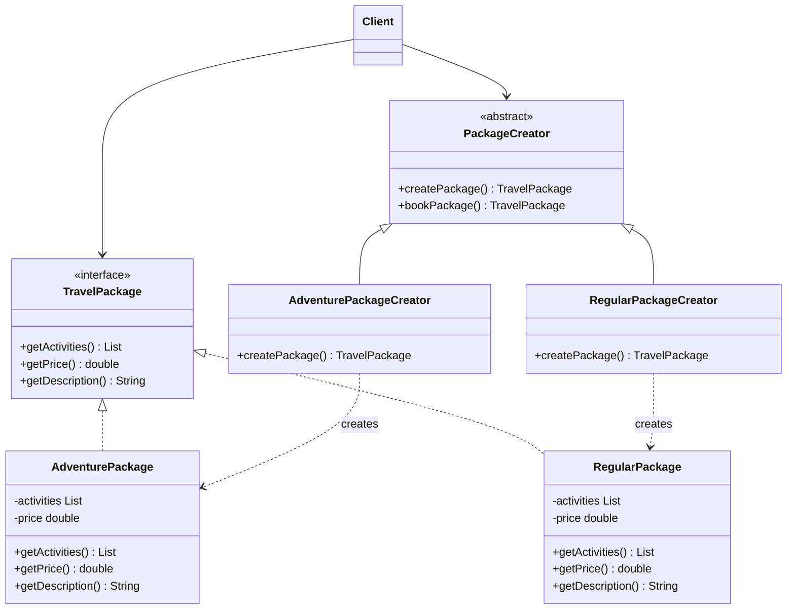
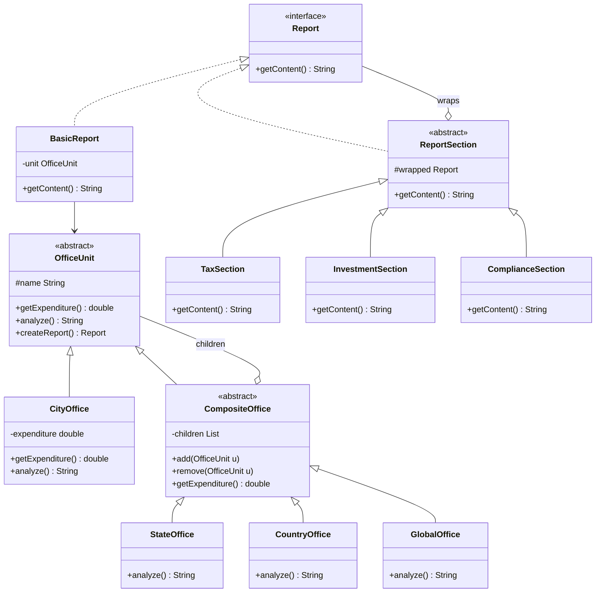
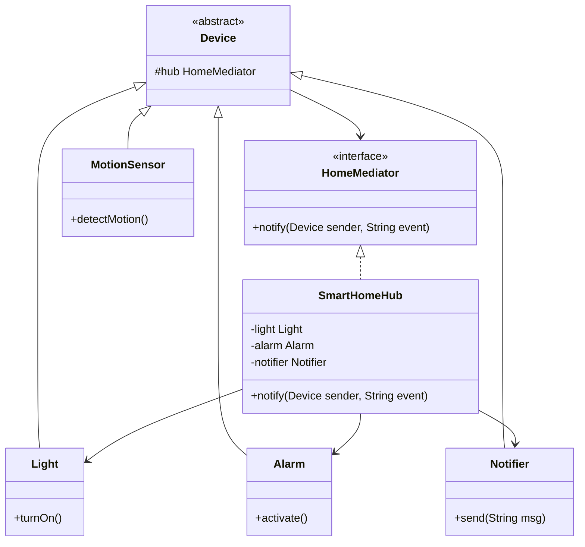
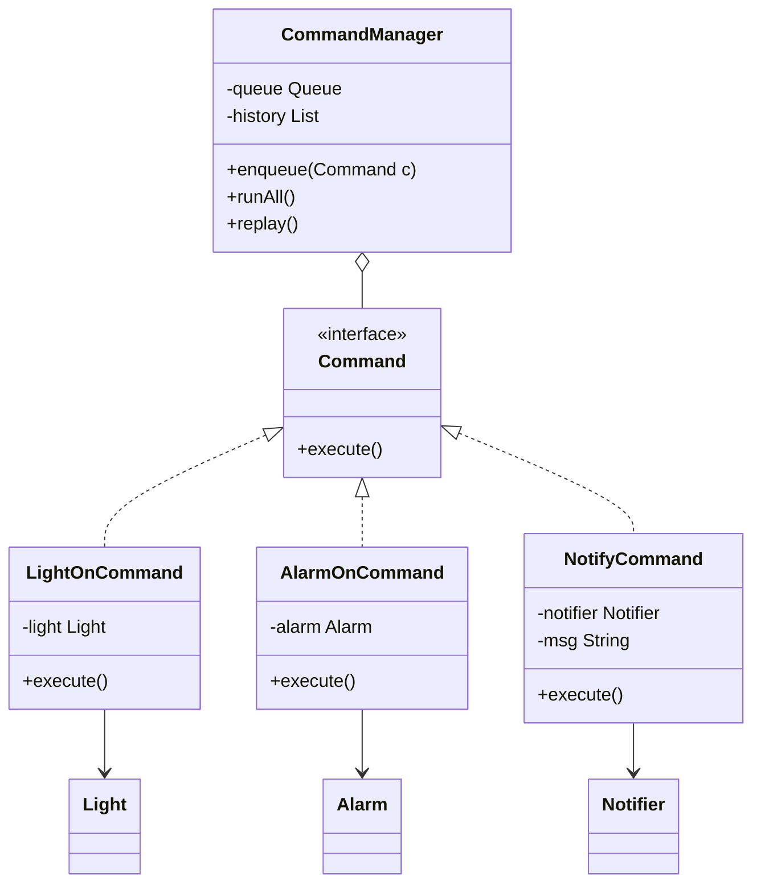
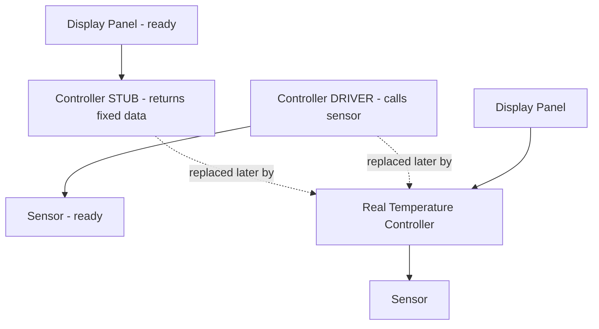
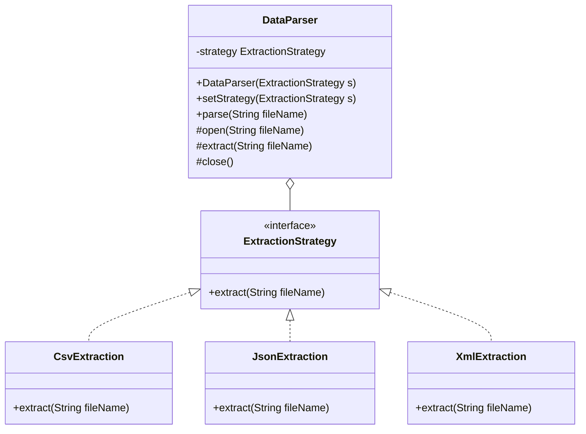
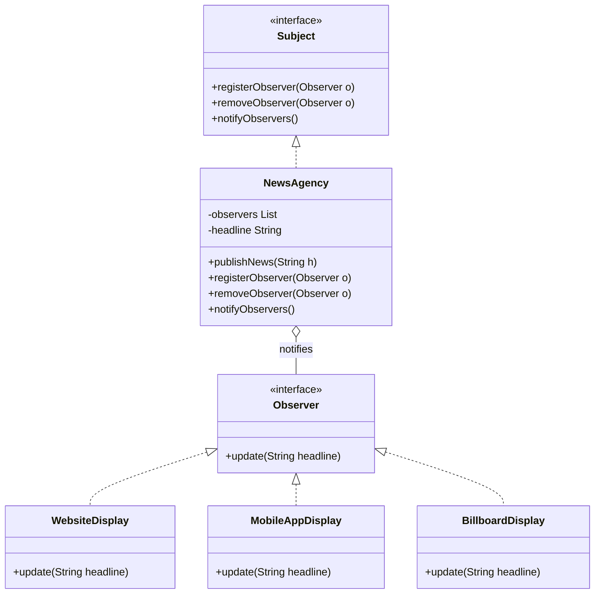

# TF 2023-24 — CSE 213 (May 2026 paper)

**Paper:** BUET L-2/T-II B.Sc. Engineering Examinations 2023-2024, CSE 213 (Software Engineering), held on 10/05/2026. Full marks 210, 3 hours. In each section there are four questions. ==Q1 is mandatory in Section A and Q5 is mandatory in Section B==, and you answer any two of the remaining three in each section.

**What to attempt.** In Section A you must write Q1, and then you choose two of Q2, Q3 and Q4. Q3 is entirely about Earned Value Management and caching/sharding/CDN, which you left out of scope, so ==pick Q2 and Q4==. Q2(a) is a 20-mark design pattern question you can fully answer, and only Q2(b) (risk, 15 marks) is skipped. Q4 is almost fully in scope, and only the proactive vs reactive risk half of Q4(b) is skipped. In Section B you must write Q5, and then you choose two of Q6, Q7 and Q8. Q6(b) (DoS) is out of scope, while Q7 is fully answerable (Q7(c) is a buffer overflow, but it is a code-review question you can answer from the code alone) and Q8 is pure design patterns. So ==pick Q7 and Q8==. Q6 is your backup if you feel weak on Q7.

---

## Q1(a) — Factory Method: travel packages [15]

🔗 Concept: [[AI-2 Creational Design Patterns#Factory Method]]

**Identification.** The requirement says three things. The client must not construct a concrete class directly, the right package object must be created through a centralized creation component, and new package types must be supported without modifying existing code. The first two point to a factory. The third rules out the "simple factory" with an `if/else` or `switch` on the package type, because every new package type would force us to edit that `if/else` chain, which ==violates the Open/Closed Principle==. Therefore the most appropriate pattern is the ==Factory Method pattern==, where an abstract creator declares the factory method `createPackage()` and each concrete creator subclass decides which concrete package to instantiate. Adding a new package type (for example a Honeymoon package) only needs one new product class and one new creator class; no existing class changes.

==Factory Method intent: define an interface for creating an object, but let subclasses decide which class to instantiate. It lets a class defer instantiation to subclasses.==

**UML class diagram.**



**Java implementation.**

```java
import java.util.*;

// ---------- Product ----------
interface TravelPackage {
    List<String> getActivities();
    double getPrice();
    String getDescription();
}

// ---------- Concrete products (each manages its own details) ----------
class AdventurePackage implements TravelPackage {
    private final List<String> activities =
            Arrays.asList("Mountain hiking", "River rafting");
    private final double price = 25000;
    public List<String> getActivities() { return activities; }
    public double getPrice()            { return price; }
    public String getDescription()      { return "For thrill-seekers: physically engaging outdoor activities"; }
}

class RegularPackage implements TravelPackage {
    private final List<String> activities =
            Arrays.asList("City sightseeing", "Museum visits");
    private final double price = 12000;
    public List<String> getActivities() { return activities; }
    public double getPrice()            { return price; }
    public String getDescription()      { return "For regular leisure travellers"; }
}

// ---------- Creator (centralized creation component) ----------
abstract class PackageCreator {
    // THE factory method – subclasses decide the concrete class
    protected abstract TravelPackage createPackage();

    // common logic that uses the product but never names a concrete class
    public TravelPackage bookPackage() {
        TravelPackage p = createPackage();
        System.out.println("Booked: " + p.getDescription() + " | Tk " + p.getPrice());
        return p;
    }
}

// ---------- Concrete creators ----------
class AdventurePackageCreator extends PackageCreator {
    protected TravelPackage createPackage() { return new AdventurePackage(); }
}
class RegularPackageCreator extends PackageCreator {
    protected TravelPackage createPackage() { return new RegularPackage(); }
}

// ---------- Client ----------
public class TourSystem {
    public static void main(String[] args) {
        PackageCreator creator = new AdventurePackageCreator(); // chosen by config/UI
        TravelPackage p = creator.bookPackage();                 // client never says "new AdventurePackage()"
        System.out.println(p.getActivities());

        creator = new RegularPackageCreator();
        creator.bookPackage();
    }
}
```

**How the requirements are satisfied.** The client works only with the `TravelPackage` and `PackageCreator` abstractions, so ==it never constructs a concrete class directly==. Object creation is centralized inside the creator hierarchy. To add a new type, say `FamilyPackage`, we write `class FamilyPackage implements TravelPackage` and `class FamilyPackageCreator extends PackageCreator`; ==no existing code is modified==, which satisfies the Open/Closed Principle.

> [!tip] 🎯 TF angle
> If you prefer one single factory class that takes a type string, make it OCP-safe with a **registry**: `Map<String, Supplier<TravelPackage>> registry`, with `register("ADVENTURE", AdventurePackage::new)` and `create(type)` returning `registry.get(type).get()`. New types are added by registering, not by editing an `if/else`. Mention this in one or two sentences as an alternative to show you understand why the plain `if/else` simple factory fails the "without modifying existing code" condition.

---

## Q1(b) — Ethical breaches in the security engineer scenario [10]

🔗 Concept: [[IJ-7 Software Ethics]]

There are ethical breaches in this scenario, even though the engineer's intention (protecting citizens) was good. Finding the vulnerabilities was exactly his job, so the discovery itself is ethical. The breach lies in ==how he disclosed them==.

**Breach 1 — Client & Employer principle (confidentiality and loyalty).** The IEEE-CS/ACM code says a software engineer shall act in the best interests of the client and employer, consistent with the public interest, and shall keep confidential information confidential. The vulnerabilities were confidential information about a government system. He leaked them to the media without first reporting them to his employer or the government client. This is a direct breach of confidentiality and of the trust placed in him.

**Breach 2 — The Public principle was used wrongly.** He justified the leak as "protecting citizens", but publicly announcing critical, unpatched vulnerabilities actually ==increases the risk to citizens==, because attackers now learn exactly where to attack before a fix exists. The ethical way to honour the public interest is ==responsible (coordinated) disclosure==: report the flaws internally at once, recommend fixes and a deadline, and only if the organization ignores a serious danger, escalate to the proper authority (for example a regulator or national CERT), not anonymously to the media. Acting "consistently with the public interest" means minimizing harm, and his action maximized exposure.

**Breach 3 — Judgment principle.** Engineers must maintain integrity and independence in professional judgment. He made a unilateral, emotional decision without weighing consequences, without consulting anyone, and without considering safer alternatives.

**Breach 4 — Profession and Colleagues principles.** The anonymous leak triggered a public scandal, damaged the firm's reputation and disrupted the government project. This harms the reputation of the profession and is unfair to colleagues who were not given the chance to fix the problem. Acting anonymously also avoids accountability, which goes against the accountability dimension of software ethics.

**Conclusion.** ==The ethical action would have been: report to the employer and client immediately, document the risk, help fix it, and escalate through official channels only if the warning was ignored.== The good intention does not excuse the method, because the method put citizens' data at greater risk.

---

## Q1(c) — Is the incremental model suitable for the Mental Health Companion? [10]

🔗 Concept: [[IJ-3 Process Models and Agile]]

**Facts from the scenario.** The client gives only high-level, vague requirements and leaves design decisions to the team. The product contains novel AI features (AI-based mental exercises and a virtual companion) whose behaviour is uncertain. The domain is sensitive: it tracks users' mental states, so privacy, safety and wrong advice are serious risks. The team wants client feedback after each small functional part.

**Where incremental fits.** The incremental model delivers a simple working core product first (for example mood tracking) and then adds functionality in increments, collecting client feedback after each increment. This matches the team's plan of "small functional parts with feedback", gives early working software and keeps the initial cost low.

**Where incremental does not fit.** In the incremental model ==the client requirements are specified beforehand and only get refined in each increment==, and ==a complete planning of the project is required before committing==. Here the requirements are vague, so it is hard to plan the whole system and hard to break the problem into increments, which the slides list as a disadvantage. If requirements keep changing between increments, refining them each time may damage the software architecture (for example the AI engine and data model). Most importantly, the incremental model has ==no explicit risk analysis==, while this is a high-risk product (privacy breaches, unsafe AI advice, regulatory issues).

**Better alternatives.** The ==Spiral model== is more appropriate because every loop starts with risk analysis: in early loops the team can identify privacy, AI-safety and compliance risks, build a prototype, get client evaluation and then plan the next loop, while requirements are allowed to evolve. The ==Prototyping model== is also suitable at the start, because when requirements are vague the team can build a quick prototype of the virtual companion and mood tracker, let the client evaluate it, and turn feedback into clear requirements. If the client can stay continuously available, ==Scrum== with short sprints would also work, as it welcomes changing requirements and delivers frequently.

**Conclusion.** The incremental model is only ==partially suitable==. A Spiral model (with prototyping in the early loops) is the better choice because it handles both vague, evolving requirements and the high risk of a mental-health AI product.

---

## Q2(a) — FinCorp reporting: Composite + Decorator [20]

🔗 Concept: [[IJ-1 Structural Design Patterns#Composite Pattern]] and [[IJ-1 Structural Design Patterns#Decorator Pattern]]

**Identification and justification.** Requirement (i) describes a part-whole hierarchy: a city office is a single unit, a state contains cities, a country contains states, and the global level contains countries. Every level must give a report through the same interface, and higher levels aggregate the data of their subordinates. This is exactly the ==Composite pattern==, which composes objects into tree structures and lets the client treat individual objects (city office) and compositions (state/country/global) uniformly. Requirement (ii) says optional extra sections (tax details, investment summary, government compliance) may be attached to a report in any combination, without changing the core report structure. Adding responsibilities to an object dynamically in any combination, without subclass explosion, is the ==Decorator pattern==. So the design uses ==Composite for the office hierarchy and Decorator for the report sections==.

Because the nature of the analysis varies by level, each composite level (State, Country, Global) overrides an `analyze()` method, while the aggregation logic is shared in the composite base class.

**UML class diagram.**



**Java implementation (minimum required functionality).**

```java
import java.util.*;

// ================= COMPOSITE: office hierarchy =================
abstract class OfficeUnit {                       // Component
    protected String name;
    OfficeUnit(String name) { this.name = name; }
    public abstract double getExpenditure();      // own or aggregated data
    public abstract String analyze();             // analysis differs per level
    public Report createReport() { return new BasicReport(this); } // same interface at every level
}

class CityOffice extends OfficeUnit {             // Leaf
    private double expenditure;
    CityOffice(String name, double expenditure) { super(name); this.expenditure = expenditure; }
    public double getExpenditure() { return expenditure; }
    public String analyze() { return "City-level cost check"; }
}

abstract class CompositeOffice extends OfficeUnit {   // Composite
    private List<OfficeUnit> children = new ArrayList<>();
    CompositeOffice(String name) { super(name); }
    public void add(OfficeUnit u)    { children.add(u); }
    public void remove(OfficeUnit u) { children.remove(u); }
    public double getExpenditure() {               // aggregate from ALL subordinates (recursive)
        double total = 0;
        for (OfficeUnit u : children) total += u.getExpenditure();
        return total;
    }
}
class StateOffice extends CompositeOffice {
    StateOffice(String n) { super(n); }
    public String analyze() { return "State Director: city-wise comparison"; }
}
class CountryOffice extends CompositeOffice {
    CountryOffice(String n) { super(n); }
    public String analyze() { return "Country Head: state-wise trend analysis"; }
}
class GlobalOffice extends CompositeOffice {
    GlobalOffice(String n) { super(n); }
    public String analyze() { return "Global CFO: worldwide/currency-adjusted analysis"; }
}

// ================= DECORATOR: optional report sections =================
interface Report { String getContent(); }         // Component

class BasicReport implements Report {             // Concrete component (core report)
    private OfficeUnit unit;
    BasicReport(OfficeUnit unit) { this.unit = unit; }
    public String getContent() {
        return "Report of " + unit.name + "\nTotal expenditure: " + unit.getExpenditure()
             + "\nAnalysis: " + unit.analyze();
    }
}

abstract class ReportSection implements Report {  // Decorator
    protected Report wrapped;
    ReportSection(Report r) { this.wrapped = r; }
}
class TaxSection extends ReportSection {
    TaxSection(Report r) { super(r); }
    public String getContent() { return wrapped.getContent() + "\n+ Tax calculation details"; }
}
class InvestmentSection extends ReportSection {
    InvestmentSection(Report r) { super(r); }
    public String getContent() { return wrapped.getContent() + "\n+ Investment summary"; }
}
class ComplianceSection extends ReportSection {
    ComplianceSection(Report r) { super(r); }
    public String getContent() { return wrapped.getContent() + "\n+ Government compliance report"; }
}

// ================= Client =================
public class FinCorpDemo {
    public static void main(String[] args) {
        StateOffice texas = new StateOffice("Texas");
        texas.add(new CityOffice("Dallas", 120000));
        texas.add(new CityOffice("Austin", 80000));

        CountryOffice usa = new CountryOffice("USA");
        usa.add(texas);
        CountryOffice germany = new CountryOffice("Germany");
        germany.add(new CityOffice("Berlin", 90000));

        GlobalOffice global = new GlobalOffice("FinCorp Global");
        global.add(usa);
        global.add(germany);

        // State Director: core report only
        System.out.println(texas.createReport().getContent());

        // Global CFO: core report + tax + compliance (any combination, core untouched)
        Report cfo = new ComplianceSection(new TaxSection(global.createReport()));
        System.out.println(cfo.getContent());
    }
}
```

**Why it works.** Every level (city, state, country, global) is an `OfficeUnit`, so ==the reporting interface is consistent for all levels==, and the recursive `getExpenditure()` in the composite performs the aggregation from all subordinate units. New levels (for example a Region between country and global) are new `CompositeOffice` subclasses. Optional sections are decorators that wrap a `Report`, so ==any number and any combination of sections can be attached at runtime without changing the core report classes==.

---

## Q2(b) — Risks of cancelling vs launching the AI feature [15]

> [!note] ⏭ Skipped — risk identification and categorization (risk management, outside your chosen scope)

---

## Q3 — Earned Value Management (SmartHome) and caching/sharding/CDN [35]

> [!note] ⏭ Skipped — Q3(a) is Earned Value Management and Q3(b) is performance optimization (server-side caching, database sharding, CDN). Both are outside your chosen scope. Do not choose Q3 in the exam.

---

## Q4(a) — Five bad smells in Student/Scholarship and their refactoring [20]

🔗 Concept: [[IJ-6 Refactoring and Code Smells]]

Below are the smells, each with the refactoring technique and the refactored code. Writing five is enough; a sixth is given as a spare in case you want to replace one.

**Smell 1 — Type code with conditionals (Switch Statements smell).** `int type` with the comment `1 = UG, 2 = PG` drives `if (type == 1) ... else if (type == 2)` in `calculateFee()`, in `printDetails()` and again in `checkEligibility()`. The same type-based decision is repeated in many places, so adding a new student category (say PhD) means editing every conditional. ==Refactoring: Replace Type Code with Subclasses and Replace Conditional with Polymorphism.== We make `Student` abstract and create `UGStudent` and `PGStudent`, each overriding `calculateFee()` and `printSpecificDetails()`. The PG-only field `isFulltime` also moves to `PGStudent`, so UG objects no longer carry a field they never use.

```java
abstract class Student {
    protected String name, id;
    protected int year;
    protected Address address;
    protected float[] yearWiseGpa;

    abstract float calculateFee();
    abstract void printSpecificDetails();
    abstract boolean isEligibleForScholarshipCategory();   // UG only, see Smell 4

    void printDetails() {
        System.out.println("Name:" + name);
        System.out.println("Student ID:" + id);
        System.out.println("Address: " + address);
        printSpecificDetails();                       // polymorphism instead of if(type==1)
    }
}
class UGStudent extends Student {
    float calculateFee() { return UG_FEE; }
    void printSpecificDetails() { /* UG-specific details */ }
    boolean isEligibleForScholarshipCategory() { return true; }
}
class PGStudent extends Student {
    private boolean isFulltime;                       // moved here: only PG needs it
    float calculateFee() { return getCgpa() > PG_MERIT_CGPA ? PG_MERIT_FEE : PG_REGULAR_FEE; }
    void printSpecificDetails() { /* PG-specific details */ }
    boolean isEligibleForScholarshipCategory() { return false; }
}
```

**Smell 2 — Duplicated Code.** The CGPA computation (`sum` over `yearWiseGpa` divided by `length`) is written in `Student.calculateFee()` and again in `Scholarship.checkEligibility()`. If the formula changes (for example to credit-weighted CGPA) one copy may be updated and the other forgotten, which introduces a bug. ==Refactoring: Extract Method== into one method `getCgpa()` in `Student` and call it from both places.

```java
// inside Student
float getCgpa() {
    float sum = 0;
    for (float gpa : yearWiseGpa) sum += gpa;
    return sum / yearWiseGpa.length;
}
```

**Smell 3 — Data Clumps.** `street`, `postOffice` and `district` always travel together (they are declared together and printed together) but are not a class of their own. ==Refactoring: Extract Class== (`Address`), and the student holds one `Address` object. Formatting the address now lives in one place.

```java
class Address {
    private String street, postOffice, district;
    Address(String street, String postOffice, String district) {
        this.street = street; this.postOffice = postOffice; this.district = district;
    }
    @Override public String toString() { return street + ", " + postOffice + ", " + district; }
}
```

**Smell 4 — Feature Envy.** `Scholarship.isRegular(Student)` uses nothing of `Scholarship`; it only reads `student.yearWiseGpa` and `student.year`. Likewise `checkEligibility()` mostly works on the student's type, year and GPAs (it even reads `yearWiseGpa` as if it were its own field). A method that is more interested in another class's data than its own is Feature Envy. ==Refactoring: Move Method== — move `isRegular()` (and the CGPA logic) into `Student`, and let `Scholarship` just ask the student.

```java
// inside Student
boolean isRegular() {                       // no gaps in yearly GPA records
    return yearWiseGpa.length == year;
}
```

**Smell 5 — Magic Numbers.** Literals such as `50000`, `40000`, `48000`, `3.5` and `2` appear with no name, so a reader cannot tell what they mean and changing a fee needs a search through the code. ==Refactoring: Replace Magic Number with Symbolic Constant.==

```java
// inside Student
static final float UG_FEE = 50000f;
static final float PG_MERIT_FEE = 40000f;
static final float PG_REGULAR_FEE = 48000f;
static final float PG_MERIT_CGPA = 3.5f;
// inside Scholarship
static final int MIN_YEAR_FOR_SCHOLARSHIP = 2;
```

**Smell 6 (spare) — Long Method with deeply nested conditionals.** `checkEligibility()` nests four `if/else` levels and prints "is not eligible" in three different branches (also duplicated code). ==Refactoring: Replace Nested Conditional with Guard Clauses== (and Consolidate Duplicate Conditional Fragments).

```java
class Scholarship {
    private String name;
    private int amount;
    private float cgpaThreshold;
    static final int MIN_YEAR_FOR_SCHOLARSHIP = 2;

    void checkEligibility(Student s) {
        if (isEligible(s))
            System.out.println(s.name + " is awarded scholarship: " + amount);
        else
            System.out.println(s.name + " is not eligible.");   // written once
    }
    private boolean isEligible(Student s) {
        if (!s.isEligibleForScholarshipCategory()) return false;   // guard clauses
        if (!s.isRegular()) return false;
        if (s.year < MIN_YEAR_FOR_SCHOLARSHIP) return false;
        return s.getCgpa() >= cgpaThreshold;
    }
}
```

> [!tip] 🎯 TF angle
> For each smell write three things: ==the smell's name, the exact line(s) in the given code that show it, and the named refactoring technique==, followed by the refactored code. Other acceptable smells here are **Comments** used as deodorant (`// 1 = UG, 2 = PG` explains a bad type code instead of fixing it), **Primitive Obsession** (an `int` for student type, a raw `float[]` for GPA history) and **Large Class / Divergent Change** (Student changes for fee rules, printing and GPA logic).

---

## Q4(b) — Code smell, technical debt, refactoring; proactive vs reactive risk [15]

🔗 Concept: [[IJ-6 Refactoring and Code Smells]]

**Code smell.** A code smell is ==a surface symptom in the source code that usually indicates a deeper design problem==. The code still works, so a smell is not a bug, but it makes the program harder to understand, change and extend, and it makes future bugs more likely. Examples are duplicated code, long method, large class, long parameter list, feature envy, data clumps and switch statements. Smells are the hints that tell us where refactoring is needed.

**Technical debt.** Technical debt is ==the implied future cost of extra rework that a team takes on when it chooses a quick, easy or "dirty" solution now instead of a better approach that would take longer==. Like financial debt it carries "interest": every time someone changes the messy code, the change takes more time and causes more bugs. Smells are the visible signs of technical debt, and refactoring is how the debt is paid back.

**Code refactoring.** Refactoring is ==the process of changing a software system so that its external (observable) behaviour does not change but its internal structure is improved==, making it easier to understand and cheaper to modify (Fowler). No new functionality is added; we apply small, named, safe steps such as Extract Method, Move Method or Replace Conditional with Polymorphism, and we run the tests after each step to confirm nothing broke.

> [!note] ⏭ Skipped — the "proactive vs reactive risk management strategies" part is risk management (outside your chosen scope). Write the three definitions above well; they carry most of this part's marks.

---

## Q5(a) — Equivalence Class Testing for course registration [15]

🔗 Concept: [[AI-10 Equivalence Partitioning and BVA]]

The three independent inputs have these classes: Completed Credits has 4 classes (C1 < 60, C2 60–99, C3 > 99, C4 invalid), CGPA has 4 classes (G1 < 2.50, G2 2.50–3.49, G3 ≥ 3.50, G4 invalid), and Status has 3 classes (S1 not approved, S2 approved, S3 invalid/missing).

**(i) Minimal weak ECT test suite.** Weak ECT (single-fault assumption) requires that ==every equivalence class of every input appears in at least one test case==. One test case can cover one class from each input at the same time, so the minimum number of test cases equals the largest number of classes of any single input: ==max(4, 4, 3) = 4 test cases==. Where an input has fewer classes, we reuse one of its classes.

| Test | Credits (class) | CGPA (class) | Status (class) | Expected result |
|---|---|---|---|---|
| T1 | 45 (C1) | 2.10 (G1) | Not approved (S1) | Registration denied |
| T2 | 80 (C2) | 3.00 (G2) | Approved (S2) | Registration allowed (per rules) |
| T3 | 120 (C3) | 3.75 (G3) | Missing (S3) | Error: invalid/missing status |
| T4 | -5 or "abc" (C4) | 4.80 or -1 (G4) | Approved (S2) | Error: invalid credit / CGPA input |

*(A table is the clearest way to show a test suite on the script.)*

**(ii) Number of test cases for strong ECT.** Strong ECT (multiple-fault assumption) tests ==every combination== of classes, i.e. the Cartesian product: ==4 × 4 × 3 = 48 test cases==.

**(iii) A defect weak ECT can miss.** Weak ECT never checks how classes interact, because each class appears only once and in an arbitrary pairing. Suppose the business rule says "a student with more than 99 credits (C3) and CGPA below 2.50 (G1) may register only if approved by the advisor (S2)", and the programmer wrongly coded this combination to always deny registration. In our weak suite C3 is only paired with G3 and S3, and G1 is only paired with C1 and S1, so ==the combination C3 + G1 + S2 is never executed and the defect remains undiscovered==. Strong ECT would include (C3, G1, S2) and reveal it. A second example: in T4 two invalid inputs appear together, so if the program reports only the first error, a bug in validating the CGPA field alone could be masked.

---

## Q5(b) — Smart Home Hub: Mediator and Command [10]

🔗 Concept: [[IJ-2 Behavioral Design Patterns#Mediator Pattern]] and [[IJ-2 Behavioral Design Patterns#Command Pattern]]

### (i) Why Mediator is better than direct communication

If the motion sensor called the light, the alarm and the notifier directly, the sensor would need references to every other device and would contain the coordination logic. Each new device or new rule would require changing the sensor (and other devices), and with n devices talking to each other we get up to n(n−1) chaotic dependencies, exactly like aircraft talking to each other without a control tower. The ==Mediator pattern restricts direct communication between objects and forces them to collaborate only via a mediator==. Here the `SmartHomeHub` is the mediator: the sensor only reports "motion detected" to the hub, and the hub decides which coordinated actions to trigger. Devices become ==loosely coupled, reusable and independent of each other==, and coordination rules live in one place, so adding a new device or changing a rule touches only the hub.



```java
interface HomeMediator { void notify(Device sender, String event); }

abstract class Device {
    protected HomeMediator hub;
    Device(HomeMediator hub) { this.hub = hub; }
}
class MotionSensor extends Device {
    MotionSensor(HomeMediator h) { super(h); }
    void detectMotion() { hub.notify(this, "MOTION"); }   // only talks to the hub
}
class Light extends Device    { Light(HomeMediator h){super(h);}    void turnOn()   { System.out.println("Light ON"); } }
class Alarm extends Device    { Alarm(HomeMediator h){super(h);}    void activate() { System.out.println("Alarm ON"); } }
class Notifier extends Device { Notifier(HomeMediator h){super(h);} void send(String m){ System.out.println("Notify: " + m); } }

class SmartHomeHub implements HomeMediator {
    Light light; Alarm alarm; Notifier notifier;
    void setDevices(Light l, Alarm a, Notifier n) { light = l; alarm = a; notifier = n; }
    public void notify(Device sender, String event) {
        if (sender instanceof MotionSensor && event.equals("MOTION")) {  // coordination lives HERE
            light.turnOn();
            alarm.activate();
            notifier.send("Motion detected");
        }
    }
}
```

### (ii) Record, queue and replay → Command pattern

Recording, queuing and later replaying actions means each action must exist as an object that can be stored and executed later. The ==Command pattern turns a request into a stand-alone object that contains all information about the request, which lets us parameterize, delay or queue a request's execution, and support undo/replay==. Each action (turn on light, activate alarm, send notification) becomes a `Command` object with `execute()`. The hub acts as the invoker: on a sensor event it creates commands and puts them into a queue, executes them, and also keeps them in a history list so they can be replayed later.



```java
import java.util.*;

interface Command { void execute(); }

class LightOnCommand implements Command {
    private Light light;
    LightOnCommand(Light l) { light = l; }
    public void execute() { light.turnOn(); }          // receiver does the real work
}
class AlarmOnCommand implements Command {
    private Alarm alarm;
    AlarmOnCommand(Alarm a) { alarm = a; }
    public void execute() { alarm.activate(); }
}
class NotifyCommand implements Command {
    private Notifier n; private String msg;
    NotifyCommand(Notifier n, String msg) { this.n = n; this.msg = msg; }
    public void execute() { n.send(msg); }
}

class CommandManager {                                  // invoker
    private Queue<Command> queue = new LinkedList<>();
    private List<Command> history = new ArrayList<>();
    void enqueue(Command c) { queue.add(c); }           // queueing
    void runAll() {
        while (!queue.isEmpty()) {
            Command c = queue.poll();
            c.execute();
            history.add(c);                             // recording
        }
    }
    void replay() { for (Command c : history) c.execute(); }   // later replay
}
// In SmartHomeHub.notify(...): manager.enqueue(new LightOnCommand(light));
// manager.enqueue(new AlarmOnCommand(alarm)); manager.enqueue(new NotifyCommand(notifier,"Motion")); manager.runAll();
```

---

## Q5(c) — Preparing a specification for an already-built product [10]

🔗 Concept: [[IJ-8 Requirement Analysis]]

Since the product already exists but no specification was ever written, I would follow the requirement analysis pipeline (==Elicitation → Analysis & Refinement → Specification → Validation==), but starting from the existing system, which is a kind of reverse engineering of requirements.

**Step 1 — Elicitation from the existing system and people.** I would first collect raw knowledge from every available source. I would study the running product and its user interface, read the source code, database schema, commit history, test cases and any informal notes or tickets, and interview the developers who built it to learn the intended behaviour and design decisions. I would also interview the product owner and key users, run surveys if there are many users, and observe users working with the system (field study) to see real workflows and workarounds.

**Step 2 — Analysis and refinement.** I would separate what the system *does* from what it *should* do, resolve conflicts between stakeholders, and remove accidental behaviour (bugs should not become requirements). I would classify everything into ==functional requirements== (what the system must do) and ==non-functional requirements== (how well it must perform: response time, security, usability), and prioritize them with ==MoSCoW== (Must, Should, Could, Won't). I would model the behaviour using use case diagrams, BPMN/activity diagrams and class diagrams.

**Step 3 — Specification.** I would write a formal Software Requirements Specification where every requirement is ==unambiguous, verifiable/testable, complete, consistent, measurable and feasible==. For example, "the app should be fast" becomes "search results appear within 2 seconds for 95% of requests". Each requirement gets a unique ID.

**Step 4 — Validation and baselining.** I would review the document with stakeholders and verify it against the actual product and their objectives, fixing gaps and disagreements. I would then create a ==Requirements Traceability Matrix== linking each requirement to its design/code and test cases, put the document under version control as the agreed baseline, and use it for future reviews, change impact analysis and improvements.

---

## Q6(a) — JUnit test class for isLeapYear [15]

🔗 Concept: [[IJ-4 Unit Testing and JUnit]]

The logically distinct input classes for leap-year determination are: divisible by 400 (leap), divisible by 100 but not by 400 (not leap), divisible by 4 but not by 100 (leap), not divisible by 4 (not leap), and the invalid class year ≤ 0 (throws `IllegalArgumentException`). I also add boundary values: 0 and −1 for the invalid boundary, and 1 and 4 as the smallest valid years. I assume the method lives in a class `YearUtil`.

```java
import org.junit.jupiter.api.*;
import static org.junit.jupiter.api.Assertions.*;

class YearUtilTest {

    private YearUtil util;

    @BeforeEach                     // fixture: fresh object before every test
    void setUp() { util = new YearUtil(); }

    // ---- Class 1: divisible by 400 -> leap ----
    @Test
    void isLeapYear_divisibleBy400_returnsTrue() {
        assertTrue(util.isLeapYear(2000), "2000 is divisible by 400");
        assertTrue(util.isLeapYear(1600), "1600 is divisible by 400");
    }

    // ---- Class 2: divisible by 100 but not 400 -> not leap ----
    @Test
    void isLeapYear_divisibleBy100Not400_returnsFalse() {
        assertFalse(util.isLeapYear(1900), "1900 is a century year not divisible by 400");
        assertFalse(util.isLeapYear(2100), "2100 is a century year not divisible by 400");
    }

    // ---- Class 3: divisible by 4 but not 100 -> leap ----
    @Test
    void isLeapYear_divisibleBy4Not100_returnsTrue() {
        assertTrue(util.isLeapYear(2024), "2024 is divisible by 4, not by 100");
        assertTrue(util.isLeapYear(1996), "1996 is divisible by 4, not by 100");
    }

    // ---- Class 4: not divisible by 4 -> not leap ----
    @Test
    void isLeapYear_notDivisibleBy4_returnsFalse() {
        assertFalse(util.isLeapYear(2023), "2023 is not divisible by 4");
        assertFalse(util.isLeapYear(2019), "2019 is not divisible by 4");
    }

    // ---- Smallest valid years (boundary of valid domain) ----
    @Test
    void isLeapYear_smallestValidYears() {
        assertFalse(util.isLeapYear(1), "year 1 is the first valid year, not leap");
        assertTrue(util.isLeapYear(4), "year 4 is the first leap year");
    }

    // ---- Class 5: invalid input (year <= 0) -> exception ----
    @Test
    void isLeapYear_yearZero_throwsIllegalArgumentException() {
        assertThrows(IllegalArgumentException.class, () -> util.isLeapYear(0));
    }

    @Test
    void isLeapYear_negativeYear_throwsIllegalArgumentException() {
        assertThrows(IllegalArgumentException.class, () -> util.isLeapYear(-1));
        assertThrows(IllegalArgumentException.class, () -> util.isLeapYear(-2000));
    }
}
```

Each test method has a ==descriptive name of the form method_condition_expectedResult==, tests ==exactly one input class (single responsibility)==, runs ==independently== thanks to the `@BeforeEach` fixture, and uses an assertion message. If your teacher's slides style (JUnit 4) is preferred, the same class works with `@Before`, `@Test(expected = IllegalArgumentException.class)` and `org.junit.Assert.*`.

---

## Q6(b) — Overload vs DoS on registration night [10]

> [!note] ⏭ Skipped — Denial-of-Service detection and defenses (security, outside your chosen scope)

---

## Q6(c) — Integration testing when the middle module is missing [10]

🔗 Concept: [[AI-8 Software Testing Fundamentals]]

The call structure is Display Panel (top) → Temperature Controller (middle) → Sensor (bottom). The top and bottom modules are ready, but the middle one is not. Pure top-down testing would need a stub for the Controller, and pure bottom-up testing would need a driver in place of the Controller. Since we have both ends ready, the best approach is ==Sandwich (hybrid) integration testing==, which combines top-down and bottom-up and meets in the middle layer.

**Top part (top-down with a stub).** A ==stub== is a dummy piece of code that stands in for a called module that is not ready yet. I would write a `TemperatureControllerStub` that the Display Panel calls; it returns pre-set data, for example "25 °C, no warning" and "48 °C, HIGH TEMPERATURE warning". This lets me test that the Display Panel correctly requests data and correctly shows normal values and warning messages.

**Bottom part (bottom-up with a driver).** A ==driver== is a dummy piece of code that calls the module under test in place of a not-yet-ready caller. I would write a `ControllerDriver` that calls `Sensor.readTemperature()` repeatedly and checks that the readings and their format/units are correct, including edge cases such as sensor failure.

**Final integration.** When the Temperature Controller is completed, I first unit test it, then ==replace the stub and the driver with the real Controller==, integrate all three modules and run the end-to-end tests (sensor reading → controller decision → display/warning). The earlier tests are re-run as regression tests to confirm the real Controller behaves like the stub and driver assumed.



---

## Q7(a) — Performance testing plan for course registration [15]

🔗 Concept: [[AI-8 Software Testing Fundamentals]]

Performance testing belongs to non-functional testing. Each risk calls for a different type of performance test.

**Risk 1 — sudden burst to 10,000 students when registration opens.** The right test is a ==Spike test== (a special load test). Its goal is to check whether the system can absorb a sudden, very sharp increase of users in a very short time, keep acceptable response times and not crash, and recover when the spike drops. JMeter configuration: ==Threads = 10,000; Ramp-Up = 10 seconds== (almost all users arrive at once); ==Loop Count = 3== (each student logs in, searches and registers a few times); ==Duration = 600 seconds== (10 minutes, with the scheduler enabled).

**Risk 2 — possible collapse when load exceeds capacity.** The right test is a ==Stress test==, which evaluates a system beyond the limits of its specification. Its goal is to find the breaking point, see how the system fails (gracefully with error messages, or by crashing and corrupting data) and confirm it recovers after load is reduced. JMeter configuration: ==Threads = 15,000== (above the expected 10,000 capacity, and increased step by step in later runs, such as 12k, 15k, 20k); ==Ramp-Up = 300 seconds== so we can see at which load errors start; ==Loop Count = Infinite==; ==Duration = 1,800 seconds== (30 minutes).

**Risk 3 — gradual slowdown after 8 hours of continuous operation.** The right test is an ==Endurance (soak) test==. Its goal is to run a normal expected load for a long time to detect memory leaks, connection-pool exhaustion, growing logs or database slowdown that appear only over time. JMeter configuration: ==Threads = 2,000== (normal sustained load); ==Ramp-Up = 300 seconds==; ==Loop Count = Infinite==; ==Duration = 32,400 seconds (9 hours)==, slightly more than 8 hours so the slowdown window is covered, while monitoring response time, memory and CPU throughout.

---

## Q7(b) — Boundary Value Analysis for the LOW-power partition [10]

🔗 Concept: [[AI-10 Equivalence Partitioning and BVA]]

The LOW partition is ==30 ≤ M ≤ 70==, so its minimum is 30 and maximum is 70. BVA tests at and just around each boundary, because ==more errors occur at the boundaries of the input domain than in its centre==. For an integer input the step is 1. The values are min−1, min, min+1, a nominal value, max−1, max and max+1.

| Test | M | Why | Expected pump state |
|---|---|---|---|
| T1 | 29 | min − 1 (just below LOW) | OFF |
| T2 | 30 | min (lower boundary) | LOW |
| T3 | 31 | min + 1 | LOW |
| T4 | 50 | nominal (middle) | LOW |
| T5 | 69 | max − 1 | LOW |
| T6 | 70 | max (upper boundary) | LOW |
| T7 | 71 | max + 1 (just above LOW) | HIGH |

So the complete set is ==7 test cases: 29, 30, 31, 50, 69, 70, 71==. T1 and T7 check that the program uses the correct comparison operators (for example, a bug writing `M > 30` instead of `M >= 30` is caught by T2, and `M < 70` instead of `M <= 70` is caught by T6).

---

## Q7(c) — Security vulnerabilities in the C login program [10]

🔗 Concept: [[IJ-5 Code Reviews]] (code review example 3: buffer overflow)

**(i) Vulnerabilities.** The first problem is that ==`strcpy(data.password, input)` copies the input into an 8-byte array with no length check==, so any input longer than 7 characters (plus the null terminator) writes past the end of `password`. The second problem is that ==`scanf("%s", input)` reads an unbounded string into the 8-byte `input` array in `main`==, so the overflow already happens there. The third problem is the memory layout: inside `struct LoginData`, ==`isAuthenticated` is stored right after `password[8]`==, so the overflowing bytes land in `isAuthenticated`. Because `isAuthenticated` is set to 0 before the copy and is never reset to 0 after the comparison fails, whatever the attacker writes into it decides whether login succeeds. A long enough input can also overwrite the saved return address on the stack and crash the program or hijack its control flow.

**(ii) Practical attack.** The attacker types a 9 or more character string such as ==`AAAAAAAAB`==. The first 8 bytes `AAAAAAAA` fill `password`, and the next byte (`B`, value 66) and the null terminator spill into `isAuthenticated`, making it non-zero. `strcmp(data.password, "pass")` fails, so the code does not touch the flag, but the `if (data.isAuthenticated)` check now sees a non-zero value and prints ==“Login Successful. Welcome!!!” without the correct password==. That is an authentication bypass. Longer inputs could crash the program (denial of service) or overwrite the return address to run injected code.

**(iii) Safer alternatives.** Read input with a bound, for example ==`scanf("%7s", input)` or `fgets(input, sizeof(input), stdin)`== and remove the trailing newline. Copy with a bound and guaranteed termination, for example `strncpy(data.password, input, sizeof(data.password) - 1); data.password[sizeof(data.password) - 1] = '\0';` or `snprintf(data.password, sizeof(data.password), "%s", input);`. Better still, ==check `strlen(input)` first and reject over-long input==, or simply compare the input directly with `strcmp(input, "pass")` without copying it into a fixed buffer at all. Compute the authentication result from the comparison itself (`int ok = (strcmp(...) == 0);`) instead of relying on a flag that sits next to a buffer. Compiler protections such as stack canaries add defence in depth, and a real system should never hard-code the password.

---

## Q8(a) — Strategy inside Template for the file-parsing framework [15]

🔗 Concept: [[IJ-2 Behavioral Design Patterns#Strategy Pattern]] and [[IJ-2 Behavioral Design Patterns#Template Method Pattern]]

**Idea of the redesign.** The Template Method keeps the fixed workflow `open() → extract() → close()` in a `final parse()` method, which is good and must stay. The problem is that the varying step `extract()` is supplied by inheritance, so every new format needs a new subclass and the format cannot change at runtime. We fix this by ==keeping the template for the fixed skeleton but delegating the varying step to a Strategy object==, that is, we replace inheritance for that step with composition. `DataParser` becomes a concrete class that holds an `ExtractionStrategy`; its `extract()` step simply calls `strategy.extract(fileName)`. A setter lets the client ==switch the extraction algorithm at runtime==, and a new format only needs a new strategy class, not a new parser subclass.



```java
// ---------- Strategy ----------
interface ExtractionStrategy {
    void extract(String fileName);
}
class CsvExtraction implements ExtractionStrategy {
    public void extract(String fileName) { System.out.println("Extracting data from CSV"); }
}
class JsonExtraction implements ExtractionStrategy {
    public void extract(String fileName) { System.out.println("Extracting data from JSON"); }
}
class XmlExtraction implements ExtractionStrategy {          // new format = new strategy only
    public void extract(String fileName) { System.out.println("Extracting data from XML"); }
}

// ---------- Template (workflow stays fixed) ----------
class DataParser {
    private ExtractionStrategy strategy;                      // composition

    public DataParser(ExtractionStrategy strategy) { this.strategy = strategy; }
    public void setStrategy(ExtractionStrategy strategy) {   // change at runtime
        this.strategy = strategy;
    }

    public final void parse(String fileName) {               // template method: skeleton is fixed
        open(fileName);
        extract(fileName);
        close();
    }
    protected void open(String fileName) { System.out.println("Opening file: " + fileName); }
    protected void extract(String fileName) { strategy.extract(fileName); }   // delegated step
    protected void close() { System.out.println("Closing file"); }
}

// ---------- Client ----------
public class ParserDemo {
    public static void main(String[] args) {
        DataParser parser = new DataParser(new CsvExtraction());
        parser.parse("sales.csv");

        parser.setStrategy(new JsonExtraction());            // interchangeable at runtime
        parser.parse("users.json");
    }
}
```

==Template Method works at the class level (inheritance, static), while Strategy works at the object level (composition, switchable at runtime)==; combining them gives a fixed workflow with an interchangeable step.

---

## Q8(b) — News agency displays: Observer [10]

🔗 Concept: [[IJ-2 Behavioral Design Patterns#Observer Pattern]]

**Pattern: Observer.** The ==Observer pattern defines a one-to-many dependency between objects so that when one object changes state, all its dependents are notified and updated automatically==. Here the news agency is the one subject whose state (the latest headline) changes, and the many displays (Website, Mobile App, Office Billboard) are the dependents that must be updated instantly.

**Justification.** First, there is a one-to-many relationship: one publisher, many displays. Second, the update must be automatic and immediate: as soon as `publishNews()` sets a new headline, the subject calls `update()` on every registered display, so nobody needs to poll. Third, the subject and the displays are ==loosely coupled==: the agency only knows that each display implements the `Observer` interface, not its concrete class. Fourth, displays can ==subscribe or unsubscribe at runtime==, so adding a new display (for example a TV ticker) needs no change in the agency class, which satisfies the Open/Closed Principle. Mediator is not suitable because the displays do not need to talk to each other, and Command is not needed because nothing is queued or undone.



```java
import java.util.*;

interface Observer { void update(String headline); }
interface Subject {
    void registerObserver(Observer o);
    void removeObserver(Observer o);
    void notifyObservers();
}

class NewsAgency implements Subject {
    private List<Observer> observers = new ArrayList<>();
    private String headline;
    public void registerObserver(Observer o) { observers.add(o); }
    public void removeObserver(Observer o)   { observers.remove(o); }
    public void notifyObservers() { for (Observer o : observers) o.update(headline); }
    public void publishNews(String h) { headline = h; notifyObservers(); }   // state change -> push
}

class WebsiteDisplay implements Observer {
    public void update(String h) { System.out.println("Website: " + h); }
}
class MobileAppDisplay implements Observer {
    public void update(String h) { System.out.println("Mobile App: " + h); }
}
class BillboardDisplay implements Observer {
    public void update(String h) { System.out.println("Billboard: " + h); }
}
// main: agency.registerObserver(new WebsiteDisplay()); ... agency.publishNews("Breaking: ...");
```

---

## Q8(c) — State vs Strategy: structurally similar, conceptually different [10]

🔗 Concept: [[IJ-2 Behavioral Design Patterns#State vs Strategy]]

**Why they are structurally similar.** The slides call them ==“twins separated at birth”==. Both are based on ==composition==: a context object holds a reference to an interface, several concrete classes implement that interface, and the context ==delegates part of its work to the current helper object==. If you draw their class diagrams, they look almost identical (Context → «interface» → ConcreteA, ConcreteB, ConcreteC), and in both the behaviour of the context changes when the helper object changes.

**Why they are conceptually different.** The difference is in intent and in who changes the helper. ==Strategy== defines a family of interchangeable algorithms for doing the same job (for example sorting with quicksort or insertion sort, or paying by card or bKash). The ==client chooses== the strategy, usually once, and ==the strategies are completely independent and unaware of each other==. ==State== lets an object alter its behaviour when its internal state changes, so the object appears to change its class (for example a gumball machine in NoQuarter, HasQuarter, Sold and SoldOut states). The ==transitions happen internally==: concrete states know about other states and ==can change the context's state themselves== (for example `HasQuarterState.turnCrank()` calls `machine.setState(soldState)`). The client usually does not even know the current state.

In short, ==Strategy answers "how should this task be done?" and is selected from outside, while State answers "what should I do in my current situation?" and moves itself from state to state==. So the shared structure is a coincidence of implementation, but the problems they solve and the dependencies they allow are different.
